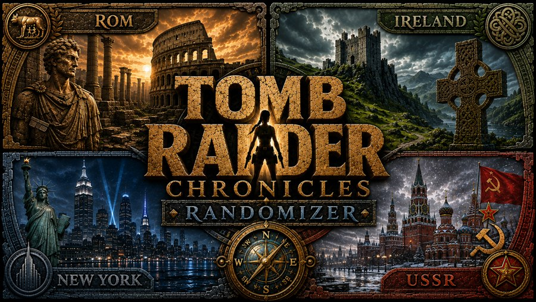
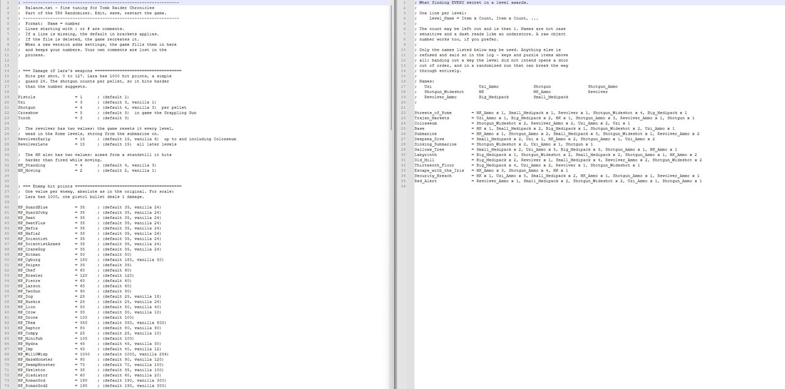
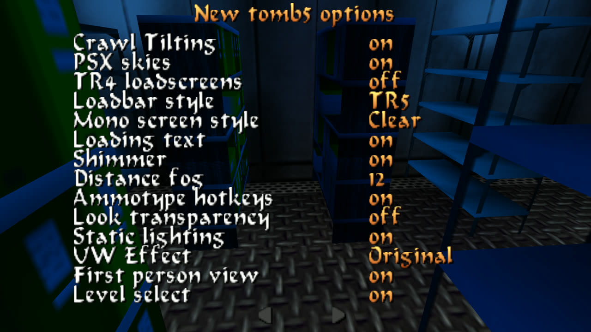
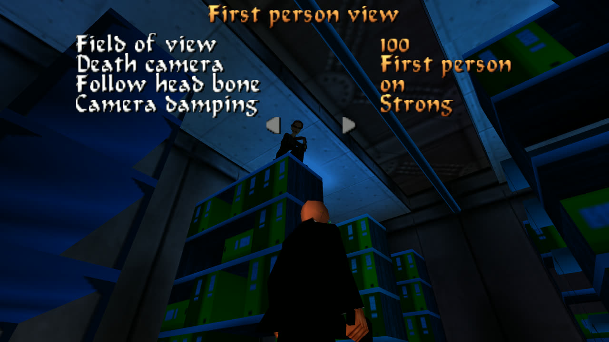
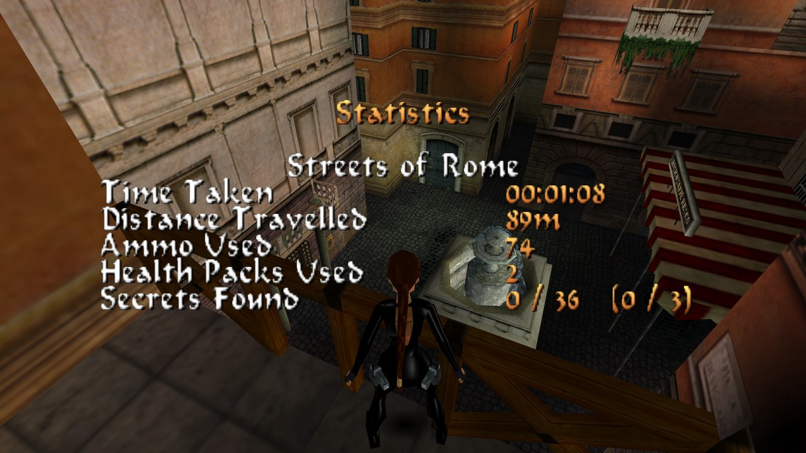
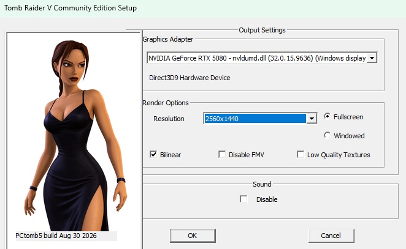
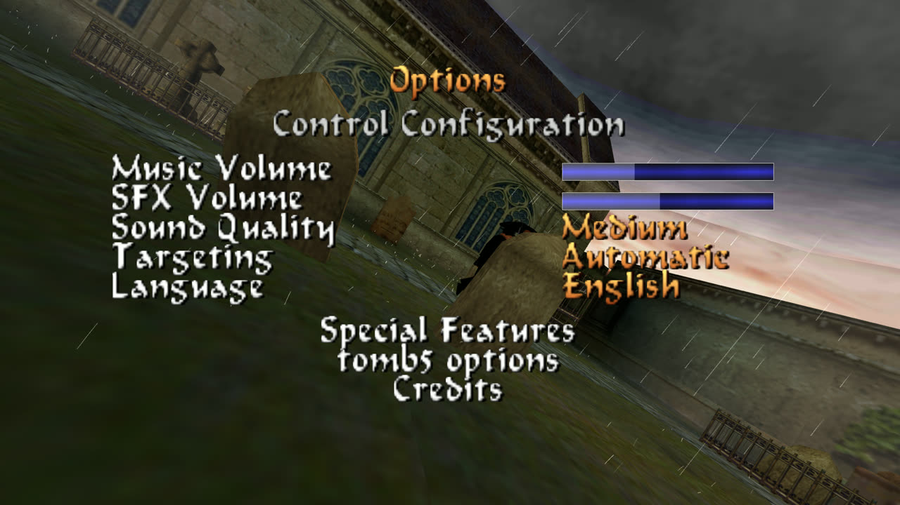

<p align="center">
  
</p>

# TR5 Randomizer

**Beta_1.0**

A randomizer for **Tomb Raider Chronicles** (PC) — including a build of the
game engine that runs natively on Windows 11 (D3D9 + XAudio2, no wrappers).
Game data is **not** included — bring your own installation. Everything is
GPLv3.

## Manuals

- **[The engine](docs/Engine-Manual.md)** - every option, every file it
  reads, what plays differently from the original, and what to do when
  something looks wrong.
- **[The randomizer](docs/Randomizer-Manual.md)** - the window section by
  section, seeds, and what actually changes in a randomized game.

## At a glance

| | |
|---|---|
| **Items and keys** | Rolled per level within verified zones — every boundary was checked in trview, so a key never lands where it cannot be reached |
| **Enemies** | Swapped among themselves, or drawn from the whole game; extra enemies on request. Guests from Tomb Raider III (T-Rex, raptor, compy, vulture) come along |
| **Outfits** | Lara's three Chronicles outfits, plus outfits imported from Tomb Raider III — pick what may be rolled in the wardrobe |
| **Secrets** | Placed in a glitchless or a glitched set, or rolled from a pool |
| **Music** | Ambience and triggers permuted; HQ soundtracks in OGG are played if you supply them |
| **Sound** | Drop the remaster's `MAIN.SFX` into `audio\` and the game plays its effects at 44.1 kHz - measurably wider, not upsampled |
| **Loading screens** | Drop the remaster's pictures into `screens\HD\` and the loading screens run at 1920x1080 instead of 640x480 |
| **Level order** | Optional, from shuffling inside a section up to a free run through the whole game |
| **Weather** | Rolled per level — the rainy Ireland levels can come up dry, the Russian base can get rain instead of snow |
| **Difficulty** | Every weapon, enemy and hazard tunable by hand in `Balance.txt`, or by three sliders |
| **Engine** | Native Direct3D 9 and XAudio2, controller support, a first-person view, and a long list of fixed original bugs |

The same **seed** produces the same game on any machine. The randomizer
window shows the version and the build id, and every run writes
`spoiler.txt` beside the program with the seed, every setting and one line
per level — that file is what makes a run reproducible, and what a bug
report should carry.

<p align="center">
  
</p>

<table>
<tr>
<td width="50%"><br>
Pick what the wardrobe may draw, and which enemies belong in the pool.</td>
<td width="50%"><br>
Two plain text files beside the game: every enemy’s hit points and every
weapon’s damage, and what each level awards for all its secrets.</td>
</tr>
</table>

## Quick start

1. **[Download the release](../../releases)** and unpack it into your Tomb
   Raider Chronicles folder — the one holding `PCTomb5.exe`.
2. Start **`TR5Randomizer.exe`**. On the first start it asks for that
   folder; either the game folder or its `data` folder is accepted.
3. Press **Randomize**. Your originals are backed up to `data\Backup`
   first, and every later run starts from that backup — so re-rolling as
   often as you like is safe.
4. Start the game with `PCTomb5.exe`.

Nothing else is required. Every option is optional; **Restore original**
puts the levels back. The two manuals above cover the rest.

## What this is

Two programs working together:

- **TR5Randomizer** rolls a new game out of your Chronicles installation:
  items, keys and weapons travel, enemies swap roles and journey between
  levels (up to guests from Tomb Raider III), outfits, music, secrets and,
  on request, the level order. The same seed produces the same game on any
  machine.
- **PCTomb5** is a modified version of [TOMB5](https://github.com/Trxyebeep/TOMB5),
  the decompilation project for the PC engine: Direct3D 9 and XAudio2
  instead of DirectDraw/DirectSound, plus the extensions the randomizer
  needs — and a few extras such as a switchable first-person view.

Both are under the **GNU GPL v3**; the complete source code lives here.

### In the game

<table>
<tr>
<td width="50%"><br>
An options page of its own: PSX skies, crawl tilting, distance fog, the
loading bar and screen styles, ammo hotkeys, static lighting, level select.</td>
<td width="50%"><br>
The first-person view, with field of view, a death camera, the head-bone
look and how hard the camera is damped.</td>
</tr>
<tr>
<td width="50%"><br>
The pause screen now counts the secrets of the level you are in, in
brackets behind the campaign total — useful when the level order is rolled
and you cannot tell from the sequence which level you are in.</td>
<td width="50%"><br>
The setup dialog, driving a native Direct3D 9 device — resolution,
fullscreen or windowed, FMVs and sound, with the build date in the corner.</td>
</tr>
<tr>
<td><br>
The language can be changed while the game runs.</td>
<td><br>
Credits for everyone whose work is in here.</td>
</tr>
</table>

<details>
<summary><b>More from a rolled run</b> (10 screenshots)</summary>

<table>
<tr><td width="50%"></td><td width="50%"></td></tr>
<tr><td width="50%"></td><td width="50%"></td></tr>
<tr><td width="50%"></td><td width="50%"></td></tr>
<tr><td width="50%"></td><td width="50%"></td></tr>
<tr><td width="50%"></td><td width="50%"></td></tr>
</table>

</details>

## Mods

Put a folder called `Mods` next to `PCtomb5.exe` and the engine reads it at
the first level. The layout is the remaster's own drop-in layout, so a mod
made for the Remaster works here as it lies:

```
Mods\<Category>\<Mod>\5\ITEM\<NAME>.TRM      models
                     \5\TEX\<n>.DDS          the pages those models wear
                     \5\DATA\MAIN.SFX        a whole sound bank
                     \4\...                  the same, searched after 5
Mods\<Mod>\...                               a mod without a category works too
```

**Order and priority.** Alphabetical by the folder path, and the first mod
that has a file wins. A folder whose name starts with `_` is switched off,
and everything under it with it — rename `IMI Uzis` to `_IMI Uzis` and the
original is back, with nothing else to undo. Nothing is ever written into
your installation or into the mod: a mod replaces a file by being *looked at
first*, never on disk.

**What a mod may replace.** Anything the HD path resolves by name: the hands
`HAND_*`, the holsters `HOLSTER_*`, the pickups `EXTRA_*` and the inventory
models `*_OPTION`. A page a mod does not ship is taken from your
installation, so a mod that brings only models works. **A mod can never
change a page of a model it did not supply** — the vanilla look cannot be
damaged by installing one.

**`mod.txt`** is optional and goes in the mod's own folder. One `key=value`
per line, `#` starts a comment. One key so far:

```
origin=tr1        # or tr2, tr3
```

Say this when the mod's models were drawn against **Tomb Raider I-III
Remastered** and name its page numbers. Without it those pages are looked
for in the IV-VI bundle, where the same numbers hold different pictures —
which is why a hand can come out black. Keys this build does not know are
written to the log and ignored.

**Sounds.** A mod's `5\DATA\MAIN.SFX` is used instead of `audio\MAIN.SFX` if
there is one, and a loose `<NNNN>.wav` — exactly four digits, anywhere under
the mod — replaces that numbered sample of the bank. The bank itself no
longer has to be copied into `audio\` by hand: without one there, the engine
reads the installed remaster's own where it lies.

**Not supported.** Outfits from mods (`OUTFIT_*.TRM`) are left alone for now
and come with the next round. A face on its own does nothing either: a mod
that ships `<NAME>_HEAD.TRM` without the body's `<NAME>.TRM` is passed over,
because a face is looked for wherever its body came from so that the two wear
pages out of one source — a lone face would land on the installation's body
and read its pages under the wrong numbers. Effect and sprite pages such as
`4\TEX\EFFECT.dds` do nothing — this engine draws no Remaster sprites — and
so does anything that only exists for Tomb Raider IV, `4\DATA\MAIN.SFX`
included.

**Mods are yours, not ours.** Nothing of any mod is part of this project and
nothing of one is ever shipped with it, exactly like the game data and the
HD art. Start the game with `-log` and the log tells you which mods were
found, what each one replaced and what was refused — every one of those
lines begins with `MODLOG`.

## What you need

Your own installation of **Tomb Raider Chronicles**. Game data is
deliberately **not** part of this project — neither levels nor music,
videos or language files. The game belongs to its rights holders; the
randomizer patches your own files at runtime and backs everything up to
`data\Backup` first. What the randomizer does ship is a survey of the
original levels' geometry, which it needs to place anything legally —
[THIRD-PARTY.md](THIRD-PARTY.md) says exactly what that is and is not.

## Building

- **Engine:** `TOMB5 Code\tomb5.vcxproj` with Visual Studio (Win32, Release).
- **Randomizer:** `TR5Randomizer\build\b1.bat` (command line) and
  `b2.bat` (GUI) — the source paths are relative to the repo, but line 3 of
  each script calls `vcvars64.bat` at a hardcoded location
  (`C:\Program Files\Microsoft Visual Studio\18\Community\...`). Another
  version, edition or drive means editing that one line.
- **Package:** `Preparation\Tools\BuildRelease.ps1` assembles
  the shippable folder including source code and licenses.

## Thanks and origin

- **[TOMB5](https://github.com/Trxyebeep/TOMB5)** by Troye (Trxyebeep),
  ChocolateFan, thatguyfrombb and Raildex — without this decompilation
  there would be nothing here.
- **[tomb3](https://github.com/Trxyebeep/tomb3)** by Troye (Trxyebeep) and
  contributors — the T-Rex, raptor, compy and vulture control code comes
  from there (GPLv3, taken over directly rather than rewritten, so its
  origin stays visible). Their models and sounds are not shipped; the
  randomizer reads them from your own Tomb Raider III installation.
- **[trview](https://github.com/chreden/trview)** by chreden — the tool
  every single zone boundary of this randomizer was verified with.
- **[Dear ImGui](https://github.com/ocornut/imgui)** by Omar Cornut (MIT) —
  the interface.
- **stb_vorbis / stb_image** by Sean Barrett (public domain) — HQ music and
  the background image.
- **[zlib](https://zlib.net/)** by Jean-loup Gailly and Mark Adler — the
  level files are compressed with it.
- **[discord-rpc](https://github.com/discord/discord-rpc)** by Discord, Inc.
  (MIT) — Troye's Discord Rich Presence. This fork switches it off, so it is
  in no binary; its libraries and headers still travel in the source tree,
  and so does its notice.

Every licence text is in `Licenses\` in the release, and
[THIRD-PARTY.md](THIRD-PARTY.md) says which is which.

**Contributors** — testing, findings and ideas, the people who played the
seeds and reported what broke: XeNoN3560, Lucifer230, Todesengel1931,
Crockett, Grylle.

## Made with AI

This project was built with **[Claude](https://www.anthropic.com/claude)**
(Anthropic) as a coding partner, and that is too large a part of the work to
hide in a credits line. A great deal of the code, most of the analysis tools
and both manuals were written in conversation with it. Every commit from 2026-08-15 on
carries a `Co-Authored-By: Claude` trailer; the ones before it do not — the
work was the same, the trailer simply was not being written yet. The history
therefore understates the AI's share rather than overstating it. No count is
quoted here on purpose, because it would be wrong again by the next commit:
`git log --grep="Co-Authored-By: Claude" --oneline | wc -l` says it exactly.

What that does not change: the design decisions, the curated lists and the
call on what shipped were ChrisChanSan's, and nothing went into a release
that had not been run in the actual game first. An AI is fast and it is
confident, which is a bad combination — more than one bug in the changelog
was put there by it and found by playing, not by reading. So the code was
reviewed and it was tested, by a human, in Tomb Raider Chronicles. Judge it
the way you would judge any other code: by whether it works.

What was changed in the engine and why is recorded in
`TOMB5 Code\MODIFICATIONS.md`; the player manual ships with the release
package as `README.txt`.
