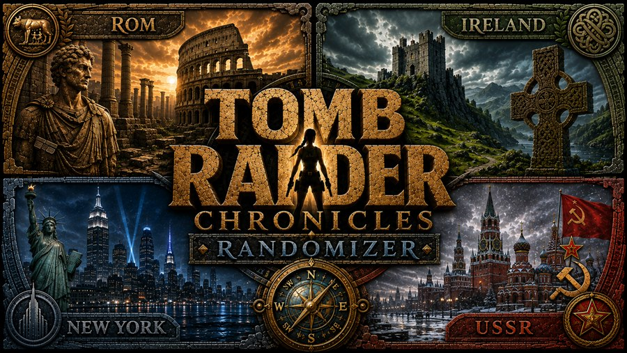
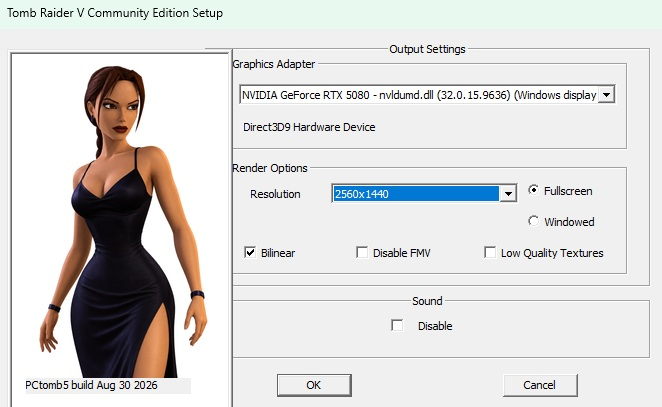
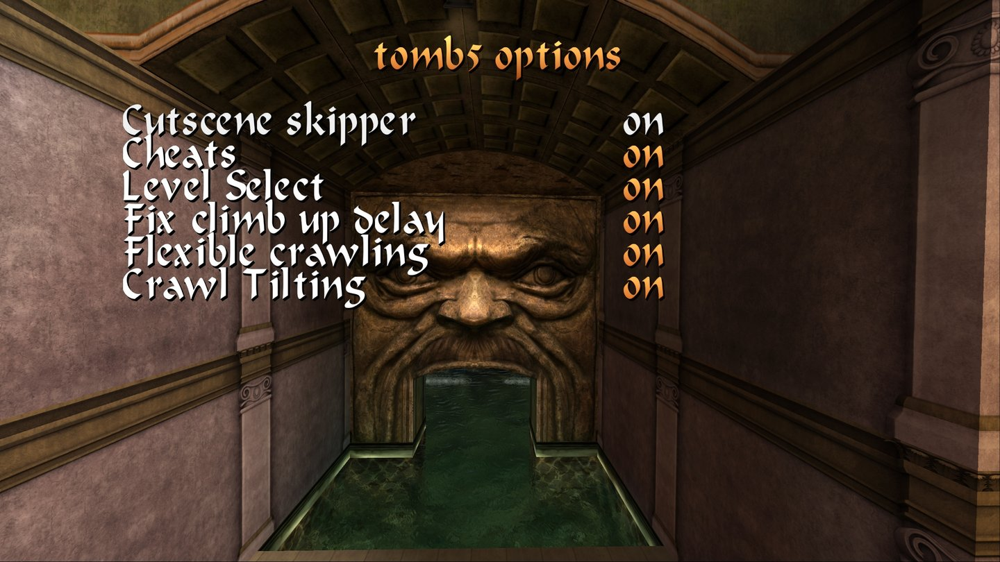
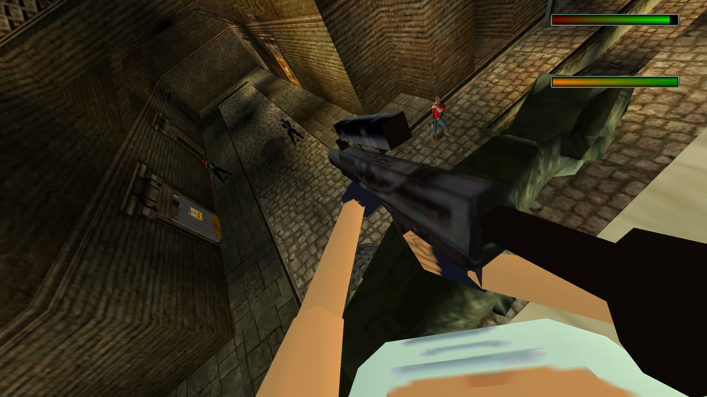
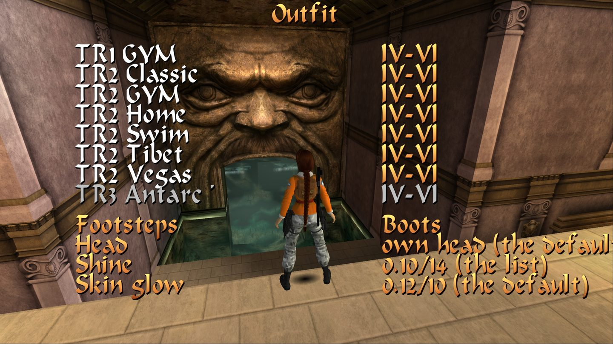
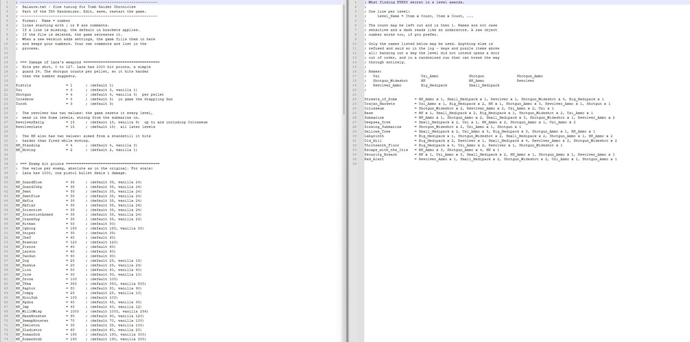
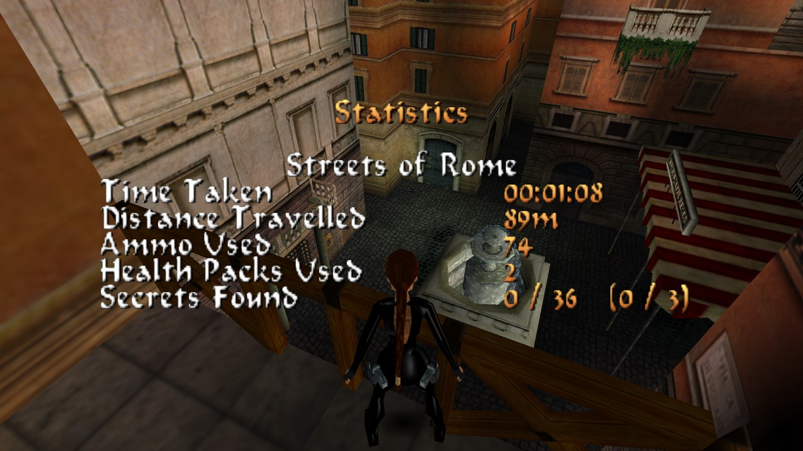

<p align="center">
  
</p>

# The engine — the manual

**PCTomb5.exe, Beta_2.0**

A native Windows 11 build of Tomb Raider Chronicles: Direct3D 9 and XAudio2,
no wrappers, one self-contained executable. This page covers everything it
does that the original did not, and everything you can set.

The randomizer has its own manual — [Randomizer-Manual.md](Randomizer-Manual.md).

> **An unofficial, non-commercial fan project.** Not affiliated with, and not
> endorsed by, Core Design, Eidos, Crystal Dynamics, Aspyr, Saber Interactive
> or Embracer. *Tomb Raider* and *Tomb Raider IV-VI Remastered* are theirs.
> You need your own copy of *Tomb Raider Chronicles*, and for the HD art, the
> HQ sounds and the HD loading screens your own copy of *Tomb Raider IV-VI
> Remastered*. Nothing of either is included here, and nothing of either is
> copied anywhere: what the HD mode draws is read at run time out of your own
> installation.

- [What this build is](#what-this-build-is)
- [Starting it, and the setup dialog](#starting-it-and-the-setup-dialog)
- [Controls](#controls)
- [The options menu](#the-options-menu)
- [tomb5 options](#tomb5-options)
- [First person view](#first-person-view)
- [Frame rate](#frame-rate)
- [Language, and HQ music](#language-and-hq-music)
- [The outfit changer, Mods and footsteps](#the-outfit-changer-mods-and-footsteps)
- [Balance.txt — tuning the whole game](#balancetxt--tuning-the-whole-game)
- [The secret counters](#the-secret-counters)
- [Secret rewards](#secret-rewards)
- [Savegames](#savegames)
- [What plays differently from the original](#what-plays-differently-from-the-original)
- [When something looks wrong](#when-something-looks-wrong)
- [Licence, source, and building it yourself](#licence-source-and-building-it-yourself)

---

## What this build is

Upstream TOMB5 — Troye's decompilation of Chronicles — ships `PCTomb5.exe`
plus a `tomb5.dll` of its own that carries the game code. (That is upstream's
file, and it is not *Tomb Raider IV-VI Remastered*'s `tomb5.dll`, which has
the same name and nothing else in common; nothing in this build ever opens
the Remaster's.) **This build is a single
executable.** There is no DLL to copy, upstream's "dll only" updates do not
apply to it, and because it links the C runtime statically it needs no Visual
C++ redistributable installed.

The rendering is Direct3D 9 and the sound is XAudio2, both native. In
practice that means no compatibility shims, no wrapper, and no fiddling with
DirectPlay or old DirectX installers.

**You supply the game.** No levels, script, sounds, music, videos, textures or
language files ship here. Put `PCTomb5.exe` into your own Chronicles
installation.

---

## Starting it, and the setup dialog

Run the game normally, or use the two helpers in the package:

| | |
|---|---|
| **`Setup.bat`** | opens the setup dialog (`PCTomb5.exe -setup`) |
| **`Log.bat`** | starts the game writing a log (`PCTomb5.exe -log`) |

The setup dialog also opens by itself the very first time the game is run.

<p align="center"></p>

**Output Settings** — *Graphics Adapter* (one entry per monitor), the renderer
named underneath, *Resolution*, and *Fullscreen* / *Windowed*.
**Render Options** — *Bilinear*, *Disable FMV*, *Low Quality Textures*.
**Sound** — *Disable*.
The bottom left corner reads `PCtomb5 build <date>`. **Quote that line in a bug
report.**

> **The dialog does not load your previous choices.** It opens at its defaults
> every time: Windowed, Bilinear on, FMVs on, sound on, 640×480. If you open
> it again just to change the resolution and press OK, you have also just
> reset all of those. Set everything you want in one pass.

Three keys work while the game runs, with no menu: **Alt+Enter** switches
fullscreen and windowed, **Alt+Plus** and **Alt+Minus** step the resolution.
They are ignored during FMVs and level loading — that looks like a dead key
and is not.

"Fullscreen" is a borderless window rather than an exclusive mode, so
Alt-Tab is instant and overlays behave.

### Where your settings live

In the registry, under `HKEY_CURRENT_USER\Software\Core Design\Tomb Raider
Chronicles`.

> **Everything in the menu is written while you play.**
> The tomb5 options write themselves the moment you change a row. The rest —
> volumes, sound quality, targeting, language, control layout and every key
> and pad binding — is written when you leave the page you changed it on,
> which for a rebinding session means leaving *Key bindings*. Nothing you
> change in the menu waits for "Exit", so a crash never throws a session's
> settings away.

Every tomb5 option has a value of its own under
`HKEY_CURRENT_USER\Software\Core Design\Tomb Raider Chronicles\tomb5`. Almost
all of them have a row in the menu and are better set there; these are the ones
worth knowing by name:

| Value | Type | Meaning |
|---|---|---|
| `fps_mode` | DWORD | How many frames a second are presented. `1`, the default, is 60; `0` is the original 30; `2` is the display's own refresh rate, which needs `vsync` on. There is no uncapped mode. The *Frame rate* row on the *Display* page writes this. See **Frame rate**. |
| `vsync` | DWORD | `1`, the default: the picture waits for the monitor, so it is never torn across the middle. `0` for the original behaviour. **The only setting in the build that is not instant** — it is read when the graphics device is made, so a change takes hold the next time the game starts (or on the next Alt+Enter or resolution change). The *VSync* row writes this. |
| `hd_enable` and its companions | | The Remaster art, and the outfit the F4 changer remembers. They have a table of their own under **HD from the Remaster**; every one of them is there, with its default. |

---

## Controls

**Options → *Controls*.** The page opens with the three centred tabs *Key
bindings*, *View* and *Modes* (Combat mode, Sprint mode, Duck mode and Grab
mode together on their own sub-page — see **The Modes sub-page** below); under
them come *Control type*, *Action* and then *Control layout* (the original
game's *Control Method*, named so to tell it apart from the *Control type*
row) with four positions: *Keyboard*, *PS5 Controller*, *Xbox Controller* and
*Joystick*.

The three controller positions mostly mean the same thing to the game — they
choose the **vocabulary** the buttons are named with, and with it the default
layout the *Key bindings* page's own *Reset to defaults* row writes back (a
centred row of its own on that page). The engine works out by itself whether your pad reports as XInput or
DirectInput, so a DualSense behind Steam still gets PS5 names.

Open *Key bindings* with a controller layout selected and the movement and
action block holds fifteen bindable rows, including *Pause*, *Save*, *Load*
and the two medipacks — vanilla had no joystick binding screen at all. Set
*Action* (see below) to *Separate* and a sixteenth row, *Secondary*, joins
the list; the keyboard's own block of sixteen gains the same row as its
seventeenth, and under *One key* neither list shows it, because a row the
setting makes inert is a row that would do nothing. The four right-stick
tilts can be bound like buttons.

**How long the list really is.** The hotkeys sit on the same page (below), so
those blocks are not the whole of it. With *Action* at *One key* and *Cheats*
off the page holds **27** bindable rows on the keyboard and **23** on a pad;
*Separate* adds the *Secondary* row and *Cheats* adds five more, so with both
on it is **33** and **29**. The list is a page of its own rather than part of
*Controls* itself, so it can page left and right with the arrows when the rows
do not fit one screen — the same paging *tomb5 options* uses.

**The hotkeys are on the same page.** There is no second binding screen for
"combination" keys: the small and large medipack, quick save, quick load, the
six weapons, (while *Cheats* is on) the five cheat hotkeys and the *HD / SD*
switch are rows on the
SAME *Key bindings* list, keyboard and pad alike — nothing extra to open, only
more pages of the one list. A centred **"1/N"** sits between the paging arrows
whenever the list needs more than one page, so it is always clear how many
there are. See **The hotkey rows** and **The pad's Modifier and its chords**
below for what those extra rows are and how they default.

A few things worth knowing:

- **Confirm and back (Cross/A and Circle/B) are fixed.** Whatever you bind
  them to, they still work as menu confirm and back.
- **Binding a button another row uses silently unbinds that row** — it shows
  `---`.
- On the keyboard page, **Enter and the arrow keys are refused** as bindings,
  and every action keeps responding to its *original* default key alongside
  your new one, unless that key has meanwhile gone to another action.
- **Save and Load are unbound by default** on the Xbox page. Bind them
  yourself if you want them.

> **Launching through Steam: switch Steam Input off for the game first.**
> Steam's own store entry lists Chronicles as having no controller support, so
> Steam translates your pad into keyboard presses — while this engine reads
> the same pad directly. Every press then arrives twice. Nothing on our side
> can prevent that.

### The keyboard: two schemes, two sets

*Control type* picks **Tank**, the original scheme, or
**Modern**, a hand-on-the-left layout around W/S/A/D — and behind the scenes
each scheme keeps its **own** keyboard bindings, remembered independently:

| Role | Tank (default) | Modern (default) |
|---|---|---|
| Forward / Back / Left / Right | Up / Down / Left / Right arrows | W / S / A / D |
| Duck | Period (`.`) | C |
| Dash | Slash (`/`) | Left Shift |
| Walk | Right Shift | Left Alt |
| Jump | Right Alt | Space |
| Action | Right Ctrl | E |
| Draw weapon | Space | Right mouse button |
| Flare | Comma (`,`) | F |
| Look | Numpad 0 | Middle mouse button |
| Roll | End | Left Ctrl |
| Inventory | Escape | Escape |
| Step left | Delete | Z |
| Step right | Page Down | X |
| Pause | P | P |
| Select | Return | Return |
| Secondary | Home | Left mouse button |

> **Where the Modern scheme comes from.** The design of the modern control —
> the stick direction read against a held reference heading and turned back
> into the game's own tank bits, with Lara's automaton left exactly as it was
> — is carried over from **TROne (GPLv3) by Todesengel1931**,
> <https://github.com/todesengel1931>, and re-derived here in this engine's
> own units; its test expectations came across with it. `THIRD-PARTY.md`
> lists what was taken, file by file. The key row above is not TROne's: it is
> this project's own starting point, and every key in it is rebindable.

Under *Modern* the four movement keys are the left stick pushed all the way, on
the keyboard page and the controller's alike: *Forward* runs Lara where the
camera looks, the other three move her as the stick pushed that way does, and
two neighbouring keys together run her at exactly 45 degrees. On the
controller's page a stick pushed off centre takes precedence over the keys; on
the keyboard page the controller's stick is not read for movement. Holding
*Look* with them and no weapon drawn turns her on the spot as under *Tank*, and
*Walk* makes her walk, since a key has no half push.

*Secondary* is the nineteenth slot in each scheme's table, and it is bindable
but does nothing while *Action* (below) is set to *One key* — the *Key
bindings* page only lists it under *Separate*, so *One key* shows the page
without it.

The three mouse buttons of the Modern row are the Remaster's own keyboard
page: draw on the right button, look on the middle one, the secondary action on
the left one. Any keyboard row can be given a mouse button: pick the row and
press the button, as you would press a key. The page names the five buttons
*Mouse L*, *Mouse R*, *Mouse M*, *Mouse 4* and *Mouse 5* (*Maus* in German).
A Modern key set saved before the mouse existed keeps its keys for those three
rows; the buttons answer beside them, as every default does that you have not
bound to another row, and *Reset to defaults* puts the buttons in their place.

### The hotkey rows

Sixteen more rows follow the nineteen above, on the same *Key bindings* list
and under the same *Reset to defaults*: the two medipacks, quick save, quick
load, the six weapons (in the order the number keys always drew them), five
cheat rows — only while *Cheats* is on, see **Cheats and the cheat hotkeys**
below — and last, always, *HD / SD*: the switch between the HD draw and the
classic draw (see **The HD/SD switch** under **HD from the Remaster**).
Where the original had a key for one of these jobs, that key was
hard-wired; here each is a role like any other, so it can be rebound like any
other.
Defaults, both key sets, the one difference between them named:

| Role | Tank / Modern default |
|---|---|
| Small medipack | 0 |
| Large medipack | 9 |
| Quick save | F5 |
| Quick load | F6 (Tank) / **F9 (Modern)** |
| Pistols | 1 |
| Shotgun | 2 |
| Uzis | 3 |
| Revolver | 4 |
| HK | 5 |
| Crossbow (Grappling Gun in rich3) | 6 |
| Fly mode (cheat) | F2 |
| All weapons (cheat) | F7 |
| All items (cheat) | F8 |
| Heal (cheat) | F11 |
| Skip level (cheat) | F1 |
| HD / SD | F12 |

> **F4 is not on that list and cannot be bound.** It opens the outfit changer
> and is read as a plain key, because it means nothing to the game and a pad
> could not reach it anyway — see **The outfit changer, Mods and footsteps**.
> F10 is likewise left alone, which is why the five cheat rows default to the
> F keys they do.

Quick load's Modern default is the one deliberate departure: every other
default key, in either scheme, is the key the engine answers to for that job
when nothing is rebound. **If you bind one of the keys above to
some other role, that key does both jobs**, because a role always answers to
its own binding first. The other direction works too — rebind a hotkey role
*away* from its default key and that key can stop being the hotkey, though
only once some other binding claims it: an abandoned default key otherwise
keeps answering to its own role, the same way every other role's does.

The Modern column is deliberately one plain listing rather than a claim of
being final — it is fully rebindable, the same as Tank's own. Every key shown
is a **scan code**, so it is *positional*: on a QWERTZ keyboard the two
letters that move between layouts print as Y and Z swapped, but the physical
keys bound are the same.

Switching *Control type* does not overwrite either scheme's bindings — it
**swaps to** the other one's, so rebinding W/S/A/D under Modern and then
switching to Tank still leaves your Tank keys exactly as you left them, and
switching back to Modern brings your Modern rebinds back too. The *Key
bindings* page always shows and captures whichever scheme is currently active,
and its **Reset to defaults** row restores that scheme's own defaults only —
resetting under Modern never touches your Tank bindings, and the other way
round.

**Menus under Modern.** Wherever the game reads keys for a menu rather than
for Lara — the title screen, the pause menu and every options page, the
inventory ring, load/save, the outfit changer — the four arrow keys and
Return still step and confirm, whatever you bound W/S/A/D and Enter's Modern
equivalent to. A Modern player who rebound the movement keys is not forced to
use them in a menu, and a player who unbound them entirely is never locked
out of one. In the game itself the arrow keys do only what the active
scheme's table says they do.

One consequence of Modern's default *Walk* key worth knowing: it is **Left
Alt**, and the title screen, load/save and the outfit changer all refuse to
confirm a row while Left Alt is held — that guard is there so that Alt+Enter,
the fullscreen toggle, does not also pick whatever the cursor sits on. Let the
walk key go to confirm on those three screens, or rebind *Walk* to a key of
your own; Escape always leaves, either way.

### Combat mode: Toggle or Hold

*Combat mode*, under *Controls*, governs what the draw key or
button does — for keyboard and pad alike, under either *Control type*:

- **Toggle** (the default, and the original behaviour): press once to draw,
  press again to holster.
- **Hold**: draw while the key or button is held down, holster the moment you
  let go. Releasing mid-draw still lets the draw finish before she holsters —
  nothing is cut short — and a **torch** in her hand is never touched: while
  she is carrying one the draw key does only what it always did, which is
  throw it.

  A **flare** is a different hand. The game parks a lit flare in the same
  empty-handed state as no weapon at all, so with the draw key held down Lara
  throws the flare away and brings the guns back — the same thing a press of
  the draw key does with a flare in hand in the original. Let the key go
  before you light one, or expect to light it and lose it.

### Action: One key or Separate

*Action*, under *Controls*, governs whether interacting and
the Secondary function share one button or sit on two, for keyboard and pad
alike, under either *Control type*:

- **One key** (the default, and the original behaviour): the *Action* key or
  button both interacts and does the Secondary function — there is only ever
  one key to reach for.
- **Separate**: *Action* interacts, switches, opens and picks up; *Secondary*
  climbs, grabs and holds a weapon ready to fire — hold it.

Under Separate:

| Key | Does |
|---|---|
| Action | Everything in the world: switches and levers, keyholes, puzzle holes, search objects and monitor screens, pickups, doors, movable blocks (pushing them and the ready pose in front of one), pulleys, the floor trap door, the burning torch, and the cutscene item triggers. It also stays the menu key — it confirms in every menu and in the inventory ring, exactly as it does under One key. |
| Secondary | Everything Lara does with her own hands: grabbing and climbing a ledge, hanging and shimmying along one, letting go, the monkey swing, pulling herself out of the water — and firing, which is every weapon, the laser sight, the VCI headset light and the DOZY cheat's own light. It does *not* confirm in menus or in the inventory ring — that stays the *Action* key's job alone, so a trigger pull in the ring cannot equip whatever the cursor happens to sit on. |
| Either key | The pole, the tightrope, the parallel bars, the death slide, catching and swinging on a rope, the jump switch and the ceiling trap door — eight sites where a held state would drop her the instant the "wrong" key let go, so both keys reach them and both keys hold them. |

That is the whole division, and it is the engine's own: every place where the
original asks "is *Action* down?" about a world object asks the *Action* key,
every place that asks it about Lara's body or her gun asks *Secondary*, and the
handful of held states above take either. Nothing else moves — *Combat mode*,
the binocular and laser-sight zoom (which read the sprint and duck keys, not
this one) and every other row are untouched. Under *One key* one key sets both
halves in the same breath, which is why the setting costs nothing there.

On a controller under Separate, the pad's default bindings switch to their
own set as well (below) — your One-key bindings on that pad are not
rewritten, and switching *Action* back to One key brings them back exactly as
you left them.

| Role | Separate default (by name) |
|---|---|
| Duck | L1 |
| Sprint | L3 |
| Walk | Square |
| Jump | Cross |
| Action | Triangle |
| Draw | L2 |
| Flare | **Modifier+R1** on the PS5 DirectInput and generic pages (no plain R1 default there); plain R1 on the two XInput-ordered pages (PS5 XInput, Xbox) |
| Look | R3 |
| Roll | Circle |
| Inventory | Share |
| Pause | Options |
| Save | **Modifier+R3** on the PS5 DirectInput and generic pages (no plain PS-button default there, and no plain *Joy 13* on the *Joystick* page); unbound on the two XInput-ordered pages (PS5 XInput, Xbox), which name no spare button at all |
| Load | **Modifier+L3** on the PS5 DirectInput and generic pages; unbound elsewhere |
| Small medipack / Large medipack | wherever this pad's own One-key table already puts them — except on the PS5 DirectInput and generic Tank rows, where the small medipack's usual button is the Modifier and both medipacks go unbound there instead of sharing it (0 and 9 on the keyboard still reach them; the Modern d-pad rows are untouched) |
| Secondary | R2 |
| HD / SD | **Modifier+Options** on the PS5 DirectInput and generic pages; unbound on the two XInput-ordered pages |

### The pad's Modifier and its chords

A pad has a **Modifier** role and thirteen chorded roles behind it —
weapon 1-6, *HD / SD* and, while *Cheats* is on, the five cheat rows — the
pad's own version of the keyboard's F-key hotkeys, on the SAME *Key bindings*
list. A
**chord** is the Modifier held down together with a second button; the value
column shows it as `Mod+<Button>`, or `---+<Button>` if the Modifier is not
bound to anything yet. Binding a chord: hold the Modifier and press the other
button while the row waits; the Modifier alone never binds any row but its
own. A plain binding and its chorded twin on the
same button coexist as two separate rows (*Look*'s plain R3 and *Save*'s
Modifier+R3, *Sprint*'s plain L3 and *Load*'s Modifier+L3); binding the
Modifier onto a button already in use unbinds every role there, plain or
chorded.

Defaults, decoded back to button names:

| Role | PS5 DirectInput / generic default | PS5 XInput / Xbox default |
|---|---|---|
| Modifier | Touchpad (`Joy 14` on the generic page) | unbound — neither page names a spare button |
| Pistols | Modifier+Cross | unbound |
| Shotgun | Modifier+Circle | unbound |
| Uzis | Modifier+Triangle | unbound |
| Revolver | Modifier+Square | unbound |
| HK / Crossbow | unbound | unbound |
| Fly mode / All weapons / All items / Heal / Skip level (cheats) | unbound | unbound |
| HD / SD | Modifier+Options | unbound |

*HD / SD* takes Options because, of the buttons no chord used, it is the
game's own system button; the PS button may belong to the system, and the
d-pad and the right stick each serve one of the schemes. Plain Options stays
*Pause*: a plain role stands aside while the Modifier is held. A Separate set
stored by a build without the switch gets Modifier+Options at its next start,
unless that pair is already one of your own bindings or the Modifier itself
sits on Options — then the row stays `---` until you bind it.

"PS5 DirectInput / generic" above means the two tables whose buttons are
numbered the DirectInput way: the *PS5* page on a pad the engine is reading
through DirectInput, and the *Joystick* page always — and with it the *Xbox*
page on a DirectInput pad, which shares the *Joystick* table. The other two
are the *PS5* and *Xbox* pages on an XInput pad.

The DualSense names above are what the *PS5* page prints; the *Joystick* page
prints the same buttons as numbers, so read *Touchpad* as `Joy 14`, R1 as
`Joy 6`, R3 as `Joy 12`, L3 as `Joy 11`, and Cross / Circle / Triangle /
Square as `Joy 2` / `Joy 3` / `Joy 4` / `Joy 1`. Whatever the page calls them,
the binding page shows you the name your own pad's page uses.

With the Modifier unbound — every One-key pad, and the two XInput-ordered
Separate pages — no chord can ever fire, and every plain role reads exactly
as it would with no chords at all.

**Flipping *Control type* never takes your Modifier away.** The flip moves a
binding the new scheme cannot use back to that scheme's default; where that
default is the Modifier's own button — at *One key* on the *PS5* DirectInput
page, Tank puts the small medipack on the touchpad — the medipack is left
unbound rather than the Modifier, and it returns to its button (d-pad up
under Modern) the next time a flip finds that button free. Your chords keep
working through both flips.

**A stored Separate pad set written by a build without the Modifier keeps its
own bindings, chord-free, until you choose *Reset to defaults* once.** The
engine tells such a set apart from a fresh one and leaves it alone rather than
laying the Modifier and its chords over buttons you had already bound
yourself — *Reset to defaults* is what fetches the Modifier and its chords in
one step.

### Camera speed and Dead zone

Two sliders on the *Controls* page, both the modern control's own feel — under *Control type: Tank* nothing reads either
number, so both rows are drawn greyed out and the cursor skips them.

| Row | Range | Default | What it does |
|---|---|---|---|
| *Camera speed* | 0–100 | **40** | How fast the right stick swings the camera round Lara. `0` turns at 60 degrees a second, `100` at 360, and the default 40 is the rate the modern control was tuned at. The up-and-down rate is always half the sideways one. Registry: `cam_speed`. |
| *Dead zone* | 0–100 | **50** | How far a stick has to be pushed before it counts as pushed. The number is a **per cent of the tuned zone**, not a zone in itself: `50` reproduces every one of the engine's own eight dead-zone widths exactly, `0` is no zone at all and `100` is twice the zone. Registry: `dead_zone`. |

Both are sliders, and a slider is written the moment it stops moving rather
than on every step while you hold the key down.

### The mouse

Under *Control type: Modern* the mouse turns the camera round Lara the way the
right stick does, and a camera you turn with the mouse takes her running
direction with it, exactly as the stick's does. Two more rows follow *Dead
zone*, greyed under *Tank* like the two above:

| Row | Range | Default | What it does |
|---|---|---|---|
| *Mouse sensitivity* | 0–100 | **50** | How far the camera turns for a given movement of the mouse. At `50` about two thousand counts of the mouse's sensor turn it once round (2048 exactly); `0` is a quarter of that speed, `100` four times it, and every step of the slider is the same 2.8 per cent more. Registry: `mouse_sens`. |
| *Invert mouse* | on / off | **off** | Off, pushing the mouse away looks up, as pushing the stick forward does; on, it looks down. The stick's own direction is not affected. Registry: `mouse_invert`. |

The mouse turns the camera at most 11.25 degrees a tick, about a turn a
second, about the right stick's top speed at *Camera speed* 100, so that at a
*Frame rate* above 30 a mouse turn is never drawn as a camera cut, in 30 Hz
steps. A faster movement is not lost: the
camera finishes it over the next ticks, falling at most half a turn behind.

While you play under *Modern*, the cursor is hidden and held inside the game
window. It is let go whenever the window loses the focus (Alt+Tab, for
example), while an FMV plays and under *Tank*, and caught again when you come
back. The mouse does nothing in the menus or the inventory;
the keyboard and the pad drive those. First person view keeps its own look and
is not turned by the mouse.

Under *Modern* the camera stays in your hands: a camera the level places with a
trigger — a door shown opening, a lever's payoff somewhere else — does not take
the view, the real sniper camera in the 13th Floor excepted, the same as in
first person. Crossing such a trigger's tile leaves no trace either: the camera
keeps following as smoothly as anywhere else, with no jump of the view and no
camera cut counted in `INTERPLOG`. The same goes for the outside view the game
cuts to while she lifts a trapdoor or turns a wheel switch: the camera stays
yours and eases through the animation instead of snapping.

Hold the left stick through the moment the sniper camera takes the view or
hands it back, and Lara keeps the course she was running: the stick still
steers her, but against the camera she set off under, until you let go or turn
the stick more than 45 degrees away from where it pointed at that moment. Push
again, or turn it that far, and the stick goes by the view you now see; turning
it does not stop her. The same holds where a level camera that follows her
takes the view and hands it back, as in the X-ray corridor of Escape with the
Iris. With `-log`, the `MODERNLOG` line of every game tick carries `cut=1` on
the tick the camera changed hands, `latch=1` while such a held course is kept,
and `latch_drop=1` on the tick a turn of the stick ended it.

In the 13th Floor and in Escape with the Iris the game pushes the camera off
the slanted wall panels that stand in the corners of some rooms, and there the
camera can stand close beside Lara, away from the angle you set. While it does,
the stick goes by the view you see, not by the angle the camera would like to
have; held through the moment the push starts or ends, it keeps her course the
same way as at the sniper camera, until you let go or turn it more than 45
degrees. With `-log`, the `CAMLOG` line ends in `diag=`, how far the push
moved the camera, and the `MODERNLOG` line ends in `ref_view=1` on the ticks
the stick goes by the view.

### The Modes sub-page: Combat, Sprint, Duck, Grab and Ledge hang

These five rows sit together on their own sub-page, **Modes** (German
*Modi*), reached by a centred tab on *Controls* right after *View* — the same
tabbed style *Key bindings* and *View* use. Each keeps its own variable,
registry name, default and effect; the sub-page only groups them.

### Combat mode, Sprint mode, Duck mode and Grab mode: Toggle or Hold

*Sprint mode*, *Duck mode* and *Grab mode* each govern
one key or button the same way — Hold is the default and the original
behaviour, Toggle turns a press into an on/off switch:

- **Hold** (the default): sprint, duck or hold on while the key is held, stop
  the moment you let go.
- **Toggle**: press once to start, press again to stop.

*Combat mode* is the fourth row of the same page and works the same way, but
it **defaults the other way round**: drawing a weapon has always been a
toggle in this game, so that row stands at *Toggle* on a fresh install and
*Hold* is the added behaviour. See **Combat mode: Toggle or Hold** above.

A few things a toggled key still respects, because it is the same bit Lara's
own states have always read, only held open by the option instead of by your
finger:

- **Sprint** still ends itself — running out of breath, hitting a wall,
  ducking, wading into deep water — and the toggle lets go the instant it
  does, or the moment you stop pushing a direction; it does not fight the
  dash timer or leave you sprinting on the spot.
- **Duck** holds through the whole duck-and-crawl family — crouching, its
  roll, both duck turns, all fours, crawling forward and back, both crawl
  turns, and a pickup made from any of them — and lets go only on a real
  drop: a ladder, a rope, a crawl-to-hang, death, water, a cutscene, a menu
  owning the input, or a level change. The latch is kept through the crawl
  even though entering it briefly occupies her hands (the reason a ladder
  drops it), and a crawl space still never traps you: the ceiling test
  decides when you may stand back up, exactly as it does for a *Hold* key,
  and the next duck after that is a fresh press.
- **Grab** governs letting go rather than holding a direction: while hanging,
  shimmying, on a ladder, a pole, a rope, the zip line, the parallel bars or
  the monkey swing, *Hold* is the original behaviour — let the key go and she
  drops (the *Ledge hang* move below has its own rule). *Toggle* lets you
  release the key and stay put: a fresh press while holding on lets go
  instead, and — so a fall past a lower ledge can never snap back onto it —
  that same press keeps letting go for as long as you keep it held, so
  release it and press again to catch something new. That last part has one
  price worth knowing: from the press that let go until you release the
  button, the action bit stays clear wherever she is, so the *same*
  continuous hold will not fire a weapon or catch anything either — and under
  *One key*, where one button carries the whole action, that held press also
  picks nothing up and operates nothing. Let the button go once and it is an
  ordinary key again. Everywhere else *Toggle* changes nothing at all:
  pushing a block uses the interact key under *Separate* and its own bit
  under *One key*, and menus read the pad and the keyboard directly, so
  neither ever sees the latch.
- Every one of the four lets go on its own at a level change, a savegame
  load, a cutscene, death, and while a menu owns the input, so a key still
  held across one of those never latches by surprise. Water ends the sprint
  and the duck; it does not end *Grab*, because a ladder can be climbed
  straight out of shallow water. Neither does a flyby camera or one of the
  office security cameras: those hand you the controls back, so they leave
  the grab alone as well.

### Ledge hang: an automatic turn and lowering at an edge

*Ledge hang* is the fifth row on the *Modes* sub-page, **Off** by default and
**Modern controls only** — it is greyed out under Tank controls, the same way
the Controls page's camera sliders are.

With it on, run or walk at an edge with the grab key held (the action key
under *One key*, the Secondary key under *Separate*) — or stand right at one
and push toward it — and instead of running off, she stops at the edge, turns
round on the spot with her own turn animation, as quickly as the stick's own
about-turn, to face the ledge, and lowers herself backward into a hang, the
same pose a manual catch below a ledge leaves her in. The lowering, like every
animation, is drawn at the full frame rate. The camera swings round behind her
as she turns, ending over the drop where the walls allow it, and keeps looking
at her all the way down, without a jolt as she goes over the edge. Let go of
the key, press Jump, or draw a weapon while she is turning and she stands back
up where she is instead.
Under *Grab mode* **Toggle** she keeps her hold by herself once the move has
begun: press the key again while she is turning to stand back up; a second
press still held when she arrives in the hang lets go of the ledge.
A running jump off the edge needs the grab key released: with the key held,
Jump pressed in the last step before the edge comes too late, because she is
stopped first and the Jump then only stands her back up.

It will not fire at all when:

- the drop behind the edge is too shallow to hang from;
- the ledge floor slopes, or would start her sliding;
- water, lava, or a death floor lies below;
- there is a ladder in the wall below the edge;
- the ceiling above the hang is too low;
- there is an item or a static mesh at the edge or in the hang;
- your weapons are drawn;
- or you approach more than about 35 degrees off a straight, square angle to
  the edge.

A trigger in the floor of the sector she hangs in fires just as it does when
she catches that ledge by hand.

With it on, holding the grab key while running off an edge the move accepts no
longer reaches for a ledge below the way it does with the option off — she is
stopped at the near edge instead, so if you relied on catching a drop that way,
turn this back off. A sprint is never stopped, and an edge the move refuses
still lets her reach for a ledge below as before.

A savegame made in the middle of the move loads correctly only in this build
or a later one.

---

## The options menu

Reached from the title screen row *Options*, or from the pause screen while
playing. The two are identical except for one row: **Special Features** can
only be opened from the title screen. From the pause menu the row is still
there — drawn greyed out, and the cursor steps over it — however many secrets
you have found; the nine secrets of a quarter of the campaign decide what the
gallery **holds**, never whether the row can be reached.

The page is one sorted tree rather than a single flat list: a title, then rows that either open another page (drawn centred, like the
Remaster's own) or are settings of their own (left-aligned, value on the
right). The seven tabs:

| Tab | Holds | Default |
|---|---|---|
| Audio | Music volume, SFX volume, Sound quality, Language | 80 / 90 / Medium / automatic |
| Controls | *Key bindings*, *View*, *Modes*, Control type, Action, Control layout, Camera speed, Dead zone, Mouse sensitivity, Invert mouse, Targeting, Ammotype hotkeys | see below |
| Graphics | *Display*, HD textures, Body physics, HD water, Fog, Distance fog, Shimmer, Mono screen style, Shadow mode, PSX skies, Static lighting, UW Effect, Look transparency, Footprints — fourteen rows on two pages of seven, turned with the arrows at the bottom | see **tomb5 options**; Body physics off; HD water on; Shadow mode *Projected* (offered only while HD is on, see **The projected shadow**) |
| HUD | Bar mode, Bar positions, Enemy bars, Ammo counter, Gameover menu, TR4 loadscreens, Loadbar style, Loading text | see **tomb5 options** |
| tomb5 options | Cutscene skipper, Cheats, Level Select, Fix climb up delay, Flexible crawling, Crawl Tilting | see below |
| Special Features | the bonus gallery (title screen only) | all locked |
| Credits | who this is built on | — |

The tabs only sort the rows: every setting keeps its own variable, range,
default and effect whichever tab it sits on. *Targeting*, which the original
keeps on the Options page itself, sits on *Controls*. See **tomb5 options**
below for the six settings on that tab, and the sections after it for the
*Graphics* and *HUD* rows.

**Credits** is a screen of its own, not one of the framework's pages, so it
never turns up while paging through settings and no paging arrows are drawn
across the names. It lists names only; the web addresses
live in `README.txt`, because the game font cannot draw every character.

---

## tomb5 options

<p align="center"></p>

<p align="center"><em>The HD art in this and every other screenshot is read at
run time from the player's own <strong>Tomb Raider IV-VI Remastered</strong>
installation — none of it is included here.</em></p>

Six settings the original never had, and that belong neither to *Graphics*
nor to *HUD* (see **The options menu** above):

*Cutscene skipper* (off), *Cheats* (off), *Level Select* (off), *Fix climb up
delay* (on — removes the pause before Lara pulls herself up), *Flexible
crawling* (on), *Crawl Tilting* (on).

The other settings the original never had — *Footprints*, *Shadow mode*,
*Fog*, *HD textures*, *Body physics*, *HD water*, *Bar mode*, *Bar positions*,
*Enemy bars*, *Ammo counter*, *Gameover menu*, *PSX skies*, *TR4 loadscreens*,
*Loadbar style*, *Mono screen style*, *Loading text*, *Shimmer*, *Distance fog*,
*Ammotype hotkeys*, *Look transparency*, *Static lighting*, *UW Effect* — sit on
the tab their subject belongs to. *Graphics* holds the picture rows (plus
*Display*, its own sub-page for *Frame rate* and *VSync* — see below), *HUD* the
rest. *First person view* and its settings sit on *Controls*' own *View* tab, shown there
always, not just while the switch is on (see **First person view** below);
*Ammotype hotkeys* and *Targeting* sit on *Controls*.

Worth spelling out:

- **Frame rate** and **VSync** live on *Graphics → Display*, a page of its
  own since they are one subject; both have a section of their own below.
  *Frame rate* is *60* by default, *30* is the original and *Display* follows
  the monitor. It changes how often the picture is drawn and **nothing
  else**: the game itself still steps thirty times a second, exactly as Core
  wrote it, so every animation, every timer, every trigger and every enemy
  behaves identically in all three. A savegame written in one is the
  savegame written in the others.

  See *Frame rate* further down for what the settings really do and how to
  check them.
- **Cheats** unlocks DOZY and five hotkey rows on the
  *Key bindings* page (below). The classic cheat words still need the compass
  in hand.

### Cheats and the cheat hotkeys

Type **D O Z Y** while playing to fly — the classic chord, unchanged in what
it does, under either *Control type*. Under Modern that needs one extra
condition: Z is Modern's *Step left* key, one of DOZY's own four letters, and
Modern *Step* carries the same bit the chord's own exit reads, so without it
the flight would switch on and off again in the same tick — she would rise
and immediately fall, and the cheat could not be used at all. The flight's
exit is therefore ignored for as long as any of the four DOZY letters is
still physically down. Everything else about ending the flight is the
original's — the walk key, and under Tank the step keys, end it; only
Modern's own step-left key cannot do it on its own, because holding it is
part of what keeps her flying.

The inventory words — **G U N S**, **I T E M**, **S K I P**, **H E A L**,
**B I T S** — are the original's and still spelt out with the compass in
hand, but under Modern the keyboard scheme owns S, A, E and P, which can make
them awkward to type there (GUNS and SKIP above all). The words stay as they are; four
of the five (all but BITS, which has no cheat effect of its own) get a second
doorway instead: a hotkey, bindable on the *Key bindings* page like any other
row, keyboard and pad alike, that does exactly what the word does — while
*Cheats* is on, in the game (not the title screen, not a cutscene, and not
while Lara is dead), one press, one effect:

| Cheat | Default key | Default pad chord |
|---|---|---|
| Fly mode (same toggle as DOZY) | F2 | unbound |
| All weapons (same as GUNS) | F7 | unbound |
| All items (same as ITEM) | F8 | unbound |
| Heal (same as HEAL) | F11 | unbound |
| Skip level (same as SKIP) | F1 | unbound |

These five rows only appear on the *Key bindings* page while *Cheats* is
switched on — with it off they are not offered at all, the same way
*Secondary* is not offered under *One key*. See **The pad's Modifier and its
chords** above for binding one of them to a pad chord.
- **Ammotype hotkeys**: the option governs **only** the ammunition cycling -
  pressing a weapon's number again while it is already out. Drawing a weapon
  and the medipacks work whether it is on or off.

  **One key per weapon, the same key in every level:** 1 pistols,
  2 shotgun, 3 uzis, 4 revolver, 5 HK, 6 crossbow (the Grappling Gun in
  rich3). 0 uses a small medipack, 9 a large one.

  Core bound only four keys and let two of them change meaning at the 13th
  Floor - key 1 became the HK, key 2 the crossbow. That works while the
  campaign runs in its built order, because by then Lara no longer carries
  the early weapons. A randomized run breaks it twice over: the switch hangs
  on `gfLevelId`, which is the level's identity and not its position, so
  with a rolled order it fires in scattered levels rather than "later"; and
  because the weapons travel too, Lara can carry an HK in the first level,
  where no key would have drawn it.
- **Level Select** adds a fifth row to the title screen that jumps straight to
  any level. It is a development shortcut, hidden by default.
- **Loading text** only shows while *Loadbar style* is TR4.
- **Shadow mode** has five values while HD is on - *Original*, *Circle*,
  *Faded circle*, *PSX* and *Projected*, Lara's projected shadow - and the
  four blobs while it is off. See **The projected shadow** for what each
  draws and when the fifth one runs.

---

## First person view

<p align="center"></p>

Switch it on under *Controls → View*. The same tab holds five rows of its
own:

| Row | What it does | Default |
|---|---|---|
| Field of view | 60 to 100 in steps of 10; the ends stop, they do not wrap | 90 |
| Death camera | First person, or pull back and show it | Third person |
| Follow head bone | nails the view to the head bone — much more physical, and much shakier | off |
| Camera damping | off / Light / Medium / Strong | Light |
| Body | **animated** as always, or **still** while she is standing still | animated |

The five rows are always shown, whether *First person view* itself is on or
off: the switch and its five settings are simply one tab, and no page appears
or disappears with a switch.

While first person is on, Lara's head and braid are not drawn, close sounds
are centred instead of panned, and the camera stays behind her eyes where
vanilla would have torn it away — trapdoors, turn switches and trigger
cameras all leave you where you are.

With *HD textures* on, **her head and her neck are not drawn at all**. The
camera hangs inside her skull, so anything of her head that is still there
stands in front of the lens; what is left out is decided by the model's own
bone weights — every scrap of her the head bone owns more than a seventh of —
which is a fact about the file and not a shape in space, so it takes the same
patch of her whatever she is doing and wherever you are looking. The hole that
leaves is closed by a **lid built on the edge of the hole itself**, wearing
that outfit's own skin, coat or diving suit and moving with it exactly: look
straight down into your own neck in a roll, or land after a dive with the
camera behind your nape, and what you see is skin and not the inside of you.
Her body is drawn one-sided while the view runs; the section on the HD Lara
below says why.

**Body: animated or still.** In first person the camera sits in her head, so
her breathing moves the whole picture while you stand and read a room. Set
*Body* to *still* and her body holds one frame while she is standing,
crouching or kneeling still — aiming at a target included, since that is the
same standing state. **Only the body**: you still turn and tilt the view as
before, the arms still draw, aim, fire and reload — and at 60 they still do it
on every drawn frame, as smoothly as with the option off — and every step,
jump, climb, pull and roll is animated exactly as it always was. It costs
nothing and can be changed from the pause screen; *animated* is the game as it
has always looked.

**Two things deliberately still switch to third person**: the binoculars and
the laser sight, which bring their own head camera, and the real sniper camera
in the 13th Floor. That is not the option failing.

---

## Frame rate

*Graphics → Display*, a page of its own. Two rows:

| row | positions | takes effect |
|---|---|---|
| *Frame rate* | **60** (default), **30**, **Display** | the very next frame |
| *VSync* | **on** (default), **off** | the next time the game starts |

**60** is the default and **30** is the original. *Frame rate* can be changed
from the pause screen in the middle of a level and the next picture is drawn
the new way — no restart, nothing reloaded.

**The game does not change.** Tomb Raider Chronicles is a thirty-steps-a-second
simulation and it stays one in all three settings: every animation frame, every
timer, every trigger, every enemy decision and every piece of physics happens
exactly as often as it always did. What the setting changes is how often the
finished picture is handed to the graphics card.

That is not a claim, it is how the engine was already built. Its clock counts
in sixtieths of a second, and the loop that runs the game spends **two** of
them on one step. Presenting once per sixtieth therefore runs the game on
every second frame, all by itself — thirty steps, sixty pictures, and not one
line of the simulation touched.

Two ways to check it yourself:

- With `-log`, the `FPSLOG` line reads `frames=60 logic_ticks=30`. Sixty
  presents, thirty game steps. `logic_ticks` reads 30 at every setting on
  this page; only `frames` changes.
- The stopwatch: a timed section (the countdown in the Submarine, the
  Escape With The Iris timer) runs for exactly as many real seconds in all
  three.

**Where the sixty applies.** In the level, on the **title screen** and in the
**inventory ring**. The pause screen, the load and save screens, the death
menu, the outfit screen and the loading fade run at thirty, on purpose:
each of them walks its menu once per *picture* while the button presses it
walks with are read once per *game step*, so at sixty each press would count
twice and the cursor would jump two rows at a time. Nothing about them looks
different at thirty — they were written for it.

The title and the ring are not on that list. Both present at the rate this
row asks for while their own logic —
the menu, the input, the cursor, every counter they own — still runs thirty
times a second, exactly as the game does. The ring's icons spin and the row
slides in half steps between two of those, the title's fly-by is drawn the
same way the level is, and a tap of Down moves one row on either of
them — but by two different means, because the two screens are built
differently. The **ring** runs its whole logic body — the input, the repeats,
the pulse colour, the mode handlers and every counter it owns — once per two
ticks, through an accumulator of exactly the shape the game's own loop uses,
so a press is simply never read twice. The **title** is walked once per
picture, as in the original, so the walk that would read the same press a
second time is handed a blank input for the length of that one call and gets
its own back immediately after.

With `-log` the ring writes an `INVLOG` line a second — `frames=` what was
presented, `steps=` its logic, and which of its motions were really drawn
in between. A healthy second at *Display* on a 165 Hz panel reads
`frames=165 steps=30`, and the `FPSLOG` line beside it reads
`frames=165 budget=6.1` rather than the `frames=30 budget=33.3` of a screen
kept at thirty.

**What you get, and what it costs.** Twice as many pictures of the same
motion, and the in-between one is a real new position rather than a repeat.
The engine remembers where everything stood before the last game step, and on
the frame that falls between two steps it draws everything halfway: Lara and
every enemy at half a stride, every turn at half its angle, the braid with
them, and the camera moving in half steps too. The picture costs half a game
step of delay on every second frame — about 8 ms on average — which is what
this technique costs everywhere it is used, and what you get for it is that
running, turning and looking around are twice as smooth as the game has ever
been.

**And the limbs move with the body.** An animation in Tomb Raider stores
every second, fourth or fifth frame and the engine blends between two stored
ones; at sixty it draws the point halfway between the two poses the game
shows at thirty. So a walk cycle, a ladder climb, a reload and an enemy's
swing all step twice as finely, Lara's head turn, torso twist and aim move in
half steps with them, and the braid hangs off a neck that is where the body
is. Animations that store *every* frame — which never blended at all in the
original, and which is most of what an enemy does — gain the most.

Two things about it are worth knowing. The in-between pose is the *midpoint
of the two poses the original draws*, never a newly computed "more correct"
one: some of the game's own blending is coarse, and correcting it would be a
different game rather than a smoother one. And where an animation *changes*
between two game steps — a jump beginning, a state ending — the **pose** is
not blended: that one frame wears the new pose, which is exactly what thirty
shows, and it lasts a sixtieth of a second.

One such change is drawn differently: the step right after the end of a
jump's twist (the standing jump's, the running jump's and the back jump's)
and of the roll on the ground. There the in-between pictures turn her from
the pose the last step showed to the new one. In the standing jump's twist
the game's own data turns her half a turn about her own left-right axis
between those two steps, which the game shows as one jump — and above thirty
the new pose then stood still until the next step as well. With this, that
half turn is spread over the in-between pictures — one at *Frame rate 60*,
five or six at *Display* on a 165 Hz panel, none at 30 — and runs the way her
body was already turning. It is a motion the animation itself does not
contain. In the other twists and the roll the step is 6 to 20 degrees and is
simply smoothed. The `BRIDGELOG` line says when it happens.

Its **position** is another matter. An animation carries an offset of its own that moves the whole body — a climb
wrap moves it 248 units in one step, the entry into a climb down 111, the
ladder grab 86 — and on the very frame the animation changes, her place in the
room has already moved half a step while that offset has not moved at all, so
a body drawn out of the two alone would jump. On those frames the offset **is**
therefore blended in time as well, as far as the
tick's own position step really pays for it and no further: where nothing
else moved with it, the frame keeps the offset it already carries. A ladder
wrap and a ledge grab are continuous; a crawl ending in a stand does not
float at the old height. The frames this really moved are counted as
`root_fix` in the `INTERPLOG` line, and they are a small minority of the
refused ones — an ordinary room has a couple of dozen refusals per drawn
frame and no `root_fix` at all.

The HD renderer follows without being asked: it takes its matrices off the
engine's own stack, so it gets the halved motion and the halved pose for
free. Sixty is as smooth with the HD art on as without it.

**And so do the small things.** Sparks, the flames of every fire, smoke, rain,
snow, the dust in flooded rooms, blood, waterfall and ceiling drips, the
shards of a smashed object, an expanding shockwave, spent shell casings,
bubbles, rats, bats, spiders and a rope Lara hangs from are all drawn between
two game steps as well. They need no memory of where they were: a particle
already carries its own speed, and the game moves it by exactly that speed
once per step, so where it stood before is a subtraction rather than something
to remember — which is how a thousand sparks and two thousand raindrops
come along for the ride at no cost. What matters, and is checked to the unit
offline, is that they are walked *backwards* from where the game holds them
and never forwards: a spark that ran ahead of the gun that fired it would be
smooth and wrong.

Their fall speeds and their lifetimes are unchanged — those are timings,
and timings are the next paragraph.

**What still steps at thirty**, on purpose, for now:

- **The arm that holds a flare or a torch.** Everything a *weapon* drives —
  the arms, the hands, the gun itself, and with the HK the torso and the head
  as well — moves in half steps like the rest of her, because the arm chain
  has a blend factor of its own; the flare's and the torch's one held-out arm
  does not, and it steps at thirty.
- **The braid in a cut scene.** There it is swung inside the drawing, not in
  the game step, so it swings once per game step, as at thirty, and is drawn
  where that step left it. The rest of the scene glides (see *Cut scenes*
  below).
- **The lightning.** A bolt is not moved from one game step to the next, it
  is drawn afresh: its segments are re-rolled from scratch every time. There
  is no halfway between two of them to draw, so the flicker keeps its thirty
  — which is what a flicker is.
- **The tumble of a flying shard.** Where a piece of a smashed object *flies*
  is in half steps; the way it *spins* is not. It spins fast enough that
  nobody can pick the difference out, and its two rotations are stored in a
  form that cannot be blended without wrapping the wrong way half the time.

**Cut scenes** are drawn between their steps like the game around them. A
cut scene is not simulated: every game step reads the next frame of the
scene's tracks from `DATA\CUTSEQ.BIN` into the camera and into the pose of
every actor, Lara's included, and the picture between two steps is drawn
from the two frames blended - the camera's eye and target, where each actor
stands and how each of its joints is turned. The tracks themselves are left
exactly as they are played at thirty. They cut, as a film cuts, and a cut is
not blended: where the eye or the target jumps more than 256 units from one
frame to the next, the in-between picture is the new frame itself; so is an
actor whose position jumps more than 1024 units, while the others glide; and
a joint that turns exactly half a turn in one frame is shown at the new
frame. The credits are cut scenes like the others. The movies, a level's
flybys and the title's own flight are not cut scenes; they have their own
machinery and are unchanged by this. With `-log`, `CUTLOG` writes a line
when a cut scene opens, one per game step it drew live and why, and a
closing line with the counts (see *When something looks wrong* below).

**Everything that is a length of time is a length of time.** This is the part
that took the most work and shows the least: dozens of counters in the
original engine measure time by counting *pictures*, which at thirty is the
same thing as counting game steps. In this build every one of them counts
game steps, so at sixty they are unchanged in real seconds — the fade to black
when Lara dies and the one between levels, the white flash of a weapon, the
level name at the bottom of the screen, the "ammo changed" caption, the
health-bar blink, the pickup sliding in from the right, a body fading away
after it falls, the rain and the snow and the underwater dust, the storm's
flicker and the delay before its thunder, the jitter of an electric bolt, the
scan band crossing a monitor screen, footprints fading out of the snow, the
scrolling water surfaces, the green of poison coming up, and the pause before
a cut scene takes over. If any one of those looks faster at 60 than at 30, it
is a bug and worth reporting. A game step itself is never one of the
in-between pictures, so what the game counts in its own step — the poison
coming up in RICH3's gas, its sway and its damage — runs at the same pace at
every setting; and the sway, which the game moves once per step, is drawn
between two steps like the camera.

**Where it deliberately jumps.** Interpolation is switched off, for one
frame, wherever the game *meant* something to jump rather than move: a
teleport (anything that crosses more than half a sector in one step), a
camera cut — a fixed camera taking over, a flyby starting or stepping to its
next node, the binoculars going up — a cut in a cut scene's own tracks, the
start and the end of a cut scene, and the first frame after a level start, a
savegame load or the inventory. Those look exactly as they do
at thirty, which is the point. A level camera that follows Lara while she
keeps playing, like the one in the X-ray corridor of Escape with the Iris,
jumps where it takes the view and where it hands it back, and is drawn
between the game steps in between, in both control schemes.

**At a corner.** Between two game steps the camera is drawn on the straight
line between the two places it stood, and beside a pillar or a door frame that
line can pass through the stone for a frame or two, which would show as a
black flash, or the sky through the level. Such a frame shows the nearest
point of that line that stands in the open, so the camera pauses at the
corner for a moment instead; a frame whose room was only taken a step too
early is drawn from the room the camera really stands in, without moving it.
This holds at *Frame rate 60* and *Display* alike and in both control
schemes; at 30 nothing is drawn between two steps, and where the camera
stands at each step does not change. A flyby follows its own track and is
drawn as before.

**Next to a wall.** In the *Modern* control scheme the camera keeps a small
gap to a wall it is pressed against, just wide enough that the edge of the
picture can no longer cut into the wall and show what lies behind it: 33
units at 16:9 and 39 at 21:9, taken from the window's shape and the field of
view. It steps straight back from the wall, never along it, so the view does
not swing. This holds at every frame rate; the classic scheme keeps its
camera as it was.

**If it does not hold.** The engine never falls back on its own — it says so
and keeps going. With `-log`, `FPSLOG`'s `late=` and the `PROFLOG` lines under
*When something looks wrong* say which part of the frame ran out of time. On a
machine that cannot hold sixty with the HD art on, `30` is the setting that
was always there.

### VSync

**On by default.** Without it the picture is handed to the graphics card the
moment it is finished, in the middle of the monitor drawing the previous one,
and the seam between the two is the horizontal tear you see when the camera
whips round. With it the hand-over waits for the monitor and the picture is
always whole.

It is the **one setting in this build that is not instant**. Direct3D 9 takes
it when the graphics device is created and offers no way to change it on a
live device, so the row reads *on (restart)*: switch it, and the next start of
the game runs with it. (Alt+Enter and a resolution change also make a new
device, so those pick it up too.)

**It also takes a busy-wait out of the engine.** The original had no vsync at
all; its thirty frames a second came from a loop that spun on the clock —
`while (!Sync());` — for whatever was left of the frame's slot, burning a core
to do nothing. With VSync on and *Frame rate* at *Display* that loop is not
entered at all: the waiting happens inside the graphics driver, which is where
it belongs.

If your graphics driver's control panel forces vsync off for this program, the
engine notices within a few seconds — the presents come back far too fast to
have waited for anything — says so in the log and falls back to 60 for the
session. That fallback exists because *Display* is paced by the waiting and by
nothing else: there is no uncapped mode in this build, on purpose.

### Frame rate: *Display*

**What it does.** The picture is presented as often as your monitor refreshes
— 60, 120, 144, whatever the panel runs at — while the game keeps its thirty
steps a second like everything else on this page. On a 144 Hz monitor that is
four to five pictures per game step instead of two, each one a real new
position rather than a repeat.

**It needs VSync**, because the monitor's rate is what the *waiting* is bound
to. With VSync off, *Display* runs at 60 instead and the row says so:
`Display (60)`.

**What it costs.** About one sixtieth of a second more delay between your
hands and the picture than *60* does. That is not an oversight, it is the
price of a blend factor that never has to stall: at *60* the frames land
exactly on the game's own clock and the engine can draw as fresh a state as
exists, while at *Display* they land wherever the panel puts them, and drawing
the freshest state would mean asking, several times a second, for one the game
has not computed yet — which shows up as the picture standing still for a
frame at every game step. Trading a tick of delay for that is the whole
design, and it is why **60 remains the default**: *Display* is for a
high-refresh monitor, where the extra pictures are worth it.

**How to check it.** With `-log`, `FPSLOG` reads `fps=144 real_fps=143.8
logic_ticks=30`: the rate asked for, the rate measured, and the game still at
thirty. `INTERPLOG`'s `alpha=` is three numbers on this setting — the smallest,
the mean and the largest blend factor of the second — and a healthy 144 Hz
second walks the whole interval, roughly `0.03/0.50/0.98`. A maximum sitting
at `1.00` with a mean close to it means the frames are arriving faster than the
game can give them new states, which is the one thing that would look worse
than *60* rather than better.

### Proving the game really did not change

The strongest check there is, and it needs no tools beyond the package:
`SaveDiff` (in `Preparation\Tools\Diagnose`, built with `bsd.bat`) compares
two savegames and names every field that differs.

1. One randomizer seed, one level, *Frame rate* **30**. Play a short,
   repeatable stretch — a corridor, a fixed number of enemies, nothing on a
   timer — and save in slot 1.
2. Copy `savegame\savegame.0` aside as `save30.sav`.
3. Switch *Frame rate* to **60**, start the same level from the same point and
   play the same stretch. Save in slot 1 again.
4. Copy `savegame\savegame.0` aside as `save60.sav`.
5. `SaveDiff save30.sav save60.sav`

Identical files print `IDENTICAL` and nothing else. Otherwise you get one line
per differing field with both values, so that "played four seconds longer"
(`Game.Timer`, the clock fields, Lara's position) is told apart at a glance
from "the game ran differently" (`Level.Kills`, the ammunition counts,
`Lara.air`, the item flags). Nobody plays the same twenty seconds twice by
hand, so the honest reading is *"everything that differs is clock and
position"* — and that is already the proof, because the fields about the
**shape** of the run are the ones that cannot differ if the simulation ran the
same way.

---

## Language, and HQ music

**Options → *Audio* → Language** switches all game text immediately, with no restart —
vanilla took the first file it found and never offered a choice.

Only files in the true TR5 PC text layout are accepted; the game checks the
file's **header**, not its name. `JAPAN.DAT` and `DUTCH.DAT` ship with every
edition of TR5 and are in fact Tomb Raider 4 files, so they are skipped
silently, and some Steam-edition language files are rejected the same way.

> If Left/Right on that row does nothing, only one usable file is present. The
> language files must sit **next to `PCTomb5.exe`**, and so must `SCRIPT.DAT`
> — never inside `data\`.

### HQ soundtracks

Put OGG files named after the track number into the folder for your language:

```
audio\HQ EN\103.OGG
audio\HQ DE\   audio\HQ FR\   audio\HQ ES\   audio\HQ IT\   audio\HQ JP\
```

The engine then plays them instead of the original WAV. **Nothing ships** —
these come from your own TR4-6 Remaster purchase, as 44.1 kHz stereo. With
the folders empty, absolutely nothing changes.

The set follows the **Language** row: German text pulls HQ DE, and so on;
English, English US and Dutch all use HQ EN. A missing track falls back to
HQ EN and then to the original WAV, so a half-filled folder is fine.

> The folder shipped as `HQ JP WIP` is not read — the engine looks for
> `audio\HQ JP`. Rename it when you have the files.

Changing the language mid-game also changes the music set, but only from the
next track that starts.

### HQ sounds

The same remaster also has the game's sound effects at twice the sample rate,
and **you do not have to copy anything for them.** At every level load the
engine looks for a sound bank in three places, in this order, and takes the
first one it finds:

```
Mods\<...>\5\DATA\MAIN.SFX     a mod's own bank, in the Mods scan's order
audio\MAIN.SFX                 a hand copy, for the players who made one
<your remaster>\5\DATA\MAIN.SFX   the installed remaster's own, read where it lies
```

The third link is why no hand copy is needed: if the engine finds
your *Tomb Raider IV-VI Remastered* installation — the same search the HD art
uses, see **HD from the Remaster** — it reads the bank straight out of it. If
you would rather keep a copy of your own, put it in `audio\MAIN.SFX` and keep
that name: the engine looks for exactly that, and the original game has no
file of that name, so nothing can collide.

**This path does not wait for `hd_enable`.** The sound is opened whatever the
HD art is set to, so a player who has the remaster installed and has never
touched an HD setting is already hearing the 44.1 kHz samples. There is no
option that turns it off: what decides is whether the engine finds a bank at
all.

**Nothing ships**, the same as with the soundtracks. Without the remaster and
without a copy of your own, the game plays Core's samples as it always has.

What it buys you: the original stores its sounds as 22 kHz ADPCM inside every
level file. The remaster's are 44.1 kHz PCM, and they are not the old ones
upsampled - there is genuinely more in them. Same recordings at the same
volume, with the bandwidth the 2000 release threw away.

About nine sounds in ten are swapped. The rest keep their original version on
purpose: enemies the randomizer moved in from other levels, and the four
guests from Tomb Raider III, have no counterpart in the remaster's bank, so
they keep the sounds they arrived with. A couple more are held back by a
length check, which is what stops a swapped-in sound from being handed the
wrong audio.

Start the game once with `-log` if you want to watch it work: `log.txt` then
carries a line per level saying how many sounds came out of the bank.

### HD loading screens

The same remaster also has the loading pictures redrawn at 1920x1080. Copy them
into a folder `HD` under `screens\`:

```
screens\HD\ANDREA1.DDS   ANDREA2  ANDREA3
screens\HD\JOBY2.DDS     JOBY3  JOBY4  JOBY5
screens\HD\ANDY1.DDS     ANDY2  ANDY3
screens\HD\RICH1.DDS     RICH2  RICH3
screens\HD\TITLE.DDS
screens\HD\LOGO_DE.DDS   LOGO_EU  LOGO_FR  LOGO_US
```

Keep the names — the engine looks up the picture by the level's own file name,
which is what makes it follow the level through a shuffled campaign instead of
sticking to the slot. The startup screen is built out of two of these files:
`TITLE.DDS` is the picture, and the wordmark is cut out of the `LOGO_` file
that matches your **Language** row and blended over it, centred just under the
top edge — the remaster keeps the two apart, and either one on its own is shown
as it is if you did not copy the other.

**Nothing ships**, the same as with the sounds and the soundtracks. Any picture
you do not copy simply stays the original 640x480 one, so a half-filled folder
is fine. There is no `RICHCUT2.DDS` in the remaster and none is needed — the
Security Breach cutscene borrows `RICH3.DDS`, Red Alert's picture, so it has
an HD screen without a file of its own.

The originals are 4:3 and the engine has always stretched them onto your
window. The HD ones are 16:9 and are fitted instead: on a 16:9 window they land
pixel for pixel, and on anything else you get black bars rather than a
stretched picture.

The **title menu** takes its wordmark from the same `LOGO_` file. Core's own
menu logo is `data\logo512.pak`, and the German and French versions of that
file (`grlogo.pak`, `frlogo.pak`) only ever existed on the German and French
CDs — the Steam edition does not have them, so those two languages have always
fallen back to the English lettering. With the HD file in place they get their
own: **DIE CHRONIK**, **SUR LES TRACES DE LARA CROFT**, and for
American English the flaming emblem. The mark is fitted into the same
rectangle the old logo filled, so it keeps its shape whatever your window size
is. Without the file nothing changes for German and French — they fall back to
the English lettering, as they always did.

**American English is the one exception.** Without `LOGO_US.DDS` it draws
`logo512.pak`, the English lettering, rather than `data\uslogo.pak`: that pak
is *Tomb Raider: The Last Revelation*'s wordmark on opaque black, left behind
in Chronicles' own `data\` folder, and drawn over the title picture it is a
black rectangle with the wrong game's name in it. With the HD file in place
American English gets its own flaming emblem instead.

> The wordmark is picked when the title level loads, so switching the
> **Language** row in the options changes the menu text at once but not the
> logo above it. Leave the title screen and come back — start a game and quit
> to the title, or restart — and the logo follows. This is how the pak logo has
> always behaved too.

Start the game once with `-log` to watch it: `log.txt` gets a line per picture
saying which file was decoded and at what size, or why one was refused, plus a
`Title logo:` line saying which wordmark went into the menu.

### HD from the Remaster — what it is so far

*Tomb Raider IV-VI Remastered* does not repaint the old game. Beside every
level it keeps a whole second version of the geometry — every room rebuilt and
lit, with the static objects baked into it — and a model of its own for each
object, at eight times the texture resolution. This engine draws that art when
it finds the remaster installed, and the original art when it does not: file
present → HD, otherwise vanilla, exactly the deal the loading screens and the
HQ sounds have.

> **Where this work comes from.** Reading the Remaster's art at run time was
> solved first by **TROne (GPLv3) by Todesengel1931**,
> <https://github.com/todesengel1931>, and a good deal of this chapter's
> design is carried over from it — the Steam discovery, the shape of the level
> build and of the draw, the page lookup, the rules of the object path, the
> composite Lara is made of — re-derived here for Direct3D 9 and this engine's
> own classic path. `THIRD-PARTY.md` lists what was taken, file by file, and
> says what was deliberately left; its origin ledger names every rule of this
> chapter that came by way of TROne or TRForge, with the count on your own
> files that holds it. **None of the Remaster's own art is
> included here**: every picture, page and model the HD mode draws is read at
> run time out of your own installation.

**The rooms, the objects and Lara are drawn in HD.** Enemies, doors, switches,
pickups, traps and machinery come out of the remaster's own models, skinned on
the classic mesh tree so that they move exactly as they always did; the rooms
around them are HD as well; and Lara is drawn out of the remaster's wardrobe —
see *Lara in HD* below for which of her stays classic and why.

**The rooms: what stands, what is cut out, and what moves.**

- **A flipped room changes its art with its geometry.** A flipmap swaps the
  contents of two rooms and leaves their numbers where they are, so the HD art
  follows the contents and not the number; art nailed to the number would
  leave a wall that has gone still standing as a texture.
- **Leaves are leaves.** The remaster's art puts its vegetation — the kelp of
  the Deepsea Dive, the trees and grass of Ireland, the ivy of Rome — in the
  opaque run of a part's index list, marked with one of the three cut-out
  materials 6, 7 and 8, whose first parameter is 0.5 in 42 of their 44 settings,
  and the pages it wears there are up to 95 % hole; drawn without a
  transparency test they come out as solid green rectangles. The test is
  switched on for those three materials, and for no others. It
  is not decided per texture page from how much of the page is transparent:
  an ordinary wall's transparency channel is a polish and wetness mask rather
  than a shape, and a per-page rule eats Rome's shop fronts, the snow of the
  crane yard and the bulkheads of the submarine full of holes.
- **Only what is meant to move in the wind moves.** The remaster marks how far
  a vertex may bend, not that it bends at all, and four fifths of the marked
  vertices of Rome belong to ordinary walls, gates and lamp posts. The bend is
  kept for the remaster's own wind material — ivy, banners, grass, kelp — and
  for flowing water, and taken away from everything else.
- **Destructible statics disappear when you shoot them.** A crate, a barred
  window or a pane of glass is baked into the room's art, so on its own the
  picture of it would go on standing after the game has broken it. The
  Remaster gives every such copy a number of its own, and the engine takes
  that copy out of the room when the game takes the object out of the level.
- **The statics the Remaster has no art for are drawn the classic way, and
  only those.** A room whose Remaster art covers only part of it would
  otherwise lose every lamp, crate and post standing in the rest. The engine
  asks, per object, whether the art draws anything where it stands - the art
  of the object's own room, the art a room drawn as a neighbour's art is
  drawn as, and the art other rooms model outside their own walls: ANDREA2's
  palm crowns stand in the room above the palm and are modelled with the
  trunk. The classic object is drawn where none of it is there, and where only
  another room's art holds it, only while that room is on the screen.
- **No room shows through another one's wall.** Tomb Raider levels are not
  built like buildings: two rooms can stand in exactly the same place in the
  world, and the game only ever shows you one of them at a time, because it
  draws each room **only inside the doorway you are looking at it through**.
  Drawn whole, two overlapping rooms - the storeroom and the air shaft of *The
  Base*, room 39 and room 53, sharing the same coordinates - put the second
  one's shelves and floor grating through the first one's wall, and it cannot
  be sorted out by distance, because both really are that far away. So every
  HD room is drawn inside the same window the original engine gives it, and
  so is every HD enemy, in the window of the room it stands in. Lara is never
  cut: she is in the camera's own room, and that room's window is the whole
  screen. Only the art that stands inside another room is cut, and only on a
  frame the original engine would not draw that part of the room either: the
  same wall is drawn whole from the square outside and hidden from the room
  it stands in, the way the original's own walls are. A room the HD path
  adds to the ones the original engine sees, so that distant HD scenery is
  not missing, has no doorway to be looked through; there only the art that
  stands a sector or more in from the other room's walls is hidden.
- **The back of a wall is not drawn.** The Remaster's solid walls are
  one-sided: a wall drawn from behind would paint over what stands behind
  it, and the X-ray window in *Escape with the Iris* would show a green wall
  instead of the corridor. Flags, leaves, railings, glass, light and water
  are still drawn from both sides.

**The light, and the sky.**

- **An added glow stops at one.** The remaster bakes its light shafts at
  double brightness and its glow meshes at the maximum; the classic engine's
  own rule stops an added glow at one, and so does this, so a light shaft is
  light and not a white surface. The panes of a light shaft, a lamp cone or a
  window glow are laid over one another as screen, the way a photographer
  stacks exposures: each adds a share of what is still left to white, so a
  shaft seen through six panes at once is bright in its core without turning
  into a flat white slab. The panes are also read with the anisotropic
  filter, which keeps their streaks a little finer at a slant - a slight
  difference, a few steps of brightness out of 255 and at most about 25 in
  the views measured. The panes also fade where a flat card would give itself
  away: within a square of the camera, so walking into a shaft no longer fills
  the screen; where a pane is seen edge-on, which also lets a round shaft read
  as a column of light; at the sides of a pane cut from the middle of its
  texture; and at the ends of a shaft whose panes stop in mid-air or on the
  floor. Where a shaft meets a wall or the floor it is still cut off sharply.
  The same fades also take most of the light out of a haze or mist drawn as
  panes all through a room, the kind that hangs around the camera wherever it
  stands, and such a haze keeps them: the mist of the church in the Labyrinth,
  faded like this, is the strength every light shaft, ray fan, lamp cone and
  window glow is held to - each is drawn so that where it shows brightest its
  brightest pixels add about as much as that mist's, a few steps out of 255,
  barely visible.
  A sea the art stacks three or four times over (the
  Deepsea Dive, the Sinking Submarine) is drawn once: the Deepsea Dive's is
  no longer pure cyan, and the Sinking Submarine's is a quarter as bright as
  before.
- **A glow has the strength the art gives it.** The remaster builds a shaft or
  a lamp cone out of dozens of overlapping panes, and its caustic net under
  water is one sheet over the whole sea bed; painted at full strength and
  added on top of each other they go white. The remaster's own art says how
  strong each of them is meant to be — the artists gave every glow and lit
  sheet a strength of its own, between a twentieth and a whole — and the engine
  reads it. Measured on the shafts of a VCI corridor: at full strength they
  reach pure white, read from the art they peak at a quarter of it, which is
  where the remaster's own picture puts them. The Deepsea Dive's sea bed is a
  soft shimmer rather than 98 % white.
- **Where the art gives no strength, the preset does.** In four places the art
  gives no usable number — a lift shaft in the VCI tower and three window
  glows in Ireland — and at full strength those draw white. The art groups its
  glows into presets, and inside a preset the strength is all but the same
  number in every level that uses it, so those four take their own preset's
  strength. The 13th Floor's lift shaft is a shaft with streaks in it rather
  than a white block; nothing saturates anywhere a player stands.
- **The great hall's sun shafts, down to a minimum.** One tuple of numbers in
  the art - the slowest-drifting shaft in the game, 16 seconds to a cycle -
  carries the shafts of the Rome hall, and taken as it stands it draws at a
  peak of 58 % of white. It is drawn at 16 %, faint but there. Every other
  shaft, cone and glow in the game is untouched by this, the VCI corridor's
  streaks included: they carry different numbers and the rule is the numbers.
- **And the light moves, a little.** The same art gives every glow a time, from
  a twentieth of a second for a candle to sixteen seconds for a sun shaft
  through a hall, and the brightness travels along a shaft at that speed. How
  far it travels is measured against two recordings of a Remaster installation,
  of the same corridor three seconds apart: its shafts move their bright places
  around and their level barely changes — four percent over three seconds. The
  travel is therefore a sixth of a quarter either way; a quarter reads as
  pulsing, while at a sixth of it the streaks wander and the room does not
  breathe. It goes off with `hd_motion` like everything else that moves. A
  glow whose time is shorter than half a second stands still: at that speed
  the travel is a flicker, not a drift.
- **A fog bulb is a soft cloud, not a sphere with an outline.** The formula is
  exact; the classic engine hides its hard rim by computing it once per room
  vertex, which a per-pixel version cannot borrow, so here it fades out over
  its own edge instead. There is no straight line out of the side of that
  cloud either: the classic engine skips fog more than 45 degrees off the
  centre of the view, which never showed on the 4:3 screens the game shipped
  for, but on a wide screen, and above all in first person, that skip cuts
  across the picture and the fog jumps away at the edge. Here only a fog ball
  entirely behind the camera is skipped. HD objects and Lara stand in the same
  cloud as the room around them, soft edge and all.
- **Animated pictures run.** The Remaster paints a monitor wall, a bank of
  ships' displays and a handful of liquid surfaces as a four page loop, and the
  engine reads the loop out of the art: the four pages and the time one of
  them stands, from a twentieth of a second to eleven seconds. The VCI control
  room's closed circuit monitors change their camera feed, the scan lines
  flicker over them, and the liquid surfaces of the submarine and of Rome
  move. Twenty-seven such surfaces in five levels; they stop with
  `hd_motion`.
- **And the longer loops run too.** A second kind of loop in the art runs over
  fourteen to thirty pages in a row, one page every fortieth to fifth of a
  second. Under the ceiling fans of the 13th Floor the fan's soft shadow on the
  vent floor turns with the fan, twenty pages a second, and at 60 frames a
  second each page stands for exactly three frames, as it does in the
  Remaster; the shadows under the two fans that start later turn from the
  beginning, as the original game's did. The monitor wall of the Security
  Breach cutscene plays its six-second loop. Flames, smoke, candle and gas
  flames, the X-ray scanner's figure in Escape with the Iris and the rain rings
  on the ground of Ireland move as well, 168 surfaces in nine levels. The ones
  that add light carry no strength in the art; the time a page stands, a
  fortieth to a tenth of a second, doubles as their strength, which is how
  faint they have always been drawn - the fires, the candle flames and the
  X-ray figure look as they did while they stood still. One strength per
  picture sheet, measured against the church mist the glows are held to, was
  tried and left out: the fires set it for the candles, the smoke and the
  X-ray figure too, and those all but vanished. A truer strength waits for a
  reference picture to measure against. They stop with `hd_motion`.
- **Metal, marble and ice shine.** A crate, a duct, a steel wall, a
  forklift, a marble hall and an ice floor catch the light of the level's
  lamps where they hang, and reflect their own light a little more strongly
  the flatter you look at them - on floors, walls and ceilings alike. The
  light belongs to the place, not to the room you are in or to the camera:
  the engine works out once per level where the lamps' light comes from at
  every spot, so a highlight stays by its lamp as you walk past, two rooms
  that meet carry the same shine across the doorway, and the shine never
  burns a surface out to white - it can brighten a surface by at most two
  and a half times its own lit colour, it never closes more than three
  quarters of the way to white, and a dark surface stays dark. Which
  surfaces shine comes from four places: the gloss the Remaster's artists
  gave a surface themselves (the window panes of Rome, the submarine's
  steel), a list of texture pages built into the engine, the floors whose
  footsteps sound of metal, marble or ice (a surface wearing the same
  picture shines everywhere, so the crate's top names its sides), and your
  own file `hd_gloss.txt` (see `hd_reflect`). Every room that wears such a
  picture shines with it; RICH2's lobby pages and every see-through floor
  stay exactly as they were. It is not a mirror: nothing of the room is
  drawn a second time.
- **The sky is the Remaster's sky.** Every level that has one carries a whole
  panorama of its own past the last room — Rome at sunset with the dome of St
  Peter's, the Irish hills at dusk — painted on a sphere around the camera
  with its own drifting cloud layers over it. Thirteen of the fifteen levels
  have one; the engine draws it in place of the classic horizon mesh and the
  two flat colour layers, and leaves the classic sky whole in the two that do
  not. The moon, the stars and the lightning still draw over it: the panorama
  has clouds but no moon, and the lightning flash is painted through a layer
  the dome would otherwise have replaced.

**The people.**

- **The cutscene actors have faces.** The Remaster ships a character's face as
  a file of its own, and it names it after the PERSON while it names the body
  after the level slot the body fills, so the obvious "the face of X is X's
  face file" finds nothing at all for a cutscene, and every speaker stands
  there without a head — the two old men in front of the fire in the Irish
  chapter, and the guard beside them wearing a cap over nothing. The engine
  goes by the person, out of a list measured face by face — and the log names
  which rule found which face, so a missing one can be looked up rather than
  guessed at. The speakers who had no face are in the list as well: the priest
  in the Irish chapter, both of him, the admiral and Sergie on the submarine,
  the hanged man at the gallows and the demon knight. Each one is found the
  way the game itself knows who is talking — the cutscene's own code says
  which figure speaks and where his head is, and the Remaster names each
  spoken line of a face after the cutscene's own sound track. The props some
  cutscenes fill a spare slot with — planks, a stone block, a pillar, an ID
  card, a horse — no longer wear somebody else's face, and the hussar shows
  his own.
- **And they speak.** The Remaster animates a face with one small file per
  spoken line, and the engine plays it in step with the cutscene: the lips
  part, the jaw drops on the teeth, the mouth closes between phrases, and now
  and then the eyes blink — Lara's face too. After the last line of a file
  the face settles back to rest over a third of a second. The files follow
  the English voices; the other languages' lines run to the same lengths but
  for two tracks that are half a second shorter, and the mouths are not
  stretched to them.
- **Between her lines Lara's face is alive.** The Remaster's face file of Lara
  carries a loop of about seventeen seconds in which her eyes blink - eight
  times, once twice in a row - glance about and her brows move, while the mouth
  stays shut. The engine plays it whenever her face is not speaking a cutscene
  line: standing, running, climbing, in the flyby cameras, in the credits'
  replays. It holds still in the inventory and the pause, stops in first
  person, while the binoculars or the laser sight are up (her face is not drawn
  then), and when she dies - then the face settles back to rest. Other faces
  keep still between their lines.
- **And she bares her teeth when she fires.** The original game swaps Lara's
  head for one with bared, clenched teeth while the fire key is held with a gun
  in her hands - with an empty gun too, never with the flare - and for half a
  second after each shot a cutscene fires. The HD face does the same at the
  same moments, with the Remaster's own clenched-teeth pose from that file, and
  blends into it and back out of it over a tenth of a second. Only a cutscene
  line her face speaks comes before it.
- **The catsuit has holsters.** With the randomizer handing Lara a gun in
  every level, the VCI catsuit — which in the original game never carries one
  — would have the pistols hanging in mid air beside her thighs. The pouches,
  the straps and the belt they hang from are not part of the gun model at all;
  they are built into the outfit, and the catsuit has none. It borrows the
  black leather rig of the Tomb Raider III London catsuit, cut out of that
  outfit and worn over its own. Only that one outfit: two others carry no rig
  either, but the Antarctica parka and the Nevada vest never wore one in Tomb
  Raider III and are finished without it — the London straps would only put
  black leather through an orange coat.
- **The braid lies on her pack.** The game only ever knew the five round
  shapes of the 1999 body, none of which reaches as far back as the HD pack,
  so on its own the braid walks straight through the backpack. The pack is a
  collision box of its own — see *The backpack is a box* at the end of *Lara in
  HD* — and the braid's anchor stays put from frame to frame, because the
  anchor is where the physics starts, and a physics that is nudged every other
  frame never comes to rest and makes the whole braid tremble.
- **And the braid does not twist.** The game works each link's direction out
  from whole-number positions, and for a braid hanging straight down two of
  those numbers are single digits — so the *twist* it derives from them is not
  an angle but a rounding, and it flips by up to half a turn from one frame to
  the next, which shows as a flicker while she stands at a door. Tomb Raider
  Chronicles never showed that because its braid is stitched together out of
  soft joins; ours is six solid pieces of one plait, and a solid plait spun on
  the spot is very visible. Each piece is turned about its own length instead,
  all six by the same amount, taken from the direction of the whole braid
  rather than of one link — which changes where nothing sits and only which
  way the plait faces.
- **Latex looks like latex.** Tomb Raider Chronicles has no highlight of any
  kind in its lighting, so an HD outfit lit that way comes out flat matt beside
  the Remaster's own picture, where the catsuits shine. Lara's parts carry a
  highlight whose strength says what they are made of — latex for the two
  catsuits, rubber for the diving suit, a soft wide sheen on skin, a light
  satin on the Rome top, a hard small point on a weapon. It follows the room's
  own lights, and in a dark corner there is nothing to reflect and it goes
  away. Where no light of the level reaches her, the camera itself is the
  lamp, weighted by the light she already has, so the shine stays in a room
  lit by its painted colours alone; a light of the room she has just left
  counts only while it still gives light, and once it has faded out it no
  longer stands in for that lamp. Only Lara has it; the creatures and the
  props have none. The material
  is named per **texture page**, not per model, because a hand model is a hand
  *and* the gun in it: her skin keeps the soft wide sheen while the weapon in
  the same hand keeps the hard point, and a gloved outfit's hands shine like
  leather rather than like skin.
- **Mesh swaps**, the enemies' separate faces and how an enemy is lit are
  described under *HD objects* below; Lara's own composite under *Lara in HD*.

**The order the picture is painted in.** Everything behind a glow depends on
it.

- **A lamp cone is not cut off at a doorway.** A glow is painted on top of
  what is already there and leaves no mark of its own in the depth buffer, so
  whatever is drawn AFTER it simply paints over it — and with the rooms drawn
  one whole room at a time, the room beyond a doorway always comes after the
  glow hanging in that doorway. The frame is therefore painted in two passes:
  everything solid first, HD and classic together, and then every glow in the
  game over the finished picture, exactly where the original engine puts its
  own see-through polygons. The wall lamps of the VCI offices keep their cones
  through a doorway, and a glow behind a crate is behind the crate rather than
  gone.
- **Glass is glass.** The Remaster marks its see-through surfaces with a
  material of their own and an opacity beside it. Drawn with an alpha *test*,
  a texel at 55 % comes out solid and one at 45 % vanishes, so a smooth pane
  becomes a hard mask of itself - the dark shard pattern in the windows of the
  submarine. Those surfaces are blended properly, after everything solid and
  with no depth of their own; 96 of them in eight levels, and nothing else in
  the game touched. The panes still break when the game breaks them: the piece
  is the same one Lara can shoot away.
- **Marble floors reflect.** The Remaster builds the polished floors of the
  VCI building - the RICH2 lobby and the halls around it, the cut scene that
  follows it and rooms of the title flyby - as a floor that is slightly
  see-through, lying over an upside-down copy of the room. A page that lets
  some light through in every texel is now drawn blended instead of cut, so
  the lamps, the palm pots and the ceiling lights show faintly in the marble;
  Lara still stands on it and her shadow still falls on it.
- **Mirrors show Lara and the doors.** The two washroom mirrors of RICH2 are
  a copy of the room behind a pane, and the copy holds no door and no Lara.
  Both are now drawn once more across the glass, mirror-inverted and moving
  as they move, together with everything else that stands in front of it.
  A reflection ends where the copy behind the glass ends: no part of it
  reaches past the copy's end into the corridor beside it, or through the
  glass into the washroom. The HD models are cut there pixel by pixel; a
  thing drawn the classic way is cut to the copy's rectangle on the screen.

**Water.**

- **Water moves over its whole surface, not just at the corners.** The
  classic engine marks a water surface at the corners of its own quads, and
  the Remaster lays a far finer mesh over the same pool - on one VCI pool, 448
  points where the classic engine has 11. The mark is carried along the
  surface's own plane, so the whole pool shimmers instead of a sliver of it,
  and over that runs a gentle swell and a caustic net computed for every pixel
  rather than for every corner. It carries no brightness of its own - the
  classic water light is untouched - only the movement, and it stops with
  `hd_motion`.
- **Water meets the bank instead of climbing it.** A swell that lifted every
  point of a surface, the ones at the water's edge included, would rise over
  the coping of a pool and cover it with a dark band that travels with the
  wave. The wave dies away over the last square before the edge, which is what
  water does; the middle of the pool moves in full.
- **Both kinds of water mark are carried.** The original engine answers "is
  this water" on two different marks — one for an ordinary pool, another for a
  room roofed by a reflecting ceiling. Ireland's water is all on the first mark
  and Rome's is all on the second, so carrying only the first would leave the
  water of Rome standing still. On the second mark the original engine says
  yes to nearly every surface in the room, walls and ceiling included, and
  taken as it stands that moves the WALLS in Rome with the ripple. Only what
  lies on the water's own plane moves; the rest catches the shimmer in its
  colour, as it always did.
- **No ripple on the wall at the waterline.** The mark is carried to the finer
  Remaster mesh by POSITION, and a wall standing at exactly the water's height
  inside a pool answers yes to it; given the surface's own ripple and its
  caustic, that wall shows a sheared, darkened triangle at the waterline. The
  geometry half therefore asks the surface to be **flat** as well; the colour
  still shimmers on those points, exactly as the original engine does.
- **The water surface the Remaster's art has no geometry for.** Held plane by plane
  against the original level, the Remaster's own room art has **no geometry at
  all** where the original draws its water surface in 61 of the game's 93
  reflecting rooms - every VCI pool among them. An HD room on its own would
  show the pool floor with nothing over it, which is what a dark, patternless
  surface looks like: there is no water there to texture. Where the level has
  a water surface and the Remaster's art has none, the level's **own** water
  face is drawn on top of the HD room, with its own texture, its own animated
  texture range and its own shimmer. A room whose surface the Remaster did
  build - Ireland's ponds, the Rome cistern, most of JOBY3 - is left to it,
  decided per room out of the art itself.
- **The Remaster's own still water is water.** One of its materials looks at
  first sight like a faint glow whose third number is its strength, and drawn
  as one it comes out at a thirtieth to a fifth of its strength - nearly
  invisible. Taken apart part by
  part over the fifteen levels it is nothing of the kind: it is the **surface
  of standing water**, 28 pieces in six levels - the fountain of Rome, the
  basins of Trajan's Markets, the pools of the Irish labyrinth, the flooded
  rooms of the sinking submarine and the two open seas - and read as a glow it
  would also suppress the original level's own water surface in favour of
  something the player cannot see, leaving twelve rooms with no visible water
  at all. It is drawn as water, and over it runs a **ripple**, computed for
  every pixel out of the three numbers the art gives each piece: they scale
  with the AREA of the body of water over the whole game - a puddle gets short
  quick waves, the Deepsea Dive's sea a long slow swell - which is what says
  they are a wave and not a brightness. In six rooms of the sinking submarine
  the two surfaces would stand on the same piece of floor, one to twenty units
  apart; there the original's face gives way to the Remaster's surface - but
  only on the squares that surface really covers, so the pool keeps its own
  surface everywhere else and no square is left bare. It stops with
  `hd_motion`.
- **And the water the Remaster's art does NOT build wears its HD frames.** The
  level's own water faces above are animated the way the original animates
  water - eight pictures that take turns in the same texture slot every fifth
  of a second - and the Remaster ships an HD painting of each of those eight.
  They are found through the level's own texture table and put on the face in
  the Remaster's order and at the original's pace, so a VCI pool moves exactly
  as it always did at four times the resolution. Seven levels have such frames
  (Rome's two, Ireland's Gallows Tree and Old Mill, and three of the four
  Russian levels — *The Base*, *Deepsea Dive* and *Sinking Submarine*); where
  a frame has no HD painting the original tile is drawn and nothing is
  missing.
- **The water sheets: this engine's own water surface** (`hd_water`, on by
  default). A *water square* is a 1024-unit square of a room that is not under
  water and whose room below is an underwater room - the very link Lara dives
  through - and its surface is the top of that water there, where Lara's head
  breaks the surface. A square whose floor slopes or is split into two
  triangles keeps its whole sheet at that height, under the level's own raised
  part (the corner plates of RICH2's pools, the edge of the island in ANDY3's
  pond), and a square whose floor stands more than a click over the water at
  every corner is no water square at all. Every water
  square the sheet can cover - every one in a room drawn HD - gets a *sheet*: a
  fine grid that moves, reflects, lets the pool floor show through and foams at
  the bank, drawn after the room's glass. The squares are joined into
  **bodies** of water across rooms, and every body is one of four **classes**:
  a **river** where the level's own currents pull Lara through its water (the
  sinks of its triggers - ANDY3's two rivers; see *Rivers* below), a
  **sea** where any of its rooms is open to the sky (long, high waves, foam
  at every edge and on the crests, the level's own sky in the reflection), a
  **channel** where it is indoors, 16 squares or more and narrow (a current
  along it, murky water, foam along the banks), a **basin** everywhere else
  (short, calm ripples, clear water, no foam). Each section of the game has its
  own colours - Rome warm green and yellow, Russia cold blue and green, Ireland
  a dark green, the VCI a dark blue - lit by the light of the rooms round the
  water, so a dark sewer has dark water, and the distance fog darkens the water
  as it darkens its banks. Ireland's levels (ANDY1 to ANDY3) are night levels,
  indoors and out: their water is lit by the moon - the brightness of the
  rooms' light in a cool, slightly blue tint, so a torch-lit room's water is
  no longer gold -, its highlight and foam take the same tint and under the
  sky are dimmer than by day, and the floor and walls under it catch no
  caustic net (a river's moving light on its floor stays, faint and in the
  moon's colour). The level line of the log says `night=1` there. Where a
  sheet lies, the level's own water face of
  the bullet above is not drawn. The Remaster's own water art over a sheet -
  its still-water surfaces and the flat water art it marks - is left out
  where its own triangles lie over a square the sheet draws, so a body of
  water has one look and not the Remaster's in one half and the sheet's in
  the other (ANDREA2's fountain hall, ANDY2's rooms 52 and 57, fourteen rooms
  of JOBY5), while a floor at the water's height drawn together with it
  beside the water - JOBY5's deck round its notch of water - stays; a row
  with `art keep` in `hd_water.txt` puts it back. Its other flat art stays
  and draws as it always did, and where that
  art lies at the water's own height - a deck, a rim, a bank the Remaster
  raised to the water plane - the sheet leaves those pixels to it (with the
  depth texture, below); a row of class `none` in `hd_water.txt` takes the
  sheet away where the two do not go together. Outside the night levels the
  floor and the
  walls of a pool under a sheet catch a moving caustic, a net of light on the
  walls as on the floor (projected along the wall's own face, not streaked
  down it - on a polished wall too). A water plane with no
  underwater room below - all of JOBY3's and RICH3's water, ANDREA3's two
  pools, and 20 more planes - is no water square by this rule and keeps the
  level's own faces. Fifteen levels hold 565 water squares in 56 bodies, each
  place counted once (a flipmap pair's second room adds 118 squares at the
  same places); ANDREA3, JOBY3, RICH1, RICH3, RICHCUT2 and the title have no
  water square by this rule. Set *HD water* off and the level's own water
  faces are restored exactly as without the sheets, and the caustic under them
  is off; what stays is only the caustic's shape and its fade with distance on
  the Remaster's own marked water art and the wave on that art, which live in
  the compiled shaders. Taken at the start of a level.
- **Seeing through the water.** Before the frame's see-through things are
  drawn, the engine takes one copy of the picture as it stands - the rooms,
  the objects, Lara - when a room of the frame has a sheet, and the sheet reads
  the floor out of that copy: bent by the waves (deep water more than shallow,
  far water less than near), tinted channel by channel by the section's colours
  (the deep colour is what a long path through the water leaves of the shallow
  one), so Lara's legs and the pool floor are seen bent and coloured through
  the surface. Seen from below, the surface is clear: the window overhead
  shows the world above, bent the same way, with a tenth of the reflection's
  colour in it, and outside the window the world above still shows through
  under a light veil of the section's shallow colour (a third of it), bent a
  quarter as far as in the window, so the surface keeps the waves' shapes
  instead of turning into one milky plane and the world above does not swing
  in wide bands;
  the screen's wobble and the water's own depth (*Under the water*) do the
  rest. Where
  the graphics card offers it (the `INTZ`
  format), the frame's depth buffer becomes a texture the sheet can read, bound
  when a level with sheets loads: the water then knows how far below it
  something was drawn - a step, an ice floe, a deep shaft - and grows clearer
  or darker with it, and nothing standing in the water is pulled into the
  floor by the bending. Three more things follow from it. Where something was
  drawn less than 8 units under the surface at rest - a deck, a rim, a raised
  bank, the top of a floe - the sheet is not drawn there at all, so solid
  ground at the water's height shows itself instead of waves running over it.
  Where the bent place lies within 96 units of the surface - a rat, whose
  belly hangs 60 units down, a post, Lara's shoulders - the sheet reads the
  pixel's own place, and the bending never reaches further than the
  shallower side allows, so a thing at the surface is not shown a second time
  torn off beside itself. And where the drawn shape meets the water - a
  post, a hull, a floe - a thin wet line of foam runs round it (within 24
  units, gone at 48) and nothing more; not round Lara: within 320 units of
  her, while she swims at the surface or wades, the line is left out, and
  only her rings stay. Nor on any creature in the water - a swimming rat, or
  Lara herself: everything drawn with an HD model marks its pixels, and so
  does a swimming rat, which the classic path draws (its own mesh is marked
  once more before the sheets), and the sheet draws them without the line
  and without any foam. On a floor that
  rises gently to the bank the line does not spread into a band across the
  shallows: it is weighed by how fast the depth under the surface changes on
  the screen, whole round a post, fading over a flat shore.
  **The banks.** Where a sheet carries a room's water, the land at the
  water's height - a bank, a deck, a coping - no longer takes the Remaster
  art's swell, wobble or shimmering caustic, which used to tear it open in
  wave shapes along the water's edge; the water meets the land flat.
  A floor at the water's height over dry ground that the art draws itself
  (JOBY5's deck) keeps no restored classic water face once a sheet
  carries the room's water: the two lay in one plane and fought in stripes.
  A card without it draws the same sheet with the depth
  of the level's own floor data, and cannot know a floor at the water's
  height: there a row of class `none` is the way. With *HD water* off neither
  the copy nor the depth texture is made.
- **The water's life.** The waves of a sheet are eight rows, long and short,
  and no row runs as one straight crest: each is broken into short trains of
  crests, one to three of its own wavelengths long, three crests deep - the
  middle one strong, its neighbours weaker - and never more than a square and
  a half; where a train stands, how long and high it is, how far it leans off
  its row (up to about 15 degrees) and how far it is shifted is decided by a
  hash of its place, so no two trains of a row are alike, neighbouring ones
  stand staggered like bricks and nothing repeats across a level. The rows
  lie in a fan round the body's own direction - the longest on it, the
  shortest widest: a basin's spread round nearly every direction, as ripples
  come from all round a fountain, a channel's mostly across the canal, a
  sea's and a river's within about 70 degrees either way of their
  direction -, and the crests are squeezed together and drawn apart along a
  smooth random field a few wavelengths wide, so no two rows cross into a
  lattice of quadrilaterals; the highlight follows the waves alone, with no
  pattern of its own. On a river, seen from under the water and in the foam's draw
  the trains do not lean, and a river's crests are not squeezed. Each row
  also swells and fades on its own slow cycle of 8 to 15 seconds, so the
  water breathes and never settles into one pattern; a sea breathes
  deepest, a basin least. `crest 0` in `hd_water.txt` gives a body the
  straight rows back. Seen flat - at eye level, or
  swimming - the waves are drawn up to three times steeper (a basin three, a
  channel two, a sea as it is), and the fine waves whose crests run toward the
  eye are kept instead of fading out with the distance, so the water has a
  body there; looking down from 37 degrees or more the surface is drawn as
  before. The foam is translucent - the
  water shows through it - lacy at its outer edge and dense at the bank, and it
  is lit as a layer with thickness: a blotch is bright on the side toward the
  light, darker on the other and round its rim, and thin foam lies darker
  than thick; on a sea a breaking crest stands a little higher, so its foam
  rides the crest; it runs
  up the bank and draws back every few seconds and with the waves, its blotches
  drift, grow and dissolve, and no two stretches of a bank look alike. The
  broad foam lies along the banks of the level's squares, with or without the
  depth texture, in patches and not as a rim: rounded lobes of their own
  sizes - from a third of a square to two squares long, reaching up to one
  and a half times the band into the water - on a little under half of a
  bank at any moment, with bare bank between them; a patch grows over a few
  seconds, stands, dissolves after about half a minute and another comes up
  elsewhere, and in a channel the patches drift with the current. Where no
  patch is, the bank keeps only a faint, broken wet line. The depth texture
  adds the thin waterline round whatever stands in the water. The waves, the
  foam, the rings, the wind and the
  caustic move on every frame drawn, at the time the frame's Lara and items
  are drawn at - at sixty frames a second and more they no longer move in
  thirty steps a second. The whitecaps of
  a sea break on the highest crests and trail behind them. Where the game itself
  makes a ripple - Lara wading or swimming, a drip, a bubble reaching the
  surface, a rat, a falling shell - the sheet draws a ring of two long, low
  waves that runs outwards and fades slowly over three and a half seconds, in
  place of the game's flat ripple picture; one body makes one ring: a ripple
  close to a ring of its kind that is younger than 0.6 seconds goes into it,
  and one that comes later starts it again from there, so a wading Lara has
  one ring that starts again every 0.6 seconds at most instead of a quick
  train of rings. When one sheet has more than its eight rings to show, a
  small ring - a bubble, a shell, a rat - comes after Lara's and a fall's,
  so a pool full of swimming rats does not crowd out the ring round her.
  Rain keeps its own rings - the game's white ring pictures.
  Indoors the reflection's light and dark
  stretches are stronger and finer, so a basin seen at eye level shows its
  waves. With `hd_motion` off the water stands still and the game's own ripple
  pictures are drawn.
- **Where a waterfall lands.** Every waterfall object of a level whose water
  ends over a sheet - 31 in the fifteen levels: ANDREA2's fountain hall,
  JOBY2's three in room 66 and 27 in JOBY5 - churns the water at its foot.
  The foot is where the falling water the room's art draws ends (the
  waterfall object's own mesh where the art has none). Waterfall objects
  whose feet come within half a square of each other land as one curtain:
  the curtain's footprint is a line along it, and round that line lies the
  sheet's own foam - 0.6 to 1.2 squares wide by the curtain's width, with an
  irregular, slowly changing outline. Where no water lands between two
  strands of a curtain (ANDREA2's fountain hall) the water stays open: each
  strand gets an oval of its own, which ends half its width past the strand
  and never comes close to the next one. The foam is pushed away from the
  line on every side: it leaves the falling water fast, stretched into streaks that
  point away from it, slows down and breaks up into lace toward the rim,
  never turning. Rings start from points along the line every half second or
  so, and drops are thrown up from them, the game's own small splash, two a
  tick at every point within eight squares of the camera. Where the art
  draws the fall, the level's own mist emitters (ANDREA2's fountain hall
  has two) are moved from the classic waterfall's place onto the art's
  footprint, so the white mist rises inside the foam and not half a square
  beside it.
  The water of a waterfall reaches its surface in every level, and the
  fading light of a curtain's lowest stretch now ends in that foam and spray.
  With `hd_motion` off none of it moves and no drops are thrown.
- **Under the water.** With the camera in a water room of a level with
  sheets, the scene fades with the distance into the water's own colour,
  channel by channel: what is near stays clear, what is far takes the
  colour and light of that water - the shallow colour of the body above,
  lit by its light, brighter where the view looks up toward the surface and
  darker where it looks down - and red goes first, so the far turns green or
  blue. The numbers are the surface's own, so the water looks the same from
  inside as from above it. The first two squares round the camera stay
  clear - Lara near the camera keeps her colour -, a room four to eight
  squares away keeps its texture under the water's colour, and the water
  adds no more light than a body lit from inside would (a flooded room
  under an open sky no longer turns into flat, bright water). It takes the
  place of the distance fog and of the level's fog bulbs while the camera
  is under water (ANDREA2's water rooms carry sixteen, a flat pale haze);
  the bulbs that stand in a water room a sheet lies over are left out over
  the water as well (ANDREA1's seven and ANDREA2's sixteen), where the
  sheet's own depth stands for them, so a body swimming just under the
  surface is not hazed pale; the look follows the room the camera is drawn
  in, frame by frame, so a dive shows no frame of the look on the other side
  of the surface;
  polished surfaces lose their sheen there and fade like the rest. A water
  room with no sheet over it takes the water of the level's largest body
  and has no surface over it: everything it sees lies in the water. In a
  level that is almost all water no sheet lies over (JOBY4, swum in the
  diving suit), every water room takes a deep sea's water in the section's
  colours - the section's deep colour, not the shallow one a pool shows over
  its floor, so the far walls go into dark blue-green water and not into a
  pale haze; the deeper the camera is under the highest water of the level,
  the dimmer that light, and looking up toward the surface is brighter than
  looking down. Lara's limbs in water a sheet lies over take the light of the
  room above the surface, not the tinted light of the water room (the lilac
  of ANDREA1's pool). The surface seen from below fades the same way over
  its distance, past the same clear two squares.
- **Rivers.** Where the level's own triggers pull Lara through the water (a
  sink, the current that drags her along ANDY3's two rivers), the body is a
  river: it flows the way the sinks pull, at the speed they pull her (120
  units a second for each step of a sink's strength; ANDY3's run at about
  1,060 and 640), held on the screen to 720. A sink that lies in the water
  of a body counts as well, wherever the squares that name it lie - but only
  where those squares cover at least a quarter of the body, so a drain in a
  pool or a sea does not turn it into a river. Its waves are short crests
  across and askew to the flow, carried with it as one, so the surface slides
  downstream and the floor seen through it bends as it passes. The waves
  themselves are lit on a river - the faces turned toward the light a little
  lighter, the ones turned away a little darker - so their crest pieces show
  from every angle, from the bank as from above and in the shallows,
  and not only where the light glints off them; the light on the floor under
  it (the caustic) is carried with the current too, and long thin lines a
  little lighter and a little darker than the water run along it, faster
  still, and come and go - nothing on it is white. ANDY3's three shallow
  streams beside its pond - over its water rooms 66, 70 and 67, knee deep -
  are rivers by the engine's own table, at 400 units a second: the stream
  over room 66 runs along -z, away from the river, the one over room 70
  along -x into the pond, the one over room 67 along +x into room 96; no
  sink pulls there. No foam lies on a river's banks - foam does not
  stay on a fast river - except where the river ends against a wall or a
  drop: there one ragged blob of foam lies across it, densest at the end,
  holed and broken further up, about three quarters of a square deep. A
  channel with a current of its own (ANDREA2's sewer canal, by the engine's
  own table) takes the same blob at its downstream end, where its water runs
  on under the end wall through the grate; its bank foam stays. The
  Remaster's own moving
  water surface over a river is left out, as its still water is.
  `hd_water.txt` can make any body a river and give it a current by hand.
  With *HD water* off there are no rivers.
- **The water up to its bank.** ANDY3's pond stands at the level's own
  water height, as every body does. Its bank is the Remaster's ground
  sloping into the water inside the water squares, so the water's edge is
  the line where that ground comes out of the water - rounder than the
  level's squares - and nothing else decides it: elsewhere the water gives
  way to a deck or a coping lying up to 8 units under its surface, but at
  the pond that would cut the water off the ground just under it and leave
  a dark band of bare ground between the grass and the water (the ground
  under the water is darker). Its surface rises and falls with its waves
  like every body's, so a trough lets that ground show for a moment at
  the edge now and then, as waves at a shore do; `ANDY3 73 - swell 0` in
  `hd_water.txt` lays it still, the waves then playing in its pixels
  alone. A body's sheet can also
  stand some units over the level's water height - its lift; no body is
  lifted. A lifted body is level everywhere, as still water is: the bank
  climbs out of it, and where the land beside it lies lower the same level
  surface runs on over the land, up to three squares out, with the ground
  hiding it wherever it rises above it; near such a bank the waves calm
  down with the depth. Lara stands on the level's own floor and swims at
  its own water height; the game's ripples, rings and splashes keep their
  places. A row's `lift`, `clip` and `swell` in `hd_water.txt` set these
  for any body.
- **`hd_water.txt` - tuning a body of water.** A text file beside the
  executable, where `hd_gloss.txt` and `SCRIPT.DAT` are, read at every level
  load. One row a line: `<LEVEL> <room> <class|-|none>` and then any of
  `tint <r> <g> <b>`, `waves <s>`, `foam <s>` and `bend <s>`. LEVEL is the
  level file's name
  (`ANDREA2`), room a room with water (a `-log` run names them) - the row tunes
  every body that room has water in - class `basin`, `channel` or `sea`, `-` to
  keep the class the body has, or `none` for no sheet over those bodies (they
  keep their class, and the level's own water faces come back there); tint
  multiplies the shallow and the deep colour per channel, waves the wave
  heights, foam the shore foam and the whitecaps, bend how far the waves bend
  the floor seen through them (`bend 1.5` half as much again) - every number 0
  to 4, where 1 changes nothing. `#` starts a comment; a line that cannot be
  read is counted and skipped. The engine's own pinned rows give JOBY2's
  three seas - the rain basin, the open sea and the sea by the ship - half
  the foam (`foam 0.5`, a project decision of 2026-10-12). The rows apply
  after the engine's own pinned rows, so a row of the file wins, and a later
  row wins over an earlier one -
  for example
  `ANDREA2 144 - tint 1.1 1.0 0.85 waves 0.7`, `JOBY2 42 - foam 0.6` or
  `ANDY2 57 none`. Any row may also carry `ripple <x> <z> <size> <seconds>`: a
  ring at that place (world units, as the game and trview give them) every so
  many seconds while the level runs, as big as a game ripple of that size
  (1 to 255; a wading Lara's is about 120) and every 0.1 to 60 seconds - for a
  fountain the game gives no ripple of its own, for example `ANDREA2 194 -
  ripple 56000 32500 60 1.1`; the rest of such a row applies like any row's.
  ANDREA2 194's basin has one by default, `ripple 55808 32768 80 0.7` in the
  engine's own row for that room, with the water sheets on; a row of the file
  with a `ripple` for the same room takes its place.
  And `art keep` (or `art hide`, what a row says without it) draws the
  Remaster's own water art over the sheets of the row's bodies again, for
  example `ANDREA2 231 - art keep`. `foot <x1> <z1> <x2> <z2> <reach>` lays
  the foot of a waterfall (*Where a waterfall lands*) along the line from
  x1, z1 to x2, z2 with that reach (64 to 2048 units), for a fountain's jet
  that has no waterfall object (for example `ANDREA2 194 - foot 55808 32700
  55808 32900 400`), and `foot off` takes the waterfalls' own feet in the
  row's bodies away, for example `ANDREA2 231 - foot off`; the `WATERLOG
  seg=` lines say where the footprints run. The older `swirl <x> <z>
  <radius>` is read as a foot from x, z to x, z and `swirl off` as `foot
  off`; the level line counts such rows (`old=`).
  The class `river` makes the row's bodies rivers (*Rivers*), and
  `flow <dx> <dz> <speed>` gives them a current by hand - the way along world
  x and z, -1 to 1 each and not both 0, and the speed in units a second, 0 to
  4,000 - in place of the one their sinks give, for example
  `ANDY3 38 - flow 1 0 300`; a river with neither runs along its longer side
  at 240. A row's room may also be a water room: where the room holds no
  water square of its own, the row tunes the bodies over that water room -
  `ANDY3 66 river flow 0 1 300` turns the stream over room 66 round, and
  `ANDY3 66 basin` makes it still water again, while a row for room 34 still
  tunes every body in room 34.
  `lift <units>` stands the row's bodies' sheets that many units over the
  level's water height, -256 to 256 in whole units, level and running on
  over the land lower than it (*The water up to its bank*); `lift 0` takes
  a lift and its skirt away, and a row without the key leaves the
  lift as it is - `ANDY3 73 - lift 96` stands the pond 96 units higher.
  `clip <units>` (0 to 256, whole units) sets how far under the surface a
  floor may lie and still be left dry - 8 for every body, 0 for the pond -
  and `swell <s>` (0 to 4) how far the water's surface rises and falls with
  its waves - 1 for every body, the pond included; `swell 0` lays a surface
  still, the waves then playing in its pixels alone; a row without either
  key leaves it as it is. `ANDY3 73 - clip 8` gives the pond the edge every
  other body has. `crest <s>` (0 to 1) sets how far the row's bodies' waves
  are short crests in a fan (*The water's life*): 1, what a body without
  the key draws, changes nothing, 0 gives the straight rows, unsqueezed,
  that cross into a lattice, and between the two the fan, the trains of
  crests, their lean and the squeeze come in by that share -
  `ANDY3 34 - crest 0` takes the pond and ANDY3's streams back to the
  straight rows, to compare in the game; a value over 1 is a line that
  cannot be read.
  No file means the engine's own rows alone.
- **`WATERLOG` in the log.** With `-log`, every level writes one `WATERLOG
  level=` line - the option, the section, the water squares and those drawing a
  sheet, the bodies by class, `hd_water.txt`'s lines, rows and unreadable lines,
  the rows of this level that found a body and those that did not, the
  squares of a flipmap twin, and whether the sheets read the copy of the
  picture (`copy=1`) and the depth texture (`depth=1`), the wave rows a sheet
  sums (`waverows=8`), the rings one sheet can show at once (`rings=8`), the
  ripple rows, the engine's and the file's, that found their water
  (`sources=`), the triangles
  of the Remaster's water art left out under the sheets (`art_hidden=`) and
  whether the sheets give way to a floor at the water's height (`clip=1`, with
  the depth texture) - and one
  `WATERLOG body=` line per body: its rooms,
  the height of its surface, its squares and those drawing a sheet, twice its
  area over its perimeter, open air, the class drawn and the class the rule
  gives, the deepest square, the light its colours are lit by and the row that
  tuned it (`table:` the engine's, `file:` yours, with the room), the tint, wave
  and foam numbers in force, its twins' squares, the light before gain, floor
  and cap (`raw=`), `none=1` when a row of class `none` took its sheet away,
  whether the Remaster's water art over it is kept or hidden (`art=`), the
  bend in force (`bend=`) and whether its waterfalls keep their feet
  (`swirl=on`) or a row took them away (`swirl=off`). The level line ends
  with the waterfall objects whose water ends over a sheet (`falls=`); one
  `WATERLOG fall=` line per waterfall object gives its highest and lowest
  point, the surface under it and the gap between (0: it reaches the water),
  its feet and how many points of the art's own falling water placed them
  (`art=`) and the curtain it lands in (`curtain=`); one `WATERLOG foot=`
  line per point the rings and drops come from gives its place, its
  curtain's reach (`radius=`), `row=1` for a row's and its curtain, and one
  `WATERLOG seg=` line per segment of a curtain's footprint its ends, its
  reach, its share of the foam (`wet=`, 0.00 over a gap where no water
  lands) and how far its foam reaches past its two ends (`head=`, 1.00 round,
  0.50 or less at a gap). After `falls=`
  the level line counts the squares whose
  surface is their water's top and not their own floor (`lowered=`), those
  left out as an island or a rim (`dropped=`) - both per room - and the
  rivers (`river=`), then the curtains and their segments (`curtains=`,
  `segs=`), the file's rows that use `swirl` (`old=`), and the underwater
  rooms that look through a body above them (`under=`) and those that take
  the level's largest body for want of one (`under_fallback=`), and 1 when
  the level's water rooms take the deep sea's water (`under_deep=`), 1 in a
  night level (`night=`) and, last, the draw calls of the Remaster's water
  art or of a river's moving surface whose box reaches a sheet's square with
  none of their triangles over it, which stay drawn (`art_kept=`); a body
  line
  ends with its current, the way along x and
  z and the speed (`flow=`, `0.00,0.00,0` without one), its places whose
  water names a sink (`sinks=`), the light its colours take - its rooms'
  light, or in a night level the moon's (`lit=`) -, `held=0` (a lifted
  sheet stands level at every point), its lift in units (`lift=`, 0
  without one), the land squares its level surface runs on over, each
  place once (`skirt=`, 0 without a lift), how far under its surface a
  floor is left dry (`clip=`, in units), how much of its class's swell its
  surface takes (`swell=`), how far its waves are short crests in a fan
  (`crest=`, 1.00 without a row's `crest`) and, last, the place of the
  ripple source its floats drift away from (`spring=x,z`, `none` without
  one).
  The squares and the sheets count each place once, the level's and a body's
  alike; the second room of a flipmap pair at a place counts under `twins=`.
  The first frame of a level whose camera is in a water room writes one
  `WATERLOG level=<stem> undergate` line: the camera's room (`room=`), that
  room's own underwater flag, which decides (`flag=`), the classic camera's
  underwater state, which the dive (JOBY4) never sets and which follows the
  room a logic step late (`cam=`), 1 when that frame is drawn under the water
  (`on=`), and 1 when the level takes the deep sea's water (`deep=`).
- **The dive splash and the fish tank.** With `hd_water` and `hd_motion`
  on, a splash over a sheet - Lara diving or wading in, an explosion under
  the water - is drawn as this water's own: two rings running out over the
  sheet, a crown of spray standing as high as the classic splash's column
  and drops falling back, in the water's own foam colour, on the
  Remaster's spray and drops pages; the classic sprite rings are not drawn
  there. A broken fish tank's spray rises as cards of the same kind
  instead of the grey classic sparks, standing on the floor where the
  water lands. The water the tank pours out - the large dome in front of
  its glass that the classic game draws as a mesh with a scrolled texture -
  is drawn as this water: the same shape, sinking as the classic one
  does, see-through with streaks running down it, coming out of the glass
  over the first quarter second and fading over the half second before
  the tank is done; on its first ticks a burst of spray and drops is
  thrown out of the broken glass. With `hd_water` on, the floor its
  water floods is covered by a thin sheet of the water with a foaming rim,
  deepest while it pours out, then sinking and drying as the floor lasers
  run down (with `hd_motion` off it keeps its resting height); the
  lasers' red glow stays. Once a tank is shot - either tank, with
  `hd_water` on - the floor its water reaches stays wet: from the squares
  under the dome out over every level square and down one step, never up
  a step (in RICH2 the floors of rooms 122, 121, 45, 46 and 113 at the
  tank of room 122, the plinth and the lowered area of room 23 at the
  other), the water arriving as the dome comes out and running on at
  about 0.7 m/s. The wet floor is darker and mirrors what stands on it -
  the vending machines, Lara, a lit screen - and the lamps, most where
  the eye looks along the floor; a game loaded with the tank shot starts
  with the floor wet, and it does not dry. With `hd_motion` off the water
  does not run out: the whole floor is wet from the moment of the shot.
  The splash's and the spray's timing and everything the game decides
  are the classic ones. `hd_water` `0` draws
  the classic splash, spray and tank's dome, and so does `hd_motion` `0`.
- **`SPLASHLOG` in the log.** With `-log`, once a second while anything of
  it draws: `SPLASHLOG level=<stem> splashes=<n> cards=<n> rings=<n>
  tank=<item>:<state>` - the HD splashes alive, the cards drawn, the splash
  rings on the sheets (two a splash), the item of the fish tank whose
  floor is wet with the film's strength 0 to 1 (`-1:0.00` when none is),
  `tanks=<n>`, the breaking tanks whose water was drawn, and, last,
  `floor=<item>:<wet>`, the tank whose floor is wet and how much of it,
  0 to 1 - the line comes once a second while that water still runs out.
  At the level's load one line a tank, `SPLASHLOG level=<stem> wet
  tank=<item> squares=<n> rooms=<list> heights=<n> points=<n> tris=<n>
  reach=<units> far=<units>`: the squares its water would reach, the
  rooms whose floor they are, and the furthest point along the water's
  way.
- **The water's warm-up.** When a level with water sheets has loaded, each
  of the water's shaders draws once off the screen, so the first frame
  that shows water does not wait for the graphics driver to ready them -
  about 40 ms the first time in a session, now spent in the load. With
  `-log` a line `HDLOG level=<stem> water warm-up <ms> ms: sheet <ms>,
  depth <ms>, under <ms>, foot <ms>, river <ms>, foam <ms>, foam depth
  <ms>, cards <ms>` gives its time, each draw's to the GPU's end. It runs
  at every load of a level with sheets.
- **The water's life** (with the water sheets, `hd_water`). Small things float on
  the sheets and a few fish swim under them, in four levels for now: ANDREA2's sewer
  canal gets bottles, rags and a barrel; ANDY3's rivers, its lake, its shallows and the
  pond of room 145, and ANDY1's two pools get dead leaves, a rag and barrels, and a
  school of fish where the water is deep enough; RICH2's fish tank holds a school of
  eight while it is whole. The places are rolled anew at every level load and never
  saved; when the game builds its HD level again after the graphics device was lost
  (an alt-tab can do it), they stay where they were. A float drifts with its body's
  current and a slow wander of its own, and away from its body's ripple source if a
  row gives the body one (slowly, 40 units a second at the source and nothing 1536
  units out), stops at a bank and slides along it, and keeps a little apart from the
  other floats, so a current lays them side by side along a wall. ANDREA2's canal
  runs toward its north end wall at 90 units a second and carries its floats round:
  over the last square a float dives under the surface into the drain under that
  wall, and it comes back out of the slot under the east walkway where the side arm
  crosses, the canal's only other opening, rising over the first square; one that
  drifts into the side arm runs along the arm's bank back into the main channel. On a
  river a float comes out of the slot under the
  block at the river's upper end, rises to the surface over the first square, rides
  down, and over the last square dives into the slot under the block at its lower end,
  growing dark as it goes, and comes back at the upper slot - it never appears or
  vanishes in open water. A float keeps to water deep enough to hold it: where the
  floor comes up to the surface, as in ANDY3's shallows, it stops as at a bank and is
  never placed. It bobs a little on a curve of its own, never more than the sheet
  itself rises, so held level it does not hang over the drawn water (its slight tilt
  can lift an edge a few units); on a sea whose waves rise high only a barrel is heavy
  enough to stay in it. A barrel rings the water round it once a bob, every 2.5 to 4
  seconds, a ring that starts at the barrel's side, four times as strong as a wading
  Lara's of its size, so it reads from the bank at night as well. The
  fish circle slowly, each rising and sinking at its own pace between 128 units under
  the surface (more under a sea's high waves) and a little over the floor, nose up as
  it climbs and down as it sinks; when Lara comes within a square of any of them, or
  something splashes into their water, each turns and darts off on a line of its own,
  away from her, about three squares in two seconds, climbing or diving to a depth of
  its own as it goes; a fish that meets the bank or a wall turns along it before it
  gets there, and after a few seconds they come back together, within ten seconds of
  the last dart, where the whole school keeps off the edge. A Lara who stands still
  where she scared them does not scare them again until she has moved a quarter
  square; once she has, coming back there scares them again. In a big body - ANDY3's
  deep-sea basin, whose deep water spans more than eight squares - the school swims
  from one far waypoint to the next, square by square, about a fish's length a
  second, each time along the water it has not swum through yet or swam through
  longest ago: a third of the basin in its first minute, three quarters in five. The
  pond and ANDY1's pools keep their slow circling. The fish of RICH2's tank never
  flee: each swims to and fro along the tank on a line of its own, there and back in
  20 to 30 seconds, turning about at each end.
  RICH2's tank counts as whole from the level's start (its item starts invisible),
  until it is shot. Under a ceiling a few
  drips fall: a drop falls from the ceiling and rings the sheet where it lands, near
  Lara and at most one in two seconds a body; the log names where they are
  (`drips_at=`). The models are the Remaster's own (a bottle, two cloths, a barrel, a
  fish), drawn as HD objects: with `hd_objects` off nothing floats, the drips and
  their rings stay; the drop is drawn as the game draws its own falling drips, and
  leaves the game's own drips alone. Without the sheets (`hd_water` 0, `hd_enable` 0)
  none of it runs.
- **`LIFELOG` in the log.** With `-log`, every level with life writes one `LIFELOG
  level=<stem>` line at its load: the bodies that took life (`bodies=`), the floats
  (`floats=`), the fish (`fish=`), the drips (`drips=`), the floats a body's swell, its
  depth or a missing model left out (`skipped=`), the pool's bytes (`bytes=`), the
  models that loaded (`models=`) and 1 when the pool was kept through a rebuild of the
  HD level (`kept=`). Then one line per body: the water body it is (`water=`, the
  `WATERLOG body=` number, -1 for a fish tank), its class (`river`, `channel`, `tank`
  or `other`), its squares, the most its sheet rises (`rise=`, units), its current
  (`flow=` x, z and units a second), its floats, fish and drips, its squares deep
  enough for fish (`deep=`) and under a ceiling (`closed=`), a river's or ANDREA2's
  canal's slot points (`in=` and `out=`, world x, y and z, y the depth a float's top
  reaches there; `none` on other water) and its drips' points (`drips_at=x,z;x,z...`
  or `none`) - stand under one of those and wait a few seconds - and `roam=1` when
  its school roams the body, else `roam=0`. Once a second of the
  game's clock a line sums the frames (`frames=`), the entries drawn and skipped over
  them (`drawn=`, `skipped=`; at most 32 a frame are drawn, nearest the eye first; an
  entry behind the eye, and a shot tank's fish, count in neither), the rings written
  by drips and barrels (`rings=`) and those a full ripple table refused (`full=`),
  the river floats come back so far (`respawned=`) and the schools fleeing now
  (`fleeing=`).

**Text.** The title menu, the names under the inventory ring, the options
pages, the load and save lists with their *(quicksave)* line, the statistics
after a level, the ammunition counter, the name of a pickup and the subtitles
of a cutscene are drawn sharp. In the original all of them come out of one
256-pixel page of glyphs from 1999, blown up four and a half times on a 1080p
screen and six times on a 1440p one, which is why the letters are soft. The
Remaster ships the very same alphabet at eight times the size - the same
shapes, redrawn, with a dark edge that keeps them readable over a bright wall -
and the engine finds each letter in it and draws that instead. Nothing about
the text changes but its sharpness: the same words in the same places, the
same size, the same colours (the orange menu titles, the yellow selected row,
the red locked ones), the same line breaks. Ninety-three of the game's 106
characters are in the Remaster's alphabet; the thirteen that are not - the
twelve PlayStation pad symbols, which it never had, and one accented letter -
are drawn the old way, each on its own, in the middle of a sharp line. Bars,
icons and the loading screens are a different matter and are not affected.

Still open in the rooms, and named rather than hidden: a **visible border**
where an HD room meets one the remaster's art has nothing for (they fall back to
the classic look, and the log's `HDLOG room=… hd=0` lines name every one), and
a **step in the wall brightness at a room boundary**, which is measured and is
the Remaster's own: it bakes each room's light on its own, and at the same
point in space the two sides of a doorway differ by up to a third of full
brightness in its own art. Nothing here widens it and nothing here can close it
without repainting the art.

**Switching it on.** Options → *Graphics* → **HD textures**. Like every row on
that tab it is remembered at once; unlike most of them it takes effect **at
the start of the next level**, because the art is read and unpacked while the
level loads. Switch it on, then load a save or start a level.

There is no options row for the *path*, and normally there does not need to be:
the engine reads Steam's own folder out of the registry, walks every library in
`steamapps\libraryfolders.vdf`, and looks one level deep in each
`steamapps\common` for a folder that holds a `tomb456.exe` with a subfolder `5`
containing `DATA`, `TEX` and `ITEM`. It goes by what is in the folder, never by
the folder's name — Steam names the same game differently per language and
depot. The same walk also looks for a `tomb123.exe` with a subfolder `3`
holding `DATA` and `TEX`, which is *Tomb Raider I-III Remastered*: the four
Tomb Raider III guests the randomizer can put into a level have their HD
models there and nowhere else. Not having that game costs those four models
and nothing else. For a copy Steam does not know about there are registry
values, in the same key as every other setting
(`HKEY_CURRENT_USER\Software\Core Design\Tomb Raider Chronicles\tomb5`):

| Value | Type | Meaning |
|---|---|---|
| `hd_enable` | DWORD | The options row writes this. `0`, the default, and nothing of the HD **art** below is read at all. One HD-adjacent thing is read anyway and is not in this table: the 44.1 kHz sound bank, which is opened out of your remaster installation whatever this value says — see **HQ sounds**. That search also reads `hd_install` and `hd_install_tr3` below and walks your Steam libraries with `hd_enable` at `0`. With `1`, the *HD / SD* key (F12) is the switch between the HD and the classic draw of a built HD level, without a load (**The HD/SD switch** below says how far it reaches in this build); it is not saved, so every game starts at what this value says. |
| `hd_objects` | DWORD | HD models for the objects **and for Lara**, `1` by default. There is no options row for it: it is not a matter of taste but a way back if one level's models ever go wrong. Set it to `0` and the rooms stay HD while every object and Lara draw the classic way. Lara has no key of her own on purpose — she is a model like the rest of them and a level's models are one buffer, so a second switch would only be a second way to end up with half a picture. Does nothing at all while `hd_enable` is off. |
| `hd_motion` | DWORD | What **moves** in an HD room, `1` by default: water and waterfalls scrolling, ivy, banners, grass and kelp swaying in the wind, and a small ripple over a water surface, the slow travel of light along a shaft or a lamp cone, the four-page animated pictures (the twenty-seven flipbook surfaces of five levels), the longer loops of fourteen to thirty pages (the turning fan shadows of the 13th Floor, the monitor wall of the Security Breach cutscene, the flames, smoke and rain rings - 168 surfaces in nine levels; set to `0` they show their first page) and the ripple over the Remaster's own still-water sheets — in short, everything this chapter says stops with `hd_motion`. All of it comes from the Remaster's own art — the artists marked which surfaces flow and which vertices bend, and this reads those marks. Like `hd_objects` it has no options row and is a way back rather than a taste: set it to `0` and an HD room stands perfectly still. Does nothing at all while `hd_enable` is off. |
| `hd_reflect` | DWORD | The **gloss** of metal, marble, ice and glass in an HD room, `1` by default: a highlight from the level's lamps where they hang - worked out once per level for every spot, so it stays by its lamp and runs on across doorways - and a reflection of the surface's own light that grows the flatter you look at it, on floors, walls, crates and ducts alike, never more than two and a half times the surface's own lit colour and never to white. Not a mirror: nothing is drawn twice. Which surfaces shine, in this order: the gloss the Remaster's artists gave a surface themselves (its own strength); your file `hd_gloss.txt`; a list of texture pages built into the engine; and the pages that lie on floors whose footsteps sound of metal, marble or ice - in every room that wears them. RICH2's lobby pages and every see-through floor stay exactly as they were. **`hd_gloss.txt`** lies beside the executable, where `SCRIPT.DAT` and `Balance.txt` are, and is read at every level load, so a change shows at the next one. One texture page per line: the page number, a class (`metal`, `marble`, `ice`, `glass` or `custom`) and optionally strength (above 0, up to 1), exponent (1 to 255, the tighter the highlight the higher) and F0 (0 to 1, how much it reflects face on), where `-` or leaving a number out takes the class's own; a `custom` page names all three. `-<page>` takes a page out (a surface the artists gave a gloss keeps it), `#` starts a comment, and a line that cannot be read is counted and skipped; a file saved as UTF-8 with or without a byte order mark reads the same - for example `140 metal 0.6 32` or `-3149 # the girders stay matt`. The page numbers of a room are in the `GLOSSLOG` lines of a `-log` run. Like `hd_motion` it has no options row and is a way back rather than a taste; set it to `0` and the picture is the one without any gloss. Does nothing while `hd_enable` is off. |
| `hd_softbody` | DWORD | The options row *Body physics* writes this. The **soft motion of the chest** of the HD Lara (see *Lara in HD*): `0` off, the default, `1` subtle, `2` normal, `3` strong; any other number reads as off. Never on a young-Lara level, never for a Lara drawn classic, and nothing at all while `hd_enable` is off. |
| `hd_water` | DWORD | The options row *HD water* writes this. The **water sheets** (see *Water* above), `1` by default: every water square the sheet can cover - over an underwater room, in a room drawn HD - gets this engine's own water surface with a caustic on the floor under it (none in the night levels, see *Water* above), and the level's own water face there is not drawn, nor the Remaster's own water art over it (`art keep` in `hd_water.txt` draws that art again); a water plane with no underwater room below keeps its faces. `0` builds no sheet, restores every water face of the level as without them and switches the caustic under them off; what stays is only the caustic's shape and its fade with distance on the Remaster's own marked water art and the wave on that art, which live in the compiled shaders. Taken at the start of a level; nothing at all while `hd_enable` is off. Tuning per body of water: `hd_water.txt`. |
| `hd_reach` | DWORD | The **reach** of the portal walk, `1` by default. In an HD level a room whose portal faces the eye and lands on the screen is drawn even where the classic walk, portal window by portal window, would refuse it, because the Remaster's art opens walls the classic level keeps shut: the torn wall beside the stairs in The Base, the tower of Trajan's Markets. Set it to `0` and the walk is the classic one in an HD level too: a room the reach alone would have listed is not drawn, so the art of one room that showed through the walls of another is gone, and an opened wall may show the clear colour behind it instead. It is there to compare the two answers at the same place with the same build, not a taste; the ROOMLIST dump says `reach=0` in the log. Does nothing while `hd_enable` is off. |
| `hd_air` | DWORD | The **air of the rooms**, `1` by default. Some of the Remaster's art of one room stands inside another room the first has no doorway, opening or shaft into; on `1` such art, where one of the overlap boxes holds it, is drawn only through its own room's portal window, and not at all when that room has no window this frame, so it no longer shows through a wall - a dark block beside a flag, a window frame in a brick loft, a marble strip above a metal stair opening, black bars beside a pillar, a lit floor in a doorway, a strip of a facade under a courtyard's ceiling. Set it to `0` and that art is drawn as it was before this setting existed: those six come back, and so does art the rule hides where a room the reach lists has no window of its own. On `1` and `2` a room seen with its own window that lies under the sky also brings in the rooms whose art stands in it, so art that hangs far from its own room's doorways - ANDREA2's brick tower beside the alley at the church gate - no longer comes and goes as the camera swings; on `0` it does as before. A room whose art there is mostly a copy of faces another room already holds is not brought in, so it is not drawn twice over itself. `2` is `1` and one more: a room whose art in another room's space stands mostly where that room's own art already stands - a second shell, like the one RICH2's lift shaft carries of the shaft's floors - has that art drawn only through its own room's window, so the doubled girders, lamps and panels no longer come and go beside the lift. It takes more than the doubles there: the shaft's counterweight and pulleys go with them, and the lamps' lit tubes, leaving a dark smear where a lamp hung. On `1` and `2` such a second shell is drawn a little behind the faces it copies, so where both stand the room's own faces win and the lamps and the grating of RICH2's lift shaft no longer speckle as the camera moves; where two rooms with no doorway between them share a stretch of wall, the art on the smaller of their two classic faces is drawn behind the larger one's, so the wall ANDREA1's room 212 shows through the grating from room 19 no longer flickers; the pipe in the hollow of JOBY2's broken pillar by the stairs is drawn whole where its room's walls are in sight; and a room brought in under the sky follows the level's flip state, so art of the state the level is not in is not drawn. It is there to compare the answers at the same place with the same build; the `HDLOG level=` line names it as `air=0`, `air=1` or `air=2` just before its last field, `covered=` (how many faces of one room lie inside a larger face of another and have their art drawn behind), so a log says which ran; with `-log` and the air on, one `HDLOG covered` line per such face follows. Taken at the start of a level; no options row; nothing at all while `hd_enable` is off. |
| `hd_threads` | DWORD | The **threads of an HD level load**, `0` by default: the machine's own count, never more than 16. The texture pages are unpacked, the rooms' buffers filled and the models' pages unpacked on that many threads; `1` does all of it on one, and any other number takes that many. The level comes out the same whatever it says - the `hash=` at the end of the `built` line is the proof (see *The loading time* below). It is there to compare, not a taste. Taken at the start of a level; no options row; nothing at all while `hd_enable` is off. |
| `hd_texture_budget_mb` | DWORD | How much video memory the HD art may take, in mebibytes. `0`, the default, means **work it out from the card** (see below; the card's own answer stops at 4095 MiB, which is a limit of the Direct3D 9 call and not of your card). Set a number and that number is the ceiling. |
| `hd_install` | String | The folder of your *Tomb Raider IV-VI Remastered* — the one holding `tomb456.exe`. Leave it **empty** and the engine finds it by itself. |
| `hd_install_tr3` | String | The folder of your *Tomb Raider I-III Remastered* — the one holding `tomb123.exe`. Needed for exactly one thing: the HD models of the four Tomb Raider III guests the randomizer can import (the T-Rex, the vulture, the Compsognathus and the raptor), which live in that bundle and in no other. Leave it **empty** and the engine looks for it in the same walk it uses for the other one; without the game those four enemies draw the classic way and nothing else changes. |
| `hd_texture_format` | String | `rgba`, the default, keeps every page exactly as the Remaster drew it. `dxt5` compresses them and uses a quarter of the video memory for a small, measurable loss. Anything else reads as `rgba`. |
| `hd_outfit` | String | Which body Lara wears, written by the **F4 outfit changer** and read at every level start. Empty — the default — means *Level facts*: the level and the rolled run decide. There is no options row for it; set it in the changer. See **The outfit changer, Mods and footsteps**. |
| `hd_footsteps` | subkey | Not a value but a key of its own, `…\tomb5\hd_footsteps`, holding one DWORD per outfit: the value's **name** is the outfit's own key and its value is `1` for bare feet or `2` for boots. Written by the changer's *Footsteps* row, one entry per outfit you have set, and read at every level start. |

### The HD/SD switch

One key between the HD draw and the classic draw, for comparing the two at the
same spot: **F12** on the keyboard in both control types, **Modifier+Options**
on a pad's *Separate* set on the PS5 DirectInput and generic pages. Both are
the *HD / SD* row of *Key bindings*, shown whatever *Cheats* says, and both can
be bound elsewhere like any hotkey.

It is a third state beside `hd_enable` `0` and `1`: the level is built HD at
its load exactly as with `1`, and the switch only chooses which of the two
draws you see. Both sets of data stay in memory for the whole level, so a
press costs no load and no wait. One press is one switch — holding the key
does not repeat — and a press in the title, in the inventory ring, the pause
menu, the load and save screens, the outfit changer or on the *Key bindings*
page switches nothing, so binding F12 there does not also switch the picture.
The choice holds for the whole session, across level loads, so the same spot
can be compared before and after a load. It is never saved: every game starts
drawn HD. With `hd_enable` at `0`, or with no installation found, there is no
HD data to switch to, and the key does nothing.

What it is to switch is the **world**: the rooms, the static meshes, the
items and enemies, Lara, the water, its life and its splashes, the shadows and
the fog bulbs. What stays as `hd_enable` says: the HUD, the inventory ring and
the pickup display, the fonts, the loading screens and the F4 outfit changer.

> **In this build the key is wired to the switch and the log, not yet to the
> picture.** The HD path decides what it draws in several places, and those
> places are being worked on in other changes at the same time; the switch is
> connected to them once those are in. Until then a press changes the
> switch's state and writes the log line below, and the picture stays HD.

Behind `-log`, every press that reaches a level writes one line:

    HDLOG switch drawn=0|1 level=<name> tick=<n> frame=<n> by=key|pad

`drawn` is the draw after the press (`1` HD, `0` classic), `level` the
level's file name, `tick` the logic tick, `frame` the drawn-frame clock and
`by` whether the keyboard role or the pad chord pressed it. A press with no
HD data writes the same line with the cause at its end: `hd_enable=0 nothing
to switch` with `hd_enable` at `0`, `hd_enable=1 install=none nothing to
switch` with it at `1` and no installation found.

### What the HD art asks of your graphics card

The floor is 2004 hardware, and there are four things the device itself has to
have: **vertex and pixel shader 3.0** (a GeForce 6 or a Radeon X1000 and
anything since), at least **512 pixel shader 3.0 instruction slots** (what shader
model 3 guarantees; the room shader uses 476), the **UBYTE4** vertex element
the 20-byte vertex is built out of, and **A8R8G8B8 textures**. Miss one of
those and the game runs classic for the rest of the session, with the reason in
the log — nothing crashes and no message box appears. Textures up to **4096
pixels** wide are wanted but not required: eleven of the Remaster's pages for
this game are that wide (4096 by 2048, the sky panoramas among them), and a
card that stops at 2048 gets those eleven one mip level down instead of not at
all.

A **32 bit index buffer** is *not* on that list. A card that says it can only
address 65,536 vertices at a time is not turned away: every draw here is one range, so each range's indices are
rebased on the lowest vertex it names and the vertex stream is moved to that
vertex instead, which never shows the device more than 65,536 at once. What
the build then does is **measure** rather than assume, per level, and refuse
out loud with the number in the log if one range really needs more. In
practice that refusal still comes: the floor under any splitting is one
triangle, and the Remaster's level files number their vertices over the whole
level, so the widest single triangle reaches over 235,507 vertices (JOBY4) to
1,391,696 (RICH2) — while RICHCUT2's widest is 33,585. So on a 16 bit card
RICHCUT2 draws in HD and the other fourteen levels stay classic, each saying
so in the log.

Video memory is the real question, and the answer is measured rather than
guessed. Kept exactly as the Remaster drew them, one level's pages come to
between **191 MiB** (JOBY4, *Deepsea Dive*) and **424 MiB** (ANDREA2,
*Trajan's Markets*); the title screen is 397. Of that, the rooms are the bulk — 168 to
376 MiB — the level's models add 5 to 72, and Lara's wardrobe 12 to 28. On top
of the pages come this level's HD geometry buffers (6 to 62 MiB), the classic
texture pages, which are still loaded and still drawn (2 to 24 MiB, measured
over all fifteen levels), and the back buffer with its depth buffer (25 MiB at
1920x1080). A **gigabyte** card has all of that several times over; the setting
exists for the ones that do not.

**The budget.** Left at `0`, the engine asks the card how much texture memory
it is offering at the moment the device is made, and takes off what else has to
live there: the back buffer and depth buffer at your resolution, the classic
texture pages of this level, this level's HD geometry buffers, and 64 MiB of
slack for the driver. What is left is the budget. For the title screen that
reserve is 155 MiB against 397 MiB of pages, so it loads everything at full
size on any card offering **552 MiB or more**; for the heaviest level, ANDREA2,
the number is **595 MiB**. Call it six hundred: a card that offers more than
that never cuts anything, and a two gigabyte card is nowhere near the line.

**Why the log says 4095 MiB on a big card.** The line

```
DXCreateD3DDevice Successful - the device offers 4095 MiB of texture memory
```

is not a mistake and not your card's real size. Direct3D 9 answers that
question with `GetAvailableTextureMem`, which returns a count of **bytes in an
unsigned 32 bit number**: 4096 MiB is the largest value that fits, so every
card with four gigabytes or more reports the same 4095. The figure is also
only ever an estimate — the driver rounds it, and it counts memory the system
may lend the card as well as the memory on it. None of that matters for what
the number is used for. It is read once, to decide whether a level's pages fit
with room to spare, and every card that hits the 4095 ceiling is nearly seven
times over the six hundred the heaviest level needs. If the device answers
nothing at all, the budget is switched off rather than guessed, and the log
says 0.

**What happens over budget.** Never a missing page — a page that is not there
is a hole in a wall and reads as a fault. Instead the **largest pages give up
their largest mip level**, biggest first, until what is left fits: a 512 pixel
page becomes 256, a 4096 one becomes 2048. Texture coordinates do not notice,
so the wall is softer and nothing else changes — no colour shift, no missing
surface, no seam. The log names the budget, what the level wanted, and how many
pages gave up how many levels. The same rule catches a card that cannot hold a
4096 pixel texture at all: those pages start one level down and the reason is
in the log.

**The other way, `hd_texture_format = dxt5`.** Instead of shrinking the pages
it compresses them, on the processor, while the level loads. Video memory drops
to a quarter — ANDREA1's rooms from 280 to 70 MiB — and every page keeps its
full size and its whole mip chain, so distant detail survives where the budget
would have blurred it. The cost is compression noise: measured over sixteen
pages of the Rome levels it is 40.3 dB peak signal to noise on average and
35.4 dB at worst, which shows up as slight banding on smooth gradients and is
hard to see on the Remaster's stone, plaster and metal. It costs about one and
a half seconds of loading on eight cores. **`rgba` remains the default and the
recommendation**; `dxt5` is there for a card that would otherwise have to blur.

If the card genuinely runs out of video memory in the middle of a level load,
that level goes back to classic as a whole — never half of it — and the log
names the page it failed on.

**The light in an HD room does everything it does in a classic one.** The
remaster's baked light on its own would leave a torch unable to brighten an HD
wall and three option switches dead inside one, so every effect the engine
computes for a classic room vertex is computed for an HD room too, from the
same numbers, at the same moment, and hanging off the same switch.

| What | Where you see it | The switch |
|---|---|---|
| Torch, flare, muzzle flash, explosions | any dark room you carry a flare into | — |
| Distance fog | anywhere with a long view | *Distance fog*, on *Graphics* |
| Fog bulbs | the Rome levels — Colosseum, Trajan's Markets, the Base | *Fog* |
| Water shimmer on a surface | any pool, and the mist rooms | *Shimmer* |
| Underwater darkening and the screen wobble | swimming, anywhere | — |
| Red Alert's green gas wobble | Red Alert! | *Shimmer* |

Three things are worth knowing about how close it is. The **numbers** are the
engine's own, proved: both formulas were written out on the processor and run
against each other over a room's own vertices, and the worst disagreement is
one part in 255 — the rounding the classic path does when it truncates its own
sum. The **brightest surfaces** stay brighter than the classic engine would
draw them: TR5 stops multiplying the texture at a certain point and starts
adding instead, which is a trick from the days of fixed graphics hardware, and
the HD path keeps multiplying, a choice of this engine: the remaster's art
carries its light as two triples that add up to as much as twice the texture
(that they add, and do not multiply, is counted on the level files themselves
— see `MODIFICATIONS.md`, "Where the HD rules come from"). And the **water
pattern** is finer: the table is sampled once per vertex, and an HD room has
far more vertices than a classic one. Same table, same speed, same strength — a
denser grid.

### HD objects — what draws, what does not, and why

An object is not a room. A room is one lump of geometry with one matrix; an
enemy is a tree of fifteen to thirty pieces that the engine walks every frame,
pushing and popping a matrix per piece and blending between two animation
frames. The HD model wants exactly those matrices, so the engine does not
build them a second time: it rides along on the walk it already does. The
animation, the frame blending and the mesh tree stay the game's own, down to
the last rounding — only the last step changes: where a piece's classic mesh
would go into the texture buckets, its **matrix** goes to the model instead.

**How many.** Per level, of every slot the level really loads - creatures,
traps, doors, pickups, the lot: ANDREA1 draws 68 of 153 in HD, JOBY3 89 of
191, RICH3 92 of 183 (`ModelProbe -level <STEM> -all`, "slots complete" +
"partial"). Most of the remainder is `no_model` on purpose - triggers, AI
markers, invisible logic slots the remaster was never asked to draw a picture
of at all - not a model that failed to bind. The rest, and every slot with no
model at all, draws exactly the classic way — the two paths sit side by side
in the same frame and in the same depth buffer.

**When an object stays classic.** Four reasons, and every one of them is
written into the log with the slot it applies to:

| Reason | What it means |
|---|---|
| `no_model` | The remaster ships no model under that name. Mostly emitters, markers and inventory-only items — things that draw nothing in the world anyway. |
| `donor_dummy` | The slot's model came from another level file and that level says, in its own name table, that the slot draws nothing on purpose. |
| `tr3_not_installed` | The slot holds one of the four Tomb Raider III guests and *Tomb Raider I-III Remastered* was not found. Its model lives only there. |
| `skeleton_nodes` | The model names a mesh-tree node the slot does not have. `FIREROPE` in eleven of the fourteen levels: TR5's slot is a rope with one piece and the model comes from TR4, where it had seventeen. |
| `skeleton_drift` | The model fits the node **count** but not the tree. This is the randomizer's case: it puts foreign creatures into slots, and `SAS` in ANDREA1 holds a twenty-five-piece body where `SAS.TRM` was drawn for fifteen. Skinning that would tear the model across the room. |
| `no_geometry` | A model with nothing in it at all. Has not been seen; the guard is there so that it cannot become a crash. |
| `baked` | Not classic at all: **nothing** draws it. The level's own name table says `DUMMY` for that slot, which is the remaster saying it draws nothing there as an object — usually because it has baked the thing into the room's art instead. Rome's lamp posts and its wall lanterns are the clearest case: draw the classic mesh on top and the lamp stands twice, a hand's width apart. Only in a room that really draws HD; a room that stayed classic keeps its lamp post. |

**Which model a slot asks for** comes from four places, in this order: the
level's own name table beside it in the remaster's `DATA` folder, which lists
only the deviations; a small hand table of our own for the slots this project
added past the original 460, for the one vanilla slot the remaster leaves
unnamed — `ROMAN_GOD`, for which it ships a sword version and a hammer version
and only two of the fifteen levels say which — and for the Desert Eagle, which
the third rule below cannot reach on its own; a third rule for **pickups**
(next paragraph); and otherwise the slot's own name. A randomized level adds a
fifth: a slot the run filled from a donor is asked of the **donor's** table
instead, because that is where the model came from.

**The pickup rule.** A pickup's model almost never sits under its own slot's
name at all — `PISTOLS_ITEM` has no `PISTOLS_ITEM.TRM` anywhere, only
`EXTRA_PISTOLS_ITEM.TRM` in the shared folder — so, whenever the level's own
table and the hand table are both silent, the engine tries the slot's name
with `EXTRA5_`, then `EXTRA_`, then `EXTRA4_` in front of it, in each of the
two `ITEM` folders. This is how the pistols, the uzi, the shotgun, the HK, the
grapple, both medipacks, the lasersight, the binoculars, the flare pack, the
crowbar, the burning torch and the compass all draw HD
without a single level having to say so.

Four more slots the rule finds a model for get one that is **built and never
drawn**, and it is worth knowing which: the lit flare `FLARE_ITEM`, the fired
bolt `CROSSBOW_BOLT` and the two shell casings. None of the four goes through
the per-item path at all — the first two are given a draw routine of their own
in the engine's object table (`DrawFlareInAir`, `DrawWeaponMissile`) and the
casings are not items in the first place, they are a table of their own that a
single call paints; all four paint the classic mesh, exactly as the muzzle
flash does. Measured, not assumed. On the shipped bundle none of them costs a
texture page of its own either — each shares one with a neighbour that does
draw — so what they cost is a vertex buffer. The flare a level lays down for
Lara to pick up is `FLARE_INV_ITEM`, an ordinary pickup, and that one does
draw HD.

The rule is skipped for Lara's own
composite and for thirteen slots that are lights, mist or a muzzle flash
rather than a level item of their own — the muzzle flash really does have a
model under this rule, but it is excluded as plain caution rather than
because binding it would break anything today: the flash is never drawn
through the same per-item path this rule feeds at all (it is a stored matrix,
painted afterwards by a separate call against the classic mesh), so nothing
would tear - a future engine change might route it differently, and until one
does, excluding it costs nothing that could ever have reached the
screen. `SILENCER_ITEM`, `MEMCARD_LOAD_INV_ITEM`/`_SAVE_INV_ITEM`,
`PC_LOAD_INV_ITEM`/`_SAVE_INV_ITEM`, `DC_LOAD_INV_ITEM`/`_SAVE_INV_ITEM`,
`CLOTH`, `COSH` and `HAMMER_ITEM` are the ones this rule was measured to find
nothing for either way — no file under any of the three prefixes, in either
folder, and none under the bare name either — so they draw classic for that
reason alone, the same `no_model` this section already names. `BOTTLE`,
`WET_CLOTH` and `EXAMINE1`/`2`/`3` are a different case worth telling apart
from those: each has a real model under its own bare name (`BOTTLE.TRM`,
`WET_CLOTH.TRM`, `EXAMINE1.TRM` and so on), so the fourth rule already
reaches them without the pickup rule - not one of the fifteen shipped
levels loads any of the three `EXAMINE` slots as a real moveable, so whether
that model actually draws has not been measured, only that it is there to be
asked for.

The skeleton test is a measurement, not a guess. For every pair of pieces that
carry geometry it compares the distance between them in the model against the
distance between them in the slot's own mesh tree, with each piece's own size
taken off — so where the modeller put an origin does not matter and a model
that sits off-centre as a whole cancels completely. Over all fourteen
randomized levels and their vanilla twins the worst model that **belongs**
where it stands is 239 units out and the best one that does not is 308, and
the line is drawn at 256 — nearer the good end on purpose, because a good
model refused is a classic-looking door and a bad one accepted is a body torn
in half. `ModelProbe -all` prints the whole table for any level.

**What an HD object cannot do yet.**

* **Mesh swaps are answered with a second model, where the remaster ships
  one.** TR5 keeps a second mesh per piece and swaps it in — a guard's hands
  the moment he is created, the Cyborg's damage panels as he is shot, the
  Mafia's pistols coming out of their holsters. A remaster model is one whole
  thing and has no second geometry for a piece, but for two of those cases it
  ships a whole second *model*, and the engine draws that instead: the Mafia
  in the white shirt has one file with his guns holstered and one with them in
  his hands, and the Cyborg has eleven, one per damage stage, cumulative in
  the order the game opens his panels. Every other swap in the game is a
  soldier's hands, and there the remaster needs no second file because its
  Mafia, SWAT and guard models already hold the weapon. What is never done is
  painting the classic swap mesh over the HD body — that is the road TROne
  took and reversed after its own users reported classic patches on an HD
  model.
* **A piece the model does not cover draws nothing** — not even its classic
  mesh. That is deliberate: a door's invisible root and a face that ships as
  its own `_HEAD.TRM` are *meant* to be empty, and drawing the classic mesh
  there put classic patches on an HD body in TROne's own user reports.
* **A separate face brings its neck with it.** Where the remaster ships the
  face as its own file — Pierre, Larson, the guards, Von Croy — that file is
  not only the face: it carries the neck and a piece of the collar as well,
  and Pierre's reaches 165 units below the joint the head turns on. Bolted
  whole to the head node, the neck would swing with the skull and tear a hole
  at the collar, which is what his death animation shows that way. The one
  piece of that file that hangs below the head follows the node the head
  hangs off — the torso — with the file's own weights kept, so the seam bends
  instead of tearing.
* **Distance models are off** for HD objects. TR5 swaps in a coarser model
  five sectors away; the remaster has no coarse model, and a door that turned
  from HD to classic as you walked away from it would pop every time.
* **Wire mesh on an object is see-through.** The remaster's object models put
  the grating in front of the fans of the Russian levels (JOBY2, JOBY3,
  JOBY5), the grille of their trapdoors, a grated staircase of RICH3 and a
  few more in the opaque run of a part's index list, marked with the cut-out
  material 6; drawn without a transparency test the holes come out as
  a solid dark plate and the fan behind it disappears. The test is switched
  on for those parts — a cut-out material on a page whose holes are painted
  fully transparent — and for nothing else. Every other object keeps its
  transparency channel as the polish mask it is: the material alone would
  cut the grips out of Lara's pistols, whose dark chequer is marked the same
  way, and a page's transparency alone would cut a Roman statue in half.

**The light is the engine's own, per vertex.** The classic engine lights an
object vertex by vertex out of a light list it builds per piece; a flat colour
per piece would have made a mannequin of every guard, with the front and the
back of his chest equally bright. So the light list itself goes to the card
and the shading is worked out per vertex there, with the remaster's own
normals — the room's lamps, the room's sun, the shadow lights that darken the
ambient, and every dynamic light the game makes: a flare, a torch, a muzzle
flash, an explosion. Two of those are finer than the classic engine could
afford: a point light's direction and its falloff are measured from the
surface itself rather than from the middle of a limb, so a flare at an enemy's
feet lights his boots and not his helmet. One light the engine holds is not
sent: a light it has faded out after a room change or out of range, where the
fade stopped a few hundred-millionths short of nothing and the engine left it
switched on. It lights nothing, and in the list it would take a place and,
for Lara, the place of the lamp her shine falls back on.

**The proof, in the log.** With `-log` the first HD object of each level
writes two lines. `HDLOG itemcheck` puts each of its pieces on the screen
twice — once through the classic transform and once through the matrix the
graphics card is handed — and prints the worst disagreement, which is under a
pixel. `HDLOG lightcheck` runs the classic lighting formula on the engine's
own light arrays and the HD one on the list that was sent to the card, on the
same surface normal, and prints both colours side by side. Its `engine=`
counts the lights the engine holds and `hd_lights=` those sent, so a light
faded to nothing shows as `engine=` above `hd_lights=` with the two colours
still equal; `HDLOG creaturelight` counts the same way.

**The inventory ring draws HD too.** Open the inventory and the pistols, the
medipacks, the flares, the keys and the puzzle pieces turning on the ring are
the remaster's models, not the 1999 ones. It is the same seam once more and
not a second renderer: the ring walks a mesh tree exactly the way the world
does, and only the last step changes.

Two things about the ring are its own, and both are visible if they go wrong.

The first is *where* an item is drawn. The classic ring projects each object
about its own place on the screen — it slides the vanishing point sideways for
the length of one object and puts it back — while the HD path builds one
projection for the whole picture. So the HD path slides *its* vanishing point
for the length of one draw call, which is the same move in the same place. The
result has to land on the same pixel and be the same size as the classic ring,
and it is: measured over the model's bounding rectangle at every place the ring
puts an item, at 4:3 and at 16:9, the two disagree by **0.0001 of a pixel**
(`ModelProbe -ringcheck`). The ring is also *not* four thirds too wide on a
widescreen monitor, which is the obvious way to get this wrong: TR5 works its
field of view out from a 4:3 width whatever the window is, and the HD
projection is built from that very number.

There is a shortcut here that looks equivalent and is not: the same sideways
slide can be put into the object's own matrix as a lean, and the projection's
division undoes it just as exactly. Done that way, the ring comes out lit
wrong — 28 % too dark in the middle of the row and 16 % too bright on the ammo
row below it, because the shader takes each surface's
*normal* through that same matrix, and a leaning matrix tilts the normals with
it. The slide belongs in the projection, where a normal never goes.

The second is the light. A ring object is lit by nothing but the ring: one
lamp above and in front of it, in the ring's own brightness — dim for the
objects to the side, bright for the one you have selected — over a near-black
ambient. That is exactly what the classic ring does, with the same doubling of
the lamp the original engine gives an inventory object, so an HD pistol is as
bright as the classic one was. No room light, no torch, no fog bulbs: the
bulbs of the room Lara is standing in would sit in front of her medipacks.

**What stays classic on the ring**, per level, is three things and always the
same three: the compass and the two passport pages, load and save. The passport
pages have no model in the remaster at all. The compass has one, but in a
campaign level it names a piece of the mesh tree TR5's compass does not have,
so the skeleton test refuses it — the same test that protects an enemy in a
randomized level. Both then draw exactly as they always did, needle and all,
and the ring has no hole in it. Everything else on the ring is HD: in the
vanilla levels 15 objects in JOBY4, 22 in JOBY3, 17 in ANDREA1
(`ModelProbe -level <STEM> -all`), and more in a randomized one, which scatters
weapons and ammunition into levels that never carried them. One place has one
more classic object, and for a different reason — the remaster ships no model
for it at all: RICH1's keypad. A randomized JOBY3 has a second such object,
the eighth key the randomizer's own key chain puts there.

With `-log`, opening the ring writes one `HDLOG ring` line saying how many
objects were on it and how many of them were HD, and one line per object with
its slot, its model file, its node mask and how the model was found.

**And so does the little turning object in the corner** when Lara picks
something up — the same models, the same size and the same place on the screen
as before, sliding in and out exactly as it always did. It hangs on *HD
textures* and on `hd_objects` together, like everything else with a model in
it, and with either of them off it is the 1999 object again. Every single item
the display can show has a model in the remaster, in all thirteen playable
levels, so there is nothing left in the corner that stays classic. It is lit
the way the classic display lit it and not the way the ring is lit — the
original engine gives an inventory object twice the lamp and everything else
three quarters of it, and the display is not the inventory. With `-log` a level
writes one `HDLOG pickupdisplay level=` line naming every slot the display can
show and which of them are HD, and one line per object the first time it is
shown.

**The actors of a cutscene draw HD as well.** A cutscene does not run the
ordinary object path: the actors are packed animation nodes played back by a
routine of their own, with their own frame buffer and their own light. Lara
is drawn by her own routine either way, so without the same seam in the actor
routine a cutscene would show an HD Lara talking to a 1999 Von Croy; the seam
is there, and the actors are HD. One actor stays classic on purpose: the
one the script fades in and out of the picture. That fade is a half-transparent
draw an HD model has no pass for, and a fade that jumped to solid halfway
would be worse than a classic model.

**A room the remaster has nothing for stays classic**, on its own, room by
room. In ANDREA1 that is four rooms out of 242. A room the randomizer built
from scratch (a secret's new chamber) is in the same position and behaves the
same way: classic, without being asked. So does a room whose art draws nothing
inside the room itself - a *hollow* group, nine rooms in the game, ANDREA2's
courtyard room 124 among them.

**A classic room whose floor and walls the remaster built in a neighbour's
art is drawn as that art.** The remaster sometimes models a room in the group
of the room next door: ANDREA2's room 124 stands in group 121, the room through
its west portal, and RICH2's stairwell room 15 in group 14. Drawn classic, such
a room and the neighbour's art lie in the same place, and whenever the view
lists both they fight in the depth buffer - which one wins changes with the
angle. At level build the engine measures, per classic room with faces, the art
of every other HD group that stands on those faces (within 128 units of a face,
facing the way it does). When one group's art covers every face completely
(sampled every 64 units), that group is the room's carrier and the room is
drawn as its art: with the carrier when the carrier's room is on the list, and
inside the room's own portal window when it is not, so the place is never
empty and never doubled. The other groups' copies of the same faces are left
out while the room is listed.

The question is asked face by face. A face is covered by a group when that
group's art covers every one of its samples; the room's carrier is the group
that covers the most faces (then the most triangles on them, then the lowest
group). When the carrier covers every face the room is drawn as its art, as
above. When it covers at least half of them the room is drawn *in part*: the
covered faces are left out of the classic room, one by one, and drawn as the
carrier's art, the kept faces stay classic; the carrier's art that lies whole
on a kept face is left out, and its art that stands on a covered face and
reaches onto a kept one is drawn pushed back, so the kept face wins the pixels
the two share. When it covers fewer than half - or none - the room stays
classic, and the art that lies on its faces whole is left out while it is
listed; art that only grazes its faces - a palm trunk beside a wall, a stair
that runs on into the next room - is still drawn, because leaving it out
would cut it, but while the room is listed it is drawn pushed back by a
five-hundredth of its distance, so the classic face wins wherever the two
meet and the art beyond the face stays. Two kinds of room keep every face
however completely the art covers them: one whose classic water surface the
HD path would not restore (a room with the mist or reflection flag), and one
whose carrier a flipmap can swap away. In the game ANDREA2 124 and RICH2 15
are drawn as the art, RICH2 16, 18 and 19 (the upper storeys of the
stairwell) and RICHCUT2 2, 3 and 4 in part; the classic faces RICH2's
storeys keep are the ceiling at the top of the stairwell, two landings and
one wall square, which the art does not cover; RICHCUT2's keep wall squares
across the art's windows, a sloped floor, a corridor ceiling, and room 3's four
corner walls, which the art covers with triangles tagged to the storey below
(a face counts only the art its own room is given). TITLE 70, 101 and 103 and
ANDREA3 74 stay classic with a few covered faces, and ANDY1 212, ANDY3 26,
28, 88, 103, 118, 122 and 210 and JOBY2 19 and 21 with none.

The static meshes of such a room follow the art: a flight, a railing or a
square laid on a wall that the carrier's art holds is drawn by the art alone.
A static another room's art holds - ANDREA2's palms, whose trunks stand in the
courtyard 124 and whose crowns in the room above it, both modelled in the art
of the rooms beside them - is that art while one of those rooms is drawn, and
otherwise its piece: those rooms' triangles of the object alone, drawn in the
static's own room's window, so a palm stays the art at every angle of the
camera. Where the art models the object as part of a larger structure (ANDY1's
hut, ANDY2's roof beams) no piece is cut out of it and the classic static
stands in. And the projected shadow: Lara standing in a room drawn as the art casts it
when the room keeps no classic face she can stand on - a face that points up
by more than half, a slope under 60 degrees - and so does a classic room with
no classic face at all, where whatever is under her is art or the room below,
unless a floor sector of it that opens into no room below has no other group's
art anywhere in the room's box: nothing would take the shadow there, and she
keeps the round one (17 rooms of the game, ANDREA3 71 and 72, RICH1 142 and
RICH3 205, 212 and 217 among them). The art drawn inside such a room's window
takes her shadow like any other. In RICH2 18 and 19, which keep a classic
landing each, she casts the round shadow.

**A room the randomizer RESHAPED is a different case, and it has to be told.**
The remaster's art describes the level as Core shipped it. When a run cuts a
wall open for a secret, adds a window, joins two rooms or lifts a floor, the
art still shows the wall that is no longer there — and unlike a room the
remaster never had, nothing in the file gives it away. So the randomizer
writes what it changed into a small text file beside the level,
`data\<LEVEL>.hdm`, and the engine acts on it. There are two kinds of entry,
and the difference is how much of the room's art the change makes wrong.

**An OPENING — a wall cut through, a window added, a floor or ceiling opened
— costs a box and not a room.** The randomizer records the box the opening
lives in, in world units, and the engine leaves out every HD triangle that
really meets that box, in every room's art. The room keeps everything else.

The box is the opening's own cross-section, stepped half a sector outward
along the opening's normal — the remaster builds walls as thick solids and
their faces do not sit on the classic wall plane — and 128 units **inward**
along the other two. Inward, because a cut room keeps its HD art and an HD
room never draws its classic roomlets, so art the box removes is replaced by
nothing at all: the box may hold only what stands inside the opening. An
outward step there would take the passage's own floor and ceiling and leave
the void showing.

Every group is asked about every box rather than just the two rooms the
doorway joins. That is insurance: the remaster's rooms reach into each other,
and a flipmap twin is a room of its own. On the eight levels measured so far
every box in fact takes art from one room only, and always one of its own
two.

**A room that was LIFTED or BUILT FROM NOTHING still costs the whole room.**
`Move_Room` moves every vertex of a room and `Make_Room_Geometry` gives a
room a surface it never had; neither leaves anything of the remaster's art
worth keeping, so those rooms are drawn the classic way, whose geometry is by
definition the geometry the run really built.

An opening costing its whole room would be far worse: ANDY3 with the
glitchless secret list opens two doorways, and whole-room treatment turns four
of its 211 rooms classic — among them the whole village courtyard — with the
seam between the HD and the classic half showing the void. The box costs two
sectors' worth of art instead.

The same file names the object slots whose **model came out of another level
file**. The remaster resolves a slot by the name *this* level gives it, and
`ANIMATING10` is a different object in every one of the fifteen files — so a
cross enemy, a moved key or a mesh warehouse would be painted as whatever
this level's `ANIMATING10` happens to be. Each of those lines names the donor
level and the slot the model was taken from, and the engine reads the
**donor's** `.MAP` for it. A guest out of Tomb Raider III is written `TR3` and
resolved out of the other bundle (see `hd_install_tr3` above).

The file is written on every run for every level, even when it has nothing to
say, and "restore original" deletes it again; a level with no such file has
no markers, which is what a vanilla installation looks like. It is plain text
and you can read it. A file this engine does not understand — a newer
randomizer, a version line it has no rule for — is refused whole, with the
reason in `log.txt`, and the level then draws as if there were no such file
at all.

**The log.** With `-log`, `log.txt` gets a block of `HDLOG` lines per level.
The ones worth reading:

```
HDLOG level=ANDREA1 trg=v3 groups=243 rooms=242 sky=1 empty=4 pages=179 ...
HDLOG room=0 group=0 tris=1216/0/0 ranges=4 statics=2 hd=1 reason=ok
      stand=0 covered=0 carrier=-1 faces=0 faces_covered=0 floors_kept=0 shadow=1
HDLOG room=66 group=66 tris=0/0/0 ranges=0 statics=0 hd=0 reason=empty_group
      stand=0 covered=0 carrier=-1 faces=0 faces_covered=0 floors_kept=0 shadow=1
HDLOG level=ANDREA1 built ms=1180 rooms=242 hd=238 classic=4 sky_groups=1 ...
      ... stand_rooms=0 covered=0 stand_tris=0 part=0 shadow_rooms=...
HDLOG level=ANDREA1 pages named=179 distinct=179 from5=179 ... mib=279.9 ...
HDLOG static room=136 mesh=0 slot=25 classic cells=0 of 768 box=... verts=50
      groups=154:30*,144:10 answer=groups piece=154:2041 held=30 open=0 others=0
HDLOG level=ANDREA1 statics classic=10 of 255, destructible pieces=6
      shatterable=3 paired=4 classic_room_art=0 classic_room_group=0 paired_other=0
HDLOG level=ANDREA1 statics suppressed=255 kept=0 (in 238 HD rooms, 4 classic)
      art=244 by_group=1 classic=10 pieces=1
HDLOG level=ANDREA1 water marks=... rooms=...
HDLOG level=ANDREA1 water stamped=... choppy=... shimmer=... ps_slots=...
HDLOG overlap room=93 holds the art of room=101 - 540 triangles, no portal
      between them faces=6 bound=540
HDLOG level=ANDREA1 overlap pairs=158 intruding tris=16718 in 89 groups
      holder=inside cull=opaque faces=558 bound=15993 unbound=725
      band_unclaimed=11020 air_ms=68 air_tris=11335 air_groups=20 air_pairs=29
      air_boxed=5256 air=1
HDLOG unlinked level=ANDREA1 group=93 host=101 tris=90
HDLOG cull level=ANDREA1 ranges opaque=2345 two_sided=125
HDLOG clip rooms=... open=... full=... scissored=... empty=... windowed_tris=...
      items_spared=... view=... view_obj=... pairs=... whole=... scissored=...
      reach_rooms=... reach_pieces=... reach_whole=... reach_hidden=...
      stand=.../.../.../.../... stand_behind=... unlinked_pieces=...
      unlinked_drawn=... unlinked_hidden=...
HDLOG reachart level=ANDREA1 room=93 reach=... holder=101 listed=1 pieces=6
      tris=108 answer=hidden band_tris=0
HDLOG matrixcheck level=ANDREA1 room=12 group=12 samples=128 used=85 behind=43
      maxdx=0.00017 maxdy=0.00009 maxdz=0.000000000 persp=572.0 center=960,540
HDLOG frame rooms=17 calls=131 dropped=0 bulbs=0 fog_start=12288 wibble=930
      cam_uw=0 shimmer=1 objects=9 object_calls=21
HDLOG frame objects hd=6 classic=4 baked=3 dropped=0 calls=20 swap_drawn=1
      swap_ignored=0 meshbits=0 clipped_lights=0(level)
HDLOG slot=33 name=SWAT model=SWAT nodes=15 maxbone=14 cover=15
      drift=22/114 head=-1 hd=1 reason=ok
HDLOG slot=31 name=SAS model=SAS nodes=25 maxbone=14 cover=15
      drift=807/2286 head=-1 hd=0 reason=skeleton_drift
HDLOG slot=436 name=ANIMATING11 model=- nodes=2 ... hd=0 reason=baked
HDLOG level=ANDREA1 map=read lines=42 baked_slots=14
HDLOG level=ANDREA1 swap slot=469 name=CYBORG kind=hitman_stages
      models=11 missing=0
HDLOG level=ANDREA1 objects hd=50 classic=111 baked=14 (of 161 loaded ...
HDLOG donor slot=45 name=LARSON from=Andrea1:45 model=LARSON hd=1
      reason=donor_slot_name
HDLOG donor slot=43 name=CROW from=TR3:43 model=VULTURE hd=0
      reason=tr3_not_installed
HDLOG level=RICH1 donors=15 donor_maps=4 map_lines=93 tr3_install=absent
HDLOG itemcheck level=ANDREA1 slot=33(SWAT) nodes=15 used=15
      maxdx=0.00021 maxdy=0.00013
HDLOG lightcheck level=ANDREA1 slot=33 classic=... hd=... diff=...
```

The `overlap` lines are the rooms whose art stands inside another room:
`faces=` is how many of the intruder's own classic faces that art belongs to
and `bound=` how many of its triangles they claim; the level line adds them
up, with `unbound=` the triangles no face claims that stand a sector deeper
inside, which are cut to the room's window whenever the room they stand in is
on the screen; the unclaimed art nearer the holder's wall is drawn whole. Once
a second the `clip` line ends in how many pieces of that art the frame asked
about (`pairs=`), drew whole and cut (the second `scissored=`; the first
counts rooms). A room the reach lists with no window of its own is not asked:
its art keeps the answer of the smaller box whatever room it stands in, drawn
whole outside it and left out inside it.
The `reach_` fields at the end of the `clip` line count those rooms, their
pieces, the ones drawn whole and the ones left out; a
`reachart` line per room and holder names them (`holder=` is the holder's
group, the room of that number until a flipmap swaps it with its pair, and
`listed=1` when that group is drawn this frame), and `band_unclaimed=` at the
end of the level line counts the unclaimed art near the holder's wall, drawn
whole on every frame. The `cull` line counts the draw calls
drawn one-sided and the ones drawn from both sides.

Art that stands in the air of a room its own room has no portal, door or vertical
link with, not even through a flipmap twin - the space that room's floor squares
enclose, off its walls and out of its doorways - and that one of the overlap boxes
holds too is drawn only inside its own room's window, and not at all when that window
is empty, whatever the answers above, unless the classic path draws a face of its room
that claims it; such art in no box keeps the answers above. The registry setting
`hd_air` (above) switches this off. The level line ends with
`air_ms=` (the time the build spent on it), `air_tris=` (such triangles),
`air_groups=`, `air_pairs=`, `air_boxed=` (the triangles of `air_tris` a box holds,
the ones held to their window) and `air=` (the `hd_air` the level was built with; with
0 every `air_` field is 0; with 2 one `HDLOG hull` line per group with such art in no
box, `hull=1` where it stands mostly on its host's own art and is held to its own
window), one `unlinked` line per pair names the art's room
(`group=`) and the room whose air it stands in (`host=`), and the `clip` line ends
with the frame's pieces of such art, the ones drawn - inside their window or whole on
a claimed face - and the ones left out (`unlinked_pieces=`, `unlinked_drawn=`,
`unlinked_hidden=`).

The fields at the end of a room line are the classic room drawn as a
neighbour's art (above): `stand=` the triangles of HD groups standing on its
classic faces, `covered=1` when one group covers every face and the room is
drawn as that art, `carrier=` that group, the carrier of a room drawn in part
too (-1 for none), `faces=` its classic faces, `faces_covered=` those the
carrier covers - left out of the classic room and drawn as the art -,
`floors_kept=` the faces she can stand on that it keeps classic, and
`shadow=1` when the room counts as HD for her projected shadow. ANDREA1 has no
such room; in ANDREA2 the courtyard reads

```
HDLOG room=124 group=124 tris=4/0/0 overhang=4 ... hd=0 reason=hollow_group
      stand=5070 covered=1 carrier=121 faces=46 faces_covered=46 floors_kept=0
      shadow=1
```

The build line ends in how many classic rooms hold such art
(`stand_rooms=`), how many of them are covered, how many triangles stand on
their faces, how many rooms are drawn in part (`part=`) and how many
classic-drawn rooms count as HD for her shadow (`shadow_rooms=`).

**The static meshes in the log.** One `HDLOG static` line per static that its
room's own art does not hold. In a room drawn HD it reads `classic cells=<n>
of <m>` - the cells of the static's box that hold the room's own art, against
the box's - then `verts=` the static's mesh vertices, `groups=` the other
groups whose art stands at them (group:vertices, the most first, a star on
each that holds the static: nine twentieths of its vertices, in that group's
art outside its own room) and `answer=` - `art` (never drawn classic),
`groups` (the art of a starred group while one is listed) or `classic` (drawn
in every frame). A static of a room drawn classic gets a `classic_room` line
with its box, `verts=`, `carrier=` and `sure=` - the vertices the carrier's art
holds that every frame listing the room draws -, `groups=` and `answer=`. Both
lines end in `piece=`: for `groups`, the static's piece - the triangles of the
first starred group that make the object, `group:triangles` - drawn in a frame
that lists its room and none of the starred groups, in its room's window, with
that group's matrix and lighting, so the object is the art at every angle;
`held=` the static's vertices the piece's own cells hold (nine twentieths
needed), `open=` the triangles of the runs it reaches into that go on outside
every static's box past 768 units (a larger structure: none allowed) and
`others=` the statics of its room held by the same group with no piece (none
allowed: a room's held statics are pieces all or none). `piece=-` with the
three counts is a static with no piece, drawn classic while none of the
starred groups is listed - ANDY1's nine parts of a hut in room 225 and ANDY2's
two beams in room 17, which the art models as one run with its walls and its
roof. Every other answer reads `piece=-`. A flat static (a pane, a square
laid on a wall) is asked only of its own room's art and the carrier, so its
`groups=` reads `-`.
`HDLOG static ... destructible piece=<p> group=<g>` pairs a shatterable static
with a piece of the art - any group's - that the game hides with it. The
level's first summary line counts the statics of rooms drawn HD that stay
classic (`classic=` - only those answered `classic`; one held by other groups'
frames is counted in the second line's `by_group=`), all shatterable statics
of every room whatever their answer and the pairs (`shatterable=`, `paired=`;
a log of the build before this rule counted those two over the statics of HD
rooms the art held), then the statics of classic-drawn rooms given to the art
for good and per frame, and the pairs with another group's piece; the second
ends in `art=`, `by_group=` and `classic=` over every static of the level and
`pieces=`, the statics of `by_group=` with a piece (ten in the game: ANDREA2's
two trunks and six crowns, ANDREA1's and ANDY3's one each). In
the game 65 statics changed their answer with this rule: ANDREA2's six crowns
and two trunks, RICH2's 40 flights, railings and squares of the stairwell,
RICHCUT2's four hanging lamps, ANDY1's nine parts of a hut, ANDY2's two roof
beams, one each in ANDREA1 and ANDY3. The `stand=` field at the end of the
`clip` line is the frame's answer, five numbers: the classic rooms with such
art on the list, the art ranges drawn with their own group, those drawn in a
covered room's window because their group is not listed, those left out
because the room is listed, and in-window draws the frame had no room for
(always 0). `stand_behind=` after it counts the ranges of the second number
that are drawn pushed back, because they reach onto the faces of a listed room
that stays classic.

A randomized level adds two more room reasons and a block of its own. A room
the run LIFTED or BUILT reads `hd=0 reason=marker`; a room that only lost the
art round an opening reads `hd=1 reason=cut` with the count in `cut=`. The
level's `markers` line names the sidecar it read, its version, how many rooms,
cut boxes and donor slots it held, and whether the Tomb Raider I-III bundle
was found, and there is one line per cut box saying which rooms it took art
from:

```
HDLOG level=ANDY3 markers file=data\ANDY3.hdm version=2 rooms=0 cuts=2
      donors=23 outfit=0 tr3_install=absent
HDLOG level=ANDY3 cut 0 x 38400..39424 y 8832..10112 z 25728..26496 -
      0 triangles out of 0 rooms: none - the remaster drew nothing there
HDLOG level=ANDY3 cut 1 x 45184..45952 y 10880..11392 z 39424..40448 -
      305 triangles out of 1 rooms: 117(305)
HDLOG level=ANDY3 cuts=2 triangles dropped=305
HDLOG room=117 group=117 tris=760/0/0 overhang=0 cut=305 ranges=4
      statics=... hd=1 reason=cut
HDLOG level=ANDY3 markers version=2 rooms=0 of them classic now=0 cuts=2
      cut_tris=305 in 1 rooms donors=23 outfit=0
```

A box that caught nothing says so in its own line rather than passing in
silence — an opening the remaster's art never covered and a box in the wrong
place look alike in a picture, and only that number tells them apart.

and one `donor` line per named slot says where its name came from and whether
the model arrived: `donor_map` (the donor level's own `.MAP` named it),
`donor_slot_name`, `donor_dummy` (the donor says that slot draws nothing),
`model_missing`, `tr3_guest`, `tr3_not_installed`, or the skeleton test's own
reason when the model was there and did not fit.

`hd=1/0` per room with its reason is the whole decision table; `built ms=` is
what the HD side added to the loading time; `matrixcheck` is the engine
comparing its own vertex transform with the matrix it hands the graphics card,
over 128 of the room's own vertices — `maxdx`/`maxdy` are pixels and they have
to stay far below 1, or an HD wall would stand beside its own floor.

There is one `slot=` line per object slot the level loads: the model it asked
for, how many pieces the mesh tree has against the highest the model names,
how much of it is covered, the skeleton drift, and `hd=1/0` with the reason.
That table answers "why is this door still the old one" without guessing.
The level's `models` line ends in `cut_ranges` and `cut_models`: how many
pieces of how many models are drawn with the cut-out test described above —
JOBY3 6 of 6, JOBY5 4 of 4, JOBY2 2 of 2, RICH2 18 of 1 (the steel door),
RICH3 8 of 2, ANDY3 4 of 1, ANDY1 2 of 1, the title 1 of 1, and 0 in every
other level. After them the line ends in `hash=` and `hash_ms=`, the models'
fingerprint and its time (see *The loading time* below).
`itemcheck` is the object twin of `matrixcheck` — the same comparison on an
object's pieces instead of a room's vertices — and `lightcheck` puts the
classic lighting formula and the HD one side by side on one surface normal.

The two `water` lines say how many of the classic path's water vertices were
found again in the remaster's geometry — `marks` is what the classic level
offered, `stamped` is what was matched. The `frame` line repeats the option
state the HD rooms are actually drawing with, so a "the fog does nothing"
report can be answered from the log: `fog_start` is `Distance fog` times 1024,
`bulbs` is zero whenever `Fog` is off, `shimmer` is the switch itself. And a
`clipped` line appears only if a room ever wanted more than eight dynamic
lights or more than sixteen fog bulbs at once — if you never see one, the
shader's maxima never bit:

```
HDLOG level=TITLE clipped first frame lights=0 bulbs=1 room=-1
      offered_lights=0 offered_bulbs=17 (maxima 8 / 16)
HDLOG level=TITLE clipped summary frames=173 lights=0 bulbs=173
      worst_lights=0(room -1) worst_bulbs=17 (maxima 8 / 16)
```

The first line is written by the first frame that clipped, the second at the
end of the level — **never once per frame**. `offered_` is what the engine
wanted, the `maxima` are what the shader has room for (the lines above are a
format sample with invented numbers; no shipped level writes them, see
below). Sixteen bulbs is a measured number, not a guess: counted out
of all sixteen level files, a level holds up to seventeen fog bulbs (`ANDREA2`,
and `TITLE` has seventeen too), and sweeping every camera position a level
allows, up to sixteen of them can be alight at once — 16 in `ANDREA2`, 14 in
`RICH2`, 13 in `ANDY1`, 11 in `TITLE`, 10 in `RICH1` — which is also the
engine's own ceiling. So in the shipped levels the bulbs never clip; if they
ever do, the bulbs that are dropped are the ones furthest down the engine's own
list.

If the HD path refuses, it says so in one line and the game runs on classic —
no error box, no changed picture:

```
HDLOG level=ANDREA1 build refused reason=the device has no vertex/pixel shader 3.0
```

**Memory.** The remaster's pages are BC7, a format Direct3D 9 has never heard
of, so every one of them is unpacked on the processor and handed to the card as
plain 32-bit pixels — no quality lost, by design. For the heaviest
level that is 376 MB of texture. Kept in video memory it costs the process
**270 MB** at its peak; kept in Direct3D's *managed* pool, where the driver
holds a second copy in main memory, it costs **545 MB**. The first is what this
engine does. Unpacking them costs about a second of the loading time on a
modern processor — the `built ms=` number above.

**The loading time.** The HD share of a level load is its own line in the log,
written at the end of the level's build:

```
HDLOG level=TITLE hd_share ms=1650 phases=scan:60,built:1350,tables:20,statics:30,
      sheets:5,surfaces:2,frames:0,objects:180 threads=16
```

`ms` is the sum of the parts: `scan` is the first look at the `.TRG` on the
loading thread (the `trg=` line ends in `scan_ms=` too), `built` the rooms'
build, and the rest the steps after it - the stand and shadow tables with the
room lines (`tables`), the static meshes (`statics`), the water sheets and
surfaces (`sheets`, `surfaces`), the water's animation pages (`frames`) and the
objects with their models and rings (`objects`; the `models` line has its own
`build_ms` and `page_ms`). What it leaves out is the classic load, the waiting
between the two loading threads, the first frame and the two fingerprints
(`hash_ms`, below). (The numbers above are a format sample.)

The `built` line ends in the parts of `built ms` (again a format sample):

```
... phases=marks:1.2,boxes:0.4,gloss:0.1,intr:3.0,air:40.0,pairs:2.0,cuts:0.1,
    stand:5.0,places:1.0,read:80.0,prep:55.0,pages:750.0,owners:8.0,verts:15.0,
    setup:0.5,fill:250.0,index:110.0 threads=16 hash=90f108bf3d786142 hash_ms=34
```

The first nine are the steps before the build (the water marks, the room boxes
and sectors, `hd_gloss.txt`, the overlap boxes, the air, the faces they pair
with, the openings, the stand faces, the static meshes' places), `read` is the
`.TRG` itself, and the build's own parts follow: `prep` the sheen field and the
gloss seed, `pages` the texture pages found, unpacked and handed to the card,
`owners` which room owns which water mark, `verts` the vertex buffer, `setup`
the glow parts and the stand holders, `fill` every room's triangles sorted
into draw calls and tagged, `index` the mirror search and the index buffer.
`pages`, `verts`, `fill` and the mirror search run on `threads` threads
(registry `hd_threads`); each room is built on its own and the rooms are put
together in their order afterwards, so the buffers are the same on one thread
as on sixteen. `hash=` says so: it is the FNV-1a 64 of what the build made -
the vertex buffer, every room's draw calls with their index bytes and tables,
the level's tables - and two logs of the same level from the same build carry
the same `hash=` whatever `hd_threads` was, the way the `models` line's
`hash=` does for the models. Working it out is `hash_ms` and runs only with
`-log`; that time is left out of `built ms` and the `built` part of the
`hd_share` line, and the models' own (`hash_ms` at the end of the `models`
line) out of that line's `ms`, `build_ms` and `buf_ms` and the `objects` part,
so the numbers read the same as in a load without the log. On the machine
this was measured on (sixteen threads) the rooms' build of the title level went
from about 3.1 seconds to about 1.3; the texture pages are now its largest
part.

Where a whole load goes, measured in 30 logged loads on one machine (2560 x
1440, sixteen threads, `-log`): 1.8 to 4.6 seconds a load, of which
the HD build is 50 to 72 percent, the loading thread with the classic level 5
to 15, and the loading bar running up to its end after the work is done 12 to
40 (0.34 to 0.72 seconds every load). In the HD build of RICH2 at `hd_air 2`
the room build is about 2.1 seconds, and inside it the three largest parts are
the texture pages (about 0.6), the air's hulls asked of every triangle on one
thread (0.5) and every room's triangles on the pool (0.5); the objects add 0.6.
A load of a savegame inside the level you are in costs exactly what a fresh
load of that level costs. The `LOADLOG` lines (*When something looks wrong*)
time every step of a load on your machine.

**Alt+Enter and the resolution keys.** Changing the resolution or toggling full
screen throws the graphics device away and makes a new one. Everything the HD
path owns lived on the old one, so it is released at that moment; the classic
texture pages and the inventory's or load screen's picture are made again on the
new device, and then the HD level is built again for the level you are in - the
same build as at a level load, from what is still loaded and from your
installation's art, so the toggle takes about as long as the `built ms=` of the
level (one to three seconds) and the game does not move meanwhile. Nothing of
the run changes: no level is loaded again and no item is reset. A level that was
drawn classic stays classic. With `-log` the line `DXLOG device recreated` says
how many pages moved and ends in `hd=rebuilt` or `hd=classic` and the build's
milliseconds, and `DXLOG window` lines give the window and its swap chain after
the start and after every toggle, so the states can be held against each other.

**Nothing is copied out of the remaster and nothing of it ships here**, the
same rule as everywhere else in this project: the art is read where it lies, in
your own installation.

### Lara in HD

Lara is the hardest model on the screen, because she is not an object. Every other creature is
one slot and one model file. Lara is a **composite**: the engine draws her out
of five slots at once — the skinned body from `LARA_SKIN`, the seams that close
it from `LARA_SKIN_JOINTS`, the hands from whichever weapon slot the mesh swap
put there this frame, the thigh straps from `LARA_HOLSTERS*` and the braid from
`HAIR` — and the install ships the same thing as a wardrobe of separate
models.

**How she is drawn.** Her fifteen joint matrices are the engine's own, built by
the same animation code as in the classic game, so she moves exactly as she
always did; only the geometry that hangs off them is the remaster's. Which
parts are on her changes from frame to frame and is read from the engine's own state: which slot owns each
hand this frame, what is in the two thigh holsters, what is on her back.

**Which outfit a level wears** is decided out of the engine's own facts, not
from a list of level names:

| Lara | Where | The model | How it is recognised |
|---|---|---|---|
| The Rome outfit | Streets of Rome, Trajan's Markets, Colosseum | `OUTFIT_CLASSIC` | everything the three rules below do not claim |
| The Russia outfit, with the cap | Base, Submarine, Sinking Submarine | `OUTFIT_RUSSIA` | the engine's **own** braid test: a Russia level with `LARA_NORMAL`, or `LARA_BUNHEAD` anywhere. That expression already stands three times in the braid code and once in the skinning code, and it is the only thing in this engine that can tell the cap from the Rome outfit — a vanilla Russia level carries the same outfit byte Rome does. |
| The diving suit | Deepsea Dive | `OUTFIT_SUBSUIT` | the outfit byte, which has a value of its own for it |
| The VCI catsuit | The 13th Floor, Escape with the Iris, Red Alert, the title screen | `OUTFIT_VCI` | the outfit byte, likewise |
| Young Lara | Gallows Tree, Labyrinth, Old Mill | — **stays classic** | the script flag `GF_YOUNGLARA`, or the outfit byte `LARA_YOUNG`. Either one. **Not the level range** — see the note below the table. This is a decision, not a limit: `OUTFIT_YOUNG`, `LARA_YOUNG_HEAD` and `HAIR_PIGTAIL` all exist in the remaster. |
| A Tomb Raider III outfit | wherever the randomizer rolls one | `OUTFIT_TR3_ANTARC`, `_NEVADA`, `_COAST`, `_CATSUIT` | `data[3]` of the level header, which the randomizer writes — see below |

Read against all fifteen vanilla level files those rules give the right answer
fifteen times out of fifteen.

**Why young Lara is not the Irish levels.** The level range alone is wrong in
a randomized run. The engine builds the child body at exactly two places,
and both of them ask the level range **and** the script flag together — the
flag is what puts the child's ribcage over the skin. The randomizer clears
that flag out of `SCRIPT.DAT` for all three Irish levels, because young Lara
can carry no weapon at all, and puts a grown Lara's skin in the level; the
range on its own would therefore say "child" about an adult and draw the
whole Irish section the classic way. The flag and the outfit byte both change when
the randomizer changes her, so either of them is a true answer and the range
is not. In a vanilla game nothing moves: those three levels carry the flag
*and* the byte.

**The rest of the wardrobe.** The face is `LARA_HEAD` and it is a *facial rig*
— its bone numbers run to 31 and mean nothing at all to her 15-piece mesh tree
— so it rides on the head as one piece, the same way an enemy's separate face
does. All of it but the throat: the file reaches almost 28 units down into her
neck, and its own rig weights that strip to her torso, so the strip goes with
the torso, blended the way the file blends it. Her throat bends where her
body's neck bends, and no flap folds out under the chin when she throws her
head back in a handstand, a crouch or a fall. The braid is `HAIR_OG`, six
bones over 280 units, which is exactly the six links TR5's braid has, measured
out of the level files themselves. The hands
come from `HAND_BARE_*`, one file per weapon, and the worn weapons from
`HOLSTER_*`: pistols and uzis on both thighs, the revolver on the right one
alone, the shotgun, the HK and the grappling gun on the back. An **empty**
holster draws nothing extra on purpose — the straps are painted into every
outfit already, which is why the game's empty-holster slot has no model in the
remaster either.

Two frames need two hand models at once and get them: a flare or a torch is in
the left hand while the right is empty, and the crowbar is in the right hand
while the left is empty. Each model is then masked to its own arm, so no hand
is drawn twice.

**Only what the level can use is loaded.** The whole wardrobe is 21 models,
3.5 MB of geometry and 30 MB of texture; a level that has no HK slot cannot
hand her an HK, so its wardrobe is smaller. In practice: Streets of Rome 11
models and 20 MB, Sinking Submarine 16 and 27 MB, The 13th Floor 6 and 17 MB,
Deepsea Dive 2 and 12 MB — the diving suit needs neither hands nor braid nor
holsters, it *is* all three.

**Does it fit her skeleton?** The same pairwise measurement the objects are
judged by, and the answer is comfortable: over every level the mean drift of a
wardrobe part against that level's own Lara mesh tree is 3 to 9 units and the
worst single pair 183, against a limit of 256.

**The Tomb Raider III outfits** are drawn in HD as well. The randomizer rolls
one of the four and writes the outfit byte `LARA_PONYTAIL` when it does — but
that is the same byte it writes for the Rome outfit inside a Russia level, so
the byte alone can say neither *which* of the four she is wearing nor that she
is wearing one at all. It therefore writes a marker beside it: `data[3]` of the level header, four bytes the engine
already reads before it loads a single room, carrying the engine's own
outfit number so that neither side has to translate. `0` in every vanilla
file — measured over all seventeen — and 5 to 8 for the four guests.

With the marker there, the `LARA_PONYTAIL` byte means one thing and not
two: the Rome body inside a Russia level, `OUTFIT_CLASSIC`. The one case left
over is a level file randomized by a version **older** than this marker: it
carries the ponytail byte and a `data[3]` of 0 for a guest as well, and shows
a Rome Lara where that run rolled a Nevada one. Nothing
in the file can tell those apart — that is what the marker was added for —
and randomizing the level again with the current version says it.
`log.txt` prints the raw facts per level in the `HDLOG … lara …
laratype=… data3=…` line.

**What else stays classic, on purpose:**

| What | Why |
|---|---|
| Young Lara | a decision, not a limit. The models exist in the remaster. |
| The skeleton cheat (`skelebob`) | its own draw path and its own overlay meshes; the wardrobe has neither. |
| The muzzle flash, the gun shells, the flare in flight | drawn by their own routines outside `DrawLara` and never part of the composite. |
| The diving suit's two thrusters | they are a separate object on her torso, not a part of her body, and the remaster's wardrobe has no model for them. They keep being drawn the classic way **on top of** the HD suit — two small low-resolution pieces, against a diving suit with nothing on its back. |
| The catsuit's environment map | the classic catsuit is drawn through the engine's environment map, a second view-dependent pass an HD model does not have. The HD catsuit shines instead through the outfit sheen described above - a latex highlight from the engine's own lights, out of a table named per material, because the wardrobe's pages carry no gloss mask to read - so it glints, but not with the classic reflection. |
| The inventory | the ring draws its own objects and never calls `DrawLara`. |

**First person** drops the same three things from the HD Lara that it
drops from the classic one: the head, the face and the braid, all three of
which sit exactly where the camera does. The braid's *physics* keeps running
the whole time — `HairControl` is part of the game loop and not of the draw —
so switching back to third person shows it hanging where it belongs on the
very next frame.

Three things then happen that have no counterpart in the classic body, and all
three are done on **her body's draw alone**, so that her hands, her holsters
and the weapon on her back are never touched:

- **The neck goes with the head, and the cut is one plane.** The classic head
  *mesh* is head and neck in one piece; an HD body is a single skinned surface
  whose neck stump hangs off the **torso**, so masking the head node leaves it
  standing — measured against the eye the camera really uses, 18.6 units away,
  inside the near plane. It is therefore discarded in the shader, and what
  discards it is a **plane carried by her head**: perpendicular to the neck
  axis, twelve units below the head joint, with everything on the head side of
  it dropped whatever node holds it. A triangle that crosses the plane is cut
  exactly at it, per pixel.

  *Twelve is measured.* Every vertex of every wardrobe body, binned by depth
  down the neck axis: the hundreds of vertices at four and six units are her
  **jaw** (widest 26 to 28 units off the axis) and the handful from eight on
  are the **neck**, a tube of radius 16 to 26. So the chin ends between six and
  eight in every body, and twelve sits four units clear of it, well inside the
  tube. Deeper eats neck one can see from outside; shallower puts the lid
  inside the renderer's near plane, which is at 20.

  **Your collar stays on.** The Russia jacket opens out twelve units down, the
  parka fourteen, and the VCI catsuit's collar ring stands seventy units off
  the axis from six to sixteen. All three are below the plane, so all three are
  drawn — and looking down at your own collar is what looking down does.

  *Why a plane and not another shape.* A **sphere around the eye** large
  enough to take the stump also bites sixty units out of her chest against a
  wall and chews a jagged edge into a wrist brought up to the camera. A
  **cylinder about the neck axis in the bind pose** leaves the collar
  standing, and the reason is one measurement: the vertex under her chin
  carries bones 7/14/5 at weights 140/114/1 — it is 55 % torso and 45 %
  *head*, so where a bind-pose shape falls on her skin **moves with the
  animation**, and the node mask that keeps the shape off an arm keeps it off
  half the neck as well. A **cone** takes only three vertices more. A plane
  fixed to the head has none of those freedoms: what is above it is above it
  in every pose and at every camera angle, and it needs no mask at all,
  because nothing of an arm is ever above your chin.

- **And the hole is closed with a lid.** A disc **in the plane itself**,
  skinned rigidly to the head node so that the two cannot drift apart. Its
  radius is the widest that outfit's own neck really is at the plane plus three
  units — 24.6 on the Rome body, 29.2 on the Russia coat, 32.1 on the
  Antarctica parka — with the search stopped at 34 so that a collar can never
  be mistaken for a neck. It wears her own **throat's** colour, measured out of
  the outfit's own texture page when the level loads, and the same skin
  material her hands wear.

  Two rules make that colour honest. The page is the one the neck's own column
  of vertices runs down — not the topmost ring, which is her *hairline*, and
  not the majority of the stump, which on the Russia coat is 276 vertices of
  coat against 51 of throat. And the coordinate is the **centroid of the
  biggest triangle** on that page rather than a vertex of it: a vertex sits on
  the edge of its texture island, where the paint stops, and taking one gives
  the four Tomb Raider III guests a dark brown (63, 38, 21) instead of skin.
  The centroids that ship read 201/153/115 for the three game 5 bodies,
  199/146/108 for the four Tomb Raider III guests, and near black for the
  diving suit, which has no throat at all.

  *Why a flat disc and not a dome.* A dome cut to the outfit's own collar
  ring, with the eye on the head joint, reads as a great flat skin-coloured
  plate across the whole view, and wears the **backpack straps** on the Russia
  coat because that is the page its rim sits on. The lid is flat because the
  hole is flat, a neck wide because the hole is a neck wide, and its colour is
  measured rather than inherited.

- **Her body is drawn one-sided there.** The HD path draws every model double
  sided; the classic engine only *looks* as if it does, because it culls back
  faces in software before the card ever sees one. No camera but this one
  stands inside a body, and with the camera in her neck the difference is the
  whole picture: the inside of her own chest. Outside first person nothing
  changes — the same view of her with and without the culling is identical to
  the pixel.

*There is no second, inward draw of the whole body.* Such a draw keeps exactly
the faces the first draw culls, so that a ray through the neck hole meets the
far wall of her own chest instead of the room. With a lid there it closes
nothing the lid does not close: forty pictures — five outfits, three pitches,
both eyes the game uses, and the head turned forty degrees and the torso bent
thirty on top of that — are identical to the pixel with it and without it. It
costs a second pass over 27,000 triangles every first person frame and brings
one real fault of its own: a strap or a shoulder flap is a single layer of
triangles whose two sides sit at the same depth to the bit, and the inward
draw wins that tie, which shows as torn edges and missing straps.

*Left over, and honestly:* in the **diving suit** the helmet is modelled on the
torso node too, so it cannot be masked off with the head. The plane cuts
straight through it and the lid closes the hole in the suit's own dark rubber —
there is no throat on that model to take a colour from. The classic suit hides
all of it, because there the helmet is part of the head mesh. The suit is out
of this work by decision and not by oversight: it neither gets a fix of its own
nor constrains the cut for the other seven bodies.

*And the second leftover, also honestly:* with the eye **on the head joint** —
the wall case, which the game reaches only when a wall is directly in front of
Lara — the camera stands inside her neck, twenty-eight units above the lid, and
a 24-unit disc that close fills the lower half of the frame. That is what
looking down your own neck from inside your own head gives, and it is closed:
straight down, none of the room shows at all.

**Her own skin shines like skin, whatever she is wearing.** The body draws with
one material, and part of a body is Lara and not her clothes: with nothing
more, a bare forearm wears the *outfit's* sheen while the separate hand model
over it wears the *skin's*, and the two meet at the wrist. Everything else at
that seam is identical - the same node ambient, the same light list, the same
sun factor, the same matrices - so the whole of the difference is the
highlight, and the shader multiplies that by the room's own brightness, which
is why it shows as a difference in *light*: from room to room the hand is
brighter, then darker than the forearm. Measured as the grey levels the
highlight adds at full ambient, that seam runs 5.1 on the Rome body, 10.2 on
the Nevada and jungle guests and 84.1 on the London one; Lara's own skin pages
are therefore named per outfit and given the hands' material, which takes all
five to 0.0. The three that keep a
difference keep it on purpose - a latex sleeve meeting a bare hand, a coat
sleeve meeting a leather glove and the diving suit's gauntlets are material
boundaries in the art, not faults.

**In a mirror room** she is drawn twice, as before. The engine mirrors her by
*moving* her — the position reflected in the plane, the angles negated — which
is a rotation and keeps every triangle's winding, so the first person culling
above is right there too. Proved with a picture through a view matrix of
negative determinant.

**The binoculars and the laser sight never reach the HD path at all.**
`BinocularCamera` sets `lara_item->mesh_bits = 0`, and `game/draw.cpp` asks
`if (lara_item->mesh_bits && !SCNoDrawLara)` before it calls `DrawLara` — so
nothing of her is put on the HD frame list while the scope is up, and leaving
it puts `mesh_bits` back to −1 in the same place it was always put back. The
scope's own mask, the pickup display and the fade lie **above** the HD world:
the HD rooms and objects are drawn immediately before `DrawBuckets`, and the
depth clear that separates the world from the overlays comes after all
of it. `AlterFOV` moves the field of view *inside* the frame while zooming, and
the HD path takes its projection when the world is **collected** rather than
when it is drawn, which is the same field of view the classic path transformed
its vertices with.

**The two proofs in the log.** Start with `-log` and the first HD Lara frame of
every level writes two lines. `HDLOG laracheck` puts each of her fifteen joint
origins on the screen twice — once through the classic transform, once through
the matrix the graphics card is handed — and reports the worst disagreement in
pixels; `HDLOG braidcheck` takes each braid link's own frame, steps it one bone
along, and reports how far it misses the next link. Both are the same checks
`ModelProbe -laracheck` runs without the game, where they read 0.00000 px and
0.00002 units.

A third line, `HAIRLOG`, is written **every frame** for every braid: which
anchor offset that frame used, where the root of the chain landed, how many
collision spheres it was tested against, whether the backpack was there and
how many of its links it pushed, where the tip ended up, how far the root and
the tip travelled since the last frame, and the worst one-frame twist of any
link — once as the game works it out and once as the picture really shows it.
It is there because the braid's physics carries state from frame to frame — the
anchor moving between two places on alternating frames makes it tremble —
and a per-frame trace is the only thing that shows it. Standing
still, the travel figures go to zero and stay there and the twist figure stays
in single digits; anything else is worth a bug report. `ModelProbe -braidsim`
runs the same chain offline, without a game around it, and says whether a braid
ever comes to rest; `ModelProbe -braidanim` runs it under Lara's own
animations, which is where the twist shows.

**The backpack is a box.** An HD outfit carries a pack the classic collision
spheres know nothing about — they are the classic body's own meshes — so with
the spheres alone the braid hangs straight through it. The pack is a slab, 120 wide, 130 tall and
62 deep behind the torso joint, identical in every wardrobe body to within
three units, and the braid is pushed out of it along whichever of its six faces
is nearest, with the rear one preferred and a margin that is the plait's own
radius. A sphere cannot do that job: one tangent to a flat face touches it at a
point, and a hand's width to either side the braid is inside the pack again.
With the box under it the braid also hangs from the hair knot rather than 15
units behind the skull — an anchor that two spheres pushing in turn would never
let settle, while a box has no curved side to slide down.

#### The soft motion of the chest

An HD Lara can be given a secondary motion of the chest: as her torso moves through the
world - a landing, a run, a sudden stop - the chest lags a little behind and swings back
into place. It is off by default and is switched on Options → *Graphics* → **Body
physics**, directly under *HD textures*: *off*, *Subtle*, *Normal*, *Strong* (in German
*aus*, *Dezent*, *Normal*, *Stark*). The row is remembered at once, like every row on that
tab, and unlike *HD textures* it takes effect at once as well, in the level that is
running: the next drawn frame starts the motion from rest at the new strength. The row
writes the registry value `hd_softbody` (see the table above): `0` off, `1` subtle, `2`
normal, `3` strong. The row is offered whatever the level on screen draws; with *HD
textures* off, on a young-Lara level or for an outfit left still (below) it changes
nothing that can be seen. It is a first version
whose feel has not been tuned yet; every number that shapes it stands in one table in
`specific/hd/hd_softbody.h`.

What it does. Each side of the chest is one point on a damped spring whose anchor is
carried by the torso. Only the torso's own motion through the world drives it - turning
the camera moves nothing - and it runs on game time, so it is the same at 30, 60 or 165
frames a second and stands still while the game is paused. Standing still, she is drawn
exactly as with the option off. A level start, a load, an outfit change, a change of the
option, a cutscene's first or last frame and anything that puts her somewhere else at once
start it again from rest, without a jolt. A mirror shows the same motion, reflected.

Where. The two regions that move are found once per outfit, when the level is built, from
the outfit model's own shape: the frontmost point of the torso on each side of its middle,
in the chest's band of her height. An outfit whose shape does not give two clear, mirrored
chest points - a coat buttoned off-centre, a diving suit's helmet, a body with too few
vertices there to bend smoothly, a chest standing so far forward that the region would move
its tip alone - is left still, and the log says why. The body, TR5's own
borrowed head, the face's throat, the first person lid and the holster rig carry the
motion; the hands with what they hold, the thigh holsters, the weapon on the back and the
braid never do.

Never on a young-Lara level, whatever the setting says, and never while Lara is drawn
classic - with `hd_enable` off nothing of it runs at all.

#### The projected shadow

In an HD room the HD Lara can throw a real shadow instead of the round blob under her
feet: her own outline, soft-edged, thrown by one fixed light and lying on the floor beside
her, on steps and slopes as they are, and up a wall she stands close to. It is the
fifth value of the shadow option, *Projected*, and it is the default of a fresh
installation. The option is the registry value `shadow`:

| `shadow` | What is drawn |
|---|---|
| `1` | Original - the classic blob, a grid laid over the floor |
| `2` | Circle - a flat dark circle |
| `3` | Faded circle - a circle that fades out to its edge |
| `4` | PSX - the PlayStation's sprite |
| `5` | Projected, the default - Lara's projected shadow where it runs, and the same shadow for the creatures and items near her that have a blob and are drawn HD; every blob still drawn is the faded circle |

The four blobs stay what they were, in HD as without it, for Lara and for everything else.
With `5`, a creature or an item that has a blob and is drawn as an HD model near her
throws a projected shadow as well, in place of its blob (see *Who else casts* below);
every other one keeps its faded circle, and Lara gets the faded circle as well wherever
the projected shadow cannot run: with *HD textures* off, while she
is drawn classic, while she stands in a room that is drawn classic, and on a graphics card
that refuses the shadow's map (`HDLOG shadow target` says which). In a frame she has the
projected shadow she has no blob, and in a frame she has the blob she has no projected
shadow - never neither, and both only in the quarter second in which the projected shadow
comes in and the blob goes out. Her reflection in a mirror has no blob; it takes the
shadows of the room as she does (see *The mirror* below). Any other stored number is
drawn as it always was.

The menu row is *Graphics → Shadow mode*. While HD is on - *HD textures* on and a
*Tomb Raider IV-VI Remastered* found, in the title screen as in a level - it steps
*Original*, *Circle*, *Faded circle*, *PSX*, *Projected* and wraps round at either end.
While HD is off it steps the four blobs only, as it always did, and a stored `5` is shown
as *Faded circle*, which is what is drawn for it then: right gives *PSX*, left *Circle*.
Opening the page writes nothing, so a `5` stays stored until the row is stepped, and comes
back as *Projected* when HD is switched on again. The row shows the stored value, not
whether this very frame can draw the projected shadow (in a classic room it cannot; `HDLOG
shadow mode` says why). A change shows on the next drawn frame of the running level; the
projected shadow comes in where the light throws it, from nothing to its full darkness
over a quarter second of game time, while the blobs it replaces go out over the same
quarter second, and from then on it moves only as she does. An installation that already
stored a blob - `3`, the faded circle, for most - keeps it: the projected shadow comes on
there by stepping the row to *Projected*.

Where the light comes from. The shadow is thrown by one fixed light for the whole game: 30
degrees off straight down, always from the same side of the world, so it lies a little
more than half her height beside her feet, the same way in every room and at one
darkness. It moves only as she does, and stands still the moment she does. The levels'
own lamps are set to colour the walls - low, close and one at a time - and each would
throw the shadow somewhere else, so a shadow turned by them jumps about by itself as she
walks from one lamp's reach into the next. One number of the table, `HD_SHADOW_PULL`,
lets the lights that light her model turn the shadow away from the fixed slant and deepen
it - the room's lamps, spots and sun, each counted by its brightness and how near it is,
without the flashes of a gun, a flare or an explosion: 0, the setting, is the fixed light,
1 the lights' full part. With a pull above 0 the slant is held to at most 55 degrees off
straight down, about one and a half of her heights long; where the lights pull against
each other the shadow is fainter; as she moves through the light the shadow turns with
her in the same frame; and when the lights themselves change - she walks into another
room's light, a lamp goes out or fades - direction and darkness glide to the new light
over about half a second of game time (two thirds of the way after half a second, nearly
all of it after one and a half), the same at 30, 60 or 165 frames a second, and standing
still while the game is paused. A level start, a load, a jump to somewhere else and the
first frame after the shadow was off start it in place. The change from the blob to the
projected shadow - a step of the row, *HD textures* switched on, Lara walking from a room
drawn classic into an HD one, the shadow's map made again after the graphics card was
lost - is a cross-fade over a quarter second of game time (`HD_SHADOW_FADE_IN` 0.25, a
first setting not yet seen in the game): the shadow's darkness rises from nothing along a
curve that starts and ends gently, and her blob and the creatures' blobs are drawn
meanwhile lighter by just as much, so the floor shows one shadow's worth at every moment,
the same at 30, 60 or 165 frames a second and standing still while the game is paused.
The way back - the row stepped to a blob, a room drawn classic - is from one frame to the
next: a frame that cannot draw the projected shadow has no map to fade out, and the blobs
are drawn whole at once.

Who else casts. In a frame Lara has the projected shadow, every creature and item the
classic game gives a blob - the guards, soldiers, dogs, the Hydra, the gladiators and the
rest - that is drawn as an HD model and stands within four sectors of her throws the same
shadow, along the same fixed light, at the same darkness and with an edge as soft as
hers, and has no blob. Towards four sectors away its shadow fades out on every side, and
a little further away it has neither; a creature drawn classic and one baked into a
room's art keep their blob, and a creature's reflection in a mirror has none. Above and
below her it fades the same way, about four and a half blocks along the light, so a
creature she climbs or drops past loses its shadow gradually. A creature just out of the
view or behind a door's edge still casts, so the part of its shadow that reaches into
the picture is there before the creature comes into view. Where two shadows overlap,
the floor is as dark as under one. A creature's shadow falls whole on a
floor up to one block behind it along the light and fades out by a block and a quarter,
so a floor about a block or more below its feet takes none - and nor does the floor of a
room beside it behind a wall, which lies as deep below.

What takes it. The HD rooms around her and the statics that are part of their art, and
the HD models: her outline falls on a creature or an HD item that stands in it, and a
creature's on her and on the HD items, each as dark as on the floor - never a shadow on
the one who throws it: Lara takes the creatures' shadows and not her own, a creature
takes hers and not its own or another creature's, an HD item without a blob (a door, a
crate, a pickup) takes both. Not the classic polygons, and not the glows and glass, which
are drawn over it. A floor more than half a block below her soles fades
out of it, and a block down it is gone, so a storey under her takes nothing through its
ceiling, and the floor of the room beside her behind a wall, which lies as deep as the
wall's foot, takes nothing either; a face turned away from the light - a ceiling, the back
of a wall - takes none, even where the room's own light lights it. A shadow still reaches
through a step or a low ledge onto the floor in front of it, and through a wall onto a
floor less than a block below her feet: the rooms do not cast. A creature's shadow is cut
the same way from its feet: the floor it stands on, a step below and half a block below
take all of it, however tall it is, and a floor about a block below its feet takes none.
A cut-out keeps its holes.
A pixel in the shadow keeps two thirds of its colour. In the distance fog the shadow fades
with the floor it lies on and is gone where the fog has made the floor black; a fog bulb's
glow in front of a floor keeps its own brightness, and the shadow darkens only the floor
under it.

The mirror. The two washrooms of RICH2 have mirrors: behind the glass stands a copy
of the room, and Lara's and the items' reflections are drawn into it. The copy takes the
shadows of the room in front of the glass, reflected - her outline on the copy's floor is
the reflection of her outline on the room's floor - and so do the reflections: hers takes
the creatures' shadows, a creature's reflection hers. A reflection has no blob and
throws no shadow of its own. Seen from behind, a mirror shows nothing, and the copy then
takes the room's ordinary shadow, as it does on a card whose depth buffer has no
stencil.

Every number that shapes it - darkness, softness, slant, the lights' pull, time - stands
in one table at the top of `specific/hd/hd_shadow.h`; they are a first setting, to be
tuned in the game. Seven of them are the creatures' map: `HD_SHADOW_OTHERS_BOX` 8192, how
far round her a creature still casts (larger reaches further, smaller keeps the map's
texels finer); `HD_SHADOW_OTHERS_MARGIN` 0.1, how far beyond that, as a part of it, a
creature's feet may stand and the creature still cast what of it reaches in, so that its
shadow fades out on every side (smaller cuts a tall creature's shadow off at the map's
edge, larger draws creatures of which nothing reaches in); `HD_SHADOW_OTHERS_MAP` 2048,
the map's texels a side (fewer is a softer, blockier outline and a cheaper map - 2048
with 8192 is the texel of her own map); `HD_SHADOW_OTHERS_DEPTH` 8192, how far above and
below her along the light a creature still casts; `HD_SHADOW_OTHERS_FADE` 0.05, the part
of that depth at each end over which a creature's shadow fades out along the light
(smaller is a harder end where a creature climbs or falls out of the map, larger thins
a creature's shadow already on the storey above or below her);
`HD_SHADOW_OTHERS_FULL` 1024 and `HD_SHADOW_OTHERS_END` 1280, how far behind a creature's
feet along the light a floor takes its whole shadow and from where none - the creatures'
map keeps each creature's feet beside its outline, so its head counts as its feet (larger
lets the shadow reach a lower floor and the room beside, smaller takes it off a floor a
step below). Her own `HD_SHADOW_FULL` 576 and `HD_SHADOW_END` 1088 do the same below her
lowest point, her ankle, which stands about 59 units above her soles. These four were
counted on the thirteen levels' own faces with ModelProbe `-shadowsurvey`: against
1024 / 2048 and the creatures' old 1536 / 2560 the shadow she lays through a wall fell by
88 per cent and through a floor by 52, a creature's by 80 and 40.

---

## The outfit changer, Mods and footsteps

Three things that live on top of the HD path: the outfit changer, the `Mods`
folder it draws its extra bodies from, and the footsteps that follow the
outfit.

**The changer needs the HD art on.** With *HD textures* off, or with no
*Tomb Raider IV-VI Remastered* found, there is nothing to dress Lara in and
nothing to re-dress her with, so F4 does nothing at all — with `-log` it says
which of the two it was, once per session. The same goes for a mod's
**models**, which only the HD path draws, and for the barefoot set. A mod's
**sound bank** is the exception: that is read by the HQ-sound chain, which
does not care what `hd_enable` says (see **HQ sounds**).

### F4 — the outfit changer

<p align="center"></p>

**Press F4 in the game and everything stops**, exactly as the pause menu stops
it — the window is headed simply **Outfit**. F4 is a fixed key and not one of
the bindable roles: it is read on its own
edge, because it has no meaning in the game and a pad cannot reach it anyway
(the menu itself is driven by the ordinary menu bits, so a pad works *inside*
it). It does nothing on the title screen, in a cutscene, with Lara dead, or
while you are looking through the binoculars or a laser sight; the inventory
and the pause menu run their own loop and cannot be open at the same time.

The list is every body this machine can dress her in — the outfits of your
*Tomb Raider IV-VI Remastered*, those of *Tomb Raider I-III Remastered* the
first has not got under the same name, and every one your `Mods` folder adds.
Each row carries where it came from — `IV-VI`, `I-III`, or the mod's own name
— and the row in force is marked with a `*`.

The first row is **Level facts**, and it means *no choice at all*: the level
and the rolled run decide, which is what a player who has never opened this
menu has, so on a fresh machine that first row is the one carrying the `*`.
Choosing it again clears the setting.

| key | what it does |
|---|---|
| up / down | move through the list |
| left / right | switch the highlighted outfit between **Boots** and **Bare** |
| select — the *Select* key (Return by default), or the pad's confirm button | wear it and close |
| deselect — Escape, the pad's back button, or the pause button | close and change nothing |

Like the title screen and the load/save screens, this one refuses to confirm a
row while **Left Alt** is held, so that Alt+Enter cannot also pick whatever
the cursor sits on — which is worth knowing under *Control type: Modern*,
where Left Alt is the default *Walk* key.

Under the list stand four rows about the **highlighted** body. *Footsteps* is
the only one of them you can change; the other three are facts, and they are
there because a value you wrote yourself somewhere else is worth nothing if
the game will not say whether it arrived — each ends with the word for which
tier answered (*the default*, *measured*, *the table*, *outfit.txt*, *origin*,
*the list*).

| row | says |
|---|---|
| *Footsteps* | **Boots** or **Bare** for this outfit — left and right change it. On *Level facts* there is nothing to hang the choice on, so it reads *as the outfit says* and the keys do nothing. If the level has no room for a second set of recordings, or nothing to take one from, the row is greyed and says so. |
| *Head* | whose head this body wears — *own head*, *TR5 head* or *TR5 hair*. A body drawn for Tomb Raider I-III carries headgear and no hair, so it is given TR5's instead; the row says so before you pick it. |
| *Shine* | the body's own specular strength and its exponent. |
| *Skin glow* | the same two numbers for Lara's **skin** — her face, her neck, her bare hands. |

**It takes effect at once.** The level's models are built again with the new
body while the game stands still; the rooms, the inventory, her weapons and
everything classic are untouched. The page cache never gives a page back
inside a level, so before every change the game asks three questions — is
there room in this level's **texture budget**, in the program's own **address
space** (`PCtomb5.exe` is a 32 bit program: four gigabytes, whatever the card
holds), and is there one free **block** big enough for a page. All three have
to say yes; otherwise the row under the list reads *applies at the next
level*, and the footsteps wait with the body. A save and load, or the next
level, starts a fresh cache and gives all of it back. With `-log` every level
build prints the budget, the free address space, the largest free block and
the reserve held back, and every change prints what it cost and how much room
is left.

**It is remembered**, in the registry beside every other setting: the string
`hd_outfit` for the body and one DWORD per outfit under the subkey
`…\tomb5\hd_footsteps` — the value's name is the outfit's key, `1` is bare and
`2` is boots. Both are read at every level start. An outfit whose mod you have
taken out again is a line in the log and the level's own body, not an error.

### The `Mods` folder

Put a folder called `Mods` next to `PCtomb5.exe` and the engine reads it at
the first level. The layout is the Remaster's own drop-in layout, so a mod
made for the Remaster works here as it lies:

```
Mods\<Category>\<Mod>\5\ITEM\<NAME>.TRM      models
                     \5\TEX\<n>.DDS          the pages those models wear
                     \5\DATA\MAIN.SFX        a whole sound bank
                     \4\...                  the same, searched after 5
Mods\<Mod>\...                               a mod without a category works too
```

**Order and priority.** Alphabetical by the folder's whole path, and the first
mod that has a file wins. A folder whose name begins with `_` is switched off
and everything under it with it — rename `IMI Uzis` to `_IMI Uzis` and the
original is back, with nothing else to undo. Nothing is ever written into your
installation or into the mod: a mod replaces a file by being *looked at
first*, never on disk.

A mod may carry a `mod.txt` beside its game folders, one `key=value` per line
with `#` for a comment. The only key so far is `origin=`, which names the game
the mod was authored for; an unknown key is a note in the log and never a
fault, so a mod written for a later build stays loadable by this one.

### A mod's own outfit, and the list files

A mod that ships outfits may put an `outfit.txt` next to them, in the same
shape as `mod.txt`, saying what its bodies are: `name=` what the F4 window
calls it, `hands=` `braid=` `holsters=` `rig=` which of the separate models it
wears, `sheen=` and `exponent=` its shine, `skin_sheen=` and `skin_exponent=`
Lara's own skin's, `skin=` which of its pages are that skin,
`footsteps=bare|boots` and `head=tr5|hair|outfit`. An unknown key is a note,
never a fault.

**A body without a mod folder can be given the same keys from a list file.**
Any loose `.txt` lying *beside* the mod folders — `Mods\outfit.txt`,
`Mods\Outfits\my_list.txt` — is read as a list; the walk never steps into a
mod, so a mod's own `mod.txt` or `outfit.txt` can never be picked up as one,
and a leading `_` switches a list off exactly as it switches a mod off. The
shape is four rules and no more:

```
# a comment, and it closes nothing
Outfit: <name>      opens a block, and closes the one before it
key=value           belongs to the open block - the same keys as outfit.txt
<an empty line>     closes the block
```

A key outside a block, a block with no name and a line with no `=` are each a
note in the log and the file goes on being read: one bad line in a file of
fifty blocks may not cost the other forty-nine. Lists are read **last**, in
path order, so a block can overrule a mod's own `outfit.txt`, the built-in
table and the defaults — and where two files name one outfit, the later one
wins. With `-log` each file reports how many blocks it opened and how many of
them found an outfit, and each block says which keys it really took, so a
value that never arrived is visible rather than silent.

### Footsteps

A step in this engine is **two sounds on one frame**: her own foot (sound id
0, about 40 ms) and the surface under it (sound ids 288 to 294, about 190 ms —
a boot on mud, on metal, on wood, chosen by the sector). The floor layer is
the loud half.

**Boots** is the level's own footstep sound, taken from the first bank in the
chain that is *not* a mod's, so a sound mod that replaces the footsteps no
longer makes every outfit barefoot. **Bare** is a second set of recordings
loaded beside the level's own: what the ordinary chain would have played for
those ids — your sound mod's own footsteps, if a mod really replaces sound id
0 — and, where the chain has nothing of its own to say, the barefoot
recordings the Remaster's bank carries and no level uses. Both ways of
shipping footsteps count: a mod's own `5\DATA\MAIN.SFX`, and loose `0000.wav`
to `0003.wav` and `0010.wav` beside it with no bank at all. While she walks
barefoot the **floor layer does not play at all**, because those recordings
are a boot on a surface and putting one under a barefoot step is exactly the
double sound this setting exists to avoid. The foot*print* is a picture and is
not touched.

What an outfit does unless you say otherwise comes from the wardrobe — an
`outfit.txt` or a list block can say `footsteps=bare`, and the built-in table
says it for the bodies that have no boots. Your own choice in the F4 window
wins over both and is kept per outfit. Every line of this in the log begins
with `SFXLOG footsteps:`.

---

## Balance.txt — tuning the whole game

<p align="center"></p>

> **Neither file is shipped, and neither exists until the game has run
> once.** The engine writes both beside `PCTomb5.exe` on its first start -
> not when the package is unpacked, and not when the randomizer runs. That
> is deliberate: the engine takes its defaults from these files, so a
> shipped copy would pin today's numbers to every installation for good and
> no later correction to the balancing would ever reach a player.
>
> All three orders end up the same, which is why it is safe: with no file
> the engine writes a complete one; with the randomizer's three-line stub it
> applies those three and completes the rest (`if (missing)
> BalanceWriteFile(0)`, balance.cpp:334); and with a full file the
> randomizer edits only its three percentage lines and leaves every hand
> tuned value alone (BalanceFile.h).

A plain text file beside `PCTomb5.exe`, created on the first start and never
touched again unless something is missing from it. Roughly eighty settings in
six blocks, and **it documents itself**: every line prints its own default in
a comment behind the value, and where the default differs from the number
the file's own table calls vanilla, that one is printed too. Careful: that
vanilla figure is what `setup.cpp` assigns, which is not always what Core
shipped - and where the two agree, no note is printed at all, so Two Gun
shows nothing even though Core gave him 24.

Format is `Name = number`, one per line; `;` or `#` starts a comment. Names
are not case-sensitive.

> **Changes take effect on the next game start.** Not on a new level, not on a
> reload. Save the file, quit the game completely, start it again.

**For scale: Lara has 1000 hit points and one pistol bullet deals 1.**

| Block | What is in it |
|---|---|
| Damage of Lara's weapons | nine lines. The revolver and the HK have two each — the revolver is weak up to Colosseum and strong from the submarine on, and the HK hits harder aimed from a standstill than fired on the move. `Crossbow` is the Grappling Gun. Shotgun damage counts **per pellet**. |
| Enemy hit points | 32 lines, `HP_<enemy>`, absolute as in the original |
| Enemy damage against Lara | per attack |
| Level hazards | the ceiling gun and its kind |
| Everything at once | `WeaponDamage`, `EnemyHealth`, `EnemyDamage` — percentages applied **on top** of everything above |
| Sound | `SceneryRange` |

**`SceneryRange`** is 65 where the original is 100: at 100, machines, fire and
dripping water carry through half a level and drown out an enemy walking up
behind you. Set it back to 100 for the original soundscape. Only stationary
scenery is affected — enemies and Lara always keep their full range.

**The three percentage lines** are what the randomizer's difficulty sliders
write, and it touches nothing else in the file. `EnemyHealth` reaches further
than the `HP_` list — it scales every thinking enemy, including those with no
line of their own. Traps, falls, fire, poison and drowning are not tunable at
all.

To undo hand-tuned values, **delete the file** — the next start writes a fresh
one.

---

## The secret counters

**Pause → Statistics** shows the level's own count in brackets behind the
campaign total:

```
Secrets Found            0 / 36   (0 / 3)
```

<p align="center"></p>

The first pair is the whole campaign, as it always was; the pair in brackets
is the level you are in. Where a level holds no secrets the bracket is left
off, which is also what keeps it off the title screen.

Nobody knows by heart how many roses each level was built with, and with a
rolled level order even a player who does cannot tell which level they are in
from the position in the sequence.

The bracket is dropped wherever the table says zero, which today means only
the title screen. Two levels really hold no roses but are entered in the
table as three - `richcut2` and the dev level `del` - so the bracket would
read `(0 / 3)` there. Core's table has always been wrong about those two, and
the same table decides when the all-secrets bonus fires; correcting it would
make the bonus fire the moment such a level starts. It is left alone
deliberately.

## Secret rewards

Finding every secret in a level awards items, the way Tomb Raider II did
it. The original Chronicles gave nothing at all.

What each level awards is read from `SecretRewards.txt` beside the executable,
one line per level, and you can edit it by hand. The defaults are one large
medipack, two small ones, and a pack each of revolver and uzi ammunition.

Only weapons, ammunition and medipacks are allowed. Handing out a key or a
puzzle item could open a door out of order — anything else you write in is
refused **by name in the log**, not silently ignored.

> With a rolled level order, a line names a **position** in the sequence, not
> a file. "Colosseum = …" belongs to whatever level is played in that slot.

---

## Savegames

They live in a `savegame\` folder next to the executable. Any `savegame.N`
still lying loose in the game folder is moved in there once, at startup, and
never overwrites a file already there.

A save written before the save format grew is **recognised and refused** with
a clear message rather than loaded into a mismatch — and then the game
**closes**. There is no way back to the title screen from there: the load has
already faded the screen and reloaded the level, so the program says what is
wrong and exits rather than carry on with half a game in memory.

> **Move your old saves aside before you start this build.** If you played
> Beta 1.0, put the contents of `savegame\` somewhere else first. Otherwise
> your first attempt to load one ends with a message box and a closed game —
> nothing is destroyed, the file is untouched, but it cannot be loaded here.

There was also a bug worth knowing about, because it is in the game you
already own: saving during the key-insert animation lost the keyhole's state.
The key was gone from the inventory, the keyhole came back "unused", and the
door could never be opened again. If a door has ever refused to open after a
reload, that was probably why. Fixed here.

Keys count like puzzle items — a second key of the same type is kept
instead of being thrown away, and the ring shows how many you carry; the save
format grew with it, which is what makes every Beta 1.0 save too short for
this build — refused, with the message box above, and the game closes.

---

## What plays differently from the original

These are deliberate. A randomized run walks into situations Core never had to
think about, and each of these is one of them.

**Three enemies can be killed.** The chef, the skeletons and the swamp
witch had hit points and took damage, but nothing ever checked whether they
had run out. In the original it never showed: the chef's level takes Lara's
weapons away first, the skeletons' level hands her nothing that hurts them,
and the swamp witch only wakes when the level is as good as over.

**The cyborg comes in two versions.** The one in Red Alert is untouched: no
weapon hurts him, and he dies only in the gas or by the short circuit in the
water — that is the puzzle, and the body has to stay lying there afterwards.
None of that can travel. The one the enemy pool places is a second copy on a
slot of its own: he can be shot, his damage panels blow open as he takes
hits, and when he goes down he shorts out, lies there for five seconds and
fades like any other corpse. He has his own two lines in `Balance.txt`
(`HP_Cyborg`, `DMG_Cyborg_Shot`), so tuning him leaves Red Alert alone. He is
also the only enemy in the game that can follow Lara along a monkey swing.

**Some deaths burst apart instead of playing an animation.** The skeletons,
the swamp witch, the Imp and the Maze Monster have no usable death animation
at all, so they shatter into their own meshes the way the Roman God does. The
chef borrows the soldiers' gunshot death — his skeleton is bone-for-bone
identical with theirs.

**Two hit-point figures moved.** The Maze Monster drops from 4000 to 90 — he
was built as an unkillable chase set piece and has to be able to die as a pool
enemy. (`setup.cpp` still assigns 120; `balance.cpp` overwrites it at every
level start, so 90 is what you fight.) That leaves him below the mini-sub,
the Roman God and the T-Rex. Two Gun rises from 24
to 90.

**Pushable blocks roll over pickups again.** TR5 refused the push if anything
at all stood on the target tile — a single small medipack was enough. TR1–4
had no such test. Enemies, statues and a second block still stop it.

**An enemy never takes a wall pickup.** Some items are pulled off a wall at a
particular angle, so an enemy standing next to one leaves it on its wall
instead of carrying it off and dropping it on open floor, where it could not be
picked up.

**Corpses and models behave.** Larson does not stand dead forever outside
Trajan's Markets. Larson and Pierre only flee where the level actually
contains the marker they run to — fleeing without one makes them immortal.
Enemies do not switch to a low-detail distance model at range, because the
engine takes whatever sits in the next model slot, which in a foreign level is
something else entirely. And a mesh swap a cutscene performs on Lara is undone
when it ends or is skipped, so you do not keep playing as catsuit Lara in a
knitted beanie.

**Lara keeps her body in the tightrope turn, the jumps and the twists.** Where
one of her animations turns a part of her - the hips, an arm, a leg, the head -
more than ninety degrees between two stored key frames, counting the turns of
the parts it hangs from, the original draws the frames in between as an average
of the two, and that average squeezes that part: her whole body to a thin sliver
in the turn on the tightrope, her arms flat and paper-thin at the take-off of a
standing jump, her body thinner or turned askew in the twists of the jumps. On
the tightrope, where the about-face happens on the second of the two key frames,
the engine draws the first key frame there instead. Everywhere else it builds
the frames in between itself, every part of her turned part of the way along the
shortest turn, so the take-offs of the jumps, the twist of the back jump and of
the forward jump and, in Red Alert!, the crouch roll turn smoothly through them
with her body whole: between 71 and 132 such pairs of key frames per level, of
the 1979 to 3444 the original averages. One pair where her arms turn that far is
left to the original's average on purpose: at the start of the handstand from a
ledge her hands stay on the ledge while her shoulders rise past them and both
upper arms flip from above her shoulders to behind them between two key frames.
Drawn as a turn, the arms swing out to the sides and her hands through the wall;
the original's average keeps her hands on the ledge and draws her arms shortened
for about a tenth of a second. At the end of the twists of the back jump and
the forward jump and of one of her rolls, the original also draws one
picture with her whole body facing the other way: the game turns her round on
the last frame of the animation, and that frame still belongs to the way she
faced before. The engine draws that frame the way she faced before. All of it
at every frame rate, with or without the HD art, under both control schemes;
every other frame is drawn as before. One seam stays: the forward jump's twist
out of a standing jump begins its second half turned half a turn about her
side-to-side axis, a jump in the game's own animation data.

**Room for bigger levels.** Several engine ceilings were raised — items per
level, sound samples, active enemies, the savegame buffer. A level that would
still exceed one stops with a clear message instead of corrupting memory.

---

## When something looks wrong

**Start with `Log.bat`.** It runs `PCTomb5.exe -log` and writes `log.txt` next
to the executable, from the very first startup line.

**When the game crashes.** The engine catches the crash itself, with or
without `-log`, and writes one line:
`CRASH code=0xC0000005 at=0x... module=PCtomb5.exe+0x... thread=game` - the
kind of fault (`0xC0000005` is a read or write through a bad pointer), the
address, the program file it happened in with the offset into it, and the
thread (`main` the window's, `game` the game's own). With `-log` the line is
the last of `log.txt`; without it, it goes into `crash.txt` beside where
`log.txt` would be. Beside it lies `PCtomb5_<date>_<time>.dmp`, a minidump
(the threads' stacks and the loaded modules, a few dozen kilobytes, no game
data) written through Windows' own `dbghelp.dll`; on a machine without that
file the line still goes out (`dump=none` in `crash.txt`). Send the line and
the dump with `log.txt`: the offset and the dump name the source line of the
very build that crashed. Windows' own crash report follows as before.

The log is not one stream — each line begins with the name of the seam that
wrote it, and each seam answers a different question:

| What you see | What to look for |
|---|---|
| the wrong sound plays | `SFXLOG` — which sample really played, and which animation command asked for it |
| an enemy is invisible | `SLOTLOG`, `SKIPLOG`, `MESHLOG`, `CLIPLOG` — four separate reasons: no free AI slot, the control skipped it, no mesh, clipped away |
| …and if it was clipped | `CLIPDETAIL` — the actual window and the camera it was measured against |
| an item is in the wrong place, or vanishes | `ITEMLOG` — slot, room, OCB and flags per item at load |
| …and something moved it later | `ITEMWATCH` — who wrote which room number, and when |
| an enemy carries an item off, or does not | `CARRYLOG` — at the level start, one line per pickup within a carrier's reach: the carrier, the item, its OCB and offset, and whether it was carried or left on its wall |
| the outfit looks wrong, a limb is misplaced | `SKINLOG` — the skin's bone stack |
| the first person view sits wrong | `FPHEAD`, `ALTERFOV` — the head bone per frame, and the field of view |
| a face in a cutscene does not move its lips, or moves them wrong | `HDLOG … lips` — at the level build, one line per face and per track file it has: which file, how many frames, how many of the face's joints it moves, and why it would not be used (`reason=`); `LIPLOG` — while a cutscene plays, one line each time a speaking face's frame changes: the frame, the track, whether the file, the settling back or the face at rest was shown (`src=`), how far the face moved from rest at its farthest point (`jaw=`) and the language; and `lips=` at the end of `HDLOG cutseq actor` and `HDLOG frame lara` |
| Lara's face does not blink between her lines, or does not bare its teeth when she fires | `HDLOG … lips loop` — at the level build, one line per face: how many frames its joint block holds, where it loops, where it lies in the file, which of its joints the loop moves and how many blinks it has, and why it would not play (`reason=`); `LIPLOG … lara face=` — one line each time her face changes between the cutscene line, the firing face, the loop and rest, with what it was before and why; `LIPLOG … lara blink` — one line on the first frame of each blink, with how far the lids are closed; and `lips=loop` or `lips=fire` at the end of `HDLOG frame lara` |
| in HD Lara's catsuit loses its shine after she walks from one room into another, and a save and a load bring it back | `HDLOG laralights` — one line on her first frame of a level and one whenever her room, the number of lights handed to the card or the number left out changes: `level=` the level, `room=` her room, `il_room=` the room her current light list was last built for, `cur=` and `prev=` the engine's current and previous light list as lights switched on / lights in it (shadow lights included), `dyn=` the dynamic lights (a flare, a torch, a muzzle flash) handed on, `handed=` every light handed to the card, `dark=` the lights of the two lists left out because they have faded to nothing, `eye=` 1 when nothing is handed on, so that the camera is the lamp of her shine, `max_dark=` the brightest colour channel among those left out and `min_lit=` the dimmest brightest channel among the room lights handed on, both on the engine's 0..1 scale (0 when there is none). Walking out of a lit room reads as a line with the old room's light in `prev=` and `dark=0`, and eight drawn frames later a second line: `dark=` counts the light where its fade left it switched on with nothing to give, `prev=` shows it switched off where the fade cleared it, and when nothing else lights her the line reads `handed=0 eye=1` either way |
| Lara under the water carries a colour of her own, or her light jumps in a long swim | `LARALOG` - once a second of game time while she is in a water room: `room=` her room, `air=` the room over that water whose ambient her wet nodes take (-1 for none), `kept=` 1 where there is none and the last one's stands in, `wet=` and `dry=` the colours the rules give, `drawn_wet=` and `drawn_dry=` the ones drawn, which follow those over a quarter of a second while she is in the water of a level with sheets, `wet_nodes=` her nodes under the water, `lights=` the lights handed to her and `light=` the brightest, `under_light=` the water's scattered light that frame, `wet_mask=` which of her fifteen nodes take the wet colour (bit 0 the hips, bit 14 the head), `sheets=` 1 where the level's sheets are built and `tween=` 1 while her colours glide |
| the soft motion of the chest does not show, shows on the wrong place, or moves too much or too little | `HDLOG softbody` — one line whenever her HD composite is built and whenever the option changes: `outfit=` the body's model, `state=` on or off, `reason=` `ok` or why it is off (`young` a young-Lara level, `classic` no HD Lara, `option` switched off, or the outfit's own refusal: `no_body`, `no_axes`, `no_front`, `no_torso`, `band_empty`, `band_edge`, `flat`, `asymmetric`, `radius`, `deep` (the chest stands further forward than its region reaches back), `sparse`), `strength=` the option 0 to 3, `apexL=` and `apexR=` the two points the regions are built on, in the body model's own units, `radius=` the regions' radius, `verts=` how many of the body's vertices each region moves, left/right, and `parts=` which parts carry the motion. While it is on, `HDLOG softbody second` once for every second of game time in which it moved at all: `peak=` the largest offset drawn in that second, `bound=` the largest it may be at this strength, `clamped=` frames that ran into the bound, `resets=` how often it went back to rest (a jump, a gap, a cutscene edge) and `steps=` how many sub-steps the spring ran |
| Lara has the round blob where the projected shadow was expected, or neither | `HDLOG shadow mode` — on her first frame of a level and whenever the answer changes: `stored=` the option as the registry holds it, `effective=` what her frame draws (`projected`, `original`, `circle`, `faded` or `psx`) and `reason=` `ok` or why the projected shadow does not run: `option` (the option is not 5), `hd_off` (the level is not drawn HD), `classic_lara` (she is drawn classic), `classic_room` (her room is drawn classic and keeps a classic face she can stand on - the line `HDLOG room=` says `shadow=0`), `target` (the shadow's map, its depth surface or its shaders do not exist on this card). `HDLOG shadow target` — on her first frame of a level and whenever the map changes: `state=` `none` (never asked for), `made`, `refused` or `released` (a lost device, a resolution change, the end), `reason=` `ok` or what refused it (`no_device`, `format` - no R32F render target, `depth` - neither D24X8 nor D16, `match`, `create`, `surface`, `depth_create`), `format=` and `size=` the map (R32F, 512), `depth=` its depth surface and `events=` a counter of the changes. `HDLOG shadow others` — the same fields for the creatures' map (G32R32F, 2048; `format` - no G32R32F render target), written in the frame it changes; it is made beside her map in the first frame her shadow runs, and a card that refuses it leaves her shadow running and the creatures their blobs |
| the projected shadow lies on the wrong side, jumps, is too dark or too faint, or is missing on a floor | `HDLOG shadow second` — once a second of game time while it runs: `dir=` the direction it is drawn with and `target=` the one the key light gives this frame (world axes, y down; the fixed slant while `HD_SHADOW_PULL` is 0, and the two differ only while a change of the lights glides in), `strength=` the darkness drawn / the target's (0.34 with the fixed light, 0.45 the darkest the lights can give), `lights=` the lights of her list that counted and `weight=` their summed brightness times nearness, both before the pull, `slant=` degrees off straight down, `snaps=` how often it started in place that second, `cast=` frames whose map was drawn / frames it ran, `parts=` her models drawn into the map a frame, `rooms=` and `calls=` the room groups drawn again and their draw calls a frame, `ms=` the processor time of the two passes a frame, `stencil=` 1 when the depth buffer's stencil keeps any pixel from being darkened twice, `lag=` the largest angle in degrees that second between the drawn direction and the frame's target - 0 with the fixed light; with a pull above 0, near 0 while only she moves, up when the lights change and back down over about a second and a half; then the creatures' map: `others=` the creatures and items drawn into it a frame (over the frames it was drawn in; 0.0 when none was near her), `omap=` frames it was drawn / frames the shadow ran, `orooms=` the room groups drawn again a frame while it was read - hers and those only its wider reach, four sectors round her, brings in - and `oms=` the processor time of its cast pass a frame (its share of the receive is in `ms=`); then the models: `models=` Lara, the creatures, the items and the reflections drawn again to take the shadow, a frame (the mean over the frames the shadow ran), `mcalls=` their draw calls a frame, `castonly=` the creatures out of view drawn into the creatures' map a frame, `mirror=` frames in which a mirror's copy or a reflection took the shadow through the mirror / frames the shadow ran (0 outside RICH2's washrooms), `mms=` the processor time of the models' pass a frame, and `arrive=` frames in which the shadow was still coming in and the blobs going out / frames the shadow ran (8 of 30 at 30 frames a second in the second it starts, 0 afterwards) |
| in HD a marble floor shows no reflection, or a washroom mirror shows no Lara and no doors | `HDLOG` — per level: the motion line ending in `clear_pages=` and `clear_parts=` (the see-through floor pages and the parts on them; RICH2, RICHCUT2 and TITLE have some) and `mirrors=`, one `mirrorwall` line per mirror found (`room=`, `axis=`, `plane=`, `side=`, `pane=`, `behind=`, `mirrored=`, `box=`); the level's first frame line ending in `clear_calls=`; and once a second while a mirror draws, `HDLOG mirror items= plane= room= axis= lara= hd= win=` — how many items it reflected, which glass, whether Lara was in it, how many of the items went through the HD models, and `win=` the copy's rectangle on the screen as left, top, right, bottom (right and bottom exclusive), which a reflection drawn the classic way is cut to |
| after Alt+Enter or a resolution key the picture is wrong, untextured or gone | `DXLOG device recreated` — one line each time the graphics device is made again: `pages=` the entries of the texture page table, `moved=` those made again on the new device, `dropped=` those that could not be and are drawn untextured until the next level, `kept=` those already there, `picture=` 1 when the inventory's or load screen's picture was moved too, and `old_device_refs=` what the old device still holds afterwards - 0 is nothing; `hd=rebuilt` when the HD level was built again on the new device, `hd=classic` when it was not or there was none, and `ms=` what that build took. Beside it `HDLOG device recreated - level= rebuilt= flipped_pairs=` (the flipped room pairs set back for the build), `DXLOG window` (after `start`, a `toggle` or a resolution `mode`) with the window's styles, its and its client's rectangle, the monitor's, and the present parameters and creation flags the device reports - the line after two toggles should read as the start's - and `DXLOG screenshot hr= file= bytes=` for every file of the apostrophe key (`hr=0x00000000` is a picture read back; `DXLOG mono picture hr=` appears only when the inventory's picture could not be) |
| it felt like it stuttered, or dropped under 30 | `FPSLOG` — one line per second: frames presented, and the longest gap between two of them |
| …and *why* it stuttered | `PROFLOG` — the same second split into the phases of a frame, plus one line for every frame that missed its slot |
| the first seconds of a level feel rough | `PROFLOG … first_frame`, and the `WARMUP` line at the end of the load |
| a level takes long to load, or loading a save inside a level takes as long as a new level | `LOADLOG` — one line per step of the load with its milliseconds (below) |
| at *Frame rate 60* the motion is no smoother than at 30, or something jerks | `INTERPLOG` — per second: how many frames were interpolated, how far Lara moved per picture, how many bodies had their **limbs** blended too, how many **particles** moved between two game steps and of which kinds, and every place the engine deliberately snapped |
| the poison sway is missing or faint at *Frame rate 60* or *Display* | `POISONLOG` — only while Lara is poisoned: a `view` line whenever the view is built, saying who built it (`who=`), whether the frame was an in-between one (`tween=`), how strong the sway is (`poisoned=`) and how strong it is heading for (`dpoisoned=`), and the stretch applied (`scale=`, 16384 is none); and a `frame` line per drawn picture with the stretch the picture really starts from (`base=`, 10000 is none). A `poisoned=` that stands still while `dpoisoned=` moves is a sway that never builds up; a `base=` of 10000 on the in-between pictures only is a sway those pictures lose |
| at *Frame rate 60* or *Display* a cut scene steps at thirty, jumps, or an actor or Lara flicks for a frame | `CUTLOG` — `open` when a cut scene starts (its number, frames, actors, nodes and the frame rate setting); a `cut` line for every game step drawn wholly or partly live, with the frame and the reason (`why=camera` with how far the eye and the target jumped, `actor` with how far that actor's position jumped, `halfturn` with the joint, `open`, `skip`, `close`); and `close` when it ends: pictures drawn, game steps, how many pictures were blended and how many live, the cuts, the actor cuts, the half turns, `hair=` how often the braid was swung (one per game step), `eye_rooms=` the blended pictures whose room walk started in another room than the game step's, and `hair_lag=` how far the braid stood behind her at most. `CutseqProbe -cutlog <n>` (`Preparation\Tools`) prints the lines the scene's own file says a run at 60 must write |
| at *Frame rate 60* a fade, a caption or the rain seems to run at double speed | `TICKLOG` — per second: how often the engine's own clocks stepped. The same line has to come out of a 30 run and a 60 run |
| at *Frame rate 60* or *Display*, a black flash — or sky — for a frame or two as the camera swings past a pillar or a door frame | `CAMLOG` — a `tick` line per pass of the chase, combat, fixed and look cameras (none during flybys, binoculars or cutscenes): where the camera stands and with which room, what it aimed for and how the wall cut it, what kind of place it stands in (`kind=open`, `wall`, `door->36`, `below:12`) and how close it is to a wall face and a corner, and `clear=`, how far the *Modern* camera was just moved off a wall (`0` nothing to do, `-1` a move refused), and last `diag=`, how far the game's push off a slanted wall panel (13th Floor, Escape with the Iris) moved the *Modern* camera (`0` none); a `draw` line for every picture whose camera had to be put right between two steps, saying how (`fix=prevroom`, `chord`, `tick` or `nosky`) and how far it moved (`moved=`); and a `sum` line per second with the counts |
| under *Modern* the mouse does not turn the camera, a mouse button does nothing, or the cursor stays hidden or visible when it should not | `MOUSELOG` — a line whenever the mouse moved or a button changed: the counts it moved (`dx=`, `dy=`), the buttons held (`buttons=`, left 1, right 2, middle 4, the side buttons 8 and 16), how far that turned the camera (`yaw=`, `pitch=`), the sensitivity (`sens=`), whether the cursor was held (`captured=`) and the counts still to be paid out on later ticks (`owed_x=`, `owed_y=`; while they are, a line comes with `dx=0 dy=0` and the step turned); and a `MOUSELOG capture=on` or `capture=off` line every time the cursor is caught or let go, with the reasons (`active=` the window has the focus, `modern=`, `fmv=`) |
| under *Modern* Lara does not run where the camera looks, with the stick or with the movement keys | `MODERNLOG` — one line per game tick of the modern control: the stick it was handed (`stick=`), the camera and her course (`cam=`, `ref=`, `course=`), the bits it sent (`bits=`), `feed=pad` for the controller's stick, `feed=keys` for the four movement keys, `feed=none` when both rest, and at the end `ref_view=1` on a tick the stick is read in the view on screen rather than in the angle the *Modern* camera was set to (the sniper camera, the level camera that follows her through the X-ray corridor, a slanted wall panel's push), and last `latch_drop=1` on the tick a turn of the stick by more than 45 degrees ended a course held through a camera cut (0 on every other tick); while *Look* is held a `MODERNLOG … mode=tank` line instead |
| at *Frame rate 60* an arm or the weapon in her hands shakes | `ARMLOG` — per drawn frame: both arms' animation frames, whether they were blended, and where shoulder, elbow and hand came out |
| the *Ledge hang* move misbehaves, or the camera jumps during it | `LEDGELOG` — one line per phase of the move, one when it starts, one when the reasons it would refuse an edge change; and with the Modern camera a `LEDGELOG cam` line on every step of the move and the ten after it: where the camera stands and what it looks at, with their rooms, and whether it had to put the look-at point back (`snaps=`, `rejected=`) |
| Lara vanishes for a moment on a rope, for instance in the half turn | `ROPELOG` — one line per tick on the rope: her heading round it (`RopeY=`), the three lengths the placement divides by (`len=`), and the angles and position she is given (`xyz=`, `pos=`); and a `ROPELOG draw` line on every drawn frame and on the one after she lets go: whether she was drawn (`drawn=`) and which term decided it, where the camera stands and what it looks at, its distance to that point and to her (`eyed=`, `larad=`), and which candidate the chase camera took (`cand=`, `clip=`) |
| Lara's body squeezed thin for a moment, for instance in the turn on the tightrope or a jump's twist, or her arms flat at a jump's take-off | `KEYFARLOG` — one line per game step on which her pose sits between two stored key frames between which some part of her turns more than ninety degrees, counting the turns of the parts it hangs from, and is drawn in place of the blend: the animation and frame (`anim=`, `frame=`), the key pair (`keys=`), the animation's rate (`rate=`), the hips' turn in degrees (`hips=`), the key frame drawn (`drawn=`, -1 where a frame is built between the two), how (`mode=hold` for the first key, on the tightrope; `mode=lerp` for a built frame, everywhere else), and the part that turns furthest (`node=`: 0 the hips, 1 to 6 the legs, 7 the torso, 8 to 13 the arms, 14 the head) with its turn in degrees (`turn=`) |
| Lara's arms shortened for a moment at the start of the handstand from a ledge | `KEYSEAMLOG` — one line per game step on which her pose sits between two stored key frames that the engine leaves to the original's average on purpose, because a part of her turns more than 170 degrees between them both on its own and counting the turns of the parts it hangs from: the animation and frame (`anim=`, `frame=`), the key pair (`keys=`), the animation's rate (`rate=`), that part (`node=`, numbered as in `KEYFARLOG`) and its two turns in degrees (`own=`, `turn=`) |
| Lara's whole body facing the other way for a moment at the end of a jump's twist or a roll | `TURNLOG` — one line per game step on which the frame the game turns her round on is drawn the way she faced before: the animation and frame (`anim=`, `frame=`), the frame the turn fires on (`flip=`), and the key pair drawn turned (`keys=`) |
| Lara turning too fast, or the wrong way round, in the moment right after the end of a jump's twist or a roll | `BRIDGELOG` — one line per game step whose in-between pictures are bridged from the pose before the step to the new one: the animations and frames on either side (`anim=210->211`, `frame=`), how far apart her hips are, the shorter way round, in degrees (`hips=`), and which way round they are turned (`arc=short`, or `arc=long` where the shorter way would run against the turn her body already makes; the standing jump's twist reads `hips=179.2 arc=long`) |

These seams are permanent, not debug leftovers. They exist so that a report
carries something to work with.

**The frame rate, measured.** "It felt slow in that room" is not something
anybody can check by looking, so with `-log` the engine writes one `FPSLOG`
line per second of wall clock, and one summary per level:

```
FPSLOG level=ANDREA1 frames=60 logic_ticks=30 fps=60 real_fps=59.9 budget=16.7
       min_ms=16.2 max_ms=17.1 avg_ms=16.7 slow=24 late=0 hd_rooms=17 hd_items=9
       hd_draws=152
FPSLOG level=ANDREA1 frames=48 logic_ticks=30 fps=60 real_fps=48.1 budget=16.7
       min_ms=16.4 max_ms=66.9 avg_ms=20.8 slow=31 late=6 hd_rooms=23
       hd_items=14 hd_draws=241
FPSLOG level=ANDREA1 summary seconds=418 frames=24906 worst_ms=83.4
       slow_frames=5602 late_frames=39
```

The game's logic is a fixed **30 steps a second** in all three *Frame rate*
settings — that is the engine, not this build. What the setting changes is how
often the picture is presented. Read the line like this:

- **`fps=`** is the setting — 30, 60, or your monitor's own rate at
  *Display* — what was asked for.
- **`real_fps=`** is what the pictures really came at, worked out from the
  mean interval between them. At *Display* it should agree with the monitor;
  if it does not, the machine is not keeping up.
- **`budget=`** is what *this* second's frames were really measured against,
  in milliseconds: `16.7` for frames presented at sixty, `33.3` for frames
  presented at thirty, and the monitor's own period at *Display* — `6.9` on a
  144 Hz panel. The first two differ whenever the setting says 60 but the
  picture came from a **modal** screen — the pause menu, the load and save
  screens, the death menu and the level-change fade, all of which keep thirty
  at any setting (see **Frame rate**) — and judging those against 16.7 ms
  would report a perfectly healthy menu as thirty late frames a second. The
  title screen and the inventory ring are *not* on that list: both present at the rate the option asks for, and `budget=` follows them
  there by itself, because it is read off the present the frame really waited
  for rather than off the setting.
- **`frames=`** is the frame rate itself. Under the rate `budget=` implies is
  a second in which the machine did not keep up.
- **`logic_ticks=`** is what the game really ran, and it must read **30**
  whatever `frames=` says. If it ever does not, the frame rate setting has
  changed the game — which is precisely what it is not allowed to do. A
  second in a **modal** menu reads `logic_ticks=0`: the game is not running at
  all there, which together with `hd_rooms=0` and `frames=30` is how such a
  second is recognised. The **title** screen is not one of them — it walks its
  own thirty ticks and draws rooms, so a title second reads `logic_ticks=30`.
- **`late=`** counts the frames that actually missed their slot — over
  `budget` plus half a sixtieth, so over 41.7 ms at a 33.3 ms budget and over
  25.0 ms at a 16.7 ms one. This is the number that matters.
  `worst_ms`/`max_ms` say how badly.
- **`slow=`** counts every gap over the plain `budget`. Half of a perfectly
  healthy second lands here on measurement jitter alone, so a large `slow=`
  with `late=0` means nothing at all.
- **`hd_rooms` / `hd_items` / `hd_draws`** are the heaviest HD frame of that
  second — rooms drawn, objects drawn, draw calls — so a drop can be put next
  to what was on the screen when it happened. They are zero with the HD path
  off, and `FPSLOG` still works: the frame clock has nothing to do with
  `hd_enable`.

The measurement is taken where the finished picture is handed to the graphics
card, so every frame counts once — the game, the inventory, the title menu, the
loading bar and the movies alike. Without `-log` not one clock is read.

**Where the milliseconds went — `PROFLOG`.** `FPSLOG` says *how long* a frame
took; it cannot say *why*. `PROFLOG` splits the same frame into the phases it
really walks, and with `-log` it writes one line per second of play:

```
PROFLOG level=ANDREA1 at=12s frames=60 logic_ticks=30 fps=60 budget=16.7
        late=0 pauses=0 frame=16.68/17.90 work=9.12/12.40 logic=1.84/3.90
        gather=3.21/5.80 rooms=2.95/5.40 sky=0.31/0.70 hdroom=0.81/1.60
        hdobj=0.42/0.90 hdlara=0.19/0.40 output=5.02/9.10 hddraw=2.61/5.20
        hdlight=0.74/1.40 hdobjdraw=0.58/1.30 buckets=1.35/2.60
        hdglow=0.51/1.10 sort=0.04/0.09 sortdraw=0.44/0.90 spin=6.90/9.80
        flip=0.28/1.60 outrest=1.90 sortn=418
```

Every phase is printed as **mean/worst** over that second, in milliseconds:

| | |
|---|---|
| `frame` | the interval between two presented frames — the same number `FPSLOG` measures |
| `work` | how long the frame itself took, waiting excluded. The logic is **not** in it: the loop is draw, present, logic, so the game step that follows a frame is counted into the *next* frame. The invariant to check a log against is `work + logic <= frame`, never `logic <= work` |
| `logic` | the game's own tick or ticks (`ControlPhase`) |
| `gather` | everything before the drawing: Lara's matrices, the room walk, every item and sprite |
| `rooms` | `DrawRooms` inside `gather`, which is nearly all of it |
| `sky` | the horizon, moon, stars and lightning, inside `rooms` |
| `hdroom`, `hdobj`, `hdlara` | the HD path's share of `gather` — rooms, objects, Lara |
| `output` | the whole draw |
| `hddraw` | the HD rooms and objects, depth-writing pass |
| `hdlight` | the per-room light block inside `hddraw` — processor work, not draw calls |
| `hdobjdraw` | the HD objects inside `hddraw` and `hdglow` |
| `hdglow` | the HD additive pass |
| `outrest` | what is left of `output` once the two HD passes are taken off: the classic buckets, the sort list, the binoculars, the pickup display and the fade |
| `buckets` | `DrawBuckets`, **wherever it was called from** — a whole-frame total, so it overlaps `sky` and `outrest` and must not be added to them |
| `sort` | the same, for the sort of the see-through polygons — the quicksort itself, processor work only |
| `sortdraw` | the same, for walking the sorted list into vertices and handing them to the card |
| `spin` | the frame was **finished and waiting for its slot**. A big number here means the machine is comfortably ahead |
| `flip` | `Present` itself, and whatever the driver does inside it |
| `sortn` | not a time: how many entries the sort list held. It is there so a slow `sort` can be told apart from a merely long one |

Three counters at the head of the line say how the second went:
**`budget=`** is what its frames were measured against (the same number
`FPSLOG` prints, and the same reasons), **`late=`** how many of them missed
that slot, and **`pauses=`** how many intervals were not a frame rate at all —
see below.

Three extra kinds of line are written on their own:

```
PROFLOG level=ANDREA1 first_frame fps=60 work=61.30 logic=0.00 gather=22.40 ...
PROFLOG level=ANDREA1 late at=3s budget=25.0 frame=63.20 work=62.90 logic=2.10 ...
PROFLOG level=ANDREA1 pause at=41s frame=5516.30 work=8.90 presents=1204
```

- **`first_frame`** — the very first frame of a level, always written. This is
  the line that answers "why does a level take a moment to settle".
- **`late`** — every single frame that missed its slot, with all its phases
  and `at=` how many seconds into the level it happened. One glance says
  whether the time went into the logic, the room walk, the draw or the driver.
- **`pause`** — an interval in which the main loop was somewhere else
  entirely: the inventory ring, the pause screen, the load or save screen, the
  title's options, or the whole window sitting in the background during an
  alt-tab. `presents=` says how many pictures were handed to the card in that
  interval; anything above `1` means a menu drew them. These are counted
  separately and are **never** counted as late — nothing about them says
  anything about the frame rate, which is why they get no phases either.

If a level is rough for its first seconds, look at `first_frame` and at the
`late` lines with a low `at=`; if one room is rough every time you enter it,
look at the `late` lines and compare `hddraw` and `buckets` against a healthy
second. Send the first ten seconds of a level's `PROFLOG` lines with a report.

**`INTERPLOG`.** One line per *game second* — thirty logic steps, so it stands
still while the inventory is up — saying what the in-between frames of the
frame rate setting really did:

```
INTERPLOG level=1 at=12s frames=60 tween=30 alpha=0.50/0.75/1.00 lara_step=15.8
  items=4.0 snaps=0 (teleport=0 roomjump=0 object=0 invalid=0) halfturn=0
  camcut=0 (type=0 spot=0 eye=0 aim=0 handover=1) cutscene=0
  pose_items=3.5 pose_skips=0.2 pose_far=0.0 pose_hd=1.5 lara_pose=29/30
  root_fix=1 arms=30/2/30 stretch=1.00@node0(anim0 f0)
  particles=118.5 particle_kinds=0041 root_flip=0 pose_back=0 bridge=0
  cutscene_cut=0
```

That is the whole line, in the order the engine prints it — it is one line in
`log.txt` and is only broken up here to fit the page.

| field | what it says |
|---|---|
| `frames` | pictures presented in that second — 60 at *Frame rate 60*, 30 at 30 |
| `tween` | how many of them fell **between** two game steps and were therefore drawn interpolated. Exactly half at 60; **zero** at 30; at *Display*, all but one per game step |
| `alpha` | the smallest, the **mean** and the largest of what the second's frames were drawn at, 1 being the live state. `0.50/0.75/1.00` at 60 and `1.00/1.00/1.00` at 30. At *Display* it is a real distribution and should walk the whole interval — roughly `0.03/0.50/0.98` on a 144 Hz panel; a largest value stuck at `1.00` with a mean near it means frames are arriving faster than the game has new states for |
| `lara_step` | **the number that proves it works.** How far Lara moved *on screen* from one picture to the next, averaged over the second. Walk the same corridor at 30 and at 60 and the 60 run must read about **half** of the 30 run — the same distance cut into twice as many steps |
| `items` | how many things really moved and were interpolated, per frame. Idle pickups, switches and empty slots are not counted |
| `snaps` | how often interpolation was deliberately skipped, and why: `teleport` something crossed more than half a sector in one step, `roomjump` it did so across a room boundary, `object` an item slot was handed to a different object, `invalid` there was no previous state |
| `halfturn` | rotations that turned **exactly half a turn** between the two steps and kept the live value instead of blending it — that is the roll's own about-face firing, once per roll. A handful over a run through a level, nought in a still second; a large number means something is turning half a turn that should not |
| `camcut` | camera cuts: a fixed camera taking over, a flyby starting or stepping, the binoculars going up. The five numbers in brackets split it: `type` changes that left the smooth camera family, `spot` flyby cuts (for a level camera that follows Lara, such as the X-ray corridor's, only the frames of the step it starts on and of the step after it ends — five or six each at *Display* on a 165 Hz panel, one at *Frame rate 60* — and none in between), `eye` and `aim` the camera's two ends jumping on their own, and `handover` changes **inside** the smooth family that were deliberately *not* taken for a cut — drawing or holstering a weapon, looking around. One or two `handover` per draw is what it looks like |
| `cutscene` | in-between frames of a cut scene drawn live, wholly or for one actor, for a reason that is **not** a cut: nought in a healthy log. The cuts in the scene's tracks, an actor's jump, a half-turned joint and the scene's first step are the scene's own and are counted in `CUTLOG` |
| `pose_items` | things whose **limbs** were drawn halfway between two game steps, per frame. Zero at 30, always |
| `pose_skips` | poses that were *not* blended because the animation changed between the two steps, or the frame number jumped, or Lara stands between the two key frames of the tightrope turn that are drawn from the first of them (see `KEYFARLOG`, `mode=hold`). A few per second is normal — that is what an animation change is. The step after a jump's twist or a roll is not among them: its in-between pictures are bridged (see `bridge`) |
| `pose_far` | poses refused for the *other* reason: two adjacent stored frames — a pair the original never blends at all — whose two poses turn more than ninety degrees at some joint. Blending a turn that size element by element does not go the long way round, it shortens the bone, so those are left alone. A small fraction is normal; a big number means an animation nobody has looked at yet |
| `pose_hd` | how many of the blended poses went through the **HD** renderer's own path. Zero with the HD art off |
| `lara_pose` | frames of the second on which **Lara's** own pose was blended, against the number of in-between frames beside it. Nearly all of them while she is moving |
| `root_fix` | of the refused frames, how many had their **position offset** blended in time instead — the rule under *And the limbs move with the body* above. A **count** over the second and not a mean, and a small minority of `pose_skips`: a door at rest, a machine standing still and an animation change that does not move the body are all refused and none of them counted. About one per climb cycle on a ladder; nought in a room with nothing moving in it. A bridged frame (see `bridge`) has its offset blended the same way and is counted here too |
| `arms` | blended / refused / in-between frames, for the **weapon arm's** own animation — the pose first person is nearly all made of. With a weapon in her hands the first number should be the in-between count and the second a handful a second, one on each frame the weapon animation changes. With empty hands, a flare or a torch all three stay nought, because those arms come out of her own key frames and there is nothing there to blend |
| `stretch` | the worst a **bone** was shortened by the pose blend that second, over its own length, with the joint, the animation and the frame it happened on. `1.00` is a rigid pose and is what a second with no in-between frame reads. Under about `0.85` is a limb one can *see* in the wrong place, and the animation and frame beside it are the pair to look at. The joint is numbered the way her skeleton counts, `14` the head and `8` to `13` the arms. A log written before 25 September 2026 compared the wrong two joints for `8` to `14` — `0.42@node14` was her torso against her left hand, `0.84@node9` her head against her shoulder |
| `particles` | sparks, raindrops, snowflakes, drips, blood, debris, shells, bats and the rest, drawn **between** two game steps, per frame. Hundreds in the rain, nought in a still room, and nought at 30 always |
| `particle_kinds` | which kinds those were, one bit each: `0001` sparks, `0002` fire, `0004` smoke, `0008` blood, `0010` drips, `0020` debris, `0040` rain, `0080` snow, `0100` underwater dust, `0200` shockwaves, `0400` shells, `0800` rats/bats/spiders, `1000` bubbles, `2000` ropes. `0041` above is sparks and rain |
| `root_flip` | of the `root_fix` frames, the ones whose previous offset was half a turn behind the frame it was handed to and had to be turned into it first: one of her rolls on the ground, whose about-face lands on the very frame the animation changes; the underwater roll and the tightrope turn, whose about-face lands on a frame whose in-between picture is refused; and the step right after the end of a jump's twist or of that other roll, whose last frame was drawn the way she faced before (see `TURNLOG`). A subset of `root_fix`, at most one per roll, turn or twist, and only where the offset really moves. A second with `halfturn` and no `root_flip` is an about-face whose in-between pictures were blended, which is what the last frame of those twists and that roll gets |
| `pose_back` | in-between frames on which Lara's pose was blended **walking backwards** — the *Ledge hang* lowering, which plays the pull-up in reverse. Counted in `lara_pose` as well. One per in-between frame drawn, so a lowering counts its 25 ticks times the in-between frames per tick: 25 at *Frame rate 60*, about 137 at *Display* on a 165 Hz panel, where every frame is an in-between one; nought everywhere else and nought at 30 |
| `bridge` | in-between frames on which Lara's pose was **bridged** across the step right after the end of a jump's twist or of the roll on the ground: turned from the pose the last step showed to the new one instead of showing the new one at once (see *And the limbs move with the body* above, and `BRIDGELOG`). Counted in `lara_pose` as well and not in `pose_skips`. One per twist or roll at *Frame rate 60*, five or six at *Display* on a 165 Hz panel; nought everywhere else and nought at 30 |
| `cutscene_cut` | in-between frames a **cut in a cut scene's camera track** drew live — the eye or the target jumping more than 256 units from one frame to the next. Counted in `camcut` as well. One per cut at *Frame rate 60*, four to six at *Display* on a 165 Hz panel; `CUTLOG` names each cut |

A healthy line during ordinary play has `snaps=0` or a small handful.
`camcut` counting every frame of a stretch means the camera never settled
long enough to interpolate — worth reporting with the level and where you
stood. And a `lara_step` at 60 that is **not** about half the 30 figure means
the interpolation is not reaching the picture, which is the one failure of
this feature that does not look like anything. The same goes for
`pose_items=0.0` in a room with things moving in it: the bodies would then be
sliding smoothly with their legs still ticking over at thirty.

`particle_kinds` is the field that finds the same failure one effect at a
time. Standing in the rain at 60 with no `0040` bit in it means the rain alone
is still stepping at thirty, and there is no other way to see that — it simply
looks like the old picture. A missing bit for something that is not on screen
means nothing at all, so read it beside what you were looking at. **The
lightning has no bit and never will**: its bolts are drawn afresh from
scratch on every game step rather than moved, so there is nothing between two
of them to draw.

**`TICKLOG`.** One line per *game second*, beside `INTERPLOG`, saying how many
times the engine's own clocks stepped in it:

```
TICKLOG level=3 at=41s fade=0 screenfade=0 weather=30 legend=0 after_death=4
```

| field | what it says |
|---|---|
| `fade` | steps the screen fade took (the fade to and from black) |
| `screenfade` | steps of the death and level-change fade — nine of them make one whole fade |
| `weather` | simulation steps of the rain, the snow and the underwater dust |
| `legend` | frames the level-name caption still had to run |
| `after_death` | bodies that aged one step towards fading away |

**The whole point of this line is that it must read the same at 30 and at
60.** The second it counts is a *game* second, so play the same stretch at
both settings and put the two lines side by side. A number that is roughly
double at 60 is a clock that is running twice as fast; that is worth reporting
with the level and what was happening.

**`ARMLOG`.** One line per *drawn frame* while Lara has a weapon in her
hands, or is drawing or holstering one — none with empty hands, so a run
without weapons costs nothing:

```
ARMLOG f=812 gc=4711 tween=1 a=0.545 path=2 blend=0.545 still=0 hd=1 lara=0/7/1 gun=5/4 wi=3/12/4 armR=3/12/11 armL=3/12/11 ok=1/1 aa=0.545/0.545 aimR=0,0,0 aimL=0,0,0 torso=0,0,0 head=0,0,0 hips=(-88,-412,1530) R=(-201,-661,1522)(-249,-486,1469)(-190,-397,1373) L=(35,-668,1516)(-4,-503,1440)(-92,-397,1369) Rx=(0.912,0.061,-0.406)
```

It is the arms as the renderer had them on that very frame. `gc` is the game
step the frame belongs to (frames sharing it are the in-between frames of one
step at *Frame rate 60*); `path` says whether her body was blended between two
steps (2), between two key frames (1) or not at all (0); `armR` / `armL` are
the weapon animation's frame the arm was drawn from beside the previous step's
frame the blend used; `ok` whether the arms were blended in time; and `hips`,
`R`, `L` are the positions of the hips and of shoulder, elbow and hand of the
right and of the left arm, in the camera's own space. It is there for the
right arm shaking with the shotgun and the HK at 60 — a shake too fast for
any one video frame, which this line turns into numbers: the hand relative to
the hips going there and back between consecutive frames.

**`WARMUP`.** One line at the end of every level load:

```
WARMUP pages=112 hd_pages=143 hd_buffers=94 ms=38.2
```

Direct3D keeps a texture in main memory until something draws with it, and
pays for the upload inside that first frame. This build asks the driver for
every one of them while the loading bar is still on screen, where a pause
costs nothing, instead of in the first second of play. The line says how many
were offered and how long it took. The same step also writes once through the
five megabytes of sort and bucket buffers the classic renderer works in —
Windows only really hands those pages over on the first write, and every one
of those small faults would otherwise fall in the level's first drawn frame.

**`LOADLOG`.** One line per step of every level load, with the milliseconds
that step took (the counter in front of a log line moves in steps of about
16 ms, so the steps carry their own clock):

```
LOADLOG level=RICH2 step=rooms ms=3.1
LOADLOG level=RICH2 step=fill ms=1276.7
LOADLOG level=RICH2 step=bar ms=594.0
```

(The numbers are a format sample.) In the order the work ends:

- the loading thread: `free` (the level before), `textures`, `read` (the
  level's data block), `rooms`, `moveables`, `sprites`, `cameras`,
  `sound_fx`, `boxes`, `anim_tex`, `tex_infos`, `hd_load` (with its own
  `markers` and `scan`, the first look at the `.TRG`), `ai`, `items`,
  `cinematic`, `samples` and `game_setup`;
- the HD objects, as their build runs: `obj_end`, `obj_map`, `obj_mods`,
  `obj_plan`, `obj_ring`, `obj_wardrobe`, `obj_models` (the `models` line
  splits it), `obj_bind` and `obj_lara`;
- the HD build, in one block at its end: `release` (the level before's HD
  objects), `budget`, the steps of the `hd_share` and `built` lines (`marks`
  to `places`, `begin` and its parts `trg_read`, `prep`, `pages`, `owners`,
  `verts`, `setup`, `fill`, `index`, then `tables` to `objects`), the two
  fingerprints `hash` and `models_hash` (only with `-log`, in no other
  step), `life` and `redress`;
- the main thread: `screen` (the load picture), `thread` (the wait for the
  loading thread), `ainit`, `hd_build`, `font`, `cutscenes`, `warmup`,
  `profile`, `bar` (the bar running up to its end) and `total`.

A build that gives up on the way (no `.TRG`, no room drawn HD) writes no
block. Without `-log` nothing is written. `RoomProbe -loadtime`
(`Preparation\Tools`) prints the HD build's steps in the same form without
starting the game.

**For a complete report, attach four things:** `log.txt`, `spoiler.txt` from
beside the randomizer, the `PCtomb5 build <date>` line from the setup dialog,
and what you were doing.

**Naming things correctly:** the package holds `trview\types.json`. Copy it to
`%LOCALAPPDATA%\trview\` and the level viewer will name the slots this build
uses — otherwise it shows "Crow" where a vulture stands, and a clear report
turns into a confusing one.

### Working as intended

- **The setup dialog forgot my settings.** It always opens at its defaults —
  see above.
- **The Language row does nothing.** Only one usable language file is present.
- **A dinosaur or a guest outfit is missing.** The Tomb Raider III paths are
  not set in the randomizer, or the vulture is missing its second game.
- **An enemy burst instead of dying.** Deliberate — see above.
- **My controller does everything twice.** Steam Input. Switch it off for the
  game.

---

## Licence, source, and building it yourself

TOMB5 is under the **GNU General Public License version 3**, and so is this
modified version and the randomizer. That is why the complete source ships
inside the package rather than only living on a website: you can rebuild the
executable yourself and do not have to take anyone's word for what is in it.

Every changed file carries a modification notice, and `MODIFICATIONS.md` is
the dated record the licence asks for — written file by file, with the
reasoning. In the release package it sits at
`Source\TOMB5 engine\MODIFICATIONS.md`; in the repository it is
`TOMB5 Code/MODIFICATIONS.md`.

The control code of the four Tomb Raider III guests is not this project's
either: it comes from **tomb3**, Troye's Tomb Raider III decompilation, is also
GPLv3, and was taken over as-is rather than rewritten so its origin stays
visible. The same goes for **TROne (GPLv3) by Todesengel1931**,
<https://github.com/todesengel1931>, which the HD work and the modern control
carry over from — see the two credits in those chapters.

Compiled into `PCtomb5.exe` itself are **zlib**, **stb_vorbis** and
**TRForge** (MIT); `Dear ImGui` is the *randomizer's* window and is compiled
into `TR5Randomizer.exe`, not into the game. **discord-rpc** is in the source
tree as upstream shipped it and is switched off at the source
(`TOMB5_DISCORD_RPC 0`) — nothing of it is linked into either program, and its
notice travels because the source does. All of them are named in
`THIRD-PARTY.md`, and every licence text is in `Licenses\`.

**No Tomb Raider game data ships with any of it**, and none of *Tomb Raider
IV-VI Remastered*'s either. Both games belong to their rights holders; you
supply your own copies, and everything the HD mode, the HQ sounds and the HD
loading screens draw on is read at run time out of your own installation.

### Building the engine

Open the engine's solution in Visual Studio with the C++ workload — in the
release package it is `Source\TOMB5 engine\tomb5.sln`, in the repository
`TOMB5 Code/tomb5.sln` (the package renames the folder so the two can be told
apart). Configuration **Release**, platform **Win32 (x86)**. The result is
`release\PCtomb5.exe`.

> **Pick Win32.** The x64 configurations are leftovers from the original
> project and build a DLL, not a game.

Or start from upstream at
[github.com/Trxyebeep/TOMB5](https://github.com/Trxyebeep/TOMB5) and apply the
changes on top — the unmodified decompilation is the first commit of this
repository, so a single `git diff` against it is the complete change set.
