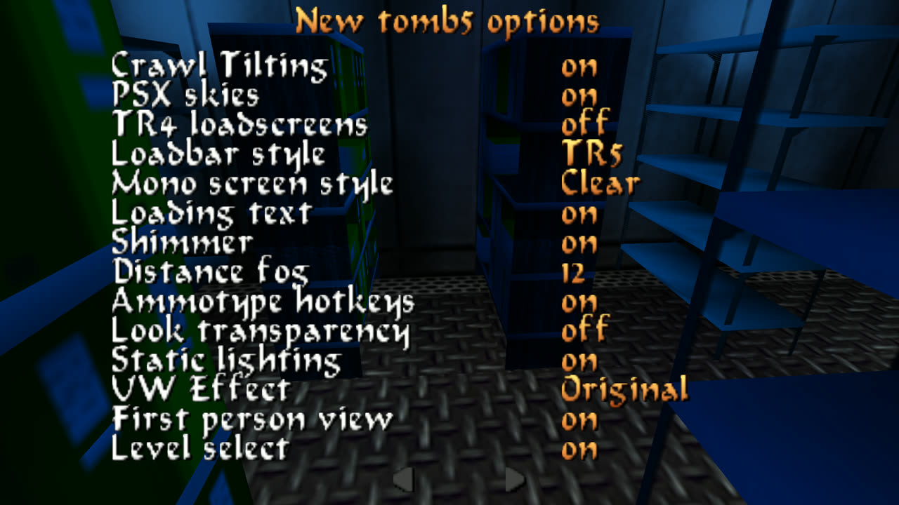

<p align="center">
  
</p>

# The engine — the manual

**PCTomb5.exe, Beta_1.0**

A native Windows 11 build of Tomb Raider Chronicles: Direct3D 9 and XAudio2,
no wrappers, one self-contained executable. This page covers everything it
does that the original did not, and everything you can set.

The randomizer has its own manual — [Randomizer-Manual.md](Randomizer-Manual.md).

- [What this build is](#what-this-build-is)
- [Starting it, and the setup dialog](#starting-it-and-the-setup-dialog)
- [Controls](#controls)
- [The options menu](#the-options-menu)
- [tomb5 options](#tomb5-options)
- [First person view](#first-person-view)
- [Language, and HQ music](#language-and-hq-music)
- [Balance.txt — tuning the whole game](#balancetxt--tuning-the-whole-game)
- [The secret counters](#the-secret-counters)
- [Secret rewards](#secret-rewards)
- [Savegames](#savegames)
- [What plays differently from the original](#what-plays-differently-from-the-original)
- [When something looks wrong](#when-something-looks-wrong)
- [Licence, source, and building it yourself](#licence-source-and-building-it-yourself)

---

## What this build is

Upstream TOMB5 — Troye's decompilation of Chronicles — ships `PCTomb5.exe`
plus a `tomb5.dll` that carries the game code. **This build is a single
executable.** There is no DLL to copy, upstream's "dll only" updates do not
apply to it, and because it links the C runtime statically it needs no Visual
C++ redistributable installed.

The rendering is Direct3D 9 and the sound is XAudio2, both native. In
practice that means no compatibility shims, no wrapper, and no fiddling with
DirectPlay or old DirectX installers.

**You supply the game.** No levels, script, sounds, music, videos, textures or
language files ship here. Put `PCTomb5.exe` into your own Chronicles
installation.

---

## Starting it, and the setup dialog

Run the game normally, or use the two helpers in the package:

| | |
|---|---|
| **`Setup.bat`** | opens the setup dialog (`PCTomb5.exe -setup`) |
| **`Log.bat`** | starts the game writing a log (`PCTomb5.exe -log`) |

The setup dialog also opens by itself the very first time the game is run.

<p align="center"></p>

**Output Settings** — *Graphics Adapter* (one entry per monitor), the renderer
named underneath, *Resolution*, and *Fullscreen* / *Windowed*.
**Render Options** — *Bilinear*, *Disable FMV*, *Low Quality Textures*.
**Sound** — *Disable*.
The bottom left corner reads `PCtomb5 build <date>`. **Quote that line in a bug
report.**

> **The dialog does not load your previous choices.** It opens at its defaults
> every time: Windowed, Bilinear on, FMVs on, sound on, 640×480. If you open
> it again just to change the resolution and press OK, you have also just
> reset all of those. Set everything you want in one pass.

Three keys work while the game runs, with no menu: **Alt+Enter** switches
fullscreen and windowed, **Alt+Plus** and **Alt+Minus** step the resolution.
They are ignored during FMVs and level loading — that looks like a dead key
and is not.

"Fullscreen" is a borderless window rather than an exclusive mode, so
Alt-Tab is instant and overlays behave.

### Where your settings live

In the registry, under `HKEY_CURRENT_USER\Software\Core Design\Tomb Raider
Chronicles`.

> **Everything in the menu is written while you play, since round 161b1.**
> The tomb5 options write themselves the moment you change a row, as they
> always did. The rest — volumes, sound quality, targeting, language, control
> layout and every key and pad binding — used to live in memory until the game
> closed normally, so a crash threw that whole session's settings away; they
> are now written when you leave the page you changed them on, which for a
> rebinding session means leaving *Key bindings*. Nothing you change in the
> menu waits for "Exit" any more.

Every tomb5 option has a value of its own under
`HKEY_CURRENT_USER\Software\Core Design\Tomb Raider Chronicles\tomb5`. Almost
all of them have a row in the menu and are better set there; these are the ones
worth knowing by name:

| Value | Type | Meaning |
|---|---|---|
| `fps_mode` | DWORD | How many frames a second are presented. `1`, the default, is 60; `0` is the original 30; `2` is the display's own refresh rate, which needs `vsync` on. There is no uncapped mode. The *Frame rate* row on the *Display* page writes this. See **Frame rate**. |
| `vsync` | DWORD | `1`, the default: the picture waits for the monitor, so it is never torn across the middle. `0` for the original behaviour. **The only setting in the build that is not instant** — it is read when the graphics device is made, so a change takes hold the next time the game starts (or on the next Alt+Enter or resolution change). The *VSync* row writes this. |
| `hd_enable` and its five companions | | The Remaster art. Their own table under **HD from the Remaster**. |

---

## Controls

**Options → *Controls*.** The page opens with the two centred tabs *Key
bindings* and *View*; under them come *Control type*, *Combat mode*, *Action*
and then, sixth, *Control layout* (the old *Control Method*, renamed since
round 161b1 to tell it apart from the newer *Control type* row) with four
positions: *Keyboard*, *PS5 Controller*, *Xbox Controller* and *Joystick*.

The three controller positions mostly mean the same thing to the game — they
choose the **vocabulary** the buttons are named with, and with it the default
layout the *Key bindings* page's own *Reset to defaults* row writes back
(round 161b1 moved *Reset* off *Control layout*'s own value list and onto that
page, as a centred row of its own — it does exactly what the old value did).
The engine works out by itself whether your pad reports as XInput or
DirectInput, so a DualSense behind Steam still gets PS5 names.

Open *Key bindings* with a controller layout selected and the list holds
fifteen bindable rows, including *Pause*, *Save*, *Load* and the two
medipacks — vanilla had no joystick binding screen at all. Set *Action* (see
below) to *Separate* and a sixteenth row, *Secondary*, joins the list; the
keyboard list gains the same row as its seventeenth, and under *One key*
neither list shows it, because a row the setting makes inert is a row that
would do nothing. The four right-stick tilts can be bound like buttons. Round
161b1 also put the list on
its own page rather than folding it into *Controls* itself, so it can page
left and right with the arrows when the keyboard's sixteen bindable rows —
seventeen under *Separate* — or the pad's fifteen (sixteen under *Separate*)
do not fit one screen — the same paging *tomb5 options* already used.

A few things worth knowing:

- **Confirm and back (Cross/A and Circle/B) are fixed.** Whatever you bind
  them to, they still work as menu confirm and back.
- **Binding a button another row uses silently unbinds that row** — it shows
  `---`.
- On the keyboard page, **Enter and the arrow keys are refused** as bindings,
  and every action keeps responding to its *original* default key alongside
  your new one, unless that key has meanwhile gone to another action.
- **Save and Load are unbound by default** on the Xbox page. Bind them
  yourself if you want them.

> **Launching through Steam: switch Steam Input off for the game first.**
> Steam's own store entry lists Chronicles as having no controller support, so
> Steam translates your pad into keyboard presses — while this engine reads
> the same pad directly. Every press then arrives twice. Nothing on our side
> can prevent that.

### The keyboard: two schemes, two sets

*Control type* (round 161b2a) picks **Tank**, the original scheme, or
**Modern**, a hand-on-the-left layout around W/S/A/D — and behind the scenes
each scheme keeps its **own** keyboard bindings, remembered independently:

| Role | Tank (default) | Modern (default) |
|---|---|---|
| Forward / Back / Left / Right | Up / Down / Left / Right arrows | W / S / A / D |
| Duck | Period (`.`) | C |
| Dash | Slash (`/`) | Left Shift |
| Walk | Right Shift | Left Alt |
| Jump | Right Alt | Space |
| Action | Right Ctrl | E |
| Draw weapon | Space | Q |
| Flare | Comma (`,`) | F |
| Look | Numpad 0 | R |
| Roll | End | Left Ctrl |
| Inventory | Escape | Escape |
| Step left | Delete | Z |
| Step right | Page Down | X |
| Pause | P | P |
| Select | Return | Return |
| Secondary | Home | Numpad 0 |

*Secondary* (round 161b2c) is the nineteenth slot in each scheme's table, and
it is bindable but does nothing while *Action* (below) is set to *One key* —
the *Key bindings* page only lists it under *Separate*, so *One key* shows
the page exactly as it always has. The Modern default is a placeholder: a
later round gives it Mouse Left, to match the game this scheme is modelled
on.

The Modern column is deliberately one plain listing rather than a claim of
being final — it is fully rebindable, the same as Tank's own. Every key shown
is a **scan code**, so it is *positional*: on a QWERTZ keyboard the two
letters that move between layouts print as Y and Z swapped, but the physical
keys bound are the same.

Switching *Control type* does not overwrite either scheme's bindings — it
**swaps to** the other one's, so rebinding W/S/A/D under Modern and then
switching to Tank still leaves your Tank keys exactly as you left them, and
switching back to Modern brings your Modern rebinds back too. The *Key
bindings* page always shows and captures whichever scheme is currently active,
and its **Reset to defaults** row restores that scheme's own defaults only —
resetting under Modern never touches your Tank bindings, and the other way
round.

**Menus under Modern.** Wherever the game reads keys for a menu rather than
for Lara — the title screen, the pause menu and every options page, the
inventory ring, load/save, the outfit changer — the four arrow keys and
Return still step and confirm, whatever you bound W/S/A/D and Enter's Modern
equivalent to. A Modern player who rebound the movement keys is not forced to
use them in a menu, and a player who unbound them entirely is never locked
out of one. In the game itself the arrow keys do only what the active
scheme's table says they do.

One consequence of Modern's default *Walk* key worth knowing: it is **Left
Alt**, and the title screen, load/save and the outfit changer all refuse to
confirm a row while Left Alt is held — that guard is there so that Alt+Enter,
the fullscreen toggle, does not also pick whatever the cursor sits on. Let the
walk key go to confirm on those three screens, or rebind *Walk* to a key of
your own; Escape always leaves, either way.

### Combat mode: Toggle or Hold

*Combat mode* (round 161b2a), under *Controls*, governs what the draw key or
button does — for keyboard and pad alike, under either *Control type*:

- **Toggle** (the default, and the original behaviour): press once to draw,
  press again to holster.
- **Hold**: draw while the key or button is held down, holster the moment you
  let go. Releasing mid-draw still lets the draw finish before she holsters —
  nothing is cut short — and a **torch** in her hand is never touched: while
  she is carrying one the draw key does only what it always did, which is
  throw it.

  A **flare** is a different hand. The game parks a lit flare in the same
  empty-handed state as no weapon at all, so with the draw key held down Lara
  throws the flare away and brings the guns back — the same thing a press of
  the draw key does with a flare in hand in the original. Let the key go
  before you light one, or expect to light it and lose it.

### Action: One key or Separate

*Action* (round 161b2c), under *Controls*, governs whether interacting and
the Secondary function share one button or sit on two, for keyboard and pad
alike, under either *Control type*:

- **One key** (the default, and the original behaviour): the *Action* key or
  button both interacts and does the Secondary function — there is only ever
  one key to reach for.
- **Separate**: *Action* interacts, switches, opens and picks up; *Secondary*
  climbs, grabs and holds a weapon ready to fire — hold it, the way the game
  he compares with holds L2 for the weapon and R2 to shoot.

Under Separate:

| Key | Does |
|---|---|
| Action | Everything in the world: switches and levers, keyholes, puzzle holes, search objects and monitor screens, pickups, doors, movable blocks (pushing them and the ready pose in front of one), pulleys, the floor trap door, the burning torch, and the cutscene item triggers. It also stays the menu key — it confirms in every menu and in the inventory ring, exactly as it does under One key. |
| Secondary | Everything Lara does with her own hands: grabbing and climbing a ledge, hanging and shimmying along one, letting go, the monkey swing, pulling herself out of the water — and firing, which is every weapon, the laser sight, the VCI headset light and the DOZY cheat's own light. It confirms in the inventory ring too, which is an addition rather than a change. |
| Either key | The pole, the tightrope, the parallel bars, the death slide, catching and swinging on a rope, the jump switch and the ceiling trap door — eight sites where a held state would drop her the instant the "wrong" key let go, so both keys reach them and both keys hold them. |

That is the whole division, and it is the engine's own: every place that asked
"is *Action* down?" about a world object now asks the *Action* key, every place
that asked it about Lara's body or her gun now asks *Secondary*, and the
handful of held states above take either. Nothing else moves — *Combat mode*,
the binocular and laser-sight zoom (which read the sprint and duck keys, not
this one) and every other row are untouched. Under *One key* one key sets both
halves in the same breath, which is why the setting costs nothing there.

On a controller under Separate, the pad's default bindings switch to their
own set as well (below) — your One-key bindings on that pad are not
rewritten, and switching *Action* back to One key brings them back exactly as
you left them.

| Role | Separate default (by name) |
|---|---|
| Duck | L1 |
| Sprint | L3 |
| Walk | Square |
| Jump | Cross |
| Action | Triangle |
| Draw | L2 |
| Flare | R1 |
| Look | R3 |
| Roll | Circle |
| Inventory | Share |
| Pause | Options |
| Save | the PS button on the PS5 page, *Joy 13* on the Xbox and Joystick pages — but only while the pad reports as DirectInput; over XInput neither page has a PS or Guide button to name, so there *Save* starts unbound |
| Load | unbound |
| Small medipack / Large medipack | wherever this pad's own One-key table already puts them |
| Secondary | R2 |

### Sprint mode and Duck mode: Toggle or Hold

*Sprint mode* and *Duck mode* (round 161b2c), under *Controls*, each govern
one key the same way *Combat mode* governs the draw key — Hold is the
default and the original behaviour, Toggle turns a press into an on/off
switch:

- **Hold** (the default): sprint or duck while the key is held, stop the
  moment you let go — today's behaviour.
- **Toggle**: press once to start, press again to stop.

A few things a toggled key still respects, because it is the same bit Lara's
own states have always read, only held open by the option instead of by your
finger:

- **Sprint** still ends itself — running out of breath, hitting a wall,
  ducking, wading into deep water — and the toggle lets go the instant it
  does, or the moment you stop pushing a direction; it does not fight the
  dash timer or leave you sprinting on the spot.
- **Duck** never holds her crouched where the bit means nothing: standing up
  under a low ceiling still needs the ceiling, not the key. Going down onto
  all fours is one of the moments the latch lets go (her hands are busy, the
  same rule as a ladder below), so a crawl runs on the ceiling from there on:
  she crawls until she reaches a spot she can actually stand in, stands up
  there, and the next duck is a fresh press — pressing again *inside* the
  crawl does not latch anything.
- Both let go on their own at a level change, a savegame load, a cutscene,
  death, entering water, and whenever her hands are busy — a ladder, a rope, a
  crawl, a pickup — and while a menu owns the input, so a key still held
  across one of those never latches by surprise.

---

## The options menu

Reached from the title screen row *Options*, or from the pause screen while
playing. The two are identical except for one row: **Special Features** only
appears from the title screen (or, while playing, once you have found nine
secrets in the matching quarter of the campaign).

Since round 161b1 the page is one sorted tree instead of a single flat list:
a title, then rows that either open another page (drawn centred, like the
Remaster's own) or are settings of their own (left-aligned, value on the
right). The seven tabs:

| Tab | Holds | Default |
|---|---|---|
| Audio | Music volume, SFX volume, Sound quality, Language | 80 / 90 / Medium / automatic |
| Controls | *Key bindings*, *View*, Control type, Combat mode, Action, Control layout, Camera speed, Dead zone, Targeting, Ammotype hotkeys | see below |
| Graphics | *Display*, HD textures, Fog, Distance fog, Shimmer, Mono screen style, Shadow mode, PSX skies, Static lighting, UW Effect, Look transparency, Footprints | see **tomb5 options** |
| HUD | Bar mode, Bar positions, Enemy bars, Ammo counter, Gameover menu, TR4 loadscreens, Loadbar style, Loading text | see **tomb5 options** |
| tomb5 options | Cutscene skipper, Cheats, Level Select, Fix climb up delay, Flexible crawling, Crawl Tilting | see below |
| Special Features | the bonus gallery (title screen only) | all locked |
| Credits | who this is built on | — |

Nothing about any one setting's variable, range, default or effect moved with
it — only which tab it sits on. *Targeting* is the one row that changed tab
outright, from the Options page itself onto *Controls*; every other row kept
the page it already had (*tomb5 options*, *Graphics* or *HUD*), just under a
tab now instead of a numbered page. See **tomb5 options** below for the six
settings that keep that name, and the sections after it for where the rest
of the old pages 1 and 2 went.

**Credits** is a screen of its own, not one of the framework's pages — as a
page it kept turning up unasked while paging through settings, with the
paging arrows drawn across the names. It lists names only; the web addresses
live in `README.txt`, because the game font cannot draw every character.

---

## tomb5 options

<p align="center"></p>

Six settings the original never had. Before round 161b1 these sat across two
numbered pages together with most of the *Graphics* and *HUD* rows below;
sorting the tree moved the graphics and HUD rows off this tab onto their own
(see **The options menu** above) and left *tomb5 options* with the six that
belong to neither:

*Cutscene skipper* (off), *Cheats* (off), *Level Select* (off), *Fix climb up
delay* (on — removes the pause before Lara pulls herself up), *Flexible
crawling* (on), *Crawl Tilting* (on).

Everything else the screenshot above still shows — *Footprints*, *Shadow
mode*, *Fog*, *HD textures*, *Bar mode*, *Bar positions*, *Enemy bars*, *Ammo
counter*, *Gameover menu*, *PSX skies*, *TR4 loadscreens*, *Loadbar style*,
*Mono screen style*, *Loading text*, *Shimmer*, *Distance fog*, *Ammotype
hotkeys*, *Look transparency*, *Static lighting*, *UW Effect* — kept its
variable, range, default and effect exactly as it always had; only the tab
changed. *Graphics* holds the picture rows (plus *Display*, its own sub-page
for *Frame rate* and *VSync* — see below), *HUD* the rest. *First person
view* moved from this page onto *Controls*' own *View* tab, and its six rows
are shown there always now, not just while the switch is on (see **First
person view** below); *Ammotype hotkeys* moved onto *Controls*; *Targeting*
moved onto *Controls* from the Options page itself.

Worth spelling out:

- **Frame rate** and **VSync** live on *Graphics → Display*, a page of its
  own since they are one subject; both have a section of their own below.
  *Frame rate* is *60* by default, *30* is the original and *Display* follows
  the monitor. It changes how often the picture is drawn and **nothing
  else**: the game itself still steps thirty times a second, exactly as Core
  wrote it, so every animation, every timer, every trigger and every enemy
  behaves identically in all three. A savegame written in one is the
  savegame written in the others.

  See *Frame rate* further down for what the settings really do and how to
  check them.
- **Cheats** governs DOZY only — type it while playing to fly. The classic
  cheats still need the compass in hand and are unaffected.
- **Ammotype hotkeys**: the option governs **only** the ammunition cycling -
  pressing a weapon's number again while it is already out. Drawing a weapon
  and the medipacks work whether it is on or off.

  **One key per weapon, the same key in every level:** 1 pistols,
  2 shotgun, 3 uzis, 4 revolver, 5 HK, 6 crossbow (the Grappling Gun in
  rich3). 0 uses a small medipack, 9 a large one.

  Core bound only four keys and let two of them change meaning at the 13th
  Floor - key 1 became the HK, key 2 the crossbow. That works while the
  campaign runs in its built order, because by then Lara no longer carries
  the early weapons. A randomized run breaks it twice over: the switch hangs
  on `gfLevelId`, which is the level's identity and not its position, so
  with a rolled order it fires in scattered levels rather than "later"; and
  because the weapons travel too, Lara can carry an HK in the first level,
  where no key would have drawn it.
- **Level Select** adds a fifth row to the title screen that jumps straight to
  any level. It is a development shortcut, hidden by default.
- **Loading text** only shows while *Loadbar style* is TR4.

---

## First person view

<p align="center"></p>

Switch it on under *Controls → View* — the switch itself moved there in
round 161b1, from its old home on *tomb5 options*. The same tab holds five
rows of its own:

| Row | What it does | Default |
|---|---|---|
| Field of view | 60 to 100 in steps of 10; the ends stop, they do not wrap | 90 |
| Death camera | First person, or pull back and show it | Third person |
| Follow head bone | nails the view to the head bone — much more physical, and much shakier | off |
| Camera damping | off / Light / Medium / Strong | Light |
| Body | **animated** as always, or **still** while she is standing still | animated |

Unlike the old page, the five rows are always shown, whether *First person
view* itself is on or off — round 161b1 dropped the gating that used to make
a settings page for something switched off appear and disappear on its own;
the switch and its five settings are simply one tab now.

While first person is on, Lara's head and braid are not drawn, close sounds
are centred instead of panned, and the camera stays behind her eyes where
vanilla would have torn it away — trapdoors, turn switches and trigger
cameras all now leave you where you are.

With *HD textures* on, **her head and her neck are not drawn at all**. The
camera hangs inside her skull, so anything of her head that is still there
stands in front of the lens; what is left out is decided by the model's own
bone weights — every scrap of her the head bone owns more than a seventh of —
which is a fact about the file and not a shape in space, so it takes the same
patch of her whatever she is doing and wherever you are looking. The hole that
leaves is closed by a **lid built on the edge of the hole itself**, wearing
that outfit's own skin, coat or diving suit and moving with it exactly: look
straight down into your own neck in a roll, or land after a dive with the
camera behind your nape, and what you see is skin and not the inside of you.
Her body is drawn one-sided while the view runs; the section on the HD Lara
below says why.

**Body: animated or still.** In first person the camera sits in her head, so
her breathing moves the whole picture while you stand and read a room. Set
*Body* to *still* and her body holds one frame while she is standing,
crouching or kneeling still — aiming at a target included, since that is the
same standing state. **Only the body**: you still turn and tilt the view as
before, the arms still draw, aim, fire and reload — and at 60 they still do it
on every drawn frame, as smoothly as with the option off — and every step,
jump, climb, pull and roll is animated exactly as it always was. It costs
nothing and can be changed from the pause screen; *animated* is the game as it
has always looked.

**Two things deliberately still switch to third person**: the binoculars and
the laser sight, which bring their own head camera, and the real sniper camera
in the 13th Floor. That is not the option failing.

---

## Frame rate

*Graphics → Display*, its own page since round 161b1 sorted the tree (before
that, the third of the *tomb5 options* pages). Two rows:

| row | positions | takes effect |
|---|---|---|
| *Frame rate* | **60** (default), **30**, **Display** | the very next frame |
| *VSync* | **on** (default), **off** | the next time the game starts |

**60** is the default and **30** is the original. *Frame rate* can be changed
from the pause screen in the middle of a level and the next picture is drawn
the new way — no restart, nothing reloaded.

**The game does not change.** Tomb Raider Chronicles is a thirty-steps-a-second
simulation and it stays one in both settings: every animation frame, every
timer, every trigger, every enemy decision and every piece of physics happens
exactly as often as it always did. What the setting changes is how often the
finished picture is handed to the graphics card.

That is not a claim, it is how the engine was already built. Its clock counts
in sixtieths of a second, and the loop that runs the game spends **two** of
them on one step. Presenting once per sixtieth therefore runs the game on
every second frame, all by itself — thirty steps, sixty pictures, and not one
line of the simulation touched.

Two ways to check it yourself:

- With `-log`, the `FPSLOG` line reads `frames=60 logic_ticks=30`. Sixty
  presents, thirty game steps. `logic_ticks` reads 30 at every setting on
  this page; only `frames` changes.
- The stopwatch: a timed section (the countdown in the Submarine, the
  Escape With The Iris timer) runs for exactly as many real seconds in both.

**Where the sixty applies.** In the level, on the **title screen** and in the
**inventory ring**. The pause screen, the load and save screens, the death
menu, the outfit screen and the loading fade still run at thirty, on purpose:
each of them walks its menu once per *picture* while the button presses it
walks with are read once per *game step*, so at sixty each press would count
twice and the cursor would jump two rows at a time. Nothing about them looks
different at thirty — they were written for it.

The title and the ring used to be on that list and came off it in September
2026. Both now present at the rate this row asks for while their own logic —
the menu, the input, the cursor, every counter they own — still runs thirty
times a second, exactly as the game does. The ring's icons spin and the row
slides in half steps between two of those, the title's fly-by is drawn the
same way the level is, and a tap of Down still moves one row: the frame that
would have read the same button press a second time is handed a blank input
for the length of that one call and gets its own back immediately after.

With `-log` the ring writes an `INVLOG` line a second — `frames=` what was
presented, `steps=` its logic, and which of its motions were really drawn
in between. A healthy second at *Display* on a 165 Hz panel reads
`frames=165 steps=30`, and the `FPSLOG` line beside it reads
`frames=165 budget=6.1` where it used to read `frames=30 budget=33.3`.

**What you get, and what it costs.** Twice as many pictures of the same
motion, and the in-between one is a real new position rather than a repeat.
The engine remembers where everything stood before the last game step, and on
the frame that falls between two steps it draws everything halfway: Lara and
every enemy at half a stride, every turn at half its angle, the braid with
them, and the camera moving in half steps too. The picture costs half a game
step of delay on every second frame — about 8 ms on average — which is what
this technique costs everywhere it is used, and what you get for it is that
running, turning and looking around are twice as smooth as the game has ever
been.

**And the limbs move with the body.** An animation in Tomb Raider stores
every second, fourth or fifth frame and the engine blends between two stored
ones; at sixty it now draws the point halfway between the two poses the game
shows at thirty. So a walk cycle, a ladder climb, a reload and an enemy's
swing all step twice as finely, Lara's head turn, torso twist and aim move in
half steps with them, and the braid hangs off a neck that is where the body
is. Animations that store *every* frame — which never blended at all in the
original, and which is most of what an enemy does — gain the most.

Two things about it are worth knowing. The in-between pose is the *midpoint
of the two poses the original draws*, never a newly computed "more correct"
one: some of the game's own blending is coarse, and correcting it would be a
different game rather than a smoother one. And where an animation *changes*
between two game steps — a jump beginning, a state ending — nothing is
blended: that one frame shows the new pose, which is exactly what thirty
shows, and it lasts a sixtieth of a second.

The HD renderer follows without being asked: it takes its matrices off the
engine's own stack, so it gets the halved motion and the halved pose for
free. Sixty is as smooth with the HD art on as without it.

**And so do the small things.** Sparks, the flames of every fire, smoke, rain,
snow, the dust in flooded rooms, blood, waterfall and ceiling drips, the
shards of a smashed object, an expanding shockwave, spent shell casings,
bubbles, rats, bats, spiders and a rope Lara hangs from are all drawn between
two game steps as well. They need no memory of where they were: a particle
already carries its own speed, and the game moves it by exactly that speed
once per step, so where it stood before is a subtraction rather than something
to remember — which is how a thousand sparks and two thousand raindrops
come along for the ride at no cost. What matters, and is checked to the unit
offline, is that they are walked *backwards* from where the game holds them
and never forwards: a spark that ran ahead of the gun that fired it would be
smooth and wrong.

Their fall speeds and their lifetimes are unchanged — those are timings,
and timings are the next paragraph.

**What still steps at thirty**, on purpose, for now:

- **The arm that holds a flare or a torch.** Everything a *weapon* drives —
  the arms, the hands, the gun itself, and with the HK the torso and the head
  as well — moves in half steps like the rest of her since the arm chain was
  given a factor of its own; the flare's and the torch's one held-out arm is
  the piece of that work still to do, and it steps at thirty.
- **Cut scenes**, whole. Their camera is decoded from a frame number rather
  than simulated, so it is left alone and they play exactly as they always
  did.
- **The lightning.** A bolt is not moved from one game step to the next, it
  is drawn afresh: its segments are re-rolled from scratch every time. There
  is no halfway between two of them to draw, so the flicker keeps its thirty
  — which is what a flicker is.
- **The tumble of a flying shard.** Where a piece of a smashed object *flies*
  is in half steps; the way it *spins* is not. It spins fast enough that
  nobody can pick the difference out, and its two rotations are stored in a
  form that cannot be blended without wrapping the wrong way half the time.

**Everything that is a length of time is a length of time.** This is the part
that took the most work and shows the least: dozens of counters in the engine
measured time by counting *pictures*, which was the same thing as counting
game steps for twenty-five years. Every one of them now counts game steps
instead, so at sixty they are unchanged in real seconds — the fade to black
when Lara dies and the one between levels, the white flash of a weapon, the
level name at the bottom of the screen, the "ammo changed" caption, the
health-bar blink, the pickup sliding in from the right, a body fading away
after it falls, the rain and the snow and the underwater dust, the storm's
flicker and the delay before its thunder, the jitter of an electric bolt, the
scan band crossing a monitor screen, footprints fading out of the snow, the
scrolling water surfaces, the green of poison coming up, and the pause before
a cut scene takes over. If any one of those looks faster at 60 than at 30, it
is a bug and worth reporting.

**Where it deliberately jumps.** Interpolation is switched off, for one
frame, wherever the game *meant* something to jump rather than move: a
teleport (anything that crosses more than half a sector in one step), a
camera cut — a fixed camera taking over, a flyby starting or stepping to its
next node, the binoculars going up — a cut scene, and the first frame after a
level start, a savegame load or the inventory. Those look exactly as they do
at thirty, which is the point.

**If it does not hold.** The engine never falls back on its own — it says so
and keeps going. With `-log`, `FPSLOG`'s `late=` and the `PROFLOG` lines under
*When something looks wrong* say which part of the frame ran out of time. On a
machine that cannot hold sixty with the HD art on, `30` is the setting that
was always there.

### VSync

**On by default.** Without it the picture is handed to the graphics card the
moment it is finished, in the middle of the monitor drawing the previous one,
and the seam between the two is the horizontal tear you see when the camera
whips round. With it the hand-over waits for the monitor and the picture is
always whole.

It is the **one setting in this build that is not instant**. Direct3D 9 takes
it when the graphics device is created and offers no way to change it on a
live device, so the row reads *on (restart)*: switch it, and the next start of
the game runs with it. (Alt+Enter and a resolution change also make a new
device, so those pick it up too.)

**It also takes a busy-wait out of the engine.** The original had no vsync at
all; its thirty frames a second came from a loop that spun on the clock —
`while (!Sync());` — for whatever was left of the frame's slot, burning a core
to do nothing. With VSync on and *Frame rate* at *Display* that loop is not
entered at all: the waiting happens inside the graphics driver, which is where
it belongs.

If your graphics driver's control panel forces vsync off for this program, the
engine notices within a few seconds — the presents come back far too fast to
have waited for anything — says so in the log and falls back to 60 for the
session. That fallback exists because *Display* is paced by the waiting and by
nothing else: there is no uncapped mode in this build, on purpose.

### Frame rate: *Display*

**What it does.** The picture is presented as often as your monitor refreshes
— 60, 120, 144, whatever the panel runs at — while the game keeps its thirty
steps a second like everything else on this page. On a 144 Hz monitor that is
four to five pictures per game step instead of two, each one a real new
position rather than a repeat.

**It needs VSync**, because the monitor's rate is what the *waiting* is bound
to. With VSync off, *Display* runs at 60 instead and the row says so:
`Display (60)`.

**What it costs.** About one sixtieth of a second more delay between your
hands and the picture than *60* does. That is not an oversight, it is the
price of a blend factor that never has to stall: at *60* the frames land
exactly on the game's own clock and the engine can draw as fresh a state as
exists, while at *Display* they land wherever the panel puts them, and drawing
the freshest state would mean asking, several times a second, for one the game
has not computed yet — which shows up as the picture standing still for a
frame at every game step. Trading a tick of delay for that is the whole
design, and it is why **60 remains the default**: *Display* is for a
high-refresh monitor, where the extra pictures are worth it.

**How to check it.** With `-log`, `FPSLOG` reads `fps=144 real_fps=143.8
logic_ticks=30`: the rate asked for, the rate measured, and the game still at
thirty. `INTERPLOG`'s `alpha=` is three numbers on this setting — the smallest,
the mean and the largest blend factor of the second — and a healthy 144 Hz
second walks the whole interval, roughly `0.03/0.50/0.98`. A maximum sitting
at `1.00` with a mean close to it means the frames are arriving faster than the
game can give them new states, which is the one thing that would look worse
than *60* rather than better.

### Proving the game really did not change

The strongest check there is, and it needs no tools beyond the package:
`SaveDiff` (in `Preparation\Tools\Diagnose`, built with `bsd.bat`) compares
two savegames and names every field that differs.

1. One randomizer seed, one level, *Frame rate* **30**. Play a short,
   repeatable stretch — a corridor, a fixed number of enemies, nothing on a
   timer — and save in slot 1.
2. Copy `savegame\savegame.0` aside as `save30.sav`.
3. Switch *Frame rate* to **60**, start the same level from the same point and
   play the same stretch. Save in slot 1 again.
4. Copy `savegame\savegame.0` aside as `save60.sav`.
5. `SaveDiff save30.sav save60.sav`

Identical files print `IDENTICAL` and nothing else. Otherwise you get one line
per differing field with both values, so that "played four seconds longer"
(`Game.Timer`, the clock fields, Lara's position) is told apart at a glance
from "the game ran differently" (`Level.Kills`, the ammunition counts,
`Lara.air`, the item flags). Nobody plays the same twenty seconds twice by
hand, so the honest reading is *"everything that differs is clock and
position"* — and that is already the proof, because the fields about the
**shape** of the run are the ones that cannot differ if the simulation ran the
same way.

---

## Language, and HQ music

**Options → *Audio* → Language** switches all game text immediately, with no restart —
vanilla took the first file it found and never offered a choice.

Only files in the true TR5 PC text layout are accepted; the game checks the
file's **header**, not its name. `JAPAN.DAT` and `DUTCH.DAT` ship with every
edition of TR5 and are in fact Tomb Raider 4 files, so they are skipped
silently, and some Steam-edition language files are rejected the same way.

> If Left/Right on that row does nothing, only one usable file is present. The
> language files must sit **next to `PCTomb5.exe`**, and so must `SCRIPT.DAT`
> — never inside `data\`.

### HQ soundtracks

Put OGG files named after the track number into the folder for your language:

```
audio\HQ EN\103.OGG
audio\HQ DE\   audio\HQ FR\   audio\HQ ES\   audio\HQ IT\   audio\HQ JP\
```

The engine then plays them instead of the original WAV. **Nothing ships** —
these come from your own TR4-6 Remaster purchase, as 44.1 kHz stereo. With
the folders empty, absolutely nothing changes.

The set follows the **Language** row: German text pulls HQ DE, and so on;
English, English US and Dutch all use HQ EN. A missing track falls back to
HQ EN and then to the original WAV, so a half-filled folder is fine.

> The folder shipped as `HQ JP WIP` is not read — the engine looks for
> `audio\HQ JP`. Rename it when you have the files.

Changing the language mid-game also changes the music set, but only from the
next track that starts.

### HQ sounds

The same remaster also has the game's sound effects at twice the sample rate.
Copy its `MAIN.SFX` into `audio\`:

```
audio\MAIN.SFX
```

In your remaster installation it sits in `5\DATA\MAIN.SFX`. Keep the name - the
engine looks for exactly that, and the original game has no file of that name,
so nothing can collide.

**Nothing ships**, the same as with the soundtracks. Without the file the game
plays Core's samples as it always has.

What it buys you: the original stores its sounds as 22 kHz ADPCM inside every
level file. The remaster's are 44.1 kHz PCM, and they are not the old ones
upsampled - there is genuinely more in them. Same recordings at the same
volume, with the bandwidth the 2000 release threw away.

About nine sounds in ten are swapped. The rest keep their original version on
purpose: enemies the randomizer moved in from other levels, and the four
guests from Tomb Raider III, have no counterpart in the remaster's bank, so
they keep the sounds they arrived with. A couple more are held back by a
length check, which is what stops a swapped-in sound from being handed the
wrong audio.

Start the game once with `-log` if you want to watch it work: `log.txt` then
carries a line per level saying how many sounds came out of the bank.

### HD loading screens

The same remaster also has the loading pictures redrawn at 1920x1080. Copy them
into a folder `HD` under `screens\`:

```
screens\HD\ANDREA1.DDS   ANDREA2  ANDREA3
screens\HD\JOBY2.DDS     JOBY3  JOBY4  JOBY5
screens\HD\ANDY1.DDS     ANDY2  ANDY3
screens\HD\RICH1.DDS     RICH2  RICH3
screens\HD\TITLE.DDS
screens\HD\LOGO_DE.DDS   LOGO_EU  LOGO_FR  LOGO_US
```

Keep the names — the engine looks up the picture by the level's own file name,
which is what makes it follow the level through a shuffled campaign instead of
sticking to the slot. The startup screen is built out of two of these files:
`TITLE.DDS` is the picture, and the wordmark is cut out of the `LOGO_` file
that matches your **Language** row and blended over it, centred just under the
top edge — the remaster keeps the two apart, and either one on its own is shown
as it is if you did not copy the other.

**Nothing ships**, the same as with the sounds and the soundtracks. Any picture
you do not copy simply stays the original 640x480 one, so a half-filled folder
is fine. There is no `RICHCUT2.DDS` in the remaster and none is needed — that
level keeps Core's picture.

The originals are 4:3 and the engine has always stretched them onto your
window. The HD ones are 16:9 and are fitted instead: on a 16:9 window they land
pixel for pixel, and on anything else you get black bars rather than a
stretched picture.

The **title menu** takes its wordmark from the same `LOGO_` file. Core's own
menu logo is `data\logo512.pak`, and the German and French versions of that
file (`grlogo.pak`, `frlogo.pak`) only ever existed on the German and French
CDs — the Steam edition does not have them, so those two languages have always
fallen back to the English lettering. With the HD file in place they get their
own at last: **DIE CHRONIK**, **SUR LES TRACES DE LARA CROFT**, and for
American English the flaming emblem. The mark is fitted into the same
rectangle the old logo filled, so it keeps its shape whatever your window size
is. Without the file nothing changes and the pak logo is drawn as before.

> The wordmark is picked when the title level loads, so switching the
> **Language** row in the options changes the menu text at once but not the
> logo above it. Leave the title screen and come back — start a game and quit
> to the title, or restart — and the logo follows. This is how the pak logo has
> always behaved too.

Start the game once with `-log` to watch it: `log.txt` gets a line per picture
saying which file was decoded and at what size, or why one was refused, plus a
`Title logo:` line saying which wordmark went into the menu.

### HD from the Remaster — what it is so far

*Tomb Raider IV-VI Remastered* does not repaint the old game. Beside every
level it keeps a whole second version of the geometry — every room rebuilt and
lit, with the static objects baked into it — and a model of its own for each
object, at eight times the texture resolution. The long-term plan (#123) is for
this engine to draw that art when it finds the remaster installed, and the
original art when it does not: file present → HD, otherwise vanilla, exactly
the deal the loading screens and the HQ sounds already have.

**As of this build the rooms, the objects and Lara are drawn in HD.** Enemies,
doors, switches, pickups, traps and machinery come out of the remaster's own
models, skinned on the classic mesh tree so that they move exactly as they
always did; the rooms around them were already HD; and Lara is drawn out of the
remaster's wardrobe — see *Lara in HD* below for which of her stays classic and
why.

**What the first round of fixes changed in the rooms.** A play-through of the
whole HD path turned up a list of faults, and five of them lived in the room
renderer:

- **A flipped room now changes its art with its geometry.** A flipmap swaps
  the contents of two rooms and leaves their numbers where they are; the HD
  path had the art nailed to the number, so a wall that had gone was still
  standing as a texture.
- **Leaves are leaves again.** The remaster draws its vegetation — the kelp of
  the Deepsea Dive, the trees and grass of Ireland, the ivy of Rome — in the
  pass that has no transparency test, and the pages it draws them on are up to
  95 % hole. They came out as solid green rectangles. The test is now switched
  on for the remaster's own cut-out materials, and for no others. (The first
  attempt decided it per texture page instead, from how much of the page was
  transparent, and that was wrong: an ordinary wall's transparency channel is
  a polish and wetness mask rather than a shape, so Rome's shop fronts, the
  snow of the crane yard and the bulkheads of the submarine were eaten full
  of holes. The second round of fixes replaced the rule.)
- **Light shafts are light again, not white surfaces.** The remaster bakes
  those at double brightness and its glow meshes at the maximum; the classic
  engine's own rule stops an added glow at one, and now so does this.
- **A fog bulb is a soft cloud, not a sphere with an outline.** The formula was
  right and exact; the classic engine hides its hard rim by computing it once
  per room vertex, which a per-pixel version cannot borrow. It now fades out
  over its own edge instead. (The second round of fixes took a straight line
  out of the side of that cloud as well: the classic engine skips fog more
  than 45 degrees off the centre of the view, which never showed on the 4:3
  screens the game shipped for. On a wide screen, and above all in first
  person, that skip cut across the picture and the fog jumped away at the
  edge. It is gone; only a fog ball entirely behind the camera is skipped
  now.)
- **Only what is meant to move in the wind moves.** The remaster marks how far
  a vertex may bend, not that it bends at all, and four fifths of the marked
  vertices of Rome belong to ordinary walls, gates and lamp posts. The bend is
  now kept for the remaster's own wind material — ivy, banners, grass, kelp —
  and for flowing water, and taken away from everything else.

**What the third round changed: the light, and the sky.** The play test's
next line about the rooms was that the light was far too bright and stood
perfectly still.

- **A light shaft is a shaft again, and a lamp is a lamp.** The remaster
  builds a shaft or a lamp cone out of dozens of overlapping panes, and its
  caustic net under water is one sheet over the whole sea bed; painted at full
  strength and added on top of each other they went white. The remaster's own
  art says how strong each of them is meant to be — the artists gave every
  glow, haze and sheet a strength of its own, between a fortieth and a whole —
  and the engine now reads it. Measured on the shafts of a VCI corridor: they
  used to reach pure white, they now peak at a quarter of it, which is where
  the remaster's own picture puts them. The Deepsea Dive's sea bed went from
  98 % white to a soft shimmer.
- **And they move.** The same art gives every glow a time, from a twentieth of
  a second for a candle to sixteen seconds for a sun shaft through a hall, and
  the brightness now travels along a shaft at that speed instead of standing
  still. It goes off with `hd_motion` like everything else that moves.
- **Animated pictures run again.** The Remaster paints a monitor wall, a
  bank of ships' displays and a handful of liquid surfaces as a four page
  loop, and the engine reads the loop out of the art: the four pages and
  the time one of them stands, from a twentieth of a second to eleven
  seconds. The VCI control room's closed circuit monitors change their
  camera feed again, the scan lines flicker over them, and the liquid
  surfaces of the submarine and of Rome move. Twenty-seven such surfaces
  in five levels; they stop with `hd_motion`.
- **Water moves over its whole surface, not just at the corners.** The
  classic engine marks a water surface at the corners of its own quads,
  and the Remaster lays a far finer mesh over the same pool - on one VCI
  pool, 448 points where the classic engine has 11. The mark is carried
  along the surface's own plane now, so the whole pool shimmers instead of
  a sliver of it, and over that runs a gentle swell and a caustic net
  computed for every pixel rather than for every corner. It carries no
  brightness of its own - the classic water light is untouched - only the
  movement, and it stops with `hd_motion`.
- **Polished surfaces catch the light at a grazing angle.** The Remaster's
  artists marked which surfaces are glossy and how glossy - the marble of
  Rome, the painted steel of the submarine, 214 surfaces over twelve
  levels - and a floor seen down a long hall now lifts towards its own lit
  colour instead of staying matt. The three VCI levels carry no such mark
  anywhere and are left exactly as they were. See `hd_reflect`.
- **Destructible statics disappear when you shoot them.** A crate, a
  barred window or a pane of glass is baked into the room's art, so
  breaking it used to leave the picture of it standing. The Remaster gives
  every such copy a number of its own, and the engine now takes that copy
  out of the room when the game takes the object out of the level.
- **And the statics the Remaster has no art for are drawn again.** A room
  whose Remaster art covers only part of it used to lose every lamp,
  crate and post standing in the rest. The engine asks, per object,
  whether the art draws anything where it stands, and draws the classic
  one where it does not.
- **The sky is the Remaster's sky.** Every level that has one carries a whole
  panorama of its own past the last room — Rome at sunset with the dome of St
  Peter's, the Irish hills at dusk — painted on a sphere around the camera
  with its own drifting cloud layers over it. Thirteen of the fifteen levels
  have one; the engine draws it in place of the classic horizon mesh and the
  two flat colour layers, and leaves the classic sky whole in the two that do
  not. The moon, the stars and the lightning still draw over it: the panorama
  has clouds but no moon, and the lightning flash is painted through a layer
  the dome would otherwise have replaced.

**What the fourth round changed: the people.** The same play test, everything
that walks and talks rather than stands still.

- **The cutscene actors have faces again.** Every speaker in a cutscene stood
  there without a head — the two old men in front of the fire in the Irish
  chapter, and the guard beside them wearing a cap over nothing. The Remaster
  ships a character's face as a file of its own, and it names it after the
  PERSON while it names the body after the level slot the body fills, so the
  obvious "the face of X is X's face file" found nothing at all for a
  cutscene. It goes by the person now, out of a list measured face by face
  against the collar it has to fill — and the log names which rule found which
  face, so a missing one can be looked up rather than guessed at. Their mouths
  still do not move: the Remaster animates a face with one small file per
  spoken line, a format nothing here reads.
- **The catsuit has holsters.** With the randomizer handing Lara a gun in
  every level, the VCI catsuit — which in the original game never carries one
  — had the pistols hanging in mid air beside her thighs. The pouches, the
  straps and the belt they hang from are not part of the gun model at all;
  they are built into the outfit, and the catsuit has none. It now borrows the
  black leather rig of the Tomb Raider III London catsuit, cut out of that
  outfit and worn over its own. Only that one outfit: two others carry no rig
  either, but the Antarctica parka and the Nevada vest never wore one in Tomb
  Raider III and are finished without it — lending them the London straps only
  put black leather through an orange coat.
- **The braid lies on her pack.** It no longer walks through her backpack: the
  game only ever knew the five round shapes of the 1999 body, none of which
  reaches as far back as the HD pack, so the pack has been given two of its
  own. What it still does is hang a finger's width clear of the back of her
  skull, because the classic braid stitches its first link into the head and
  an HD link is a rigid piece. Moving the braid's anchor closed that gap and
  made the whole braid tremble instead — the anchor is where the physics
  starts, and a physics that is nudged every other frame never comes to rest —
  so the anchor is back where it was and the gap is back with it. A quiet
  braid with a small gap beat a restless one.
- **And the braid stopped twisting.** After all that it still flickered while
  she stood at a door, and the cause was not the physics at all: the game
  works each link's direction out from whole-number positions, and for a braid
  hanging straight down two of those numbers are single digits — so the *twist*
  it derives from them is not an angle but a rounding, and it flips by up to
  half a turn from one frame to the next. Tomb Raider Chronicles never showed
  that because its braid is stitched together out of soft joins; ours is six
  solid pieces of one plait, and a solid plait spun on the spot is very
  visible. Each piece is now turned about its own length instead, all six by
  the same amount, taken from the direction of the whole braid rather than of
  one link — which changes where nothing sits and only which way the plait
  faces.
- **Latex looks like latex.** Tomb Raider Chronicles has no highlight of any
  kind in its lighting, so every HD outfit came out flat matt beside the
  Remaster's own picture, where the catsuits shine. Lara's parts now carry a
  highlight whose strength says what they are made of — latex for the two
  catsuits, rubber for the diving suit, a soft wide sheen on skin, a light
  satin on the Rome top, a hard small point on a weapon. It follows the room's
  own lights, and in a dark corner there is nothing to reflect and it goes
  away. Only Lara has it for now; the creatures and the props are unchanged.
  The material is named per **texture page**, not per model, because a hand
  model is a hand *and* the gun in it: her skin keeps the soft wide sheen while
  the weapon in the same hand keeps the hard point, and a gloved outfit's hands
  shine like leather rather than like skin.

**What the fifth round changed: the order the picture is painted in.** The
play test came back with one sentence about all of it — *"everything behind a
glow is always slightly wrong"* — and that turned out to be the whole story.

- **A lamp cone is not cut off at a doorway any more.** A glow is painted on
  top of what is already there and leaves no mark of its own in the depth
  buffer, so whatever was drawn AFTER it simply painted over it — and the
  rooms were drawn one whole room at a time, so the room beyond a doorway
  always came after the glow hanging in that doorway. The frame is painted in
  two passes now: everything solid first, HD and classic together, and then
  every glow in the game over the finished picture, exactly where the original
  engine puts its own see-through polygons. The wall lamps of the VCI offices
  keep their cones through a doorway, and a glow behind a crate is behind the
  crate rather than gone.
- **The light stopped throbbing.** The travel of brightness along a shaft was
  set by hand at a quarter either way in the third round, and the play test
  called it pulsing. Measured against the Remaster's own two recordings of the
  same corridor three seconds apart, its shafts move their bright places
  around and their level barely changes — four percent over three seconds. The
  travel is a sixth of what it was; the streaks still wander, the room no
  longer breathes.
- **The last white shafts are gone.** The third round read every glow's
  strength out of the art and named four places where the art gives no usable
  number — a lift shaft in the VCI tower and three window glows in Ireland,
  which therefore kept drawing at full white. The art groups its glows into
  presets, and inside a preset the strength is all but the same number in
  every level that uses it, so those four now take their own preset's
  strength. The 13th Floor's lift shaft went from a white block to a shaft
  with streaks in it; nothing saturates anywhere a player stands.
- **Water meets the bank instead of climbing it.** The swell added in the
  third round lifted every point of a surface, the ones at the water's edge
  included, so the water rose over the coping of a pool and covered it with a
  dark band that travelled with the wave. The wave now dies away over the last
  square before the edge, which is what water does; the middle of the pool
  moves exactly as it did.
- **And the water of Rome animates at last.** The original engine answers "is
  this water" on two different marks — one for an ordinary pool, another for a
  room roofed by a reflecting ceiling — and the third round carried only the
  first of them across to the finer Remaster mesh. Ireland's water is all on
  the first mark and moved; Rome's is all on the second and stood still. Both
  are carried now. With it, a correction that had to come along: on the second
  mark the original engine says yes to nearly every surface in the room, walls
  and ceiling included, so the ripple was moving the WALLS in Rome. Only what
  lies on the water's own plane moves; the rest still catches the shimmer in
  its colour, as it always did.
- **And the room shader on disk is the room shader in the source again.** The
  checked-in bytecode had been left one edit behind its own HLSL and still
  carried an experiment the third round had measured and thrown out — 636 of
  the 512 instruction slots a shader model 3 card must provide. Nothing on the
  screen changes (the extra code was unreachable); what changes is that the
  shader now fits inside the guarantee on every card that claims it.

- **The water surface the Remaster does not draw.** Held plane by plane
  against the original level, the Remaster's own room art has **no geometry at
  all** where the original draws its water surface in 61 of the game's 93
  reflecting rooms - every VCI pool among them. An HD room therefore showed
  the pool floor with nothing over it, which is what a dark, patternless
  surface looks like: there was no water there to texture. Where the level has
  a water surface and the Remaster's art has none, the level's **own** water
  face is drawn on top of the HD room now, with its own texture, its own
  animated texture range and its own shimmer. A room whose surface the
  Remaster did build - Ireland's ponds, the Rome cistern, most of JOBY3 - is
  left to it, decided per room out of the art itself.
- **Glass is glass again.** The Remaster marks its see-through surfaces with a
  material of their own and an opacity beside it, and this build drew them
  with an alpha *test*: a texel at 55 % came out solid and one at 45 %
  vanished, so a smooth pane became a hard mask of itself - the dark shard
  pattern in the windows of the submarine. Those surfaces are blended properly
  now, after everything solid and with no depth of their own; 96 of them in
  eight levels, and nothing else in the game touched. The panes still break
  when the game breaks them: the piece is the same one Lara can shoot away.
- **The great hall's sun shafts, down to a minimum.** One tuple of numbers in
  the art - the slowest-drifting shaft in the game, 16 seconds to a cycle -
  carries the shafts of the Rome hall, and it was drawing at a peak of 58 % of
  white. It is 16 % now, faint but there. Every other shaft, cone and glow in
  the game is untouched, the VCI corridor's streaks included: they carry
  different numbers and the rule is the numbers.
- **And no ripple on the wall at the waterline.** The mark that says "this is
  water" is carried to the finer Remaster mesh by POSITION, and a wall
  standing at exactly the water's height inside a pool answers yes to it. It
  was getting the surface's own ripple and its caustic, which on a wall is a
  sheared, darkened triangle at the waterline. The geometry half now asks the
  surface to be **flat** as well; the colour still shimmers on those points,
  exactly as the original engine does.

- **The Remaster's own still water is water.** One of its materials had been
  read as a second kind of haze and drawn at a fortieth to a fifth of its
  strength - nearly invisible. Taken apart part by part over the fifteen
  levels it is nothing of the kind: it is the **surface of standing water**,
  28 pieces in six levels - the fountain of Rome, the basins of Trajan's
  Markets, the pools of the Irish labyrinth, the flooded rooms of the sinking
  submarine and the two open seas - and where the Remaster builds one, the
  original level's own water surface was being suppressed in favour of
  something the player could not see. Twelve rooms had no visible water at all
  for that reason. They have it now, and over it runs a **ripple**, computed
  for every pixel out of the three numbers the art gives each piece: they
  scale with the AREA of the body of water over the whole game - a puddle gets
  short quick waves, the Deepsea Dive's sea a long slow swell - which is what
  says they are a wave and not a brightness. In six rooms of the sinking
  submarine the two surfaces would have stood on the same piece of floor, one
  to twenty units apart; there the original's face gives way to the Remaster's
  sheet - but only on the squares the sheet really covers, so the pool keeps
  its own surface everywhere else and no square is left bare. It stops with
  `hd_motion`.
- **And the water the Remaster does NOT build wears its HD frames.** The
  surfaces the round before restored are the level's own faces, animated the
  way the original animates water - eight pictures that take turns in the same
  texture slot every fifth of a second - and the Remaster ships an HD painting
  of each of those eight. They are found through the level's own texture table
  and put on the face in the Remaster's order and at the original's pace, so a
  VCI pool moves exactly as it always did at four times the resolution. Seven
  levels have such frames (Rome's two, Ireland's Gallows Tree and Old Mill,
  and three of the four Russian levels — *The Base*, *Deepsea Dive* and
  *Sinking Submarine*); where a frame has no HD painting the original
  tile is drawn and nothing is missing.

- **No more seeing one room through another one's wall.** Tomb Raider levels
  are not built like buildings: two rooms can stand in exactly the same place
  in the world, and the game only ever shows you one of them at a time,
  because it draws each room **only inside the doorway you are looking at it
  through**. The HD path drew whole rooms instead, so where two of them
  overlapped - the storeroom and the air shaft of *The Base*, room 39 and room
  53, sharing the same coordinates - the second one's shelves and floor grating
  came through the first one's wall. It cannot be sorted out by distance,
  because both really are that far away. Every HD room is now drawn inside the
  same window the original engine gives it, and so is every HD enemy, in the
  window of the room it stands in. Lara is never cut: she is in the camera's
  own room, and that room's window is the whole screen.

- **Every line of text is sharp.** The title menu, the names under the
  inventory ring, the options pages, the load and save lists with their
  *(quicksave)* line, the statistics after a level, the ammunition counter,
  the name of a pickup and the subtitles of a cutscene: all of them used to be
  one 256-pixel page of glyphs from 1999, blown up four and a half times on a
  1080p screen and six times on a 1440p one, which is why the letters were
  soft. The Remaster ships the very same alphabet at eight times the size -
  the same shapes, redrawn, with a dark edge that keeps them readable over a
  bright wall - and the engine now finds each letter in it and draws that
  instead. Nothing about the text changes but its sharpness: the same words in
  the same places, the same size, the same colours (the orange menu titles,
  the yellow selected row, the red locked ones), the same line breaks.
  Ninety-three of the game's 106 characters are in the Remaster's alphabet;
  the thirteen that are not - the twelve PlayStation pad symbols, which it
  never had, and one accented letter - are drawn the old way, each on its own,
  in the middle of a sharp line. Bars, icons and the loading screens are a
  different matter and are not affected.

Still open in the rooms, and named rather than hidden: a **visible border**
where an HD room meets one the remaster draws nothing for (they fall back to
the classic look, and the log's `HDLOG room=… hd=0` lines name every one), and
a **step in the wall brightness at a room boundary**, which is measured and is
the Remaster's own: it bakes each room's light on its own, and at the same
point in space the two sides of a doorway differ by up to a third of full
brightness in its own art. Nothing here widens it and nothing here can close it
without repainting the art.

**Switching it on.** Options → *Graphics* → **HD textures** (moved there in
round 161b1 from its old home as the last row of *tomb5 options*' first
page). Like every row on that tab it is remembered at once; unlike most of
them it takes effect **at the start of the next level**, because the art is
read and unpacked while the level loads. Switch it on, then load a save or
start a level.

There is no options row for the *path*, and normally there does not need to be:
the engine reads Steam's own folder out of the registry, walks every library in
`steamapps\libraryfolders.vdf`, and looks one level deep in each
`steamapps\common` for a folder that holds a `tomb456.exe` with a subfolder `5`
containing `DATA`, `TEX` and `ITEM`. It goes by what is in the folder, never by
the folder's name — Steam names the same game differently per language and
depot. The same walk also looks for a `tomb123.exe` with a subfolder `3`
holding `DATA` and `TEX`, which is *Tomb Raider I-III Remastered*: the four
Tomb Raider III guests the randomizer can put into a level have their HD
models there and nowhere else. Not having that game costs those four models
and nothing else. For a copy Steam does not know about there are registry
values, in the same key as every other setting
(`HKEY_CURRENT_USER\Software\Core Design\Tomb Raider Chronicles\tomb5`):

| Value | Type | Meaning |
|---|---|---|
| `hd_enable` | DWORD | The options row writes this. `0`, the default, and nothing below is read at all. |
| `hd_objects` | DWORD | HD models for the objects **and for Lara**, `1` by default. There is no options row for it: it is not a matter of taste but a way back if one level's models ever go wrong. Set it to `0` and the rooms stay HD while every object and Lara draw the classic way. Lara has no key of her own on purpose — she is a model like the rest of them and a level's models are one buffer, so a second switch would only be a second way to end up with half a picture. Does nothing at all while `hd_enable` is off. |
| `hd_motion` | DWORD | What **moves** in an HD room, `1` by default: water and waterfalls scrolling, ivy, banners, grass and kelp swaying in the wind, and a small ripple over a water surface, and the slow travel of light along a shaft or a lamp cone. All of it comes from the Remaster's own art — the artists marked which surfaces flow and which vertices bend, and this reads those marks. Like `hd_objects` it has no options row and is a way back rather than a taste: set it to `0` and an HD room stands perfectly still. Does nothing at all while `hd_enable` is off. |
| `hd_reflect` | DWORD | The **gloss** the Remaster's own art carries, `1` by default: the marble of Rome, the painted steel of the submarine and a few hundred other surfaces its artists marked as polished, each with a strength of its own. What they get is not a mirror - nothing is drawn twice - but the one thing a polished floor does that a matt one does not: seen at a grazing angle it lifts towards its own lit colour. Like `hd_motion` it has no options row and is a way back rather than a taste; set it to `0` and every surface is matt again. The three VCI levels carry no such mark in their art at all and look the same either way. Does nothing while `hd_enable` is off. |
| `hd_texture_budget_mb` | DWORD | How much video memory the HD art may take, in mebibytes. `0`, the default, means **work it out from the card** (see below; the card's own answer stops at 4095 MiB, which is a limit of the Direct3D 9 call and not of your card). Set a number and that number is the ceiling. |
| `hd_install` | String | The folder of your *Tomb Raider IV-VI Remastered* — the one holding `tomb456.exe`. Leave it **empty** and the engine finds it by itself. |
| `hd_install_tr3` | String | The folder of your *Tomb Raider I-III Remastered* — the one holding `tomb123.exe`. Needed for exactly one thing: the HD models of the four Tomb Raider III guests the randomizer can import (the T-Rex, the vulture, the Compsognathus and the raptor), which live in that bundle and in no other. Leave it **empty** and the engine looks for it in the same walk it uses for the other one; without the game those four enemies draw the classic way and nothing else changes. |
| `hd_texture_format` | String | `rgba`, the default, keeps every page exactly as the Remaster drew it. `dxt5` compresses them and uses a quarter of the video memory for a small, measurable loss. Anything else reads as `rgba`. |

### What the HD art asks of your graphics card

The floor is 2004 hardware: **vertex and pixel shader 3.0** (a GeForce 6 or a
Radeon X1000 and anything since), **A8R8G8B8 textures**, and a **32 bit index
buffer**. Miss one of those and the game runs classic for the rest of the
session, with the reason in the log — nothing crashes and no message box
appears. Textures up to **4096 pixels** are wanted but not required: eleven of
the Remaster's pages are that big, and a card that stops at 2048 gets those
eleven one mip level down instead of not at all. (The 32 bit index buffer is
the one real cut-off, and it is not a judgement: the Remaster's level files
number their vertices over the whole level, so a single wall tile can name
three vertices a million entries apart, and no amount of splitting brings that
under 65536. Only RICHCUT2 is small enough to draw without one.)

Video memory is the real question, and the answer is measured rather than
guessed. Kept exactly as the Remaster drew them, one level's pages come to
between **191 MiB** (JOBY4, *Deepsea Dive*) and **424 MiB** (ANDREA2,
*Trajan's Markets*); the title screen is 397. Of that, the rooms are the bulk — 168 to
376 MiB — the level's models add 5 to 72, and Lara's wardrobe 12 to 28. On top
of the pages come this level's HD geometry buffers (6 to 62 MiB), the classic
texture pages, which are still loaded and still drawn (2 to 24 MiB, measured
over all fifteen levels), and the back buffer with its depth buffer (25 MiB at
1920x1080). A **gigabyte** card has all of that several times over; the setting
exists for the ones that do not.

**The budget.** Left at `0`, the engine asks the card how much texture memory
it is offering at the moment the device is made, and takes off what else has to
live there: the back buffer and depth buffer at your resolution, the classic
texture pages of this level, this level's HD geometry buffers, and 64 MiB of
slack for the driver. What is left is the budget. For the title screen that
reserve is 155 MiB against 397 MiB of pages, so it loads everything at full
size on any card offering **552 MiB or more**; for the heaviest level, ANDREA2,
the number is **595 MiB**. Call it six hundred: a card that offers more than
that never cuts anything, and a two gigabyte card is nowhere near the line.

**Why the log says 4095 MiB on a big card.** The line

```
DXCreateD3DDevice Successful - the device offers 4095 MiB of texture memory
```

is not a mistake and not your card's real size. Direct3D 9 answers that
question with `GetAvailableTextureMem`, which returns a count of **bytes in an
unsigned 32 bit number**: 4096 MiB is the largest value that fits, so every
card with four gigabytes or more reports the same 4095. The figure is also
only ever an estimate — the driver rounds it, and it counts memory the system
may lend the card as well as the memory on it. None of that matters for what
the number is used for. It is read once, to decide whether a level's pages fit
with room to spare, and every card that hits the 4095 ceiling is nearly seven
times over the six hundred the heaviest level needs. If the device answers
nothing at all, the budget is switched off rather than guessed, and the log
says 0.

**What happens over budget.** Never a missing page — a page that is not there
is a hole in a wall and reads as a fault. Instead the **largest pages give up
their largest mip level**, biggest first, until what is left fits: a 512 pixel
page becomes 256, a 4096 one becomes 2048. Texture coordinates do not notice,
so the wall is softer and nothing else changes — no colour shift, no missing
surface, no seam. The log names the budget, what the level wanted, and how many
pages gave up how many levels. The same rule catches a card that cannot hold a
4096 pixel texture at all: those pages start one level down and the reason is
in the log.

**The other way, `hd_texture_format = dxt5`.** Instead of shrinking the pages
it compresses them, on the processor, while the level loads. Video memory drops
to a quarter — ANDREA1's rooms from 280 to 70 MiB — and every page keeps its
full size and its whole mip chain, so distant detail survives where the budget
would have blurred it. The cost is compression noise: measured over sixteen
pages of the Rome levels it is 40.3 dB peak signal to noise on average and
35.4 dB at worst, which shows up as slight banding on smooth gradients and is
hard to see on the Remaster's stone, plaster and metal. It costs about one and
a half seconds of loading on eight cores. **`rgba` remains the default and the
recommendation**; `dxt5` is there for a card that would otherwise have to blur.

If the card genuinely runs out of video memory in the middle of a level load,
that level goes back to classic as a whole — never half of it — and the log
names the page it failed on.

**The light in an HD room now does everything it did before.** An earlier
build drew the remaster's rooms with the remaster's baked light and nothing
else, so a torch did not brighten an HD wall and three option switches were
dead inside one. That is over: every effect the engine computes for a classic
room vertex is computed for an HD room too, from the same numbers, at the same
moment, and hanging off the same switch.

| What | Where you see it | The switch |
|---|---|---|
| Torch, flare, muzzle flash, explosions | any dark room you carry a flare into | — |
| Distance fog | anywhere with a long view | *Distance fog*, on *Graphics* |
| Fog bulbs | the Rome levels — Colosseum, Trajan's Markets, the Base | *Fog* |
| Water shimmer on a surface | any pool, and the mist rooms | *Shimmer* |
| Underwater darkening and the screen wobble | swimming, anywhere | — |
| Red Alert's green gas wobble | Red Alert! | *Shimmer* |

Three things are worth knowing about how close it is. The **numbers** are the
engine's own, proved: both formulas were written out on the processor and run
against each other over a room's own vertices, and the worst disagreement is
one part in 255 — the rounding the classic path does when it truncates its own
sum. The **brightest surfaces** stay brighter than the classic engine would
draw them: TR5 stops multiplying the texture at a certain point and starts
adding instead, which is a trick from the days of fixed graphics hardware, and
the HD path keeps multiplying — which is how the remaster's own art is meant to
be lit and how the HD rooms already looked before this change. And the **water
pattern** is finer: the table is sampled once per vertex, and an HD room has
far more vertices than a classic one. Same table, same speed, same strength — a
denser grid.

### HD objects — what draws, what does not, and why

An object is not a room. A room is one lump of geometry with one matrix; an
enemy is a tree of fifteen to thirty pieces that the engine walks every frame,
pushing and popping a matrix per piece and blending between two animation
frames. The HD model wants exactly those matrices, so the engine does not
build them a second time: it rides along on the walk it already does. The
animation, the frame blending and the mesh tree stay the game's own, down to
the last rounding — only the last step changes, where a piece's classic mesh
used to go into the texture buckets and its **matrix** now goes to the model
instead.

**How many.** Per level, of every slot the level really loads - creatures,
traps, doors, pickups, the lot: ANDREA1 draws 68 of 153 in HD, JOBY3 89 of
191, RICH3 92 of 183 (`ModelProbe -level <STEM> -all`, "slots complete" +
"partial"). Most of the remainder is `no_model` on purpose - triggers, AI
markers, invisible logic slots the remaster was never asked to draw a picture
of at all - not a model that failed to bind. The rest, and every slot with no
model at all, draws exactly as it did before — the two paths sit side by side
in the same frame and in the same depth buffer.

**When an object stays classic.** Four reasons, and every one of them is
written into the log with the slot it applies to:

| Reason | What it means |
|---|---|
| `no_model` | The remaster ships no model under that name. Mostly emitters, markers and inventory-only items — things that draw nothing in the world anyway. |
| `donor_dummy` | The slot's model came from another level file and that level says, in its own name table, that the slot draws nothing on purpose. |
| `tr3_not_installed` | The slot holds one of the four Tomb Raider III guests and *Tomb Raider I-III Remastered* was not found. Its model lives only there. |
| `skeleton_nodes` | The model names a mesh-tree node the slot does not have. `FIREROPE` in eleven of the fourteen levels: TR5's slot is a rope with one piece and the model comes from TR4, where it had seventeen. |
| `skeleton_drift` | The model fits the node **count** but not the tree. This is the randomizer's case: it puts foreign creatures into slots, and `SAS` in ANDREA1 holds a twenty-five-piece body where `SAS.TRM` was drawn for fifteen. Skinning that would tear the model across the room. |
| `no_geometry` | A model with nothing in it at all. Has not been seen; the guard is there so that it cannot become a crash. |
| `baked` | Not classic at all: **nothing** draws it. The level's own name table says `DUMMY` for that slot, which is the remaster saying it draws nothing there as an object — usually because it has baked the thing into the room's art instead. Rome's lamp posts and its wall lanterns are the clearest case: draw the classic mesh on top and the lamp stands twice, a hand's width apart, which is exactly what the first play-through showed. Only in a room that really draws HD; a room that stayed classic keeps its lamp post. |

**Which model a slot asks for** comes from four places, in this order: the
level's own name table beside it in the remaster's `DATA` folder, which lists
only the deviations; a small hand table of our own for the slots this project
added past the original 460, for the one vanilla slot the remaster leaves
unnamed — `ROMAN_GOD`, for which it ships a sword version and a hammer version
and only two of the fifteen levels say which — and for the Desert Eagle, which
the third rule below cannot reach on its own; a third rule for **pickups**
(next paragraph); and otherwise the slot's own name. A randomized level adds a
fifth: a slot the run filled from a donor is asked of the **donor's** table
instead, because that is where the model came from.

**The pickup rule.** A pickup's model almost never sits under its own slot's
name at all — `PISTOLS_ITEM` has no `PISTOLS_ITEM.TRM` anywhere, only
`EXTRA_PISTOLS_ITEM.TRM` in the shared folder — so, whenever the level's own
table and the hand table are both silent, the engine tries the slot's name
with `EXTRA5_`, then `EXTRA_`, then `EXTRA4_` in front of it, in each of the
two `ITEM` folders. This is how the pistols, the uzi, the shotgun, the HK, the
grapple, both medipacks, the lasersight, the binoculars, the flare pack, the
crowbar, the burning torch and the compass all draw HD
without a single level having to say so.

Four more slots the rule finds a model for get one that is **built and never
drawn**, and it is worth knowing which: the lit flare `FLARE_ITEM`, the fired
bolt `CROSSBOW_BOLT` and the two shell casings. None of the four goes through
the per-item path at all — the first two are given a draw routine of their own
in the engine's object table (`DrawFlareInAir`, `DrawWeaponMissile`) and the
casings are not items in the first place, they are a table of their own that a
single call paints; all four paint the classic mesh, exactly as the muzzle
flash does. Measured, not assumed. On the shipped bundle none of them costs a
texture page of its own either — each shares one with a neighbour that does
draw — so what they cost is a vertex buffer. The flare a level lays down for
Lara to pick up is `FLARE_INV_ITEM`, an ordinary pickup, and that one does
draw HD.

The rule is skipped for Lara's own
composite and for thirteen slots that are lights, mist or a muzzle flash
rather than a level item of their own — the muzzle flash really does have a
model under this rule, but it is excluded as plain caution rather than
because binding it would break anything today: the flash is never drawn
through the same per-item path this rule feeds at all (it is a stored matrix,
painted afterwards by a separate call against the classic mesh), so nothing
would tear - a future engine change might route it differently, and until one
does, excluding it costs nothing that could ever have reached the
screen. `SILENCER_ITEM`, `MEMCARD_LOAD_INV_ITEM`/`_SAVE_INV_ITEM`,
`PC_LOAD_INV_ITEM`/`_SAVE_INV_ITEM`, `DC_LOAD_INV_ITEM`/`_SAVE_INV_ITEM`,
`CLOTH`, `COSH` and `HAMMER_ITEM` are the ones this rule was measured to find
nothing for either way — no file under any of the three prefixes, in either
folder, and none under the bare name either — so they draw classic for that
reason alone, the same `no_model` this section already names. `BOTTLE`,
`WET_CLOTH` and `EXAMINE1`/`2`/`3` are a different case worth telling apart
from those: each has a real model under its own bare name (`BOTTLE.TRM`,
`WET_CLOTH.TRM`, `EXAMINE1.TRM` and so on), so the fourth rule already
reaches them without this round's help - not one of the fifteen shipped
levels loads any of the three `EXAMINE` slots as a real moveable, so whether
that model actually draws has not been measured, only that it is there to be
asked for.

The skeleton test is a measurement, not a guess. For every pair of pieces that
carry geometry it compares the distance between them in the model against the
distance between them in the slot's own mesh tree, with each piece's own size
taken off — so where the modeller put an origin does not matter and a model
that sits off-centre as a whole cancels completely. Over all fourteen
randomized levels and their vanilla twins the worst model that **belongs**
where it stands is 239 units out and the best one that does not is 308, and
the line is drawn at 256 — nearer the good end on purpose, because a good
model refused is a classic-looking door and a bad one accepted is a body torn
in half. `ModelProbe -all` prints the whole table for any level.

**What an HD object cannot do yet.**

* **Mesh swaps are answered with a second model, where the remaster ships
  one.** TR5 keeps a second mesh per piece and swaps it in — a guard's hands
  the moment he is created, the Cyborg's damage panels as he is shot, the
  Mafia's pistols coming out of their holsters. A remaster model is one whole
  thing and has no second geometry for a piece, but for two of those cases it
  ships a whole second *model*, and the engine draws that instead: the Mafia
  in the white shirt has one file with his guns holstered and one with them in
  his hands, and the Cyborg has eleven, one per damage stage, cumulative in
  the order the game opens his panels. Every other swap in the game is a
  soldier's hands, and there the remaster needs no second file because its
  Mafia, SWAT and guard models already hold the weapon. What is never done is
  painting the classic swap mesh over the HD body — that is the road TROne
  took and reversed after its own users reported classic patches on an HD
  model.
* **A piece the model does not cover draws nothing** — not even its classic
  mesh. That is deliberate: a door's invisible root and a face that ships as
  its own `_HEAD.TRM` are *meant* to be empty, and drawing the classic mesh
  there put classic patches on an HD body in TROne's own user reports.
* **A separate face brings its neck with it.** Where the remaster ships the
  face as its own file — Pierre, Larson, the guards, Von Croy — that file is
  not only the face: it carries the neck and a piece of the collar as well,
  and Pierre's reaches 165 units below the joint the head turns on. Bolting
  the whole file to the head node made the neck swing with the skull and tear
  a hole at the collar, which is what his death animation showed. The one
  piece of that file that hangs below the head now follows the node the head
  hangs off — the torso — with the file's own weights kept, so the seam bends
  instead of tearing.
* **Distance models are off** for HD objects. TR5 swaps in a coarser model
  five sectors away; the remaster has no coarse model, and a door that turned
  from HD to classic as you walked away from it would pop every time.
* **A glow can be painted over.** A model's additive pass — glowing eyes, a
  lamp — is drawn before the classic opaque objects, so a classic object
  standing *behind* such a glow paints over it. Rare, and the same hole the
  rooms have had since they went HD.

**The light is the engine's own, per vertex.** The classic engine lights an
object vertex by vertex out of a light list it builds per piece; a flat colour
per piece would have made a mannequin of every guard, with the front and the
back of his chest equally bright. So the light list itself goes to the card
and the shading is worked out per vertex there, with the remaster's own
normals — the room's lamps, the room's sun, the shadow lights that darken the
ambient, and every dynamic light the game makes: a flare, a torch, a muzzle
flash, an explosion. Two of those are finer than the classic engine could
afford: a point light's direction and its falloff are measured from the
surface itself rather than from the middle of a limb, so a flare at an enemy's
feet lights his boots and not his helmet.

**The proof, in the log.** With `-log` the first HD object of each level
writes two lines. `HDLOG itemcheck` puts each of its pieces on the screen
twice — once through the classic transform and once through the matrix the
graphics card is handed — and prints the worst disagreement, which is under a
pixel. `HDLOG lightcheck` runs the classic lighting formula on the engine's
own light arrays and the HD one on the list that was sent to the card, on the
same surface normal, and prints both colours side by side.

**The inventory ring draws HD too.** Open the inventory and the pistols, the
medipacks, the flares, the keys and the puzzle pieces turning on the ring are
the remaster's models, not the 1999 ones. It is the same seam once more and
not a second renderer: the ring walks a mesh tree exactly the way the world
does, and only the last step changes.

Two things about the ring are its own, and both are visible if they go wrong.

The first is *where* an item is drawn. The classic ring projects each object
about its own place on the screen — it slides the vanishing point sideways for
the length of one object and puts it back — while the HD path builds one
projection for the whole picture. So the HD path slides *its* vanishing point
for the length of one draw call, which is the same move in the same place. The
result has to land on the same pixel and be the same size as the classic ring,
and it is: measured over the model's bounding rectangle at every place the ring
puts an item, at 4:3 and at 16:9, the two disagree by **0.0001 of a pixel**
(`ModelProbe -ringcheck`). The ring is also *not* four thirds too wide on a
widescreen monitor, which is the obvious way to get this wrong: TR5 works its
field of view out from a 4:3 width whatever the window is, and the HD
projection is built from that very number.

There is a shortcut here that looks equivalent and is not: the same sideways
slide can be put into the object's own matrix as a lean, and the projection's
division undoes it just as exactly. The first version of this did that, and the
ring came out lit wrong — 28 % too dark in the middle of the row and 16 % too
bright on the ammo row below it, because the shader takes each surface's
*normal* through that same matrix, and a leaning matrix tilts the normals with
it. The slide belongs in the projection, where a normal never goes.

The second is the light. A ring object is lit by nothing but the ring: one
lamp above and in front of it, in the ring's own brightness — dim for the
objects to the side, bright for the one you have selected — over a near-black
ambient. That is exactly what the classic ring does, with the same doubling of
the lamp the original engine gives an inventory object, so an HD pistol is as
bright as the classic one was. No room light, no torch, no fog bulbs: the
bulbs of the room Lara is standing in would sit in front of her medipacks.

**What stays classic on the ring**, per level, is three things and always the
same three: the compass and the two passport pages, load and save. The passport
pages have no model in the remaster at all. The compass has one, but in a
campaign level it names a piece of the mesh tree TR5's compass does not have,
so the skeleton test refuses it — the same test that protects an enemy in a
randomized level. Both then draw exactly as they always did, needle and all,
and the ring has no hole in it. Everything else on the ring is HD: in the
vanilla levels 15 objects in JOBY4, 22 in JOBY3, 17 in ANDREA1
(`ModelProbe -level <STEM> -all`), and more in a randomized one, which scatters
weapons and ammunition into levels that never carried them. One place has one
more classic object, and for a different reason — the remaster ships no model
for it at all: RICH1's keypad. A randomized JOBY3 has a second such object,
the eighth key the randomizer's own key chain puts there.

With `-log`, opening the ring writes one `HDLOG ring` line saying how many
objects were on it and how many of them were HD, and one line per object with
its slot, its model file, its node mask and how the model was found.

**And so does the little turning object in the corner** when Lara picks
something up — the same models, the same size and the same place on the screen
as before, sliding in and out exactly as it always did. It hangs on *HD
textures* and on `hd_objects` together, like everything else with a model in
it, and with either of them off it is the 1999 object again. Every single item
the display can show has a model in the remaster, in all thirteen playable
levels, so there is nothing left in the corner that stays classic. It is lit
the way the classic display lit it and not the way the ring is lit — the
original engine gives an inventory object twice the lamp and everything else
three quarters of it, and the display is not the inventory. With `-log` a level
writes one `HDLOG pickupdisplay level=` line naming every slot the display can
show and which of them are HD, and one line per object the first time it is
shown.

**The actors of a cutscene draw HD as well.** A cutscene does not run the
ordinary object path: the actors are packed animation nodes played back by a
routine of their own, with their own frame buffer and their own light. Lara
was HD there from the start because she is drawn by her own routine either
way, so a cutscene showed an HD Lara talking to a 1999 Von Croy until the same
seam was put into the actor routine. One actor stays classic on purpose: the
one the script fades in and out of the picture. That fade is a half-transparent
draw an HD model has no pass for, and a fade that jumped to solid halfway
would be worse than a classic model.

**A room the remaster has nothing for stays classic**, on its own, room by
room. In ANDREA1 that is four rooms out of 242. A room the randomizer built
from scratch (a secret's new chamber) is in the same position and behaves the
same way: classic, without being asked.

**A room the randomizer RESHAPED is a different case, and it has to be told.**
The remaster's art describes the level as Core shipped it. When a run cuts a
wall open for a secret, adds a window, joins two rooms or lifts a floor, the
art still shows the wall that is no longer there — and unlike a room the
remaster never had, nothing in the file gives it away. So the randomizer
writes what it changed into a small text file beside the level,
`data\<LEVEL>.hdm`, and the engine acts on it. There are two kinds of entry,
and the difference is how much of the room's art the change makes wrong.

**An OPENING — a wall cut through, a window added, a floor or ceiling opened
— costs a box and not a room.** The randomizer records the box the opening
lives in, in world units, and the engine leaves out every HD triangle that
really meets that box, in every room's art. The room keeps everything else.

The box is the opening's own cross-section, stepped half a sector outward
along the opening's normal — the remaster builds walls as thick solids and
their faces do not sit on the classic wall plane — and 128 units **inward**
along the other two. Inward, because a cut room keeps its HD art and an HD
room never draws its classic roomlets, so art the box removes is replaced by
nothing at all: the box may hold only what stands inside the opening. An
outward step there takes the passage's own floor and ceiling and leaves the
void showing, which is what the first version of this did.

Every group is asked about every box rather than just the two rooms the
doorway joins. That is insurance: the remaster's rooms reach into each other,
and a flipmap twin is a room of its own. On the eight levels measured so far
every box in fact takes art from one room only, and always one of its own
two.

**A room that was LIFTED or BUILT FROM NOTHING still costs the whole room.**
`Move_Room` moves every vertex of a room and `Make_Room_Geometry` gives a
room a surface it never had; neither leaves anything of the remaster's art
worth keeping, so those rooms are drawn the classic way, whose geometry is by
definition the geometry the run really built.

Before this was split in two, an opening took its whole room as well. ANDY3
with the glitchless secret list opens two doorways, and that turned four of
its 211 rooms classic — among them the whole village courtyard — with the
seam between the HD and the classic half showing the void. The box costs two
sectors' worth of art instead.

The same file names the object slots whose **model came out of another level
file**. The remaster resolves a slot by the name *this* level gives it, and
`ANIMATING10` is a different object in every one of the fifteen files — so a
cross enemy, a moved key or a mesh warehouse would be painted as whatever
this level's `ANIMATING10` happens to be. Each of those lines names the donor
level and the slot the model was taken from, and the engine reads the
**donor's** `.MAP` for it. A guest out of Tomb Raider III is written `TR3` and
resolved out of the other bundle (see `hd_install_tr3` above).

The file is written on every run for every level, even when it has nothing to
say, and "restore original" deletes it again; a level with no such file has
no markers, which is what a vanilla installation looks like. It is plain text
and you can read it. A file this engine does not understand — a newer
randomizer, a version line it has no rule for — is refused whole, with the
reason in `log.txt`, and the level then draws the way it did before any of
this existed.

One thing that will look wrong if you go looking for it: a static object you
destroy — a vase, a crate — disappears from the game but not from the room's
art, because that art is one baked piece. It belongs to the stage that draws
objects.

The sky stays the engine's own. TR5 draws it procedurally, before the rooms and
without depth, and the HD walls paint over it exactly as the classic ones did.
The remaster keeps a sky dome of its own in the same file — one extra group per
level, measured — and it is deliberately not drawn.

**The log.** With `-log`, `log.txt` gets a block of `HDLOG` lines per level.
The ones worth reading:

```
HDLOG level=ANDREA1 trg=v3 groups=243 rooms=242 sky=1 empty=4 pages=179 ...
HDLOG room=0 group=0 tris=1216/0/0 ranges=4 statics=2 hd=1 reason=ok
HDLOG room=66 group=66 tris=0/0/0 ranges=0 statics=0 hd=0 reason=empty_group
HDLOG level=ANDREA1 built ms=1180 rooms=242 hd=238 classic=4 sky_groups=1 ...
HDLOG level=ANDREA1 pages named=179 distinct=179 from5=179 ... mib=279.9 ...
HDLOG level=ANDREA1 statics suppressed=255 kept=0 (in 238 HD rooms, 4 classic)
HDLOG level=ANDREA1 water marks=... rooms=...
HDLOG level=ANDREA1 water stamped=... choppy=... shimmer=... ps_slots=...
HDLOG matrixcheck level=ANDREA1 room=12 group=12 samples=128 used=85 behind=43
      maxdx=0.00017 maxdy=0.00009 maxdz=0.000000000 persp=572.0 center=960,540
HDLOG frame rooms=17 calls=131 dropped=0 bulbs=0 fog_start=12288 wibble=930
      cam_uw=0 shimmer=1 objects=9 object_calls=21
HDLOG frame objects hd=6 classic=4 baked=3 dropped=0 calls=20 swap_drawn=1
      swap_ignored=0 meshbits=0 clipped_lights=0(level)
HDLOG slot=33 name=SWAT model=SWAT nodes=15 maxbone=14 cover=15
      drift=22/114 head=-1 hd=1 reason=ok
HDLOG slot=31 name=SAS model=SAS nodes=25 maxbone=14 cover=15
      drift=807/2286 head=-1 hd=0 reason=skeleton_drift
HDLOG slot=436 name=ANIMATING11 model=- nodes=2 ... hd=0 reason=baked
HDLOG level=ANDREA1 map=read lines=42 baked_slots=14
HDLOG level=ANDREA1 swap slot=469 name=CYBORG kind=hitman_stages
      models=11 missing=0
HDLOG level=ANDREA1 objects hd=50 classic=111 baked=14 (of 161 loaded ...
HDLOG donor slot=45 name=LARSON from=Andrea1:45 model=LARSON hd=1
      reason=donor_slot_name
HDLOG donor slot=43 name=CROW from=TR3:43 model=VULTURE hd=0
      reason=tr3_not_installed
HDLOG level=RICH1 donors=15 donor_maps=4 map_lines=93 tr3_install=absent
HDLOG itemcheck level=ANDREA1 slot=33(SWAT) nodes=15 used=15
      maxdx=0.00021 maxdy=0.00013
HDLOG lightcheck level=ANDREA1 slot=33 classic=... hd=... diff=...
```

A randomized level adds two more room reasons and a block of its own. A room
the run LIFTED or BUILT reads `hd=0 reason=marker`; a room that only lost the
art round an opening reads `hd=1 reason=cut` with the count in `cut=`. The
level's `markers` line names the sidecar it read, its version, how many rooms,
cut boxes and donor slots it held, and whether the Tomb Raider I-III bundle
was found, and there is one line per cut box saying which rooms it took art
from:

```
HDLOG level=ANDY3 markers file=data\ANDY3.hdm version=2 rooms=0 cuts=2
      donors=23 outfit=0 tr3_install=absent
HDLOG level=ANDY3 cut 0 x 38400..39424 y 8832..10112 z 25728..26496 -
      0 triangles out of 0 rooms: none - the remaster drew nothing there
HDLOG level=ANDY3 cut 1 x 45184..45952 y 10880..11392 z 39424..40448 -
      305 triangles out of 1 rooms: 117(305)
HDLOG level=ANDY3 cuts=2 triangles dropped=305
HDLOG room=117 group=117 tris=760/0/0 overhang=0 cut=305 ranges=4
      statics=... hd=1 reason=cut
HDLOG level=ANDY3 markers version=2 rooms=0 of them classic now=0 cuts=2
      cut_tris=305 in 1 rooms donors=23 outfit=0
```

A box that caught nothing says so in its own line rather than passing in
silence — an opening the remaster's art never covered and a box in the wrong
place look alike in a picture, and only that number tells them apart.

and one `donor` line per named slot says where its name came from and whether
the model arrived: `donor_map` (the donor level's own `.MAP` named it),
`donor_slot_name`, `donor_dummy` (the donor says that slot draws nothing),
`model_missing`, `tr3_guest`, `tr3_not_installed`, or the skeleton test's own
reason when the model was there and did not fit.

`hd=1/0` per room with its reason is the whole decision table; `built ms=` is
what the HD side added to the loading time; `matrixcheck` is the engine
comparing its own vertex transform with the matrix it hands the graphics card,
over 128 of the room's own vertices — `maxdx`/`maxdy` are pixels and they have
to stay far below 1, or an HD wall would stand beside its own floor.

There is one `slot=` line per object slot the level loads: the model it asked
for, how many pieces the mesh tree has against the highest the model names,
how much of it is covered, the skeleton drift, and `hd=1/0` with the reason.
That table answers "why is this door still the old one" without guessing.
`itemcheck` is the object twin of `matrixcheck` — the same comparison on an
object's pieces instead of a room's vertices — and `lightcheck` puts the
classic lighting formula and the HD one side by side on one surface normal.

The two `water` lines say how many of the classic path's water vertices were
found again in the remaster's geometry — `marks` is what the classic level
offered, `stamped` is what was matched. The `frame` line repeats the option
state the HD rooms are actually drawing with, so a "the fog does nothing"
report can be answered from the log: `fog_start` is `Distance fog` times 1024,
`bulbs` is zero whenever `Fog` is off, `shimmer` is the switch itself. And a
`clipped` line appears only if a room ever wanted more than eight dynamic
lights or more than eight fog bulbs at once — if you never see one, the
shader's maxima never bit:

```
HDLOG level=TITLE clipped first frame lights=0 bulbs=1 room=-1
      offered_lights=0 offered_bulbs=9 (maxima 8 / 8)
HDLOG level=TITLE clipped summary frames=173 lights=0 bulbs=173
      worst_lights=0(room -1) worst_bulbs=9 (maxima 8 / 8)
```

The first line is written by the first frame that clipped, the second at the
end of the level — **never once per frame**, which is what an earlier version
did and what got the fog bulb maximum raised from six to eight in the first
place. `offered_` is what the engine wanted, the `maxima` are what the shader
has room for. Eight is a measured number, not a guess: counted out of all
sixteen level files, a level holds up to seventeen fog bulbs (`ANDREA2`, and
`TITLE` has seventeen too), and sweeping every camera position a level allows,
up to sixteen of them can be alight at once — 16 in `ANDREA2`, 14 in `RICH2`,
13 in `ANDY1`, 11 in `TITLE`, 10 in `RICH1`. So a `clipped bulbs` line in those
levels is expected: the bulbs that are dropped are the ones furthest down the
engine's own list. Eight is where the title screen stopped visibly losing one;
the engine's own ceiling is sixteen.

If the HD path refuses, it says so in one line and the game runs on classic —
no error box, no changed picture:

```
HDLOG level=ANDREA1 build refused reason=the device has no vertex/pixel shader 3.0
```

**Memory.** The remaster's pages are BC7, a format Direct3D 9 has never heard
of, so every one of them is unpacked on the processor and handed to the card as
plain 32-bit pixels — no quality lost, which was your call. For the heaviest
level that is 376 MB of texture. Kept in video memory it costs the process
**270 MB** at its peak; kept in Direct3D's *managed* pool, where the driver
holds a second copy in main memory, it costs **545 MB**. The first is what this
engine does. Unpacking them costs about a second of the loading time on a
modern processor — the `built ms=` number above.

**Alt+Enter and the resolution keys.** Changing the resolution or toggling
full screen throws the graphics device away and makes a new one. Everything the
HD path owns lived on the old one, so it is released at that moment and the
rooms go back to classic **until the next level starts**. That is deliberate: a
picture you can explain beats a crash.

**Nothing is copied out of the remaster and nothing of it ships here**, the
same rule as everywhere else in this project: the art is read where it lies, in
your own installation.

### Lara in HD

Lara was the last thing on the screen that was still the original model, and
she is the hardest one, because she is not an object. Every other creature is
one slot and one model file. Lara is a **composite**: the engine draws her out
of five slots at once — the skinned body from `LARA_SKIN`, the seams that close
it from `LARA_SKIN_JOINTS`, the hands from whichever weapon slot the mesh swap
put there this frame, the thigh straps from `LARA_HOLSTERS*` and the braid from
`HAIR` — and the remaster does the same thing with a wardrobe of separate
models.

**She is drawn now.** Her fifteen joint matrices are the engine's own, built by
the same animation code as before, so she moves exactly as she always did; what
changed is which geometry hangs off them. Which parts are on her changes from
frame to frame and is read from the engine's own state: which slot owns each
hand this frame, what is in the two thigh holsters, what is on her back.

**Which outfit a level wears** is decided out of the engine's own facts, not
from a list of level names:

| Lara | Where | The model | How it is recognised |
|---|---|---|---|
| The Rome outfit | Streets of Rome, Trajan's Markets, Colosseum | `OUTFIT_CLASSIC` | everything the three rules below do not claim |
| The Russia outfit, with the cap | Base, Submarine, Sinking Submarine | `OUTFIT_RUSSIA` | the engine's **own** braid test: a Russia level with `LARA_NORMAL`, or `LARA_BUNHEAD` anywhere. That expression already stands three times in the braid code and once in the skinning code, and it is the only thing in this engine that can tell the cap from the Rome outfit — a vanilla Russia level carries the same outfit byte Rome does. |
| The diving suit | Deepsea Dive | `OUTFIT_SUBSUIT` | the outfit byte, which has a value of its own for it |
| The VCI catsuit | The 13th Floor, Escape with the Iris, Red Alert, the title screen | `OUTFIT_VCI` | the outfit byte, likewise |
| Young Lara | Gallows Tree, Labyrinth, Old Mill | — **stays classic** | the script flag `GF_YOUNGLARA`, or the outfit byte `LARA_YOUNG`. Either one. **Not the level range** — see the note below the table. This is your decision, not a limit: `OUTFIT_YOUNG`, `LARA_YOUNG_HEAD` and `HAIR_PIGTAIL` all exist in the remaster. |
| A Tomb Raider III outfit | wherever the randomizer rolls one | `OUTFIT_TR3_ANTARC`, `_NEVADA`, `_COAST`, `_CATSUIT` | `data[3]` of the level header, which the randomizer writes — see below |

Read against all fifteen vanilla level files those rules give the right answer
fifteen times out of fifteen.

**Why young Lara is not the Irish levels.** She used to be, and it was wrong
in a randomized run. The engine builds the child body at exactly two places,
and both of them ask the level range **and** the script flag together — the
flag is what puts the child's ribcage over the skin. The randomizer clears
that flag out of `SCRIPT.DAT` for all three Irish levels, because young Lara
can carry no weapon at all, and puts a grown Lara's skin in the level; the
range on its own therefore said "child" about an adult and drew the whole
Irish section the classic way. The flag and the outfit byte both change when
the randomizer changes her, so either of them is a true answer and the range
is not. In a vanilla game nothing moves: those three levels carry the flag
*and* the byte.

**The rest of the wardrobe.** The face is `LARA_HEAD` and it is a *facial rig*
— its bone numbers run to 31 and mean nothing at all to her 15-piece mesh tree
— so it is nailed rigidly to the head, the same way an enemy's separate face
is. The braid is `HAIR_OG`, six bones over 280 units, which is exactly the six
links TR5's braid has, measured out of the level files themselves. The hands
come from `HAND_BARE_*`, one file per weapon, and the worn weapons from
`HOLSTER_*`: pistols and uzis on both thighs, the revolver on the right one
alone, the shotgun, the HK and the grappling gun on the back. An **empty**
holster draws nothing extra on purpose — the straps are painted into every
outfit already, which is why the game's empty-holster slot has no model in the
remaster either.

Two frames need two hand models at once and get them: a flare or a torch is in
the left hand while the right is empty, and the crowbar is in the right hand
while the left is empty. Each model is then masked to its own arm, so no hand
is drawn twice.

**Only what the level can use is loaded.** The whole wardrobe is 21 models,
3.5 MB of geometry and 30 MB of texture; a level that has no HK slot cannot
hand her an HK, so its wardrobe is smaller. In practice: Streets of Rome 11
models and 20 MB, Sinking Submarine 16 and 27 MB, The 13th Floor 6 and 17 MB,
Deepsea Dive 2 and 12 MB — the diving suit needs neither hands nor braid nor
holsters, it *is* all three.

**Does it fit her skeleton?** The same pairwise measurement the objects are
judged by, and the answer is comfortable: over every level the mean drift of a
wardrobe part against that level's own Lara mesh tree is 3 to 9 units and the
worst single pair 183, against a limit of 256.

**The Tomb Raider III outfits** were the last gap and are closed. The
randomizer rolls one of the four (#122) and writes the outfit byte
`LARA_PONYTAIL` when it does — but that is the same byte it writes for the
Rome outfit inside a Russia level, so the byte alone can say neither *which*
of the four she is wearing nor that she is wearing one at all. It now writes
a marker beside it: `data[3]` of the level header, four bytes the engine
already reads before it loads a single room, carrying the engine's own
outfit number so that neither side has to translate. `0` in every vanilla
file — measured over all seventeen — and 5 to 8 for the four guests.

With the marker there, the `LARA_PONYTAIL` byte means one thing again and
not two: the Rome body inside a Russia level, `OUTFIT_CLASSIC`. The one case
left over is a level file randomized by a version **older** than this
marker: it carries the ponytail byte and a `data[3]` of 0 for a guest as
well, and now shows a Rome Lara where that run rolled a Nevada one. Nothing
in the file can tell those apart — that is what the marker was added for —
and randomizing the level again with the current version says it.
`log.txt` prints the raw facts per level in the `HDLOG … lara …
laratype=… data3=…` line.

**What else stays classic, on purpose:**

| What | Why |
|---|---|
| Young Lara | your decision. The models exist in the remaster. |
| The skeleton cheat (`skelebob`) | its own draw path and its own overlay meshes; the wardrobe has neither. |
| The muzzle flash, the gun shells, the flare in flight | drawn by their own routines outside `DrawLara` and never part of the composite. |
| The diving suit's two thrusters | they are a separate object on her torso, not a part of her body, and the remaster's wardrobe has no model for them. They keep being drawn the classic way **on top of** the HD suit — two small low-resolution pieces, against a diving suit with nothing on its back. |
| The catsuit's sheen | the classic catsuit is drawn through the engine's environment map, a second view-dependent pass an HD model does not have. The remaster's own `OUTFIT_VCI` carries its shading in its textures, so the HD catsuit is matte where the classic one glints. Not faked: inventing a specular term would be inventing a look. |
| The inventory | the ring draws its own objects and never calls `DrawLara`. |

**First person** (#126) drops the same three things from the HD Lara that it
drops from the classic one: the head, the face and the braid, all three of
which sit exactly where the camera does. The braid's *physics* keeps running
the whole time — `HairControl` is part of the game loop and not of the draw —
so switching back to third person shows it hanging where it belongs on the
very next frame.

Three things then happen that have no counterpart in the classic body, and all
three are done on **her body's draw alone**, so that her hands, her holsters
and the weapon on her back are never touched (#123, stage S8, fix rounds J, K,
L and S):

- **The neck goes with the head, and the cut is one plane.** The classic head
  *mesh* is head and neck in one piece; an HD body is a single skinned surface
  whose neck stump hangs off the **torso**, so masking the head node leaves it
  standing — measured against the eye the camera really uses, 18.6 units away,
  inside the near plane. It is therefore discarded in the shader, and what
  discards it is a **plane carried by her head**: perpendicular to the neck
  axis, twelve units below the head joint, with everything on the head side of
  it dropped whatever node holds it. A triangle that crosses the plane is cut
  exactly at it, per pixel.

  *Twelve is measured.* Every vertex of every wardrobe body, binned by depth
  down the neck axis: the hundreds of vertices at four and six units are her
  **jaw** (widest 26 to 28 units off the axis) and the handful from eight on
  are the **neck**, a tube of radius 16 to 26. So the chin ends between six and
  eight in every body, and twelve sits four units clear of it, well inside the
  tube. Deeper eats neck one can see from outside; shallower puts the lid
  inside the renderer's near plane, which is at 20.

  **Your collar stays on.** That is the visible change: the Russia jacket opens
  out twelve units down, the parka fourteen, and the VCI catsuit's collar ring
  stands seventy units off the axis from six to sixteen. All three are below
  the plane, so all three are drawn — and looking down at your own collar is
  what looking down does.

  *Three shapes were tried before it and all three were sent back by the play
  test.* A **sphere around the eye** (stage S8) large enough to take the stump
  also bit sixty units out of her chest against a wall and chewed a jagged edge
  into a wrist brought up to the camera. A **cylinder about the neck axis in
  the bind pose** (fix rounds J to L) came back three rounds running with the
  collar still standing, and the reason is one measurement: the vertex under
  her chin carries bones 7/14/5 at weights 140/114/1 — it is 55 % torso and
  45 % *head*, so where a bind-pose shape falls on her skin **moves with the
  animation**, and the node mask that kept the shape off an arm kept it off
  half the neck as well. A **cone** was built in round L and bought three
  vertices. A plane fixed to the head has none of those freedoms: what is above
  it is above it in every pose and at every camera angle, and it needs no mask
  at all, because nothing of an arm is ever above your chin.

- **And the hole is closed with a lid.** A disc **in the plane itself**,
  skinned rigidly to the head node so that the two cannot drift apart. Its
  radius is the widest that outfit's own neck really is at the plane plus three
  units — 24.6 on the Rome body, 29.2 on the Russia coat, 32.1 on the
  Antarctica parka — with the search stopped at 34 so that a collar can never
  be mistaken for a neck. It wears her own **throat's** colour, measured out of
  the outfit's own texture page when the level loads, and the same skin
  material her hands wear.

  Two rules make that colour honest. The page is the one the neck's own column
  of vertices runs down — not the topmost ring, which is her *hairline*, and
  not the majority of the stump, which on the Russia coat is 276 vertices of
  coat against 51 of throat. And the coordinate is the **centroid of the
  biggest triangle** on that page rather than a vertex of it: a vertex sits on
  the edge of its texture island, where the paint stops, and taking one gave
  the four Tomb Raider III guests a dark brown (63, 38, 21) instead of skin.
  The centroids that ship read 201/153/115 for the three game 5 bodies,
  199/146/108 for the four Tomb Raider III guests, and near black for the
  diving suit, which has no throat at all.

  *A dome was tried for two rounds and withdrawn* (#123, fix rounds I and J,
  undone in K). It was cut to the outfit's own collar ring, and with the eye on
  the head joint it read as a great flat skin-coloured plate across the whole
  view, wearing the **backpack straps** on the Russia coat because that is the
  page its rim happened to sit on. This one is flat because the hole is flat, a
  neck wide because the hole is a neck wide, and its colour is measured rather
  than inherited.

- **Her body is drawn one-sided there.** The HD path draws every model double
  sided; the classic engine only *looks* as if it does, because it culls back
  faces in software before the card ever sees one. No camera but this one
  stands inside a body, and with the camera in her neck the difference is the
  whole picture: the inside of her own chest. Outside first person nothing
  changes — the same view of her with and without the culling is identical to
  the pixel.

*A second, inward draw of the whole body was tried and measured out again*
(#123, fix round K, withdrawn in fix round S). It kept exactly the faces the
first draw culls, so that a ray through the neck hole met the far wall of her
own chest instead of the room. With a lid there it closes nothing the lid does
not close: forty pictures — five outfits, three pitches, both eyes the game
uses, and the head turned forty degrees and the torso bent thirty on top of
that — are identical to the pixel with it and without it. It cost a second pass
over 27,000 triangles every first person frame and one real fault of its own: a
strap or a shoulder flap is a single layer of triangles whose two sides sit at
the same depth to the bit, and the inward draw won that tie, which is the torn
edges and missing straps of one play test.

*Left over, and honestly:* in the **diving suit** the helmet is modelled on the
torso node too, so it cannot be masked off with the head. The plane cuts
straight through it and the lid closes the hole in the suit's own dark rubber —
there is no throat on that model to take a colour from. The classic suit hides
all of it, because there the helmet is part of the head mesh. The suit is out
of this work by decision and not by oversight: it neither gets a fix of its own
nor constrains the cut for the other seven bodies.

*And the second leftover, also honestly:* with the eye **on the head joint** —
the wall case, which the game reaches only when a wall is directly in front of
Lara — the camera stands inside her neck, twenty-eight units above the lid, and
a 24-unit disc that close fills the lower half of the frame. That is what
looking down your own neck from inside your own head gives, and it is closed:
straight down, none of the room shows at all.

**Her own skin shines like skin, whatever she is wearing.** The body draws with
one material, and part of a body is Lara and not her clothes: a bare forearm
therefore wore the *outfit's* sheen while the separate hand model over it wore
the *skin's*, and the two met at the wrist. Everything else at that seam is
identical - the same node ambient, the same light list, the same sun factor,
the same matrices - so the whole of the difference was the highlight, and the
shader multiplies that by the room's own brightness. That is why the play test
reported it as a difference in *light*: "in five rooms the hand is now brighter,
now darker than the forearm". Measured as the grey levels the highlight adds at
full ambient, the seam ran 5.1 on the Rome body, 10.2 on the Nevada and jungle
guests and 84.1 on the London one; naming Lara's own skin pages per outfit and
giving them the hands' material takes all five to 0.0. The three that keep a
difference keep it on purpose - a latex sleeve meeting a bare hand, a coat
sleeve meeting a leather glove and the diving suit's gauntlets are material
boundaries in the art, not faults.

**In a mirror room** she is drawn twice, as before. The engine mirrors her by
*moving* her — the position reflected in the plane, the angles negated — which
is a rotation and keeps every triangle's winding, so the first person culling
above is right there too. Proved with a picture through a view matrix of
negative determinant.

**The binoculars and the laser sight never reach the HD path at all.**
`BinocularCamera` sets `lara_item->mesh_bits = 0`, and `game/draw.cpp` asks
`if (lara_item->mesh_bits && !SCNoDrawLara)` before it calls `DrawLara` — so
nothing of her is put on the HD frame list while the scope is up, and leaving
it puts `mesh_bits` back to −1 in the same place it was always put back. The
scope's own mask, the pickup display and the fade lie **above** the HD world:
the HD rooms and objects are drawn immediately before `DrawBuckets`, and the
depth clear that separates the world from the overlays (#127) comes after all
of it. `AlterFOV` moves the field of view *inside* the frame while zooming, and
the HD path takes its projection when the world is **collected** rather than
when it is drawn, which is the same field of view the classic path transformed
its vertices with.

**The two proofs in the log.** Start with `-log` and the first HD Lara frame of
every level writes two lines. `HDLOG laracheck` puts each of her fifteen joint
origins on the screen twice — once through the classic transform, once through
the matrix the graphics card is handed — and reports the worst disagreement in
pixels; `HDLOG braidcheck` takes each braid link's own frame, steps it one bone
along, and reports how far it misses the next link. Both are the same checks
`ModelProbe -laracheck` runs without the game, where they read 0.00000 px and
0.00002 units.

A third line, `HAIRLOG`, is written **every frame** for every braid: which
anchor offset that frame used, where the root of the chain landed, how many
collision spheres it was tested against, whether the backpack was there and
how many of its links it pushed, where the tip ended up, how far the root and
the tip travelled since the last frame, and the worst one-frame twist of any
link — once as the game works it out and once as the picture really shows it.
It is there because the braid's physics carries state from frame to frame — the
anchor moving between two places on alternating frames is what once made it
tremble — and a per-frame trace is the only thing that shows it. Standing
still, the travel figures go to zero and stay there and the twist figure stays
in single digits; anything else is worth a bug report. `ModelProbe -braidsim`
runs the same chain offline, without a game around it, and says whether a braid
ever comes to rest; `ModelProbe -braidanim` runs it under Lara's own
animations, which is where the twist was caught.

**The backpack is a box.** An HD outfit carries a pack the classic collision
spheres know nothing about — they are the classic body's own meshes — so the
braid used to hang straight through it. It is a slab, 120 wide, 130 tall and
62 deep behind the torso joint, identical in every wardrobe body to within
three units, and the braid is pushed out of it along whichever of its six faces
is nearest, with the rear one preferred and a margin that is the plait's own
radius. A sphere cannot do that job: one tangent to a flat face touches it at a
point, and a hand's width to either side the braid is inside the pack again.
With the box under it the braid also hangs from the hair knot rather than 15
units behind the skull, which is where the remaster hangs it — that anchor was
tried once before and withdrawn because two spheres pushing in turn would not
let the chain settle, and a box has no curved side to slide down.

---

## Balance.txt — tuning the whole game

<p align="center"></p>

> **Neither file is shipped, and neither exists until the game has run
> once.** The engine writes both beside `PCTomb5.exe` on its first start -
> not when the package is unpacked, and not when the randomizer runs. That
> is deliberate: the engine takes its defaults from these files, so a
> shipped copy would pin today's numbers to every installation for good and
> no later correction to the balancing would ever reach a player.
>
> All three orders end up the same, which is why it is safe: with no file
> the engine writes a complete one; with the randomizer's three-line stub it
> applies those three and completes the rest (`if (missing)
> BalanceWriteFile(0)`, balance.cpp:334); and with a full file the
> randomizer edits only its three percentage lines and leaves every hand
> tuned value alone (BalanceFile.h).

A plain text file beside `PCTomb5.exe`, created on the first start and never
touched again unless something is missing from it. Roughly eighty settings in
six blocks, and **it documents itself**: every line prints its own default in
a comment behind the value, and where the default differs from the number
the file's own table calls vanilla, that one is printed too. Careful: that
vanilla figure is what `setup.cpp` assigns, which is not always what Core
shipped - and where the two agree, no note is printed at all, so Two Gun
shows nothing even though Core gave him 24.

Format is `Name = number`, one per line; `;` or `#` starts a comment. Names
are not case-sensitive.

> **Changes take effect on the next game start.** Not on a new level, not on a
> reload. Save the file, quit the game completely, start it again.

**For scale: Lara has 1000 hit points and one pistol bullet deals 1.**

| Block | What is in it |
|---|---|
| Damage of Lara's weapons | nine lines. The revolver and the HK have two each — the revolver is weak up to Colosseum and strong from the submarine on, and the HK hits harder aimed from a standstill than fired on the move. `Crossbow` is the Grappling Gun. Shotgun damage counts **per pellet**. |
| Enemy hit points | 32 lines, `HP_<enemy>`, absolute as in the original |
| Enemy damage against Lara | per attack |
| Level hazards | the ceiling gun and its kind |
| Everything at once | `WeaponDamage`, `EnemyHealth`, `EnemyDamage` — percentages applied **on top** of everything above |
| Sound | `SceneryRange` |

**`SceneryRange`** is 65 where the original is 100: machines, fire and dripping
water used to carry through half a level and drown out an enemy walking up
behind you. Set it back to 100 for the original soundscape. Only stationary
scenery is affected — enemies and Lara always keep their full range.

**The three percentage lines** are what the randomizer's difficulty sliders
write, and it touches nothing else in the file. `EnemyHealth` reaches further
than the `HP_` list — it scales every thinking enemy, including those with no
line of their own. Traps, falls, fire, poison and drowning are not tunable at
all.

To undo hand-tuned values, **delete the file** — the next start writes a fresh
one.

---

## The secret counters

**Pause → Statistics** now shows the level's own count in brackets behind the
campaign total:

```
Secrets Found            0 / 36   (0 / 3)
```

<p align="center"></p>

The first pair is the whole campaign, as it always was; the pair in brackets
is the level you are in. Where a level holds no secrets the bracket is left
off, which is also what keeps it off the title screen.

Nobody knows by heart how many roses each level was built with, and with a
rolled level order even a player who does cannot tell which level they are in
from the position in the sequence.

The bracket is dropped wherever the table says zero, which today means only
the title screen. Two levels really hold no roses but are entered in the
table as three - `richcut2` and the dev level `del` - so the bracket would
read `(0 / 3)` there. Core's table has always been wrong about those two, and
the same table decides when the all-secrets bonus fires; correcting it would
make the bonus fire the moment such a level starts. It is left alone
deliberately.

## Secret rewards

Finding every secret in a level now awards items, the way Tomb Raider II did
it. The original Chronicles gave nothing at all.

What each level awards is read from `SecretRewards.txt` beside the executable,
one line per level, and you can edit it by hand. The defaults are one large
medipack, two small ones, and a pack each of revolver and uzi ammunition.

Only weapons, ammunition and medipacks are allowed. Handing out a key or a
puzzle item could open a door out of order — anything else you write in is
refused **by name in the log**, not silently ignored.

> With a rolled level order, a line names a **position** in the sequence, not
> a file. "Colosseum = …" belongs to whatever level is played in that slot.

---

## Savegames

They live in a `savegame\` folder next to the executable. Any `savegame.N`
still lying loose in the game folder is moved in there once, at startup, and
never overwrites a file already there.

A save written before the save format grew is **recognised and refused** with
a clear message rather than loaded into a mismatch.

There was also a bug worth knowing about, because it is in the game you
already own: saving during the key-insert animation lost the keyhole's state.
The key was gone from the inventory, the keyhole came back "unused", and the
door could never be opened again. If a door has ever refused to open after a
reload, that was probably why. Fixed here.

Keys now count like puzzle items — a second key of the same type is kept
instead of being thrown away, and the ring shows how many you carry; the save
format grew with it, so savegames from an older build are refused rather than
loaded.

---

## What plays differently from the original

These are deliberate. A randomized run walks into situations Core never had to
think about, and each of these is one of them.

**Three enemies can now be killed.** The chef, the skeletons and the swamp
witch had hit points and took damage, but nothing ever checked whether they
had run out. In the original it never showed: the chef's level takes Lara's
weapons away first, the skeletons' level hands her nothing that hurts them,
and the swamp witch only wakes when the level is as good as over.

**The cyborg comes in two versions.** The one in Red Alert is untouched: no
weapon hurts him, and he dies only in the gas or by the short circuit in the
water — that is the puzzle, and the body has to stay lying there afterwards.
None of that can travel. The one the enemy pool places is a second copy on a
slot of its own: he can be shot, his damage panels blow open as he takes
hits, and when he goes down he shorts out, lies there for five seconds and
fades like any other corpse. He has his own two lines in `Balance.txt`
(`HP_Cyborg`, `DMG_Cyborg_Shot`), so tuning him leaves Red Alert alone. He is
also the only enemy in the game that can follow Lara along a monkey swing.

**Some deaths burst apart instead of playing an animation.** The skeletons,
the swamp witch, the Imp and the Maze Monster have no usable death animation
at all, so they shatter into their own meshes the way the Roman God does. The
chef borrows the soldiers' gunshot death — his skeleton is bone-for-bone
identical with theirs.

**Two hit-point figures moved.** The Maze Monster drops from 4000 to 90 — he
was built as an unkillable chase set piece and has to be able to die as a pool
enemy. (`setup.cpp` still assigns 120; `balance.cpp` overwrites it at every
level start, so 90 is what you fight.) That leaves him below the mini-sub,
the Roman God and the T-Rex. Two Gun rises from 24
to 90.

**Pushable blocks roll over pickups again.** TR5 refused the push if anything
at all stood on the target tile — a single small medipack was enough. TR1–4
had no such test. Enemies, statues and a second block still stop it.

**A wall pickup dropped by an enemy becomes an ordinary one.** Some items are
pulled off a wall at a particular angle; dropped on open floor that can never
happen again and the item would be lost for good.

**Corpses and models behave.** Larson no longer stands dead forever outside
Trajan's Markets. Larson and Pierre only flee where the level actually
contains the marker they run to — without one they used to become immortal.
Enemies no longer switch to a low-detail distance model at range, because the
engine took whatever sat in the next model slot, which in a foreign level is
something else entirely. And a mesh swap a cutscene performs on Lara is undone
when it ends or is skipped, so you do not keep playing as catsuit Lara in a
knitted beanie.

**Room for bigger levels.** Several engine ceilings were raised — items per
level, sound samples, active enemies, the savegame buffer. A level that would
still exceed one stops with a clear message instead of corrupting memory.

---

## When something looks wrong

**Start with `Log.bat`.** It runs `PCTomb5.exe -log` and writes `log.txt` next
to the executable, from the very first startup line.

The log is not one stream — each line begins with the name of the seam that
wrote it, and each seam answers a different question:

| What you see | What to look for |
|---|---|
| the wrong sound plays | `SFXLOG` — which sample really played, and which animation command asked for it |
| an enemy is invisible | `SLOTLOG`, `SKIPLOG`, `MESHLOG`, `CLIPLOG` — four separate reasons: no free AI slot, the control skipped it, no mesh, clipped away |
| …and if it was clipped | `CLIPDETAIL` — the actual window and the camera it was measured against |
| an item is in the wrong place, or vanishes | `ITEMLOG` — slot, room, OCB and flags per item at load |
| …and something moved it later | `ITEMWATCH` — who wrote which room number, and when |
| the outfit looks wrong, a limb is misplaced | `SKINLOG` — the skin's bone stack |
| the first person view sits wrong | `FPHEAD`, `ALTERFOV` — the head bone per frame, and the field of view |
| it felt like it stuttered, or dropped under 30 | `FPSLOG` — one line per second: frames presented, and the longest gap between two of them |
| …and *why* it stuttered | `PROFLOG` — the same second split into the phases of a frame, plus one line for every frame that missed its slot |
| the first seconds of a level feel rough | `PROFLOG … first_frame`, and the `WARMUP` line at the end of the load |
| at *Frame rate 60* the motion is no smoother than at 30, or something jerks | `INTERPLOG` — per second: how many frames were interpolated, how far Lara moved per picture, how many bodies had their **limbs** blended too, how many **particles** moved between two game steps and of which kinds, and every place the engine deliberately snapped |
| at *Frame rate 60* a fade, a caption or the rain seems to run at double speed | `TICKLOG` — per second: how often the engine's own clocks stepped. The same line has to come out of a 30 run and a 60 run |
| at *Frame rate 60* an arm or the weapon in her hands shakes | `ARMLOG` — per drawn frame: both arms' animation frames, whether they were blended, and where shoulder, elbow and hand came out |

These seams are permanent, not debug leftovers. They exist so that a report
carries something to work with.

**The frame rate, measured.** "It felt slow in that room" is not something
anybody can check by looking, so with `-log` the engine writes one `FPSLOG`
line per second of wall clock, and one summary per level:

```
FPSLOG level=ANDREA1 frames=60 logic_ticks=30 fps=60 real_fps=59.9 budget=16.7
       min_ms=16.2 max_ms=17.1 avg_ms=16.7 slow=24 late=0 hd_rooms=17 hd_items=9
       hd_draws=152
FPSLOG level=ANDREA1 frames=48 logic_ticks=30 fps=60 real_fps=48.1 budget=16.7
       min_ms=16.4 max_ms=66.9 avg_ms=20.8 slow=31 late=6 hd_rooms=23
       hd_items=14 hd_draws=241
FPSLOG level=ANDREA1 summary seconds=418 frames=24906 worst_ms=83.4
       slow_frames=5602 late_frames=39
```

The game's logic is a fixed **30 steps a second** in both *Frame rate*
settings — that is the engine, not this build. What the setting changes is how
often the picture is presented. Read the line like this:

- **`fps=`** is the setting — 30, 60, or your monitor's own rate at
  *Display* — what was asked for.
- **`real_fps=`** is what the pictures really came at, worked out from the
  mean interval between them. At *Display* it should agree with the monitor;
  if it does not, the machine is not keeping up.
- **`budget=`** is what *this* second's frames were really measured against,
  in milliseconds: `16.7` for frames presented at sixty, `33.3` for frames
  presented at thirty, and the monitor's own period at *Display* — `6.9` on a
  144 Hz panel. The first two differ whenever the setting says 60 but the
  picture came from a menu — the title screen, the inventory, the pause and
  load screens all keep thirty at either setting (see **Frame rate**), and
  judging them against 16.7 ms would report a perfectly healthy menu as thirty
  late frames a second.
- **`frames=`** is the frame rate itself. Under the rate `budget=` implies is
  a second in which the machine did not keep up.
- **`logic_ticks=`** is what the game really ran, and it must read **30**
  whatever `frames=` says. If it ever does not, the frame rate setting has
  changed the game — which is precisely what it is not allowed to do. A
  second in a menu reads `logic_ticks=0`: the game is not running at all
  there, which together with `hd_rooms=0` is how a menu second is recognised.
- **`late=`** counts the frames that actually missed their slot — over
  `budget` plus half a sixtieth, so over 41.7 ms at a 33.3 ms budget and over
  25.0 ms at a 16.7 ms one. This is the number that matters.
  `worst_ms`/`max_ms` say how badly.
- **`slow=`** counts every gap over the plain `budget`. Half of a perfectly
  healthy second lands here on measurement jitter alone, so a large `slow=`
  with `late=0` means nothing at all.
- **`hd_rooms` / `hd_items` / `hd_draws`** are the heaviest HD frame of that
  second — rooms drawn, objects drawn, draw calls — so a drop can be put next
  to what was on the screen when it happened. They are zero with the HD path
  off, and `FPSLOG` still works: the frame clock has nothing to do with
  `hd_enable`.

The measurement is taken where the finished picture is handed to the graphics
card, so every frame counts once — the game, the inventory, the title menu, the
loading bar and the movies alike. Without `-log` not one clock is read.

**Where the milliseconds went — `PROFLOG`.** `FPSLOG` says *how long* a frame
took; it cannot say *why*. `PROFLOG` splits the same frame into the phases it
really walks, and with `-log` it writes one line per second of play:

```
PROFLOG level=ANDREA1 at=12s frames=60 logic_ticks=30 fps=60 budget=16.7
        late=0 pauses=0 frame=16.68/17.90 work=9.12/12.40 logic=1.84/3.90
        gather=3.21/5.80 rooms=2.95/5.40 sky=0.31/0.70 hdroom=0.81/1.60
        hdobj=0.42/0.90 hdlara=0.19/0.40 output=5.02/9.10 hddraw=2.61/5.20
        hdlight=0.74/1.40 hdobjdraw=0.58/1.30 buckets=1.35/2.60
        hdglow=0.51/1.10 sort=0.04/0.09 sortdraw=0.44/0.90 spin=6.90/9.80
        flip=0.28/1.60 outrest=1.90 sortn=418
```

Every phase is printed as **mean/worst** over that second, in milliseconds:

| | |
|---|---|
| `frame` | the interval between two presented frames — the same number `FPSLOG` measures |
| `work` | how long the frame itself took, waiting excluded. The logic is **not** in it: the loop is draw, present, logic, so the game step that follows a frame is counted into the *next* frame. The invariant to check a log against is `work + logic <= frame`, never `logic <= work` |
| `logic` | the game's own tick or ticks (`ControlPhase`) |
| `gather` | everything before the drawing: Lara's matrices, the room walk, every item and sprite |
| `rooms` | `DrawRooms` inside `gather`, which is nearly all of it |
| `sky` | the horizon, moon, stars and lightning, inside `rooms` |
| `hdroom`, `hdobj`, `hdlara` | the HD path's share of `gather` — rooms, objects, Lara |
| `output` | the whole draw |
| `hddraw` | the HD rooms and objects, depth-writing pass |
| `hdlight` | the per-room light block inside `hddraw` — processor work, not draw calls |
| `hdobjdraw` | the HD objects inside `hddraw` and `hdglow` |
| `hdglow` | the HD additive pass |
| `outrest` | what is left of `output` once the two HD passes are taken off: the classic buckets, the sort list, the binoculars, the pickup display and the fade |
| `buckets` | `DrawBuckets`, **wherever it was called from** — a whole-frame total, so it overlaps `sky` and `outrest` and must not be added to them |
| `sort` | the same, for the sort of the see-through polygons — the quicksort itself, processor work only |
| `sortdraw` | the same, for walking the sorted list into vertices and handing them to the card |
| `spin` | the frame was **finished and waiting for its slot**. A big number here means the machine is comfortably ahead |
| `flip` | `Present` itself, and whatever the driver does inside it |
| `sortn` | not a time: how many entries the sort list held. It is there so a slow `sort` can be told apart from a merely long one |

Three counters at the head of the line say how the second went:
**`budget=`** is what its frames were measured against (the same number
`FPSLOG` prints, and the same reasons), **`late=`** how many of them missed
that slot, and **`pauses=`** how many intervals were not a frame rate at all —
see below.

Three extra kinds of line are written on their own:

```
PROFLOG level=ANDREA1 first_frame fps=60 work=61.30 logic=0.00 gather=22.40 ...
PROFLOG level=ANDREA1 late at=3s budget=25.0 frame=63.20 work=62.90 logic=2.10 ...
PROFLOG level=ANDREA1 pause at=41s frame=5516.30 work=8.90 presents=1204
```

- **`first_frame`** — the very first frame of a level, always written. This is
  the line that answers "why does a level take a moment to settle".
- **`late`** — every single frame that missed its slot, with all its phases
  and `at=` how many seconds into the level it happened. One glance says
  whether the time went into the logic, the room walk, the draw or the driver.
- **`pause`** — an interval in which the main loop was somewhere else
  entirely: the inventory ring, the pause screen, the load or save screen, the
  title's options, or the whole window sitting in the background during an
  alt-tab. `presents=` says how many pictures were handed to the card in that
  interval; anything above `1` means a menu drew them. These are counted
  separately and are **never** counted as late — nothing about them says
  anything about the frame rate, which is why they get no phases either.

If a level is rough for its first seconds, look at `first_frame` and at the
`late` lines with a low `at=`; if one room is rough every time you enter it,
look at the `late` lines and compare `hddraw` and `buckets` against a healthy
second. Send the first ten seconds of a level's `PROFLOG` lines with a report.

**`INTERPLOG`.** One line per *game second* — thirty logic steps, so it stands
still while the inventory is up — saying what the in-between frames of the
frame rate setting really did:

```
INTERPLOG level=1 at=12s frames=60 tween=30 alpha=0.50/0.75/1.00 lara_step=15.8
  items=4.0 snaps=0 (teleport=0 roomjump=0 object=0 invalid=0) camcut=0 cutscene=0
  pose_items=3.5 pose_skips=0.2 pose_hd=1.5 lara_pose=29/30
  particles=118.5 particle_kinds=0041
```

| field | what it says |
|---|---|
| `frames` | pictures presented in that second — 60 at *Frame rate 60*, 30 at 30 |
| `tween` | how many of them fell **between** two game steps and were therefore drawn interpolated. Exactly half at 60; **zero** at 30; at *Display*, all but one per game step |
| `alpha` | the smallest, the **mean** and the largest of what the second's frames were drawn at, 1 being the live state. `0.50/0.75/1.00` at 60 and `1.00/1.00/1.00` at 30. At *Display* it is a real distribution and should walk the whole interval — roughly `0.03/0.50/0.98` on a 144 Hz panel; a largest value stuck at `1.00` with a mean near it means frames are arriving faster than the game has new states for |
| `lara_step` | **the number that proves it works.** How far Lara moved *on screen* from one picture to the next, averaged over the second. Walk the same corridor at 30 and at 60 and the 60 run must read about **half** of the 30 run — the same distance cut into twice as many steps |
| `items` | how many things really moved and were interpolated, per frame. Idle pickups, switches and empty slots are not counted |
| `snaps` | how often interpolation was deliberately skipped, and why: `teleport` something crossed more than half a sector in one step, `roomjump` it did so across a room boundary, `object` an item slot was handed to a different object, `invalid` there was no previous state |
| `camcut` | camera cuts: a fixed camera taking over, a flyby starting or stepping, the binoculars going up |
| `cutscene` | frames in a cut scene, which is played whole at thirty |
| `pose_items` | things whose **limbs** were drawn halfway between two game steps, per frame. Zero at 30, always |
| `pose_skips` | poses that were *not* blended because the animation changed between the two steps, or the frame number jumped. A few per second is normal — that is what an animation change is |
| `pose_hd` | how many of the blended poses went through the **HD** renderer's own path. Zero with the HD art off |
| `lara_pose` | frames of the second on which **Lara's** own pose was blended, against the number of in-between frames beside it. Nearly all of them while she is moving |
| `particles` | sparks, raindrops, snowflakes, drips, blood, debris, shells, bats and the rest, drawn **between** two game steps, per frame. Hundreds in the rain, nought in a still room, and nought at 30 always |
| `particle_kinds` | which kinds those were, one bit each: `0001` sparks, `0002` fire, `0004` smoke, `0008` blood, `0010` drips, `0020` debris, `0040` rain, `0080` snow, `0100` underwater dust, `0200` shockwaves, `0400` shells, `0800` rats/bats/spiders, `1000` bubbles, `2000` ropes. `0041` above is sparks and rain |

A healthy line during ordinary play has `snaps=0` or a small handful.
`camcut` counting every frame of a stretch means the camera never settled
long enough to interpolate — worth reporting with the level and where you
stood. And a `lara_step` at 60 that is **not** about half the 30 figure means
the interpolation is not reaching the picture, which is the one failure of
this feature that does not look like anything. The same goes for
`pose_items=0.0` in a room with things moving in it: the bodies would then be
sliding smoothly with their legs still ticking over at thirty.

`particle_kinds` is the field that finds the same failure one effect at a
time. Standing in the rain at 60 with no `0040` bit in it means the rain alone
is still stepping at thirty, and there is no other way to see that — it simply
looks like the old picture. A missing bit for something that is not on screen
means nothing at all, so read it beside what you were looking at. **The
lightning has no bit and never will**: its bolts are drawn afresh from
scratch on every game step rather than moved, so there is nothing between two
of them to draw.

**`TICKLOG`.** One line per *game second*, beside `INTERPLOG`, saying how many
times the engine's own clocks stepped in it:

```
TICKLOG level=3 at=41s fade=0 screenfade=0 weather=30 legend=0 after_death=4
```

| field | what it says |
|---|---|
| `fade` | steps the screen fade took (the fade to and from black) |
| `screenfade` | steps of the death and level-change fade — nine of them make one whole fade |
| `weather` | simulation steps of the rain, the snow and the underwater dust |
| `legend` | frames the level-name caption still had to run |
| `after_death` | bodies that aged one step towards fading away |

**The whole point of this line is that it must read the same at 30 and at
60.** The second it counts is a *game* second, so play the same stretch at
both settings and put the two lines side by side. A number that is roughly
double at 60 is a clock that is running twice as fast; that is worth reporting
with the level and what was happening.

**`ARMLOG`.** One line per *drawn frame* while Lara has a weapon in her
hands, or is drawing or holstering one — none with empty hands, so a run
without weapons costs nothing:

```
ARMLOG f=812 gc=4711 tween=1 a=0.545 path=2 blend=0.545 still=0 hd=1 lara=0/7/1 gun=5/4 wi=3/12/4 armR=3/12/11 armL=3/12/11 ok=1/1 aa=0.545/0.545 aimR=0,0,0 aimL=0,0,0 torso=0,0,0 head=0,0,0 hips=(-88,-412,1530) R=(-201,-661,1522)(-249,-486,1469)(-190,-397,1373) L=(35,-668,1516)(-4,-503,1440)(-92,-397,1369) Rx=(0.912,0.061,-0.406)
```

It is the arms as the renderer had them on that very frame. `gc` is the game
step the frame belongs to (frames sharing it are the in-between frames of one
step at *Frame rate 60*); `path` says whether her body was blended between two
steps (2), between two key frames (1) or not at all (0); `armR` / `armL` are
the weapon animation's frame the arm was drawn from beside the previous step's
frame the blend used; `ok` whether the arms were blended in time; and `hips`,
`R`, `L` are the positions of the hips and of shoulder, elbow and hand of the
right and of the left arm, in the camera's own space. Written for a report of
the right arm shaking with the shotgun and the HK at 60 — a shake too fast for
any one video frame, which this line turns into numbers: the hand relative to
the hips going there and back between consecutive frames.

**`WARMUP`.** One line at the end of every level load:

```
WARMUP pages=112 hd_pages=143 hd_buffers=94 ms=38.2
```

Direct3D keeps a texture in main memory until something draws with it, and
pays for the upload inside that first frame. This build asks the driver for
every one of them while the loading bar is still on screen, where a pause
costs nothing, instead of in the first second of play. The line says how many
were offered and how long it took. The same step also writes once through the
five megabytes of sort and bucket buffers the classic renderer works in —
Windows only really hands those pages over on the first write, and every one
of those small faults would otherwise fall in the level's first drawn frame.

**For a complete report, attach four things:** `log.txt`, `spoiler.txt` from
beside the randomizer, the `PCtomb5 build <date>` line from the setup dialog,
and what you were doing.

**Naming things correctly:** the package holds `trview\types.json`. Copy it to
`%LOCALAPPDATA%\trview\` and the level viewer will name the slots this build
uses — otherwise it shows "Crow" where a vulture stands, and a clear report
turns into a confusing one.

### Working as intended

- **The setup dialog forgot my settings.** It always opens at its defaults —
  see above.
- **The Language row does nothing.** Only one usable language file is present.
- **A dinosaur or a guest outfit is missing.** The Tomb Raider III paths are
  not set in the randomizer, or the vulture is missing its second game.
- **An enemy burst instead of dying.** Deliberate — see above.
- **My controller does everything twice.** Steam Input. Switch it off for the
  game.

---

## Licence, source, and building it yourself

TOMB5 is under the **GNU General Public License version 3**, and so is this
modified version and the randomizer. That is why the complete source ships
inside the package rather than only living on a website: you can rebuild the
executable yourself and do not have to take anyone's word for what is in it.

Every changed file carries a modification notice, and
`Source\TOMB5 engine\MODIFICATIONS.md` is the dated record the licence asks
for — written file by file, with the reasoning.

The control code of the four Tomb Raider III guests is not this project's
either: it comes from **tomb3**, Troye's Tomb Raider III decompilation, is also
GPLv3, and was taken over as-is rather than rewritten so its origin stays
visible. The libraries compiled in keep their own notices — Dear ImGui, zlib,
stb_vorbis, discord-rpc. All of them are named in `THIRD-PARTY.md`, and every
licence text is in `Licenses\`.

**No Tomb Raider game data ships with any of it.** The game belongs to its
rights holders; you supply your own copy.

### Building the engine

Open `Source\TOMB5 engine\tomb5.sln` in Visual Studio with the C++ workload.
Configuration **Release**, platform **Win32 (x86)**. The result is
`release\PCtomb5.exe`.

> **Pick Win32.** The x64 configurations are leftovers from the original
> project and build a DLL, not a game.

Or start from upstream at
[github.com/Trxyebeep/TOMB5](https://github.com/Trxyebeep/TOMB5) and apply the
changes on top — the unmodified decompilation is the first commit of this
repository, so a single `git diff` against it is the complete change set.
