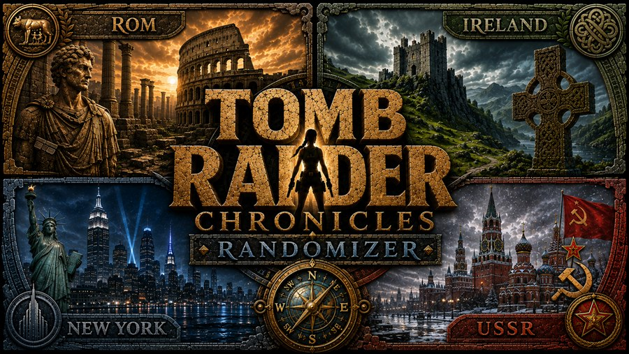
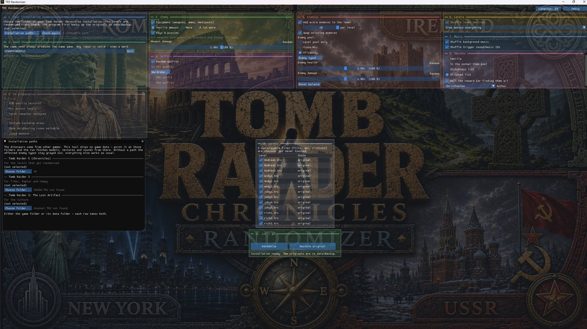
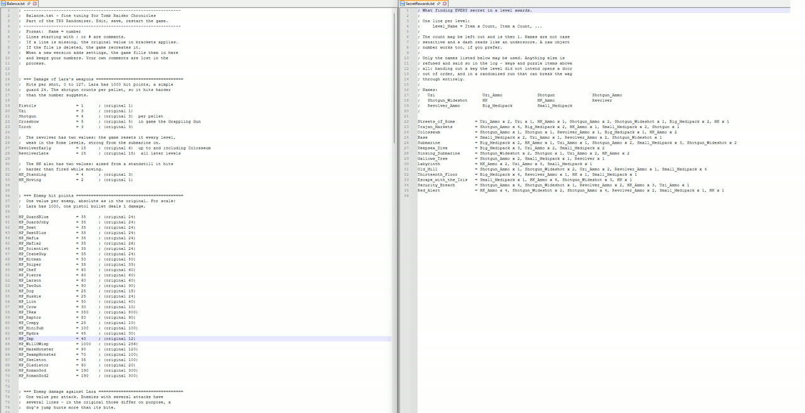
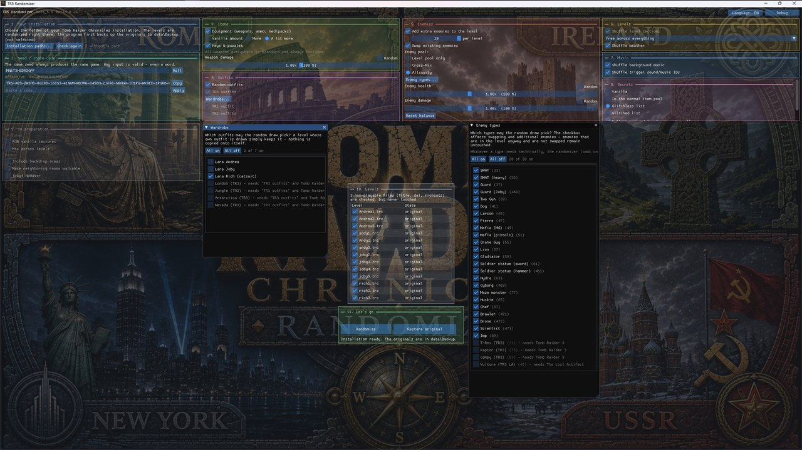

  

# TR5 Randomizer — the manual

**Beta_1.0**

Everything the program does, in the order you will meet it. If you only read
one section, read [Your first run](#your-first-run) — the rest you can look
up when you need it.

- [What you need](#what-you-need)
- [Your first run](#your-first-run)
- [The seed](#the-seed)
- [1. Your installation](#1-your-installation)
- [2. Seed](#2-seed)
- [3. Items](#3-items)
- [4. Outfits](#4-outfits)
- [5. Enemies](#5-enemies)
- [6. Levels](#6-levels)
- [7. Music](#7-music)
- [8. Secrets](#8-secrets)
- [9. In preparation](#9-in-preparation)
- [Randomize, and getting back](#randomize-and-getting-back)
- [spoiler.txt, and reporting a problem](#spoilertxt-and-reporting-a-problem)
- [The Tomb Raider III guests](#the-tomb-raider-iii-guests)
- [Things that look wrong and are not](#things-that-look-wrong-and-are-not)

---

## What you need

**Your own copy of Tomb Raider Chronicles.** Nothing of the game ships with
this program — no levels, no script, no sounds. The randomizer works on the
installation you already own.

**Optionally, Tomb Raider III and The Lost Artifact.** They unlock four guest
enemies and four guest outfits. Everything else works without them. Details
in [The Tomb Raider III guests](#the-tomb-raider-iii-guests).

The package holds `TR5Randomizer.exe` (this program) and `PCTomb5.exe` (the
engine that plays the result). The engine has its own manual —
[Engine-Manual.md](Engine-Manual.md).

---

## Your first run

1. **On the very first start the folder dialog opens by itself.** Pick the
   folder that contains `PCtomb5.exe`.
   **Not the `data` folder inside it** — see the warning below.
   (Later, or if you cancelled it, the same thing sits behind
   **"Choose folder..."** in box *1. Your installation*.)
2. The status line should read *"Installation checked — all levels
   unmodified."*
3. **Press "Randomize"** at the bottom.
4. Start the game.

That is the whole thing. Every option below is optional; with none of them
touched you still get the full weapon set in every level.

> **The one trap that costs a whole playthrough.** Pick the folder with
> `PCtomb5.exe` in it, not `data\`. The levels are found either way, so
> nothing looks wrong — but `SCRIPT.DAT` is only looked for in the folder you
> chose and in a `data` folder below it. Choose `data\` itself and the entire
> script step is skipped **in silence**. You notice it only in the game:
> young Lara in the three Ireland levels with no weapons, joby3 without its
> key, rich2 keeping the pistols. The only trace is a line in `spoiler.txt`
> reading *"SCRIPT.DAT not found — the Andy levels keep young Lara"*.

---

## The seed

The same seed always produces the same game, on any machine.

Anything you type is a valid seed. `Christmas` works, and always gives the
same game. The program's own format is thirteen characters from an alphabet
that leaves out the look-alikes `0`/`O` and `1`/`I`/`L`; anything that is not
readable as that format is treated as plain text instead. Spaces, hyphens and
underscores inside a proper seed are ignored, and lower case is fine.

**"Roll"** puts a fresh seed in the field. It replaces what is there without
asking — write the old one down first if a playthrough is still running on
it.

**The `effective:` line** under the field is the number actually rolled with,
and it is *not* just your seed text: the settings that change the game are
mixed into it. Watch it change while you tick a box and you can see which
settings matter.

Two people get the same game only when the seed text **and** these settings
agree:

| In the effective seed | Not in it |
|---|---|
| Equipment, Keys & puzzles, item amount | which enemy kinds you deselected |
| Random outfits, TR3 outfits, the wardrobe | the secret options |
| extra enemies and their count | the music options |
| enemy swap, enemy pool | level sections and level order |
| | the three balance sliders |

And three things sit outside the seed entirely: **the randomizer's version,
the level data it ships with, and the engine**. The build number matters most
here, because it is bumped whenever something can move an item — including
changes to the curated placement data, which is not code at all. The same
seed on two different builds is two different games.

That is why both numbers stand at the top of the window and in `spoiler.txt`:
`Beta_1.0` is the release, `Build 0.18` is the placement data. Nothing stops
you mixing a randomizer and an engine of different versions — the numbers are
there to be read, not enforced.

> **The seed field is remembered.** It holds what you used last time, not a
> fresh roll. Pressing "Randomize" on two different days replays the same
> game unless you change or re-roll it.

---

## 1. Your installation

**"Choose folder..."** points the tool at your Chronicles installation. The
choice is remembered, so it is asked once.

**"Check again"** re-hashes every level and compares it against the shipped
list. It runs by itself at start and after every run; the button is for
repeating it by hand. It also re-scans `data\secrets`, which is the only way
short of a restart to make a newly added secret list appear.

The check is deliberately all-or-nothing. One single level that differs from
vanilla makes the whole installation unusable as a source — *"3 levels differ
from vanilla (first: joby2.trc)"*. That is not pedantry: a seed cannot be
reproduced from an already-modified level.

**`data\Backup`** is created on the first run and holds your originals. Every
later run reads from there, never from what the last run produced — which is
why re-rolling as often as you like is safe, and why the same seed always
gives exactly the same game.

> **Do not delete `data\Backup`.** It is the only copy of your original
> levels the program knows about, and "Restore original" plays back from it.

**"Installation paths..."** opens a window with three folders: Chronicles,
Tomb Raider 3, and The Lost Artifact. See
[The Tomb Raider III guests](#the-tomb-raider-iii-guests).

---

## 2. Seed

Covered above: [The seed](#the-seed).

---

## 3. Items

**"Equipment (weapons, ammo, medipacks)"** — *on by default.* Shuffles the
level's non-key pickups among the spots curated for that level. Nothing is
added or removed by this switch alone; the same things end up elsewhere.

**"Vanilla amount" / "More" / "A lot more"** — *"Vanilla amount" by default.*
How much consumable equipment a level holds. "More" adds up to twelve per
level, "A lot more" up to thirty. Only what the level already knows is
scattered, weighted by what it needs: Andy2 (young Lara, no weapons) gets
medipacks, a weapon level gets ammunition. Keys, puzzle pieces and secrets
are never used as filler.

There is no "fewer than vanilla" and there never will be. Removing an item
would shift every later item number, and the level's own triggers refer to
items by number.

**"Keys & puzzles"** — *on by default.* Shuffles key items and puzzle pieces
among the spots curated as safe for them. This is the switch that changes the
route through a level rather than just the loot.

**"All weapons everywhere is standard and always included."** This grey line
is not a control. Every level gets the full weapon set on every run —
pistols, Uzi, shotgun, Desert Eagle (which replaces the revolver), HK, with
ammunition. Some of them are also scattered into the level as pickups. Every
level keeps its own working weapon on top.

Three deliberate exceptions, or they read as bugs: **joby4** (Deepsea Dive)
stays vanilla, **rich2** gets no pistols because its pistol slot carries
scripted material from Core, and the **grappling gun** occupies the crossbow
slot in rich3 only.

**"Weapon damage"** — *1.00x.* Scales all of Lara's weapons at once. The
"Random" box beside it hands the value to the seed instead, rolled between
0.50x and 2.00x in steps of five.

> Turning everything in this box off does **not** give a vanilla game — the
> weapon set is still added. For a truly untouched game use "Restore
> original".

---

## 4. Outfits

**"Random outfits"** — *off.* Lara's outfit is re-rolled **per level**. Only
her skin and head travel, never her animations, so her moves never change.
The three built-in choices are Lara Andrea (Rome), Lara Joby (Russia) and
Lara Rich (catsuit, VCI). A level that draws what it already wears keeps it.

This is the section's master switch — the other two controls are greyed out
while it is off.

**"TR3 outfits"** — *off.* Adds London, Jungle, Antarctica and Nevada to the
draw. Needs a Tomb Raider III installation; the models are read from it while
the run happens.

**"Wardrobe..."** opens the fine selection — untick the ones you do not want
drawn. What is stored is the *deselection*, so an outfit added in a later
version arrives switched on rather than falling through an old settings file.

Two things that surprise people: **joby4 always keeps the diving suit** and
never rolls, and the **Ireland levels always draw an adult outfit**, because
young Lara has none of the three. Independent of this box, every run switches
the young-Lara flag off in the Ireland levels — otherwise Lara would meet a
Two Gun with no weapons.

---

## 5. Enemies

**"Add extra enemies to the level"** — *off.* Puts enemies into a level that
were never there. Each gets its own trigger about three sectors ahead of it on
your path, never on its own tile, and fires once — so it is invisible until
you cross that tile and then simply stands there ahead of you.

**"per level"** — *6, range 1 to 20.* A maximum, not a promise. A level with
no free spot left gets fewer, and the run says so.

**"Swap existing enemies"** — *off.* The enemies already in the level trade
roles. Only the **type** changes; every enemy still wakes exactly where and
when its original trigger intended, so level progress cannot shift.

**"Enemy pool:"** — *"Level pool only".* What the two switches above draw
from.

| Mode | What you get |
|---|---|
| **Level pool only** | strictly the level's own curated list — the enemies you know, in different places |
| **Cross-Mix** | up to three foreign types join that level's pool; when swapping, roughly every fourth role goes to one of them, so the level still feels like itself |
| **Allsanity** | the whole pool is open to every level and every role re-rolls freely — maximum variety, the level loses its face |

The three foreign types are drawn per level, so different levels get
different guests. joby4 never receives foreign types in any mode.

**"Enemy types..."** opens a checkbox per enemy kind with its internal number,
plus "All on" / "All off". Deselect all but one to meet only that enemy.

Only the **draw** is trimmed. Whatever a chosen type needs technically —
its animation base, mandatory companions — is loaded anyway. This selection
is **not** part of the seed.

**"Enemy health" / "Enemy damage"** — *1.00x each,* range 0.50x to 2.00x, each
with its own "Random" box. Traps, falls, fire, poison, drowning and the
built-in level hazards are never scaled and stay exactly as hard as in the
original.

**"Reset balance"** puts all three sliders back to 1.00x and unticks the
"Random" boxes. It resets only those three lines — anything you tuned by hand
in `Balance.txt` survives.

> The three sliders write into `Balance.txt` beside `PCtomb5.exe`, when you
> **release** the slider, and they take effect **on the next game start** —
> not on the next randomize.

---

## 6. Levels

**"Shuffle level sections"** — *off.* Plays Rome, Russia, Ireland and VCI in
random order. Inside a section the order is untouched, so every key chain
within a section still works.

**Level order** — *"off".* A drop-down with three entries: *off*, *within the
sections*, and *free across everything*. "Within" shuffles the levels inside
each block; "free" throws all thirteen playable levels into one pot.

The cutscene richcut2 is glued behind rich2 and travels with it. Neither roll
can land on the vanilla order — it re-rolls if it does, so the box always
visibly does something.

### The inventory reset — read this before you panic

As soon as either level option is on, **every level begins by clearing the
level-bound half of the inventory**: puzzle items, keys, pickup items with all
their halves, the crowbar, the torch, the examine objects, the chloroform set
and the grappling gun. **Weapons, ammunition, medipacks and flares are kept.**

This is deliberate, and it is what makes a rolled order playable at all.
TR5's inventory slots are generic: the *same slot* is called "Garden Key" in
Andrea1, "Chaff flares" in joby4 and "Helipad access key" in rich3. A key
carried across a level boundary would silently turn into something else.

What a level genuinely needs from another the script hands over by itself,
model and inventory name included — the Swipe Card from joby2 for joby3, and
the crowbar from Andrea2 for Andrea3.

The secret rose is taken too, but the **counter is not** — the "n of 3" line
reads the engine's own counter, so nothing is lost.

> Old savegames do not match a new order. Finish a run before re-rolling.

---

## 7. Music

**"Shuffle background music"** — *off.* The levels trade their ambient
tracks.

**"Shuffle trigger sound/music IDs"** — *off.* The music and sound cues that
triggers fire are redistributed across the measured catalogue. Cutscene and
FMV audio stay put, and so do Lara's own lines.

Neither option is part of the seed.

---

## 8. Secrets

**"Vanilla"** — *default.* The roses stay where Core hid them.

**"In the normal item pool"** — their pins are lifted and they roll like any
other pickup. This only does something if **"Equipment"** in box 3 is also
ticked: the mode removes the pins, the equipment shuffle is what moves them.

**"Glitchless list" / "Glitched list"** — hand-picked hiding places from an
author's list. Such a list can do more than move a rose: it may add keys,
switches, doors, climbable walls, new portals, and even flood a room.

**"Author"** appears while a list mode is selected. Lists are plain text files
in `data\secrets` named `Author_Category.txt` — anyone can drop their own in
there. A newly added list needs **"Check again"** in box 1 before it shows up.
Files starting with an underscore are skipped on purpose, which is why the
shipped `_Vanilla_Reference.txt` never appears: it is a reference of where the
secrets sit in vanilla, not a playable list.

**"Roll the reward for finding them all"** — *off.* Rolls what each level
hands over when every secret in it is found: four to eight entries drawn from
weapons, their ammunition and medipacks. No keys, no puzzle items. Written as
`SecretRewards.txt` beside `PCtomb5.exe`, editable by hand.

The secret setting is **not** part of the seed, so the same seed gives an
identical item and enemy layout whether secrets are on or off — the two runs
are directly comparable.

---

## 9. In preparation

A grey box of things that are planned and not built: texture options and room
options. Everything in it is switched off and cannot be clicked; hovering
still shows what each is meant to become. The box exists so the window
already has its final shape — a greyed row is a promise, not a broken
control.

---

## Randomize, and getting back

**"Randomize"** plays every level back from `data\Backup`, rewrites
`SCRIPT.DAT` from the backed-up copy, writes `Balance.txt` and, if asked,
`SecretRewards.txt`, then patches each level in turn. There is no
confirmation prompt — the click starts the run.

Because every run starts from the backup, options are never cumulative: a run
with the level options off puts the original order back.

**"Restore original"** copies the level files back out of `data\Backup`.

> **It restores the level files only.** A rolled level order, rolled
> background music and the script's inventory changes live in `SCRIPT.DAT`,
> which is *not* put back — nor are `Balance.txt` and `SecretRewards.txt`. For
> a fully vanilla game, copy `data\Backup\SCRIPT.DAT` back by hand, press
> "Reset balance", and delete `SecretRewards.txt`.

**"Debug"** builds copies of the levels with every valid placement sector
marked, for looking at in trview. Those files will **not** start in the game —
they carry thousands of markers. Your installation is untouched; everything
lands in a `Debug Level` folder beside the program.

---

## spoiler.txt, and reporting a problem

After every run, `spoiler.txt` lands beside `TR5Randomizer.exe`. It holds the
version and build, your seed, the effective seed, **every setting**, what was
done to `SCRIPT.DAT`, and one line per level.

**Attach it to any bug report.** Handing over the seed alone is not enough —
the effective seed depends on the settings, and the build number decides
whether the same seed even means the same game.

If something goes wrong in the *game* rather than in the tool, start it with
`Log.bat` and attach `log.txt` as well. Which symptom is answered by which
part of the log is in the [engine manual](Engine-Manual.md).

---

## The Tomb Raider III guests

Four enemies — T-Rex, Raptor, Compy, Vulture — and four outfits — London,
Jungle, Antarctica, Nevada — are read from your own Tomb Raider III at run
time. **Nothing from Tomb Raider III ships with this program.**

Set the paths under **"Installation paths..."** in box 1. Each row reports
`OK`, or names the file it could not find. It checks for the actual file, not
the folder, so an empty folder still says "not found".

**The vulture needs both games.** Its model is in The Lost Artifact's
`chunnel.TR2`, but its sounds come from Tomb Raider III's `MAIN.SFX` — and the
two games ship different `MAIN.SFX` files.

Turning the guests on takes three things: a path, the enemy options in box 5,
and the type left ticked in "Enemy types...". Without a path the affected
rows stay greyed with *"— needs Tomb Raider 3"*.

**The Compy only ever arrives as a pack of four** on one sector behind one
trigger, or not at all. One Compy is not the animal.

**Checking your copy is the right one:** `data\Tr3Checksums.csv` lists the
size and SHA-256 of exactly the files these were ported from. If a dinosaur or
an outfit comes out looking wrong, compare yours against that list.

**The `Import-Export` folder** beside the program is a cache of what was
extracted. It carries a file `DO NOT REDISTRIBUTE.txt`, and that is meant
literally: it holds another game's data. Deleting it is always safe — it is
just re-extracted, slower, once.

---

## Things that look wrong and are not

**Key items vanish between levels.** Deliberate — see [the inventory
reset](#the-inventory-reset--read-this-before-you-panic). It only happens
with a level option switched on.

**joby4 looks untouched.** It is. Deepsea Dive keeps its diving suit, its
vanilla weapon situation and its own enemies.

**rich2 has no pistols.** Its pistol slot carries scripted material from Core
and is left alone on purpose.

**Some enemies look unswapped.** Scripted enemies are never swapped, and
neither are enemies whose OCB carries a behaviour rather than a pose.

**"A lot more" gave nowhere near thirty items.** The count is capped by
whichever runs out first — the free placement spots the level has, or the
engine's ceiling of 512 items per level.

**An enemy stands somewhere odd.** Extra enemies never go into a water room
and never within 1.5 sectors of an operable fixture — an enemy there would
push Lara out of the operating animation and lock the level. Beyond that,
placement is by curated zone, not by taste.

**The status line said "only N of M extra enemies placed".** The level ran out
of valid spots. Nothing is broken.
